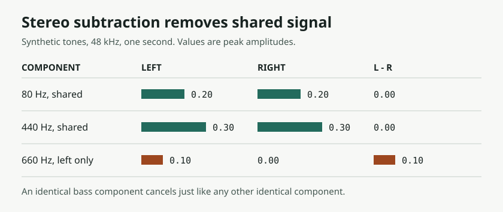

# From an MP3 Splitter to AI Covers: What Stem Separation and Upload Results Can Tell Us

> Source: [Qingliu Agent's Zhihu development diary](https://zhuanlan.zhihu.com/p/2041861168235536468), dated May 24, 2026 on the page. Reviewed November 6, 2026. The tool behavior and upload outcomes are the author's account. Our independent check is limited to the synthetic-signal comparison below.

The author started with a utility for splitting MP3s by duration. With Claude, it became a Windows tool for selecting and joining excerpts, invoking a vocal separator, and exporting audio. The diary follows several experiments prompted by Suno's upload checks. **The reusable lesson is how to make audio-processing decisions testable, not how to repeat an upload that happened to succeed.**

## The Utility Prepares Audio; Suno Generates the Cover

The author describes `Mp3Splitter` as a C#/.NET 8 WinForms program using NAudio and LAME for MP3 I/O. Later versions called `audio-separator` through a Python subprocess, with FFmpeg in the media stack. The utility processes reference audio; Suno generates the new performance. [Zhihu diary](https://zhuanlan.zhihu.com/p/2041861168235536468) · [Audio Separator project](https://github.com/nomadkaraoke/python-audio-separator)

The diary has a source-code section and names `MainForm.cs`, but its readable text does not identify a repository, revision, or build. It ends by describing a plan to open-source this version. **We can discuss the reported architecture without treating the application as a verified open-source release.** Audio Separator's public repository is a separate project.

## Stereo Subtraction Removes Shared Signal, Not Just Vocals

The author reports that subtracting the right channel from the left narrowed the backing track and weakened bass and drums, prompting a switch to model-based separation. If `L = C + A` and `R = C + B`, then `L − R = A − B`. **The common component `C` can be a vocal, a bass, a kick, or anything else identical in both channels.** Vocal reverb or doubled parts that differ between channels need not cancel. Copying the difference signal into two channels does not restore the original stereo backing track.

*Local numerical check: shared 80 Hz and 440 Hz components cancel; a 660 Hz component present only on the left survives. The tones demonstrate subtraction, not separation quality or upload behavior.*

Learned separation estimates sources from a mixture rather than defining vocals by their position. `audio-separator` runs pretrained models; MDX research addresses stem estimation, not lossless recovery of the original session tracks. Listen for residual vocals, lost instruments, softened transients, and changes in stereo image. The author's favorable listening report is not a measured result of this review. [Audio Separator](https://github.com/nomadkaraoke/python-audio-separator) · [KUIELab-MDX-Net paper](https://arxiv.org/abs/2111.12203)

## An Upload Outcome Does Not Reveal the Detector

The author reports that some submissions were rejected and others accepted. **Those are observations about individual submissions; the reasons are hypotheses.** The experiments changed content, duration, timing, and processing, without a published fixed sample set, single-variable controls, inspectable logs, or evidence about the platform's implementation. They do not establish that Suno relies primarily on lyrics, uses a particular training scheme, or consistently accepts a given clip length.

Separation quality, upload acceptance, and generation quality are three distinct checks. A cleaner backing track does not explain a platform decision, and acceptance does not show that the output preserves the intended melody or structure. We did not reproduce an evasion workflow, submit files to Suno, or generate a Cover.

## Access to a File Is Not Permission to Upload or Release It

Under the [Suno Terms reviewed here](https://suno.com/terms), uploaders need the rights to provide their material and allow the applicable use by the service. The [Community Guidelines](https://suno.com/community-guidelines) prohibit evasion of platform controls and unauthorized uses. Suno's [Cover help page](https://help.suno.com/en/articles/2872257) describes changing the style of songs you created, not a way to license someone else's work.

For production, track the **composition, recording and performances, and permitted uses of the output** separately. An extracted backing track still derives from the input recording. Noncommercial intent does not by itself satisfy upload terms, and output rights from a paid plan do not clear the input. If a file you have the rights to use is rejected in error, retain the original and rights documentation and contact platform support.

## Make the Experiment Reproducible with Your Own Demo

1. **Keep the original.** Use a rights-cleared demo you made. If you have the session, export its original vocal and backing stems as references.
2. **Estimate stems only when needed.** Record the model filename, version, input, and output. Use WAV or FLAC for intermediate work to avoid repeated lossy encoding; neither can repair existing separation artifacts.
3. **Review separation and editing independently.** Level-match the original and the backing track. Listen for bleed, weakened bass and drums, changes in stereo, and audible joins. Change one variable at a time.
4. **Generate last.** Submit only where feature rules and rights allow. Keep upload status, generation settings, and listening notes separate. Treat a rejection as something to resolve through the platform, not as a test of rights clearance.

AI-assisted coding makes it quicker to connect an interface, audio libraries, and subprocesses. **A dependable workflow still comes from preserved inputs, controlled comparisons, and clear acceptance criteria.** [Sources and reproduction](imgs/suno-cover-stem-separation-evidence/SOURCES.md)
