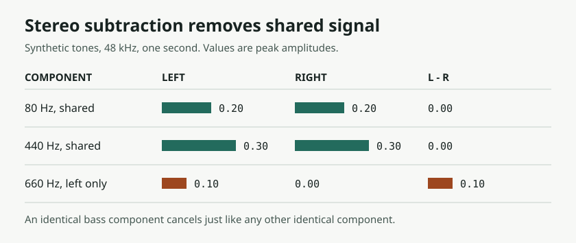

# 从 MP3 切割到 AI 翻唱：人声分离能解决什么，Suno 的上传结果又能证明什么？

> 来源：[清流Agent 的知乎开发记录](https://zhuanlan.zhihu.com/p/2041861168235536468)，页面显示发布于 2026 年 5 月 24 日。本文于 2026 年 11 月 6 日核查。原文中的工具行为与上传经历来自作者自述；本次独立验证仅限下文的合成信号对照。

一个按时长切割 MP3 的小程序，被作者用 Claude 扩展成 Windows 音频工具：可以挑选片段、拼接、调用人声分离模型，再导出音频。原文以 Suno 的上传检测为线索，描述了多次修改方向的过程。**最值得复用的不是某次上传成功，而是把音频处理拆成可对照、可试听的步骤。**

## 1. 这不是一个新的翻唱模型

按作者描述，`Mp3Splitter` 的界面和任务调度由 C#、.NET 8 和 WinForms 承担，NAudio 与 LAME 用于 MP3 读写。后期接入 `audio-separator` 作为 Python 子进程，并依赖 FFmpeg 处理媒体。该工具负责处理参考音频；真正生成新演绎的是 Suno，不是这个 Windows 程序。[原文](https://zhuanlan.zhihu.com/p/2041861168235536468) · [Audio Separator 项目](https://github.com/nomadkaraoke/python-audio-separator)

原文有“工具开源 / 完整代码”小节，也提到 `MainForm.cs`，但可读正文未给出可定位的仓库、版本或安装包，文末则说计划开源。**可以分析作者描述的架构，不能据此认定这版已经开源或可复现。** 独立项目 Audio Separator 的公开代码也不是 `Mp3Splitter` 的源码。

## 2. 左右声道相减，去掉的是共同信号

原文先用 `L − R` 去掉中心声道成分，作者报告伴奏变窄，而且低音和鼓声有损失；后来改用神经网络分离。前一种方法的限制可以直接解释：如果 `L = C + A`、`R = C + B`，那么 `L − R = A − B`。**被抵消的是共同成分 `C`，它可以是人声，也可以是低音、底鼓或任何相同的信号。** 不完全相同的混响、叠唱等成分也不会被同样抵消。把这个差分信号复制到两轨，仍不是恢复了原立体声伴奏。

*本地数值实验：两声道共有的 80 Hz 和 440 Hz 分量在差分后归零，只有左声道独有的 660 Hz 保留。纯音只是验证相减行为，不代表对真实歌声、模型分离或平台检测的测试。*

神经网络分离则尝试从混音里估计不同声源，不把“在中间”当成人声定义。`audio-separator` 是运行预训练分离模型的工具层；MDX 系列研究讨论的是如何估计分轨，并不意味着能无损找回原工程里的轨道。具体效果仍要听残留人声、乐器被削弱、瞬态模糊和立体声变化。原文的“完整保留”属于该作者的听感报告，不是本文验证的指标。[Audio Separator](https://github.com/nomadkaraoke/python-audio-separator) · [KUIELab-MDX-Net 论文](https://arxiv.org/abs/2111.12203)

## 3. 一次上传结果，不能反推出检测器

作者报告，有些输入被平台识别，有些处理后的版本被接受。**观察是“某次提交的状态不同”，推断才是“检测依赖哪些特征”。** 原文在迭代中同时改变过输入内容、长度、时间结构和音频处理方式，没有提供固定样本集、单变量对照、可核对的运行日志或平台内部资料。不能从这些经历得出 Suno 主要靠歌词、使用某种对抗训练，或者某个长度会稳定通过的结论。

同样，分离质量、上传状态和生成质量是三项不同的检查。伴奏听起来更干净，不能说明平台为何接受；文件被接受，也不能说明生成结果保留了想要的旋律和结构。这篇文章不复现原文的检测规避配方，也没有对 Suno 发起上传或生成测试。

## 4. 有素材可用，不等于有权上传或发行

按核查时的 [Suno 服务条款](https://suno.com/terms)，上传者需要具备向服务提供素材并允许相应使用的权利；[社区指南](https://suno.com/community-guidelines) 也明确禁止规避平台控制和未经允许的相关内容使用。[Cover 帮助页](https://help.suno.com/en/articles/2872257) 将功能描述为给自己创作的歌曲换一种演绎风格。它不是取得他人作品许可的入口。

做制作排期时，建议把三件事分别核实：**底层词曲、使用的录音及表演、平台输出可怎么使用。** 分离出来的伴奏仍源于原录音；不发行或不收费，也不能自动满足上传条款。付费方案提供的输出使用权益不能替代输入素材的授权。权利清楚的文件若被误拒，保留原件和权利证明，走平台支持或申诉路径。

## 5. 用自己的 Demo，把实验做成制作流程

1. **先保留原件。** 用自有且权利清楚的 Demo；有工程分轨时，直接导出伴奏和人声，拿它们做对照。
2. **没有分轨才做估计。** 保留模型文件名、版本、输入和输出。编辑中间文件优先用 WAV 或 FLAC，避免反复有损编码；无损格式不会修复已经出现的分离伪影。
3. **单独验收分离和剪辑。** 同响度对照原混音与伴奏，听副歌人声残留、低频、鼓点、声像与剪接边界。一次只改一个因素，记录哪项变化真的改善了听感。
4. **最后才生成。** 只在当前功能与权利允许时提交，分别记录上传状态、生成设置和试听结论。遇到拒绝时，不把继续改文件当成版权确认。

这个案例对 Vibe Coding 的启发很朴素：AI 能快速接好音频库、子进程和界面，但**让一次试验变成可靠流程，要靠原始素材、对照结果和明确的验收标准。** [来源与本地实验复现](imgs/suno-cover-stem-separation-evidence/SOURCES.md)
