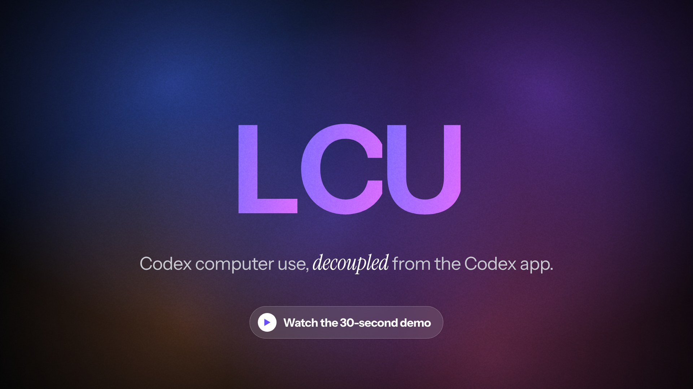
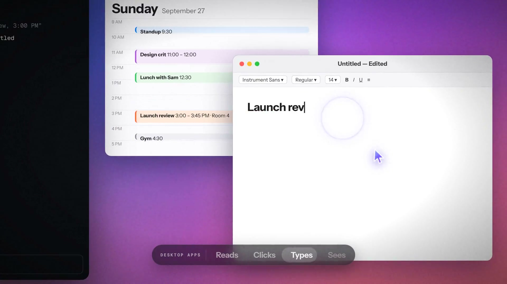
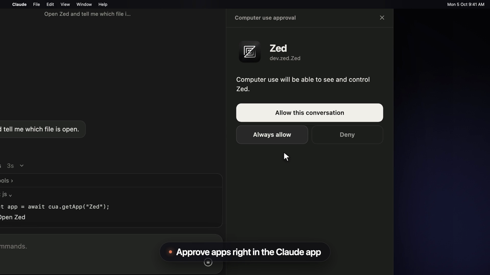
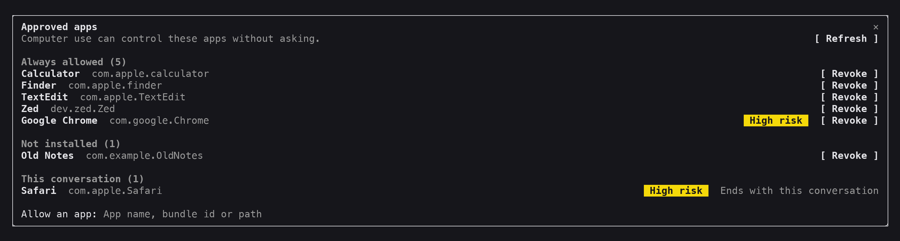

# LCU 源码拆解：让 Claude Code、Pi 与 Codex CLI 共享本机 Computer Use 运行时

你更喜欢某个模型的推理和编码方式，却希望它能使用另一套成熟的桌面控制工具。LCU 处理的正是这个组合问题：把本机 OpenAI 桌面应用里的 Computer Use 运行时接给外部 Agent，让模型通过同一套接口观察窗口、点击、输入和读取结果。

宝玉在 2026 年 10 月 5 日介绍 `amontlabs/lcu`。帖子准确抓住了它的关键设计：复用已安装应用的运行时，并通过 MCP 与持久 JavaScript REPL 接入其他宿主。到本文核查的 10 月 23 日，最新 Release 已是 `v0.12.0`，部分安装要求和适配范围也已变化。



*项目官方演示封面。本文图片均为上游发布素材，未在本机运行 LCU 操作桌面。*

- 原帖：[宝玉对 LCU 的介绍](https://x.com/dotey/status/2107144243726729645)，发布时间为 2026-10-05 16:21 UTC
- 项目：[amontlabs/lcu](https://github.com/amontlabs/lcu)，[项目官网](https://lcu.amontlabs.com/)
- 核查版本：[v0.12.0](https://github.com/amontlabs/lcu/releases/tag/v0.12.0)，2026-10-21 发布
- 对应提交：`99d0759a7610e38251037759a69fcdbef816a8c2`
- 核查范围：源码、安装与适配文档、上游验证记录及 OpenAI 官方 Computer Use 文档；未安装运行时或独立复现桌面测试

## 模型、宿主与桌面控制各自负责什么

LCU 的工作可以用四层关系说明：

```text
模型：理解目标，决定下一步
    ↓
Claude Code / Pi / Codex CLI：管理会话、工具与用户确认
    ↓
LCU：查找运行时、连接 MCP、适配授权和生命周期
    ↓
本机 OpenAI Computer Use 运行时：观察与操作桌面应用
```

LCU 会定位本机已安装的官方 ChatGPT 桌面应用，验证支持的平台与应用结构，再使用其中的 Node、REPL 和 Computer Use 组件。源码中，`lcu/runtime.mjs` 负责启动路径与环境，`adapters/client.mjs` 和 `adapters/claude.mjs` 负责宿主连接与结果转发。

这意味着选择模型与选择执行工具可以相对独立。Claude Code 可以继续使用自己的模型和会话系统，桌面操作则交给被桥接的运行时。

**“不要求登录 ChatGPT/Codex”指的是这个本地执行通道。** 宿主 Agent 仍需要自己的认证或模型服务，LCU 不提供模型额度。它是第三方 MIT 项目；OpenAI 应用、运行时与指令保留各自条款，并没有随 LCU 被重新开源。[安装说明](https://github.com/amontlabs/lcu/blob/v0.12.0/docs/INSTALLATION.md)

## 两个模型工具，背后是一套可编程接口

主要适配器只向模型暴露两个工具：

| 工具 | 职责 |
|---|---|
| `js` | 在持久 JavaScript 环境中执行代码，调用预置的 `cua` 对象 |
| `js_reset` | 重置 JavaScript 执行环境 |

截图、点击、输入和滚动属于 `cua` 及其目标对象的方法。模型需要先获得当前状态和文档，再选择应用或浏览器目标。

第一次进入时，可以单独执行：

```javascript
await cua.getState();
```

读完返回的说明后，另一次调用再选定应用：

```javascript
let app = await cua.getApp("TextEdit");
```

后续调用可以复用 `app`，按运行时文档读取无障碍信息、获取截图或操作界面。遇到新窗口、焦点变化或页面加载，应先重新观察，再决定动作。

这个接口让模型能在一次调用里组合少量确定操作，并保留变量供下一次使用。它减少的是工具往返和重复发现目标的成本；长串操作的中途状态仍可能改变，必须用返回状态或截图验证结果。

OpenAI 官方 Computer Use 文档也描述了通过代码运行界面操作、保留环境状态并返回观察结果的集成方式。不过，官方 API 的通用集成文档与 LCU 复用桌面应用组件的实现是两条不同的产品接入路径，不能据此把 LCU 称为官方发布的 SDK。[官方说明](https://developers.openai.com/api/docs/guides/tools-computer-use)

## 无障碍信息为什么有帮助

仅靠截图操作时，模型需要从像素推断按钮位置。无障碍树还能给出应用暴露的文本、控件类型和交互目标，帮助模型更直接地选择界面元素。

在合适的应用中，这可以减少窗口移动、缩放或显示分辨率变化带来的坐标误差。但应用必须提供足够好的无障碍信息。自绘 Canvas、游戏界面或复杂编辑器仍可能需要截图和坐标操作。



*取自上游 30 秒宣传视频第 16 秒，展示读取 Calendar 内容并在 TextEdit 中输入笔记的流程。它是项目演示素材，不是本文完成的任务记录。*

## 真正需要适配的是授权与任务结束

能连接 MCP 之后，仍有几个宿主问题要解决：谁显示授权请求？谁接收用户选择？任务结束或中断后，谁通知运行时释放控制状态？子 Agent 结束会不会误停父任务？

LCU 的工程工作有相当部分就在这里。当前 Claude Code 适配包含 `lcu-approve` mod，把应用授权请求显示为 Claude 应用里的问题卡片，或终端中的批准面板。用户可以只允许当前会话、在运行时提供该选项时长期允许，或者拒绝。



*上游 v0.9.1 的发布截图：授权 Zed 的选择由用户完成。*

源码同时保留模型不可见的宿主生命周期调用，例如 `turn_ended`。这解释了为什么模型只有两个公开工具，适配器内部仍有额外控制通道。

还有可选的 Claude Code 跨轮次设置，用来处理后台子任务或 turn 结束后的继续操作。它默认关闭；每个应用的权限与宿主的工具批准仍然有效。平台兼容适配也可能增加 wrapper 或调整提示的交付方式，因此“复用原版运行时”不等于外层没有适配代码。[适配文档](https://github.com/amontlabs/lcu/blob/v0.12.0/docs/ADAPTERS.md)



*上游界面展示了长期授权、当前会话授权以及撤销入口。*

## 原帖与 v0.12.0 有哪些差异

| 项目 | 原帖描述 | 2026-10-23 核查结果 |
|---|---|---|
| 安装依赖 | Python 3.12+ | 当前用户安装无需 Python，使用已安装应用自带的 Node |
| 主要宿主 | Pi、Codex CLI、Claude Code | 仍是主要文档路径 |
| 实验适配 | Oh My Pi、Hermes | 新增 DeepSeek Harness；v0.12.0 称仅在 macOS arm64 做过 live 验证 |
| 浏览器 | Chrome 需额外开启 | 仍需开启官方扩展和网站授权；当前状态检查覆盖 Chrome、Edge、Brave、Opera、Vivaldi |
| Windows | 候选阶段 | 仍不属于本次正式交付的平台 |

这些变化说明阅读旧帖后应重新查发布记录。尤其不能把“状态检查识别了某个浏览器”写成“该浏览器里的完整任务已经验证通过”。[v0.12.0 Release](https://github.com/amontlabs/lcu/releases/tag/v0.12.0)

## 哪些系统能用

macOS 的支持目标是 Apple Silicon，并需要对相关组件授予辅助功能和屏幕录制权限。Linux 的支持目标是 ARM64 或 x86-64、Ubuntu 24.04 兼容的 glibc 环境，以及已存在的 X11 桌面和 D-Bus 会话。

Intel Mac、原生 Wayland 和 musl Linux 不在当前支持范围。LCU 本身也不创建桌面或虚拟机。

外部浏览器控制是额外启用的能力，依赖官方扩展及网站批准。Claude Code 的 Chrome 支持仍被文档标为实验性，部分打断路径的临时标签清理存在限制。用户批准调用 LCU 工具，也不等于已经批准所有应用和网站。

## “字节一致”证明了多少

宝玉提到的逐字节对比有对应记录。项目文档称，在特定 macOS 应用版本上，原版服务与 LCU relay 的 MCP 初始化指令、`cua.getState()` 首次返回指南一致。文档也注明：`js` 描述的浏览器部分会因 LCU 默认只启用 computer surface 而不同。[指令交付记录](https://github.com/amontlabs/lcu/blob/v0.12.0/docs/INSTRUCTIONS.md)

这支持“模型能收到相应原版指令与接口说明”的判断。它没有证明换一个模型后，长任务成功率、视觉理解、异常恢复或权限行为都自动达到同样水平。

还需要区分几类上游证据：

| 证据 | 能支持的判断 | 不能直接推出的结论 |
|---|---|---|
| MCP 初始化、REPL 变量与 reset 对比 | 接口和状态转发正常 | 已经操作过真实 GUI |
| 截图字节与文本结果转发 | 宿主收到预期数据 | 模型能正确理解并完成任务 |
| TextEdit 保存后的独立文件检查 | 某一组合完成过真实编辑保存 | 任意应用或新版本均可用 |
| Stop/Interrupt 记录 | 对应路径发生过清理 | 所有宿主的中断路径都可靠 |

例如，10 月 21 日的上游记录报告，在 ChatGPT `26.1013.40934`、CUA `0.0.30`、LCU `0.11.8` 组合上，Claude Code 计算并保存包含 Unicode 的文件，Codex CLI 完成计算器任务，并做了独立结果检查。该记录同时明确没有验证浏览器动作，也不是对 v0.12.0 所有平台的重新验收。[具体验证记录](https://github.com/amontlabs/lcu/blob/v0.12.0/docs/verification/macos-chatgpt-26.1013-2026-10-21.md)

本文只读取这些记录和源码，没有在当前机器上复现。

## 接入后的价值取决于任务

对于已经在 Claude Code、Pi 或 Codex CLI 中工作，又需要查看原生应用、读取窗口或执行少量桌面交互的用户，LCU 提供了一条复用现成执行能力的路径。

当任务已经有稳定 CLI、文件 API 或应用专用接口时，直接使用那些接口通常更容易验证。LCU 更有价值的环节是跨越没有接口的界面操作，例如检查应用真正显示了什么，或完成只能通过 GUI 进行的步骤。

使用时，最有意义的第一轮验收是一个无敏感内容的窗口：批准目标应用，获取可读状态和截图，执行一次小操作，再独立确认结果。`doctor`、安装完成和工具返回成功，都应与实际应用状态分别检查。涉及发布、发送或删除时，仍需要任务本身的明确授权。

LCU 展示了 Agent 工具可以与模型和宿主分别选择的可能性。它的价值在于接通原版执行能力，并处理外部宿主的权限、结果和生命周期；最终能完成多少工作，还取决于模型、目标应用，以及这几层之间是否经过实际验证。

## 来源

- [宝玉原帖](https://x.com/dotey/status/2107144243726729645)
- [LCU v0.12.0 源码](https://github.com/amontlabs/lcu/tree/v0.12.0)与[发布记录](https://github.com/amontlabs/lcu/releases/tag/v0.12.0)
- [Installation](https://github.com/amontlabs/lcu/blob/v0.12.0/docs/INSTALLATION.md)、[Adapters](https://github.com/amontlabs/lcu/blob/v0.12.0/docs/ADAPTERS.md)、[Instructions](https://github.com/amontlabs/lcu/blob/v0.12.0/docs/INSTRUCTIONS.md)
- [Parity Status](https://github.com/amontlabs/lcu/blob/v0.12.0/docs/PARITY-STATUS.md)与 [Dependency Provenance](https://github.com/amontlabs/lcu/blob/v0.12.0/docs/PROVENANCE.md)
- [OpenAI Computer Use 官方文档](https://developers.openai.com/api/docs/guides/tools-computer-use)

*版本、平台与权限行为可能继续变化。本文截至 2026-10-23 的结论来自指定源码版本和所引用记录，演示图片及上游测试均未作为本机独立验证。*
