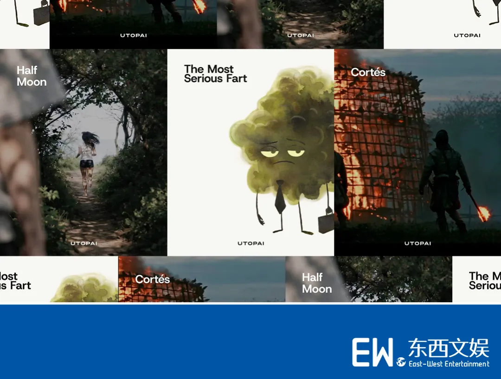
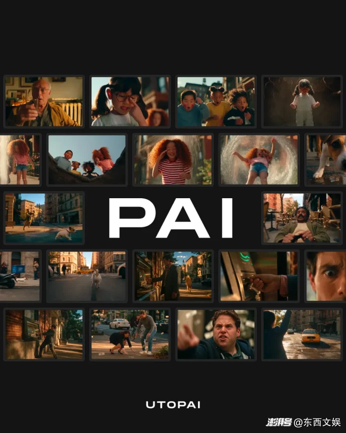
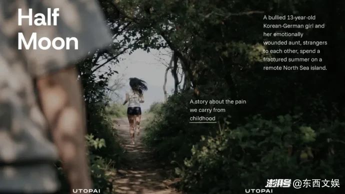
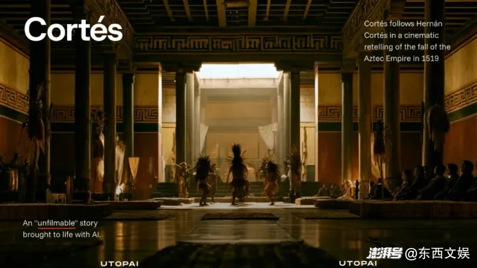
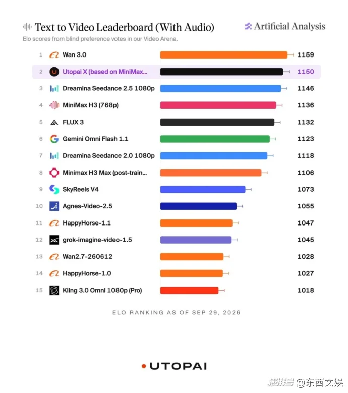

# Utopai Studios 商业模式拆解：1.1 亿美元不是收入，2027 年才是 AI 原生制片厂的交付考

> **一句话结论：** Utopai Studios 真正值得研究的，不是“全球第二视频模型”或“1.1 亿美元预售”两个孤立数字，而是它把定制模型 Utopai X、制片工作台 PAI、自有及联合片单、融资与全球发行放进了同一家公司。这个结构一旦跑通，项目数据可以反哺模型，模型又能降低下一部作品的试错成本；但目前最强的公开证据仍集中在榜单、融资估值、合作与片单宣布，尚未覆盖长片交付、院线接受度、真实项目毛利和跨镜头稳定性。真正的分水岭不是 2026 年的宣传声量，而是 2027 年能否按质量、预算与档期把作品交出去。

2026 年 10 月 7 日，东西文娱发布[《从预售 1.1 亿美元到 2027 年 AI 院线电影片单》](https://mp.weixin.qq.com/s/Dc_BMNM30KmFw1dm3RG1DA)，把 Utopai Studios 描绘成一家由 AI 驱动的下一代制片厂。文章串起了三个很吸引人的指标：`Space Nation` 与 `Cortés` 的潜在价值最高 1.1 亿美元、PAI 上线约 60 天达到 1,100 万美元 ARR、Utopai X 在 Artificial Analysis 带音频文生视频榜单排名全球第二。

这三个数字都能找到公开出处，但它们分别代表不同的东西：一个是**以最终交付为条件的潜在项目价值**，一个是**订阅收入的年化运行率**，一个是**短视频盲选偏好榜的动态名次**。把三者直接相加，会得到一个很耀眼、却容易失真的故事。

更准确的观察方式，是把 Utopai 当成一次“模型公司、软件公司与影视公司合并经营”的实验。

---

## 01｜先把最容易混淆的五个数字拆开

| 对外说法 | 公开证据实际支持什么 | 不能直接推出什么 |
|---|---|---|
| 1.1 亿美元预售 | Forbes 估算 `Space Nation` 与 `Cortés` 在完成交付的前提下，合计可能达到最高约 1.1 亿美元；部分国际发行权已预售 | 不是已确认收入、到账现金或两份合同公开总额 |
| 10 亿美元估值 | Forbes 估算 Carmelo Anthony 旗下 Creative 7 的投资发生在约 10 亿美元估值，投资额约 500 万美元 | 不是营业收入、利润，也不是完整融资轮公开定价 |
| 1,100 万美元 ARR | Forbes 报道 PAI 发布 60 天内通过向数家制作公司授权达到 1,100 万美元年化经常性收入 | ARR 不是 60 天已收 1,100 万美元，更不是利润 |
| 25 个项目 | Utopai 官网称有 25 个原创项目处于开发或制作的不同阶段 | 不等于 25 个项目已经开机、完成融资或拿到发行 |
| 全球第二 | 2026 年 10 月 12 日，Artificial Analysis 带音频 T2V 榜显示 Utopai X 为第 2 名，Elo `1149±10` | 不等于长片连续性第二、制作系统第二或商业交付第二 |

其中最重要的修正是 1.1 亿美元。Forbes 的原话并不是“Utopai 已经签下 1.1 亿美元订单”，而是：**在最终产品交付的条件下**，Forbes 估计两个项目合计可能达到这一上限，并且在更多地区或全球流媒体继续销售时还有上行空间。

这意味着它更接近一个“交付后可实现的权利价值模型”，而不是财务报表里的确认收入。预售的确比意向书更强，因为它证明传统买家愿意在 AI 作品尚未完成时讨论市场价格；但交付质量、验收条款、地区销售、回款节奏与成本超支仍会决定最后结果。

---

## 02｜Utopai 不是单一模型公司，而是四层闭环

Utopai 的商业结构可以拆成四层：

| 层级 | 核心资产 | 作用 |
|---|---|---|
| 模型层 | Utopai X | 在 PAI 内提供文本生成视频能力，并围绕影视需求继续训练与评估 |
| 制片系统层 | PAI | 保存剧本、角色、场景、镜头、素材、Take、版本与审批上下文 |
| 内容层 | `Cortés`、`Half Moon`、`The Most Serious Fart`、`Space Nation` 等 | 把技术放进真实项目，产生创作反馈、制作数据与可销售 IP |
| 商业层 | 联合制作、版权预售、院线/电视/流媒体发行、企业授权 | 让内容收入与软件收入互相获客，而不是只卖生成次数 |

这套结构解释了为什么创始人 Cecilia Shen 对 Forbes 说，仅做技术供应商无法成为一家 100 亿美元公司，必须成为工作室。单卖模型会承受同质化、算力成本和价格竞争；单做内容又要承担项目制波动。Utopai 想做的是，让每一部作品既是商品，也是 PAI 与 Utopai X 的训练场和展示样片。

[Utopai 对新版 PAI 的说明](https://www.utopaistudios.com/en/blog/introducing-the-all-new-pai-and-utopai-x)显示，它并不只是一个视频生成输入框。系统围绕剧本拆解、Production Library、Canvas、Shot、Take、版本历史、审批与时间线组织工作，还能把选中素材送往 Adobe Premiere 和 DaVinci Resolve。Utopai X 是其中一个生成模型，团队也可以选择其他可用模型并控制成本。

这才是“production intelligence”与普通生成器的差别：模型负责产出一次结果，制片系统负责保存**为什么这样做、参考了什么、哪一版获批、下一镜怎样继续**。

---

## 03｜2027 片单不是一种 AI 电影，而是四种不同实验

[Utopai 2027 片单页](https://www.utopaistudios.com/en/news/utopai-is-revolutionizing-storytelling-as-worlds-largest-independent-ai-native-film-and-tv-studio-will-premiere-3-movies-and-2-series-in-2027)列出三部电影和两部剧集。关键不是数量，而是 AI 在每个项目里承担的职责不同。

### `The Most Serious Fart`：人类主导的 AI 辅助动画

这部改编自 Mike Bender 与 Chuck Dillon 童书的动画长片计划 2027 年院线上映。公司明确说它依赖传统艺术家、分镜师和动画团队，AI 是辅助工具。它检验的不是“能否一键生成电影”，而是 AI 能否进入成熟动画管线，又不破坏美术主导权与团队协作。

### `Half Moon`：真人实拍中的局部视觉支持

`Half Moon` 是 Hyo-joo Yang 编剧并执导的德韩真人剧情片。官网称主体拍摄于 2026 年 8 月在德国开始，PAI 只支持部分视觉元素，影片仍以真人表演、导演叙事和传统电影技法为基础。它更像一家 AI 公司参与的国际合拍片，而不是生成式长片。

### `Cortés`：用 AI 处理传统上过于昂贵的史诗规模

`Cortés` 是 Nicholas Kazan 编剧、Paul Mignot 执导的历史史诗。Utopai 的官方表述是，AI 制作工具将帮助解决规模与成本问题；微信原文进一步称 PAI 将用于主演数字减龄。无论具体镜头最终采用何种方案，这个项目真正要验证的是：AI 能否在表演、历史场景、复杂调度与数千镜头的质量控制中稳定节省成本，而不是只生成几段概念预告。

### `Space Nation` 与《西游记》：连续剧与 AI 主生产路径

八集科幻剧 `Space Nation` 由 Ex Machina Studios 制作，Utopai 与 Globoplay 联合制作，K5 International 负责全球发行。Utopai 官网写的是主体制作进行中，并“预计”按好莱坞公会要求推进。这比微信原文“严格按照公会规定有序推进”的语气更保守，也更准确。

与华策合作的 `Journey to the West: The Lost Five Hundred Years` 则被定义为 AI 生成动画改编。它与 `Half Moon` 放在同一片单中，说明“AI-native”在 Utopai 这里不是统一制作比例，而是一种公司组织方式：不同项目可以从局部辅助一直到以 AI 为主要生产方法。

---

## 04｜Utopai X 的全球第二很强，但它只回答了一个窄问题

[Artificial Analysis 的 AA-Video-T2V v2.0 榜单](https://artificialanalysis.ai/video/leaderboard/text-to-video)通过同一提示词下两段视频的匿名两两比较，汇总受招募人类评审的偏好并计算 Elo。2026 年 10 月 12 日的带音频榜单中，Utopai X 为 `1149±10`，排名第二；第一名 Wan 3.0 为 `1156±9`，第三名 Dreamina Seedance 2.5 为 `1143±9`。三者置信区间重叠，因此名次不应被理解成绝对质量断层。

这个结果仍然很有价值：它表明 Utopai X 的单段生成成片在盲选中可以与头部模型竞争，而且 Utopai 是少数把模型、制片软件和内容片单放在一起的美国公司。

但该榜单没有直接测试：

- 一个角色跨 100 个镜头能否保持身份、服装、表演和空间关系；
- 导演提出局部修改时，系统能否只改目标而不破坏其他元素；
- 镜头能否稳定进入剪辑、调色、声音和 VFX 流程；
- 生成成本、失败率、返工次数和最终可用镜头比例；
- 长片在观众、发行商、工会和版权审查中的接受度。

Utopai 自己也承认，Utopai X 是在现有基础视频模型上继续开发，并强调内部还会用制片人选择、拒绝原因和项目上下文做评估。因此，榜单证明的是**模型有竞争力**，不是**整个制片闭环已经被证明**。

---

## 05｜PAI 的真正护城河可能不是生成，而是“决策数据”

影视制作最稀缺的数据，不只是“这段视频长什么样”，而是专业团队对它的判断：

- 这版角色为什么不成立；
- 导演为什么选 Take 7 而不是 Take 4；
- 哪个镜头需要重做，哪个只需要局部修改；
- 同一角色进入下一个场景时，哪些元素必须保持；
- 发行、法务与品牌团队最终批准了哪一版。

PAI 如果真能把剧本、资产、镜头、版本、修改理由与批准状态连接起来，就能积累普通公开视频数据没有的“制作决策数据”。这也是 Utopai 同时做片单与平台的战略价值：真实项目持续暴露模型失败点，团队的取舍又可以成为训练和评测信号。

但这里仍有四个待验证问题：

1. **数据权属：** 联合制作方、演员、编剧和美术团队是否允许项目数据用于模型改进，许可范围如何划分；
2. **可迁移性：** 一个项目积累的偏好是否能帮助下一部风格完全不同的作品；
3. **经济性：** 模型训练、推理、人工修复与传统后期加总后，是否真的降低整片成本；
4. **依赖性：** Utopai X 基于现有基础模型继续开发，底层许可、供应、价格或能力变化会不会影响长期交付。

---

## 06｜“全球最大独立 AI 原生影视公司”更像定位语，不是行业认证

微信原文称 Variety 将 Utopai 评价为“全球最大独立 AI 原生影视公司”。需要补充一个重要上下文：2026 年 8 月 27 日的[相关 Variety 页面](https://variety.com/2026/biz/news/utopai-worlds-largest-independent-ai-native-film-tv-studio-will-premiere-3-movies-2-series-in-2027-1236844803/)署名为 **Partner Content / Sponsored Content**。它能作为公司片单和定位的公开材料，但不应等同于 Variety 编辑部独立调查后授予的行业排名。

同样，公司称“25 个原创项目”时使用的是“various stages of development and production”。开发可能包含版权、剧本、融资、包装、主创洽谈等阶段，与已经开机或接近交付相距很远。

这不代表 Utopai 没有规模，而是判断规模时应该看更硬的指标：完成片数量、总分钟数、获批镜头比例、预算偏差、交付准时率、已确认收入、回款、发行覆盖、观众表现和复购企业客户。

---

## 07｜2027 年应该看什么

Utopai 的故事到 2027 年会从“融资与宣布”进入“交付与验收”。届时最值得跟踪的不是又增加多少项目，而是以下八项：

| 检验项 | 为什么重要 |
|---|---|
| 三部电影是否按期完成并获得实际发行 | 区分开发片单与真正产能 |
| `Space Nation` 是否交付完整八集 | 检验跨集角色、世界与叙事连续性 |
| 预售权利是否完成验收并确认收入 | 把潜在 1.1 亿美元转成可核验商业结果 |
| 单片预算、团队规模与传统方案的可比口径 | 验证 AI 是否真的降低总成本 |
| AI 镜头占比与返工率 | 判断节省来自模型还是大量人工修复 |
| 演职人员、公会与训练数据条款 | 检验“human-directed”能否落实为制度 |
| PAI 企业客户留存与净收入留存 | 判断 1,100 万美元 ARR 是否可持续 |
| 院线、电视与流媒体观众反应 | 检验观众是否为故事买单，而非为技术新闻买单 |

其中最关键的是第一项和第三项：作品完成，买方验收，收入确认。它们会把此前所有模型、估值、片单和合作声明连接成一个真正闭环。

---

## 结论：Utopai 值得关注，因为它选择了最难被演示视频掩盖的战场

Utopai Studios 与普通 AI 视频产品最大的区别，是它主动把自己暴露在影视工业最残酷的约束下：几年周期、复杂版权、多人协作、预算、连续性、交付日期、发行验收和真实观众。

它当前已经证明了三件事：Utopai X 能进入头部短视频生成榜；PAI 至少获得了一批付费制作客户；公司能够吸引传统制作人、广播机构、区域合作方和投资者围绕片单下注。

它尚未证明的，是这三件事能否共同产出稳定、完整、可发行且赚钱的长篇作品。

所以，1.1 亿美元不该被当成庆功数字，而应该被看作一份交付压力表。榜单第二也不是终点，而是模型拿到进入制片现场的资格。2027 年真正需要回答的问题只有一个：Utopai 能否把演示级优势变成作品级可靠性，再把作品级可靠性变成可确认的收入。

---

## 主要来源

- [东西文娱微信原文](https://mp.weixin.qq.com/s/Dc_BMNM30KmFw1dm3RG1DA)
- [澎湃新闻转载页（含发布日期与完整图文）](https://m.thepaper.cn/newsDetail_forward_34205832)
- [Forbes：Meet The 25-Year-Old Vying To Become Hollywood's First AI Movie Mogul](https://www.forbes.com/sites/mattcraig/2026/05/21/meet-the-25-year-old-vying-to-become-hollywoods-first-ai-movie-mogul/)
- [Utopai Studios：2027 slate](https://www.utopaistudios.com/en/news/utopai-is-revolutionizing-storytelling-as-worlds-largest-independent-ai-native-film-and-tv-studio-will-premiere-3-movies-and-2-series-in-2027)
- [Utopai Studios：Introducing the all-new PAI and Utopai X](https://www.utopaistudios.com/en/blog/introducing-the-all-new-pai-and-utopai-x)
- [Artificial Analysis：AA-Video-T2V v2.0](https://artificialanalysis.ai/video/leaderboard/text-to-video)
- [Utopai Studios 与华策合作公告](https://www.utopaistudios.com/en/news/huace-chooses-utopai-studios-pai-to-power-next-generation-cinematic-storytelling-at-global-scale)
- [Variety Partner Content：Utopai 2027 slate](https://variety.com/2026/biz/news/utopai-worlds-largest-independent-ai-native-film-tv-studio-will-premiere-3-movies-2-series-in-2027-1236844803/)

*来源发布日期：2026 年 10 月 7 日。事实核验日期：2026 年 10 月 12 日。榜单名次、Elo、片单状态、项目数量、ARR 与估值均可能变化。本文未接触 Utopai 的合同、财务报表、PAI 私有部署、完整生成日志或未公开成片；1.1 亿美元、10 亿美元估值和 1,100 万美元 ARR 均按 Forbes 的报道口径呈现，项目能力与制作优势按公司公开材料呈现，不视为独立完成审计。文中图片来自东西文娱原文及其澎湃转载页，已保存至本仓库。*
