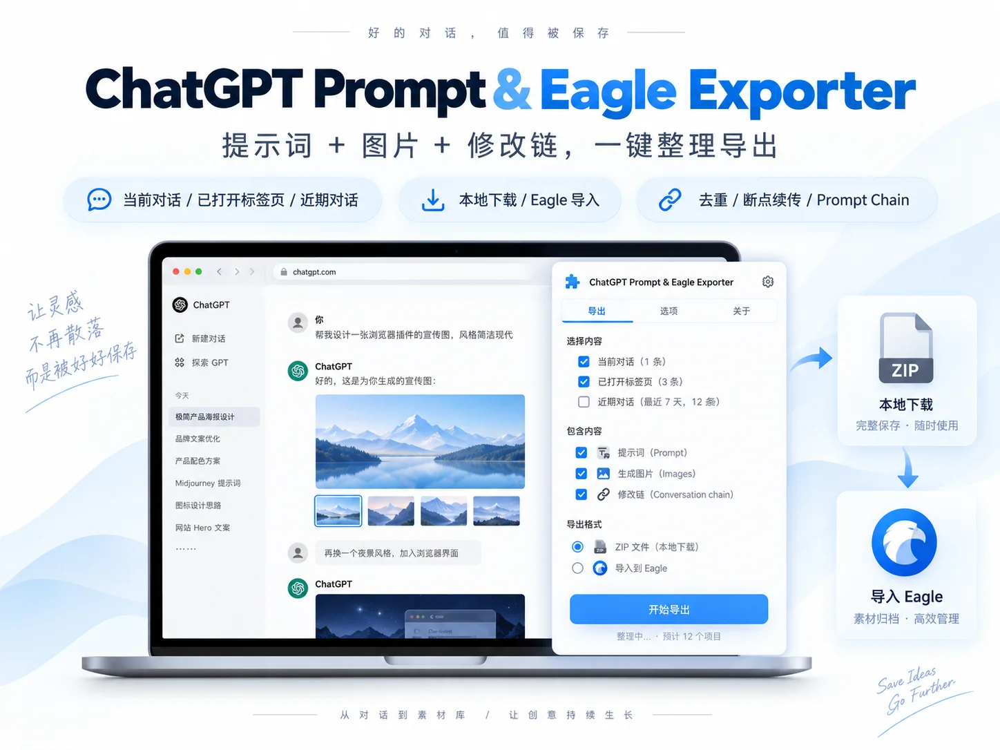

# Inside Vibe Shot Club: Not a Prompt Vault, but an AIGC Community Connecting Aesthetic Assets, Creator Identity, and Commerce

> **Bottom line:** Vibe Shot Club's real product is not the headline number of “10,000+ prompts.” It is a pipeline that turns visual inspiration into community infrastructure. The Gallery attracts discovery; the Style Atlas and motion library convert aesthetics into searchable vocabulary; the Forum preserves process and critique; the Open Source area circulates tools, skills, and plugins; and the Academy and membership layer let creators monetize experience. This is closer to a professional network for AI visual creators than another prompt download site. Its public member, resource, and creator-success figures are nevertheless platform-reported, some catalog counts use unexplained definitions, and buyers still need to verify quality, update cadence, usage rights, and data-processing boundaries.

[Vibe Shot Club](https://vibeshot.club/) describes itself as a professional AIGC community for AI image and video creators. Its thesis is that as generation becomes inexpensive and accessible, taste, judgment, narrative, and sustained creative practice become the scarcer assets.

That message could have remained a community manifesto. The actual product has already turned it into a substantial system. Public navigation spans Gallery, Forum, Academy, Creators, Open Source, Workshop, Shop, and annual membership. The adjacent product [Viko](https://viko.fun/) organizes image analysis, keywords, color palettes, and outputs as “creative memory.” VSC is attempting to cover discovery, learning, making, archiving, discussion, identity, and commerce rather than displaying finished images alone.

---

## 01 | Aesthetic Asset Pipeline Beneath a Visual Community

VSC's pages are not isolated content sections. Together they form a loop:

| Stage | Product surface | What the creator gets |
|---|---|---|
| Discover | Gallery, Creators | Works, authors, and visual directions |
| Decompose | Prompts, Style Atlas, motion library | Styles, materials, camera language, and reusable vocabulary |
| Make | Workshop, adjacent Viko product | Upscaling, splitting, watermark removal, reverse prompting, archiving, and remixing |
| Reflect | Forum, Knowledge Base | Parameters, failures, methods, critique, and documentation |
| Distribute | Creator profiles, curation, Creator Wall | Identity, portfolio, and cross-platform visibility |
| Transact | Annual Membership, Academy | Paid access, courses, columns, and premium articles |
| Incentivize | Open Source, points, Shop | Contributions converted into membership, tools, or identity rewards |

A prompt is not the destination in this model. It is an intermediate asset connecting a work, its method, and the next creation. The Gallery supports image, video, and favorite filters. Individual works can carry a title, author, prompt, and several images. Visitors can browse part of the archive, while full prompts and member resources sit behind account or payment access.

This supplies context that a prompt spreadsheet cannot: the image for which a phrase worked, whether the creator built a series, whether the source is image or video, and whether the community continued to discuss it. Those relationships often matter more than copying a block of text.

---

## 02 | The Style Atlas Turns “Style” Into a Knowledge Structure

The [Style Atlas](https://vibeshot.club/lexicon) best reveals VSC's product ambition. Its public page currently reports 13 domains, 157 lineages, and 1,617 style concepts across Western painting, global traditions, illustration, anime, graphic design, photography, cinema, 3D, motion, interfaces, internet subcultures, architecture, materials, and products.

The value is hierarchical organization rather than another list of fashionable labels:

- Photography, Optics and Film branches into documentary, commercial still life, film exposure, and fashion photography.
- Cinema, Television and Video separates screen genres from cinematography, color, and postproduction.
- Materials, Surfaces and Products connects transparent materials, textiles, industrial design, and decorative craft.
- Map, All, Explore, and Mix provide navigation, retrieval, serendipity, and combination modes.

The intended lesson is not that typing “cyberpunk” produces a good image. It is that a visual style is assembled from history, medium, craft, and controllable variables.

The public site also exposes an unresolved measurement issue. The membership page advertises 620 distinctive styles across ten style families, while the Style Atlas reports 1,617 concepts across 13 domains and 157 lineages. They may describe a curated member catalog and a broader concept ontology, or they may be versioned counts. The pages do not explain the mapping, so the figures should remain labeled rather than added together.

---

## 03 | The Motion Library Makes Camera Language Observable

Still images can demonstrate a visual style. Camera movement cannot be understood from text alone. At the time of review, the [Motion & Camera Library](https://vibeshot.club/depth-library) publicly listed 48 video resources across three broad groups:

1. depth references for dance and multi-person movement;
2. mannequin demonstrations of dollies, pans, tilts, cranes, orbits, Dolly Zoom, and Crash Zoom;
3. body turns, blocks, stand-ups, and compound action-camera examples.

Entries pair Chinese labels with production terms such as `Dolly In`, `Whip Snap`, and `Master Wide`. The membership page says members can access depth and mannequin videos, compare results, and retrieve source assets and usage notes.

This is closer to production reference than a tutorial saying “slowly push in.” A creator can first observe motion, then decide how to describe, adapt, or combine it. What remains to be verified is the asset license, download scope, model compatibility, and reproducibility across video generators. The catalog demonstrates resources, not a cross-model success benchmark.

---

## 04 | The Forum Preserves More Than Finished Work

The [Forum](https://vibeshot.club/forum) separates works, methods, discussions, and announcements. At review time, the page showed roughly 1.2k works, 135 method posts, 91 discussions, and four announcements. These are dynamic page counters, not independently audited active-user metrics.

The publishing prompt is more revealing than the totals. VSC asks contributors to record process, parameters, failed versions, and new work, and it highlights posts that explain where a workflow breaks. Curated content spans prompt-structure analysis and an agent workflow connecting Blender blockouts to AI-video camera movement.

The same creative subject can therefore live at three levels:

- Gallery for fast visual discovery;
- Forum for methods, failures, and conversation;
- Knowledge Base for more durable tutorials and documentation.

The public Knowledge Base is login-gated, so its article count, depth, and update cadence cannot be verified from the open site. Its completeness remains a membership proposition, not a publicly demonstrated fact.

---

## 05 | The Creator Economy Runs on Three Ledgers

VSC operates three distinct forms of value.

### Membership Access

The [Annual Membership](https://vibeshot.club/join) currently displays CNY 365 per year, marked down from CNY 499. It says membership includes 10,000+ image and video prompts, the style and motion libraries, the knowledge base, community groups, and creator support. The site reports 800+ paid members. Its Terms say current purchases are one-time payments and do not auto-renew.

### Separately Sold Creator Content

At review time, the [Academy](https://vibeshot.club/courses) presented eight paid articles, columns, and courses, with visible prices ranging from free to CNY 599. The membership FAQ explicitly says separately priced products require an additional purchase. Annual membership is not an all-site course pass.

### Community Points

The [Open Source area](https://vibeshot.club/open-source) accepts tools, skills, and plugins. The page says submissions receive human review and publishes a points schedule: 300 points for an approved listing, ten for each first valid acquisition, and two for a first like. Points can be used for Workshop processing, membership, or Shop items. The reviewed catalog contained 26 entries, including prompt skills, a ChatGPT image-archiving extension, asset managers, and image-production skills for Codex.

Points connect public contribution to platform consumption. Contributors may gain utility and status before direct revenue; paid education supplies a cash path; annual membership supplies recurring platform access revenue. Together, the three ledgers reduce dependence on one-off prompt copying.

Important economics remain undisclosed on public pages: Academy revenue share, detailed review standards, the stability of point redemption, member retention, and the distribution of creator income. Testimonials about creators reaching 10,000 followers and earning money are examples, not platform-wide outcome guarantees.

---

## 06 | Workshop and Viko Push the Community Into the Workflow

The [Workshop](https://vibeshot.club/workshop/upscale) is an operational tool, not a content page. Its public interface includes upscaling, image splitting, and watermark removal. Upscaling exposes 2K and 4K output, Faithful, Balanced, Portrait, Gentle, and Anime presets, enhancement blending, sharpening, PNG/WebP export, and batches. At the review snapshot, 2K cost three points per image and 4K cost six.

The homepage also promotes [Viko](https://viko.fun/), an adjacent product operated by VESCEND TECHNOLOGY LIMITED. Viko frames reference capture, reverse prompting, nine-dimensional image decomposition, keyword storage, color palettes, and output archiving as “Creative Memory.” The goal is to make an inspiration reusable in later work rather than leaving it in a bookmark folder.

These surfaces reveal VSC's direction: from content community toward an in-community production loop. When a user finds a work, decomposes its style, archives assets, invokes a tool, publishes a result, and returns for critique, the platform begins to occupy the creative process rather than merely receiving traffic.

Viko is a separate site, however. A banner does not establish that its full feature set is included in VSC membership, that accounts and assets are unified, or that points transfer between products. Those questions require the separate product's pricing and terms.

---

## 07 | Creator Wall and Shop Monetize Identity, Not Only Content

The [Creators page](https://vibeshot.club/creators) divides its wall into featured, spotlight, and constellation layers. It publicly displayed 23 creators at review time and showed community works, community followers, and claimed external follower counts. The design lets creators import reputation from X, Douyin, and other networks instead of starting social proof from zero.

The [Shop](https://vibeshot.club/shop) offers nickname colors, avatar frames, profile backgrounds, intros, particle effects, themes, and titles. These do not improve generation quality. They give contribution points a visible use and turn the creator page into another medium of expression.

The purpose is not merely selling cosmetic items. It connects contribution, identity, and visibility. The corresponding risk is equally familiar: if points purchase mostly status cosmetics, or curation repeatedly concentrates attention on the same head creators, incentives can drift from creative quality toward internal rank. Long-term credibility will require clear curation standards, anti-manipulation controls, and visible routes for ordinary members to earn distribution.

---

## 08 | Know What You Are Buying

| Assumption | What the public pages actually establish |
|---|---|
| CNY 365 unlocks everything | Membership covers four resource categories and community benefits; separately priced courses and tools may cost extra |
| A prompt can automatically be used commercially | Users must clear inputs, references, output, and third-party model terms; VSC does not guarantee originality or non-infringement |
| “Open Source” means code has been security-audited | The page says listings receive human review, but provides no standardized public security reports |
| 10,000+ prompts establishes quality | It is a platform-reported dynamic count, not proof of deduplication, reproducibility, or cross-model performance |
| 800+ members proves broad monetization success | Member count and testimonials do not disclose retention, income distribution, or success rate |
| Private creative material never leaves VSC | Invoking AI or media processing sends the necessary material to the relevant technology provider |

VSC's [Terms of Service](https://vibeshot.club/terms) say creators retain rights they lawfully hold while granting VSC a limited, non-exclusive license to host, display, distribute, and promote public content. A paid purchase grants personal, non-transferable, non-resalable access rather than ownership. Once digital access is delivered, change-of-mind refunds are generally unavailable, with review paths for duplicate charges, missing access, removed or materially misdescribed content, unauthorized transactions, and mandatory legal rights.

Its [Privacy Policy](https://vibeshot.club/privacy) says VSC does not sell creative material or use private content to train VSC-owned general-purpose AI models without separate explicit consent. When a user invokes AI, analysis, or media-processing features, however, the required material, prompts, and parameters are transmitted to the relevant technology provider under that provider's terms. That distinction matters for client product images, unreleased character designs, and identifiable faces.

---

## 09 | The Defensible Advantage and the Unproven Layer

If VSC develops a moat, it will not be a model. Models represented in its Gallery, including GPT Image, Midjourney, Seedance, Grok Imagine, and open systems, will continue changing. More difficult to reproduce are:

- an actively maintained visual vocabulary and taxonomy;
- relationships connecting works, prompts, camera language, and methods;
- a creator network willing to share failures and settings;
- incentives spanning open contribution, reputation, and paid education;
- a daily workflow joined to tools and asset memory.

What public evidence does not yet establish includes:

- deduplication, reproducibility, and update quality across the 10,000+ prompts;
- the relationship between 620 styles and 1,617 concepts;
- what “human review” verifies for security, copyright, and content quality;
- member retention, course completion, creator revenue share, and income distribution;
- complete data export and post-shutdown access to purchased or personal material;
- processing providers, output quality, and privacy routes for individual Workshop tools.

These are not reasons to dismiss the product. They are the metrics that distinguish an active community from durable creator infrastructure.

---

## Conclusion: VSC Is Turning Aesthetics Into a System That Can Accumulate Value

The interesting part of Vibe Shot Club is not placing prompts behind a membership wall. It converts aesthetics into several operational objects: works can be discovered, styles classified, camera moves observed, methods reviewed, tools contributed, creators curated, experience priced, and identity accumulated.

That makes it resemble a vertical professional network for AI visual creators. Gallery is the entry point; Style Atlas and the motion library form the knowledge layer; Forum and Open Source form the collaboration layer; Academy, membership, and points create the economic layer.

Whether VSC becomes the Asia-Pacific AIGC visual infrastructure it aspires to build will depend on translating quantity claims into verifiable quality: consistent catalog definitions, sustained updates, explicit rights and model labels, creator-revenue transparency, portable personal assets, and clearer security information for open-source projects and AI tools.

For creators, the reason to watch VSC is not another place to find prompts. It is the harder question the platform is attempting to answer: once generation becomes cheap, how can taste, process, reputation, and collaboration be preserved and made valuable over time?

---

## Primary Sources

- [Vibe Shot Club homepage](https://vibeshot.club/)
- [About and Mission](https://vibeshot.club/about)
- [Annual Membership](https://vibeshot.club/join)
- [Gallery](https://vibeshot.club/gallery)
- [Forum](https://vibeshot.club/forum)
- [Style Atlas](https://vibeshot.club/lexicon)
- [Motion & Camera Library](https://vibeshot.club/depth-library)
- [Open Source](https://vibeshot.club/open-source)
- [Academy](https://vibeshot.club/courses)
- [Creators](https://vibeshot.club/creators)
- [Workshop](https://vibeshot.club/workshop/upscale)
- [Shop](https://vibeshot.club/shop)
- [Terms of Service](https://vibeshot.club/terms)
- [Privacy Policy](https://vibeshot.club/privacy)
- [Viko](https://viko.fun/)

*Page audit date: October 11, 2026. Member counts, prompt totals, style counts, forum totals, prices, point costs, and course listings reflect the public pages on that date and may change. This review did not purchase membership, courses, or tool credits; log in to inspect the Knowledge Base or complete prompts; access private groups or downloadable member assets; or independently verify creator-income testimonials, the human-review process, and model-processing quality. Images are preserved locally from public first-party pages.*
