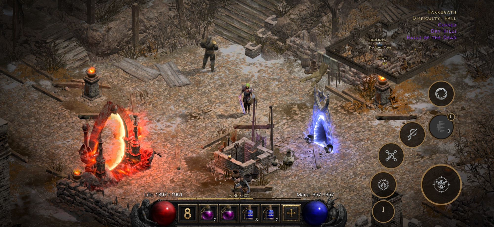
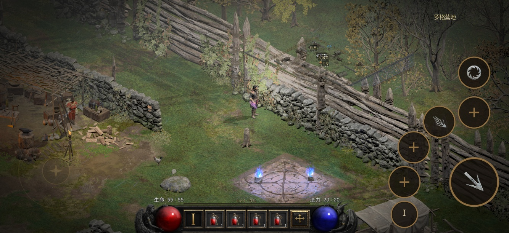
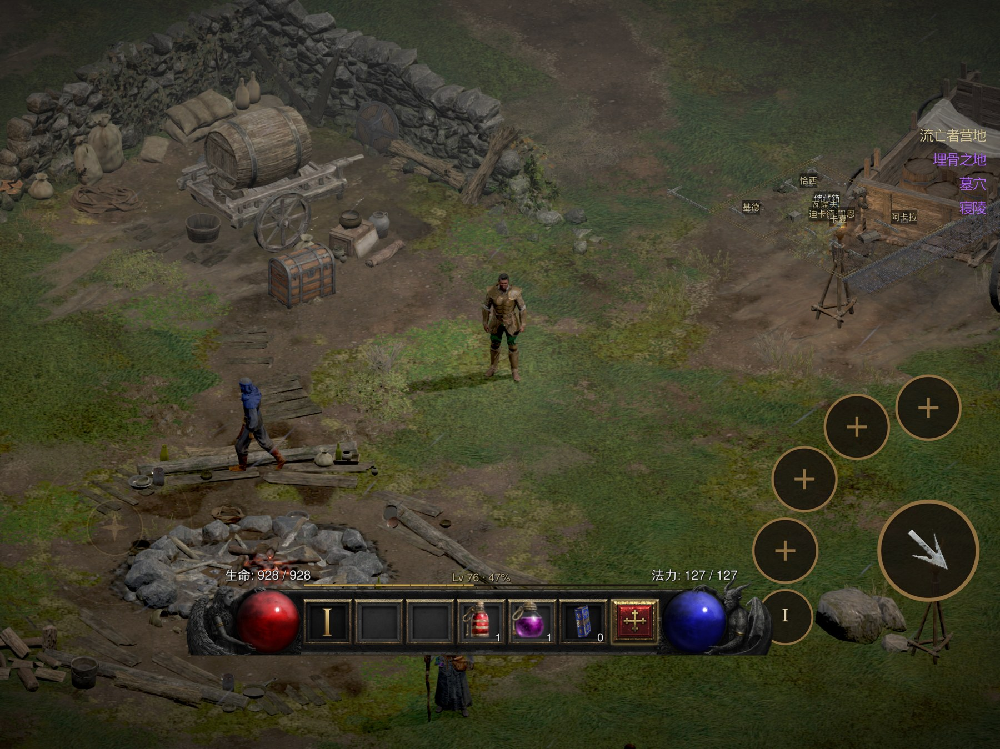
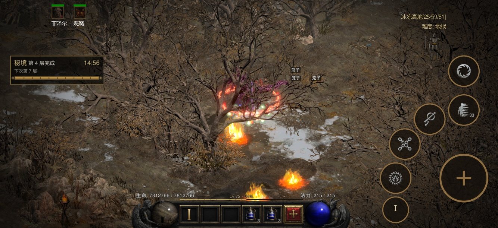

# D2R Mobile Source Audit: Not an Emulator, but a Switch ARM64 Compatibility Layer for iOS and Metal

> **Bottom line:** D2R Mobile neither recompiles Diablo II: Resurrected as an iOS app nor emulates an entire Nintendo Switch on an iPhone. It preserves most of the original ARM64 game instructions, rewrites the small set that cannot execute under Apple's kernel, supplies system, file, audio, and input services through a custom host, reimplements the Switch NVN graphics interface on Metal, and translates shaders offline. The source is substantial enough to establish that this is a real, game-specific compatibility project. Claims about 44 tested devices, flawless 60 fps on A16, and roughly 3.8 W power draw remain project-reported measurements that I did not independently reproduce.

The repository in the original link, [`donghaozhang/d2r-mobile`](https://github.com/donghaozhang/d2r-mobile), appeared publicly on October 12, 2026. Its provenance matters: it is a synchronized fork of [`jhaizhou-ops/d2r-mobile`](https://github.com/jhaizhou-ops/d2r-mobile), not a separate implementation. At the time of this audit, both pointed to commit [`286fbd4`](https://github.com/jhaizhou-ops/d2r-mobile/tree/286fbd417b875549a343189b16aa8de665b93f84). The upstream public history contains only two commits, with the first commit delivering nearly the entire repository at once.

Commit count therefore tells us very little. The useful question is whether the repository is merely a release page and IPA shell, or whether it genuinely connects the original program, an iOS host, graphics translation, and touch interaction into one system.

---

## 01 | “Native” does not mean “the original file runs unchanged”

The Switch and modern iPhones both use ARM64, which removes one of the heaviest layers found in a cross-architecture emulator. D2R Mobile does not need to dynamically translate every ARM64 instruction into a different CPU ISA. A shared ISA, however, is not a shared platform.

The two systems still have different kernels, ABIs, thread registers, system calls, file layouts, graphics APIs, audio stacks, and input devices. iOS cannot load a Switch game merely because both processors speak ARM64.

D2R Mobile's path can be reduced to four stages:

1. `dm/tools/patch_nso.py` reads the user's own Switch executable and rewrites incompatible operations such as thread-pointer access, system calls, and timers.
2. `dm/host` loads the rewritten program and supplies the platform services it expects.
3. `dm/gfx` reimplements NVN on Metal and converts the original shaders into a Metal-compatible form offline.
4. `dm/ios` provides the app shell, touch controls, controller switching, interface adaptation, and lifecycle handling.

The most precise label is therefore **a game-specific ARM64 binary compatibility layer**. Most CPU code executes directly, but it still depends on instruction rewriting, platform HLE, and graphics translation. “Not a conventional emulator” is a fair description; “no conversion at all” would not be.

---

## 02 | This is not an empty shell: the hard parts are in the repository

The audited snapshot contains 997 Git-tracked files and roughly 224,000 lines across all text files. That count includes third-party code such as the Ryujinx shader translator and libdeflate, so it should not be presented as entirely original work. The first-party core is still substantial:

| Layer | Representative path | Visible responsibility at the audited commit |
|---|---|---|
| Instruction rewriting | `dm/tools/patch_nso.py` | Parses NSO, applies controlled ARM64 rewrites, and emits the relocated program |
| Host | `dm/host` | Loads the program and supplies memory, threading, files, audio, timing, and game-specific logic |
| NVN to Metal | `dm/gfx/nvn/nvn_mtl.m` | Implements resources, pipelines, commands, synchronization, swapchains, and Metal encoding |
| iOS front end | `dm/ios/Sources` | Handles app lifecycle, touch state, UI, controllers, and localization |
| Verification | `dm/verify`, `dm/*/tests` | Checks instruction equivalence, host behavior, graphics behavior, and regressions |

`nvn_mtl.m` alone exceeds 5,800 lines, while `patch_nso.py` is nearly 900. The graphics layer exposes 523 NVN names and slots. Local test output reported 216 as implemented or explicit no-op implementations; remaining calls resolve to visible error stubs instead of silently pretending to work.

This is not a WebView wrapper, nor an emulator hidden behind branding. The engineering resides exactly where a compatibility layer should: at the host API boundary, where familiar thread, file, and NVN semantics are redirected to iOS and Metal.

---

## 03 | NVN-to-Metal work matters more than the shared ARM64 headline

A common CPU ISA only gives the game instructions a chance to execute directly. Whether a 3D game can render correctly depends on a harder boundary: Nintendo's NVN and Apple's Metal are not the same graphics API.

The graphics layer must cover:

- NVN devices, queues, windows, memory pools, and command buffers;
- texture formats, mipmaps, compressed textures, and swizzle/deswizzle paths;
- render and compute pipelines, resource slots, barriers, fences, and events;
- shader interface facts, mapping tables, PSO manifests, and offline compilation caches;
- GPU suspension, restoration, and resource residency across iOS lifecycle changes.

Shader translation is deliberately moved ahead of gameplay. The README says the no-Xcode route compiles 7,212 shaders on first launch, taking about seven minutes on an iPhone 17 Pro Max; later scene entry avoids just-in-time shader compilation. It trades a heavy first-run preparation step for runtime stability.

Still, “NVN now reaches Metal” does not imply general Switch compatibility. The repository contains D2R-specific addresses, shader facts, function tables, and behavior patches. It demonstrates a deeply completed vertical slice for one title, not a universal Switch-to-iOS converter.

---

## 04 | The touch layer is a second product effort, not a controller overlay

Rendering a frame would make this an impressive porting experiment, but not yet a mobile product. D2R Mobile goes further with movement sticks, tap-to-pathfind, press-and-hold casting, drag aiming, automatic targeting, and stateful tap, double-tap, long-press, and drag-and-drop item interactions. Touching the screen or using a controller also switches the interface immediately.

The project does not stop at reproducing the original game. It adds Greater Rifts, Boss Rush, expanded storage, loot filtering, automatic buff recasting, potion logic, and drop alerts. These features show that the host does more than expose platform APIs; it injects title-specific logic at known program addresses.

That specialization is both a product strength and a limit on generality. The closer the addresses, state machines, and content logic are tied to D2R, the less this resembles a framework that can be applied unchanged to another game.

---

## 05 | What I actually tested, and where verification stops

I checked out the fixed `286fbd4` commit and ran the public tests on an Apple M4 Pro Mac. The results need to be separated by evidence level:

| Check | Result | What it establishes |
|---|---|---|
| `python3 dm/i18n/scan_literals.py` | Passed; 439 Chinese literals were covered by allowlists or translation tables | The static localization rule is independently reproducible |
| `python3 dm/ios/tools/dm_i18n.py --check` | Passed; 298 entries | The iOS message tables are internally consistent |
| `make -C dm/host/tests run` | Compiled many test binaries, then stopped because `build/main.orig.bin` was absent | Part of the public host source compiles; the full host run requires a game-derived fixture that is not published |
| `make -C dm/gfx/tests run` | Executed many tests; `t_nvn` passed 61/61 checks, while pacing, dirty-slot, and GPU deswizzle tests also passed. The suite ultimately exited nonzero because two shader-reflection JSON samples were absent | The Metal core is executable, not paper architecture; the full suite still depends on unpublished derived cache material |

The graphics build also emitted roughly 30 categories of Metal-related warnings, mainly around MTL4 versus legacy encoder types, Objective-C types, and ARC qualifiers. Tests continued to compile and run on this machine, but those warnings should not disappear behind a statement that most tests passed.

There is no public GitHub Actions workflow in the repository, so there is no external cross-machine CI record to inspect. The documentation describes instruction-equivalence checks, scripted touch regressions, and device smoke tests. The tooling exists in source, but its presence cannot substitute for the game files, derived shader caches, and device evidence held by the author.

The accurate verdict is neither “all tests pass” nor “the project fails”: **the public portion is enough to prove that the engineering is real and several core mechanisms execute, but not enough to independently reconstruct the claimed end-to-end validation.**

---

## 06 | How to read the 44-device and 60 fps claims

The upstream README says 44 iPhones and iPads in a closed beta completed Normal, Nightmare, and Hell, with the lowest model, an iPhone 14 Pro Max with A16 and 6 GB of memory, maintaining a “flawless 60 fps.” It also reports about 0.15 seconds for app launch, one second to enter a game, roughly 3.8 W at 60 fps, and roughly 1.85 W at 30 fps on an iPhone 17 Pro Max.

The inclusion of a device, date, scene, and brightness for some measurements is more useful than a context-free marketing claim. The evidence is still first-party:

- no per-device logs, frame-time traces, or downloadable benchmark dataset are public;
- the 44-device completion claim has no independent tester roster or raw records;
- battery life is calculated from measured power and battery capacity, not a full discharge run;
- I did not have the legally obtained game files and matching iPhone environment needed to reproduce it.

We can verify that the project publicly states these conditions, not that an independent review confirmed them. The [`v1.0` release](https://github.com/jhaizhou-ops/d2r-mobile/releases/tag/v1.0) does provide an approximately 4.4 MB shell IPA, but it contains no game content and cannot establish full-game performance by itself.

---

## 07 | The open-source boundary is explicit, but legal questions do not vanish

The project uses the MIT License and excludes the game executable, art, audio, strings, data tables, original shaders, generated Metal libraries, and saves. Users must own the designated Switch build, version `3.3.94012` with the Reign of the Warlock expansion, and extract their own ExeFS and RomFS.

The public repository still contains compatibility-derived facts: about 523 NVN names and slots, shader IDs and interface descriptions, a PSO manifest, roughly 800 `main+0x...` addresses, instruction rewrite rules, and seven offline patches attributed to a community LFS Mod Offline Fix whose original provenance is unknown. The project discloses these categories in [`docs/DERIVED.md`](https://github.com/jhaizhou-ops/d2r-mobile/blob/286fbd417b875549a343189b16aa8de665b93f84/docs/DERIVED.md), which is the right kind of transparency.

Not distributing game files removes the most obvious redistribution issue, but does not make binary modification, compatibility research, technological protection measures, or personal backups automatically lawful in every jurisdiction. This article is a technical audit, not legal advice, and provides no game content, keys, or bypass procedure.

The no-Xcode path also labels itself experimental. The documentation reports an end-to-end Windows package and one installed/tested build, while installation signing through tools such as AltStore and Sideloadly remains unverified. The resulting roughly 130 MB package contains the user's game material, is for personal devices, and must not be redistributed.

---

## 08 | What is genuinely advanced about D2R Mobile

D2R Mobile is interesting not merely because a console game appears on a phone, but because it places the engineering effort in three precise locations:

1. **Preserve what can execute directly.** Most same-ISA ARM64 instructions are left alone; only actual Apple-platform incompatibilities are rewritten.
2. **Separate compatibility boundaries.** The rewriter, host, NVN/Metal layer, shader pipeline, iOS interface, and verification tools have clear ownership instead of collapsing into one launcher full of patches.
3. **Treat mobile interaction as a product.** Touch is not a final row of virtual buttons. It covers combat, navigation, inventory, controller transitions, and application lifecycle.

It is not a one-click system for turning Switch games into iOS apps. The exact version lock, hundreds of fixed addresses, dedicated shader facts, D2R gameplay patches, and unpublished derived fixtures all identify it as a highly vertical compatibility effort.

The fairest one-sentence conclusion is: **D2R Mobile shows that a console program sharing ARM64 with iOS can become a real mobile product through limited instruction rewriting, a complete platform compatibility layer, and game-specific graphics and interaction engineering; it does not yet show that the method generalizes automatically to other Switch titles, nor does the public evidence independently confirm every performance claim.**

---

## Primary sources

- [The user-linked `donghaozhang/d2r-mobile` fork](https://github.com/donghaozhang/d2r-mobile)
- [Upstream `jhaizhou-ops/d2r-mobile`](https://github.com/jhaizhou-ops/d2r-mobile)
- [Audited commit `286fbd4`](https://github.com/jhaizhou-ops/d2r-mobile/tree/286fbd417b875549a343189b16aa8de665b93f84)
- [D2R Mobile v1.0 release](https://github.com/jhaizhou-ops/d2r-mobile/releases/tag/v1.0)
- [Game files and required version](https://github.com/jhaizhou-ops/d2r-mobile/blob/286fbd417b875549a343189b16aa8de665b93f84/docs/GAME_FILES.md)
- [Derived material inventory](https://github.com/jhaizhou-ops/d2r-mobile/blob/286fbd417b875549a343189b16aa8de665b93f84/docs/DERIVED.md)
- [Experimental no-Xcode packaging path](https://github.com/jhaizhou-ops/d2r-mobile/blob/286fbd417b875549a343189b16aa8de665b93f84/docs/NO_XCODE.md)
- [Graphics layer documentation](https://github.com/jhaizhou-ops/d2r-mobile/blob/286fbd417b875549a343189b16aa8de665b93f84/dm/gfx/README.md)
- [Verification tooling](https://github.com/jhaizhou-ops/d2r-mobile/tree/286fbd417b875549a343189b16aa8de665b93f84/dm/verify)

*Audited on October 12, 2026. Stars, forks, release downloads, and code will continue to change; technical conclusions are pinned to commit `286fbd4`. Performance, device coverage, and power figures are explicitly treated as project-reported claims. Device images come from the project's release assets and are stored locally with this article.*
