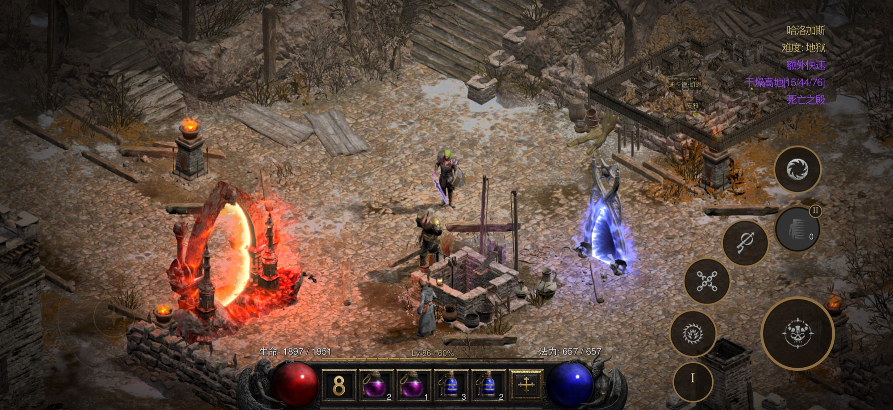

# D2R Mobile 源码审计：它不是模拟器，而是把 Switch ARM64 程序接进 iOS 与 Metal

> **结论先行：** D2R Mobile 不是把《暗黑破坏神 II：狱火重生》重新编译成 iOS App，也不是在 iPhone 里模拟一台 Switch。它保留绝大多数原始 ARM64 游戏指令，只改写无法在 Apple 内核下直接执行的少量指令，再用自建 host 补齐系统调用、文件、音频与输入，用 Metal 重做 Switch 的 NVN 图形接口，并把 shader 离线转译。源码证明这是一套规模可观的专项兼容工程；但“44 台设备通关”“A16 稳定 60 fps”“约 3.8W”等数据仍是项目方自测，本文没有独立复现。

2026 年 10 月 12 日，[`donghaozhang/d2r-mobile`](https://github.com/donghaozhang/d2r-mobile) 公开出现。先要说明来源：这个仓库是 [`jhaizhou-ops/d2r-mobile`](https://github.com/jhaizhou-ops/d2r-mobile) 的同步 fork，不是另一套独立实现；两者审计时都指向提交 [`286fbd4`](https://github.com/jhaizhou-ops/d2r-mobile/tree/286fbd417b875549a343189b16aa8de665b93f84)。上游公开历史只有两个提交，首个版本就是一次性放出的大型代码库。

这让判断标准不能是 commit 数量，而要回到代码本身：它究竟只是一个宣传页和 IPA 外壳，还是已经把原程序、iOS 宿主、图形翻译与触控界面接成了真实系统？

---

## 01 | “原生运行”不是“原文件直接运行”

Switch 和 iPhone 都使用 ARM64 指令集，确实省去了传统跨架构模拟器最重的一层：D2R Mobile 不需要把每条 ARM64 指令动态翻译成另一套 CPU 指令。但共享 ISA 不等于共享平台。

两边仍有不同的内核、ABI、线程寄存器、系统调用、文件布局、图形 API、音频栈和输入设备。Switch 游戏不能因为 CPU 同属 ARM64，就直接被 iOS 装载。

D2R Mobile 的处理可以压缩成四步：

1. `dm/tools/patch_nso.py` 读取用户自己的 Switch 可执行文件，只改写线程指针、系统调用、计时器等不兼容指令；
2. `dm/host` 装载改写后的程序，并提供游戏预期的平台服务；
3. `dm/gfx` 在 Metal 上重新实现 NVN 接口，同时把原始 shader 离线转成 Metal 可用形式；
4. `dm/ios` 提供 App 外壳、触控、手柄切换、界面适配与生命周期管理。

因此，更准确的叫法是：**面向单一商业游戏的 ARM64 二进制兼容层**。CPU 代码大部分直接执行，但程序仍依赖指令改写、平台 HLE 和图形翻译。“不是传统模拟器”基本成立，“完全没有转换”则不成立。

---

## 02 | 这不是空壳：真正困难的部分都在仓库里

审计快照包含 997 个 Git 跟踪文件，全部文本约 22.4 万行；其中包括 Ryujinx shader translator、libdeflate 等第三方代码，因此不能把总行数都算作作者原创。不过第一方关键模块并不小：

| 模块 | 代表文件 | 审计时可见职责 |
|---|---|---|
| 指令重写 | `dm/tools/patch_nso.py` | 解析 NSO、应用受控 ARM64 改写、生成重定位后的程序 |
| Host | `dm/host` | 装载程序，承接内存、线程、文件、音频、计时与游戏专项逻辑 |
| NVN → Metal | `dm/gfx/nvn/nvn_mtl.m` | 资源、管线、命令、同步、交换链与 Metal 编码 |
| iOS 前端 | `dm/ios/Sources` | App 生命周期、触控状态机、UI、手柄和本地化 |
| 验证 | `dm/verify`、`dm/*/tests` | 指令等价、宿主单测、图形测试与回归脚本 |

其中 `nvn_mtl.m` 超过 5,800 行，`patch_nso.py` 接近 900 行。图形层公开了 523 个 NVN 函数名与槽位；本地测试输出显示其中 216 个已有实现或显式空实现，其余函数会落到可见报错 stub，而不是静默伪造成功。

这套结构说明它不是“套一个 WebView”或“把模拟器藏起来”。真正的工程工作恰恰发生在主机 API 边界：让原游戏以为自己仍在调用熟悉的线程、文件和 NVN 语义，而调用最终落到 iOS 与 Metal。

---

## 03 | NVN 到 Metal，比 ARM64 直跑更决定项目能否成立

CPU 共享 ARM64 只解决了“指令有没有机会直接执行”。一款 3D 游戏能否真正出画面，取决于另一个更难的边界：Switch 的 NVN 与 Apple Metal 并不是同一个图形 API。

仓库中的图形层需要处理：

- NVN 设备、队列、窗口、内存池和命令缓冲；
- 贴图格式、mipmap、压缩纹理与 swizzle/deswizzle；
- render/compute pipeline、资源槽位、barrier、fence 与 event；
- shader 接口事实、映射表、PSO manifest 与离线编译缓存；
- iOS 前后台切换时的 GPU 挂起、恢复和资源驻留。

项目把 shader 转译放在进入场景之前。README 称无 Xcode 安装路线首次启动要编译 7,212 个 shader，在 iPhone 17 Pro Max 上约需 7 分钟；之后进入场景时不再临时编译。这个设计用较重的首次准备，换取运行时稳定性。

不过“NVN 已接到 Metal”不等于完整兼容所有 Switch 游戏。这里有大量 D2R 专项地址、shader facts、函数表和行为补丁。它证明的是一个标题级 vertical slice 被深入打通，不是一个通用 Switch-to-iOS 转换器。

---

## 04 | 触控层不是虚拟手柄贴图，而是第二次产品化

如果工程只做到“画面能亮”，它仍然只是移植实验。D2R Mobile 明显继续做了移动端产品层：移动摇杆、点击寻路、按住连续施法、拖动瞄准、自动选敌，以及装备的点击、双击、长按和拖放状态机。触屏与手柄输入还会即时切换 UI。

项目也不只追求原版复现。它加入 Greater Rift、Boss Rush、扩展仓库、战利品筛选、自动补 Buff、自动喝药和掉落提醒等终局与便利功能。这些修改说明 host 不只是“补系统 API”，还会在固定程序地址上接入游戏专项逻辑。

这既是它的产品优势，也是通用性的限制：地址、状态机和内容逻辑越贴近 D2R，这套系统就越不像可直接迁移到其他游戏的框架。

---

## 05 | 我实际跑了哪些测试，结果到哪一层

我在 Apple M4 Pro、macOS 环境检出固定提交 `286fbd4`，运行仓库公开测试。结果需要拆开说：

| 检查 | 结果 | 能证明什么 |
|---|---|---|
| `python3 dm/i18n/scan_literals.py` | 通过，439 条中文 literal 均受白名单或中英表管理 | 本地化静态规则可独立复现 |
| `python3 dm/ios/tools/dm_i18n.py --check` | 通过，298 条 | iOS 文案表一致性可复现 |
| `make -C dm/host/tests run` | 多组测试二进制编译成功，运行阶段因缺少 `build/main.orig.bin` 停止 | 公开源码可编译一部分；完整 host 回归依赖未发布的游戏派生 fixture |
| `make -C dm/gfx/tests run` | 多组测试实际执行；`t_nvn` 61/61、帧节拍、dirty slots、GPU deswizzle 等通过，最终因缺少两份 shader reflection JSON 以非零退出 | Metal 图形核心不是纸面代码；完整套件仍依赖未发布的派生缓存 |

图形构建还出现约 30 类 Metal 类型告警，集中在 MTL4 与传统 encoder 接口、Objective-C 类型和 ARC qualifier 上。测试在本机能够继续编译运行，但这些告警不应被“测试大部分通过”掩盖。

仓库没有公开 GitHub Actions workflow，因此也没有可供外部审计者核对的跨机器 CI 记录。项目文档描述了指令等价检查、触控脚本回归和真机 smoke test；公开源码能确认这些工具存在，却不能替代作者持有的游戏文件、派生 shader 缓存和真机测试证据。

所以最准确的结论不是“测试通过”或“测试失败”，而是：**公开部分足以证明工程真实且若干核心机制可运行，但不足以独立重建项目方宣称的完整端到端验证。**

---

## 06 | 44 台设备与 60 fps：应当怎样读

上游 README 称封闭测试覆盖 44 台 iPhone/iPad，全部完成普通、噩梦和地狱难度，最低机型 iPhone 14 Pro Max（A16、6GB）可“无瑕 60 fps”。它还给出 iPhone 17 Pro Max 上约 0.15 秒 App 启动、约 1 秒进入游戏、60 fps 约 3.8W、30 fps 约 1.85W 等数据。

这些数字写明了部分设备、日期、场景和亮度条件，比没有测量条件的宣传口号更有价值。但它们仍来自项目方：

- 没有公开逐设备日志、帧时间曲线或可下载 benchmark 数据；
- “44 台完成三难度”没有外部测试名单与原始记录；
- 续航是根据功耗和电池容量推算，不是从满电连续游玩到关机；
- 本文没有合法游戏文件与对应 iPhone 测试环境，无法独立复现。

因此可以确认“项目公开声称并描述了测试条件”，不能把这些数据改写成“独立评测证明”。[`v1.0`](https://github.com/jhaizhou-ops/d2r-mobile/releases/tag/v1.0) 确实提供约 4.4MB 的 shell IPA，但它不包含游戏内容，也不能单独证明完整游戏性能。

---

## 07 | 开源边界做得很明确，但法律问题不会自动消失

项目采用 MIT License，仓库明确排除了游戏可执行文件、图片、音频、文本、数据表、原始 shader、生成后的 Metal 库和存档。用户必须拥有指定的 Switch 版本 `3.3.94012` 及 Reign of the Warlock expansion，并自行提取 ExeFS 与 RomFS。

但公开仓库仍包含为兼容而记录的派生事实：约 523 个 NVN 函数名/槽位、shader ID 与接口描述、PSO manifest、约 800 个 `main+0x...` 地址、指令改写规则，以及 7 条来自社区 LFS Mod Offline Fix、原始来源不明的离线补丁。项目在 [`docs/DERIVED.md`](https://github.com/jhaizhou-ops/d2r-mobile/blob/286fbd417b875549a343189b16aa8de665b93f84/docs/DERIVED.md) 中逐项披露了这些内容，这是好事。

“不分发游戏文件”降低了最明显的再分发风险，却不等于在所有司法辖区都自动合法。二进制改写、兼容性研究、技术保护措施和个人备份的规则因地区而异。本文只做技术审计，不提供法律意见，也不提供游戏、密钥或绕过步骤。

另外，无 Xcode 路线的文档自己标注为 experimental。它验证过 Windows 打包与一份安装包，但 AltStore、Sideloadly 等签名安装流程尚未验证。最终生成的约 130MB 包会包含用户自己的游戏内容，只适合个人设备，不能分发。

---

## 08 | D2R Mobile 真正先进在哪里

D2R Mobile 最值得看的，不是“把主机游戏塞进手机”这句结果，而是它把工作放在了三个很准确的位置：

1. **保留能直接执行的东西。** 同 ISA 的绝大多数 ARM64 指令不做无意义翻译，只处理 Apple 平台真正不兼容的边界。
2. **把兼容问题显式分层。** 指令 rewriter、host、NVN/Metal、shader、iOS UI 和验证各自有清晰目录，不把所有补丁堆进一个启动器。
3. **把移动端体验当成独立产品。** 触控不是最后加的一排虚拟按钮，而是覆盖战斗、寻路、物品、手柄切换和前后台生命周期的交互系统。

但它不是“一键把 Switch 游戏转成 iOS”的通用技术。准确版本锁定、数百个固定地址、专用 shader facts、D2R 玩法补丁和未公开派生 fixture，都表明它是一项高度垂直的兼容工程。

最终最准确的一句话是：**D2R Mobile 证明了同为 ARM64 的主机程序，可以通过少量指令改写、完整的平台兼容层和专项图形/交互工程，在 iOS 上形成真实产品；它尚未证明这种方法能自动扩展到其他 Switch 游戏，也没有提供足够公开证据让外部独立确认全部性能宣传。**

---

## 主要来源

- [用户提供的 `donghaozhang/d2r-mobile` fork](https://github.com/donghaozhang/d2r-mobile)
- [上游 `jhaizhou-ops/d2r-mobile`](https://github.com/jhaizhou-ops/d2r-mobile)
- [固定审计提交 `286fbd4`](https://github.com/jhaizhou-ops/d2r-mobile/tree/286fbd417b875549a343189b16aa8de665b93f84)
- [D2R Mobile v1.0 release](https://github.com/jhaizhou-ops/d2r-mobile/releases/tag/v1.0)
- [Game files and required version](https://github.com/jhaizhou-ops/d2r-mobile/blob/286fbd417b875549a343189b16aa8de665b93f84/docs/GAME_FILES.md)
- [Derived material inventory](https://github.com/jhaizhou-ops/d2r-mobile/blob/286fbd417b875549a343189b16aa8de665b93f84/docs/DERIVED.md)
- [Experimental no-Xcode packaging path](https://github.com/jhaizhou-ops/d2r-mobile/blob/286fbd417b875549a343189b16aa8de665b93f84/docs/NO_XCODE.md)
- [Graphics layer documentation](https://github.com/jhaizhou-ops/d2r-mobile/blob/286fbd417b875549a343189b16aa8de665b93f84/dm/gfx/README.md)
- [Verification tooling](https://github.com/jhaizhou-ops/d2r-mobile/tree/286fbd417b875549a343189b16aa8de665b93f84/dm/verify)

*审计日期：2026 年 10 月 12 日。仓库 stars、forks、release 下载量和代码会继续变化；技术结论固定到提交 `286fbd4`。文中性能、设备覆盖与功耗数字均标为项目方自述；实机图片来自项目 release assets，并已随文章本地保存。*
