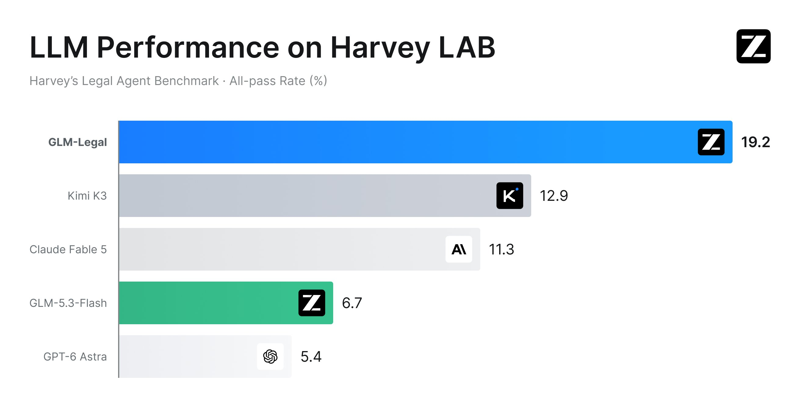
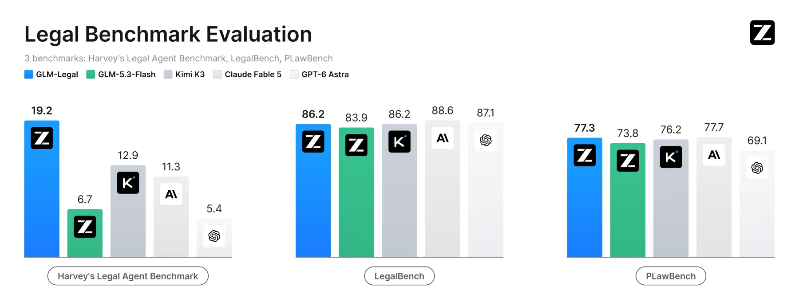
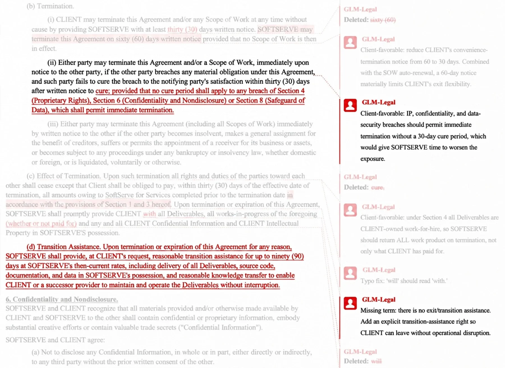
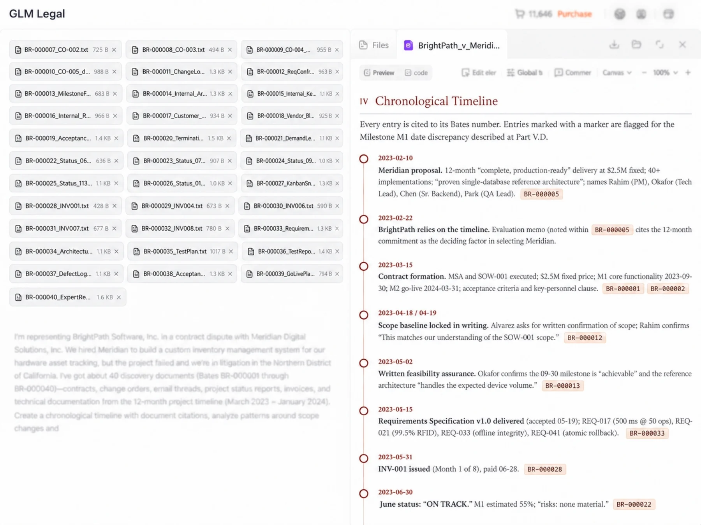
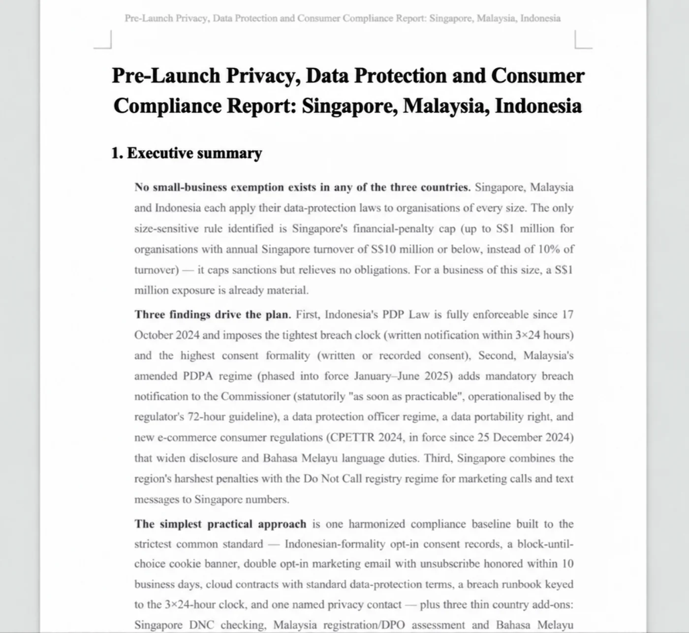

# GLM-Legal 深度拆解：19.2% 全通过率背后，法律 AI 正从“答题”走向可审阅交付物

> **结论先行：** Z.ai 在 2026 年 10 月 12 日发布的 GLM-Legal，不是一套单独的法律问答提示词，而是基于 GLM-5.3-Flash 做法律领域中训、真实任务强化学习，并与 Agent harness 联合迭代的专业模型。它在 Harvey Legal Agent Benchmark 上从基础模型的 6.7% 提升到 19.2% 全通过率，说明领域训练确实把能力推进到了文件、工具和交付物层面。但完整榜单里它是第 7，不是第一；19.2% 也意味着约五分之四的任务仍无法满足所有标准。更准确的判断是：GLM-Legal 展示了法律 AI 的正确产品形态，但远未证明它可以脱离律师复核独立执业。

2026 年 10 月 12 日，[Z.ai 的发布帖](https://x.com/Zai_org/status/2109678174468534511)称，GLM-Legal 基于 GLM-5.3-Flash，在主流法律基准上达到前沿模型水平，并面向合同审查、证据分析和合规等真实工作流。官方同时开放 [API Beta 申请](https://z.ai/consultation/legal)，并预告模型将进入桌面 Agent 平台 [AutoClaw](https://autoclaw.z.ai/)。

这次发布最值得看的，不是“法律模型又多了一个”，而是 Z.ai 把训练目标从**生成一段看起来专业的回答**，改成了**读取材料、调用工具、完成文件、满足全部任务标准并交给专业人员复核**。

---

## 01 | 它不是新的基座，而是 GLM-5.3-Flash 的法律专业化版本

GLM-Legal 建立在 GLM-5.3-Flash 上。基础模型本身是一个 320B 总参数、18B 激活参数的 MoE 模型，支持 1M 上下文和 128K 最大输出；开放权重已经发布。GLM-Legal 的变化发生在其上层：

1. 扩充高质量法律语料做 specialized mid-training；
2. 在数万个真实感法律环境中做强化学习后训练；
3. 让模型与 Agent harness 共同迭代；
4. 用律师对真实交付物的反馈更新任务、rubric 和运行逻辑。

官方没有披露 GLM-Legal 增加了多少参数、训练 token、训练算力或领域数据构成，也没有说明它是否保留了基础模型的全部多模态能力。因此，现阶段可以确认的是**训练与运行路线**，不能把基础模型的所有参数表直接当成 GLM-Legal 的独立模型卡。

---

## 02 | 19.2% 是严格的“整项全过”，不是普通准确率

[Harvey Legal Agent Benchmark](https://www.vals.ai/benchmarks/hlab)要求 Agent 使用 Read File、Edit File、Write File、Glob、Bash 和 Grep，还提供 DOCX、PPTX、XLSX 三种 skill。任务覆盖 24 类法律业务，最终交付物要满足一组任务专属标准。

这里的 19.2% 是 **all-pass rate**：只有每一项标准都通过，整个任务才算解决。Vals 的完整数据给出了更有解释力的一组数字：

| 指标 | GLM-Legal | 含义 |
|---|---:|---|
| 整项任务全通过率 | 19.17% ± 3.25 | 79 个模型中第 7 |
| 单项标准通过率 | 92.5% | 多数要求能做到，但少数遗漏会让整项失败 |
| 每题推理成本 | 约 0.15 美元 | 当时前十中最低 |
| 平均任务时长 | 约 1 小时 12 分 | 前十里最慢的一档 |

这组差距比排名本身更重要。法律任务是典型的“合取型交付”：漏掉一个关键例外、错误引用一个法条、没有按 brief 输出可编辑文件，可能让一份其余部分都不错的工作产品失效。92.5% 的标准通过率最后只换来 19.2% 的整项全过，恰好说明“看起来大部分都对”离“可以签字交付”还有多远。

同样，这也给成本数字加了条件。0.15 美元的模型调用很便宜，但 72 分钟的运行时间、人工复核、材料准备、失败重跑和错误责任都不在 token 单价里。

---

## 03 | “追平前沿模型”只在特定评测和口径下成立

Z.ai 的发布图选取 GLM-5.3-Flash、Kimi K3、Claude Fable 5 和 GPT-6 Astra 做对比，GLM-Legal 在三项基准中分别达到：

| Benchmark | GLM-Legal | 基础模型 GLM-5.3-Flash | 增益 |
|---|---:|---:|---:|
| Harvey LAB | 19.2 | 6.7 | +12.5 个百分点 |
| LegalBench | 86.2 | 83.9 | +2.3 个百分点 |
| PLawBench | 77.3 | 73.8 | +3.5 个百分点 |

Harvey LAB 和 LegalBench 由 [Vals](https://www.vals.ai/models/zai_glm-legal)独立运行。完整 Harvey 榜单里，GLM-Legal 位于第 7，前面还有 Muse Spark 系列、Wonder Full 和 Gemini 4 Argon；所以发布图展示的是一个对比子集，不是完整排名。

在 [LegalBench](https://www.vals.ai/benchmarks/legal_bench) 上，GLM-Legal 为 86.23%，排名第 15，距离第一名 88.56% 约 2.33 个百分点。可以说它进入了前沿模型密集区，但不能写成全面领先。Vals 还报告它在 Legal Research Bench 上为 41.83%、第 24，说明法律专业化提升并不均匀覆盖所有研究任务。

[PLawBench](https://aclanthology.org/2026.acl-long.458/)面向中文法律实务，覆盖咨询、案件分析和法律文书起草，以专家 rubric 检查事实识别、结构化推理、法条与文书质量。77.3 分来自 Z.ai 发布图；官方博客只说 Harvey LAB 和 LegalBench 由 Vals 独立评估，因此 PLawBench 结果目前应视为厂商报告，不能和独立榜单混写。

---

## 04 | 真正的新东西，是模型与 Harness 一起训练

普通领域微调的逻辑是：让模型学更多专业词汇、案例和格式。GLM-Legal 多走了一步，把 harness 也放进训练循环。

官方把 harness 定义为运行时编排层：它负责装载任务上下文、连接工具、管理步骤并把执行反馈送回模型。两边不是先后独立完成，而是共同迭代：

- 训练暴露出的边缘案例，用来发现上下文组织、工具连接和流程逻辑中的瓶颈；
- harness 的改进又给模型提供更真实的约束、工具反馈和中间状态；
- 模型学习的不是抽象“法律回答”，而是如何把分散材料推进到指定格式的最终交付物。

这条路线比“给通用模型加一个法律 system prompt”更接近专业 Agent 的真实工程。因为法律错误不只来自知识不足，也来自文件漏读、证据关系断裂、引用不可追溯、版本写错、格式不合规，以及在中间步骤正确却最终文件没有落地。

---

## 05 | 三个演示展示的是工作产品，而不是聊天答案

官方博客给出三个 AutoClaw 场景，刻意把对比放在基础模型与 GLM-Legal 的交付深度上。

### 合同审查：从建议变成可谈判条款

基础模型会建议缩短解约通知期、返回数据并配合交接；GLM-Legal 则给出更具体的编辑：把 60 天改成 30 天，为知识产权、保密和数据安全违约取消补救期，要求返还已完成和进行中的工作产品，并增加最长 90 天的交接协助。

关键不只是文本更长，而是 AutoClaw 把内容落进 Word 的修订和评论，律师可以直接逐条接受、拒绝或继续谈判。

### 证据分析：让事实、出处和推论形成链条

第二个演示要求分析 40 份软件项目争议文件。GLM-Legal 把对外宣称“完成 60%”与内部约 41% 的快照、无法达成里程碑的警告、继续开票的指令以及合同中的权利保留条款连起来，并保留 Bates 编号。

这里的产品价值不是“总结 40 个文件”，而是把**事实、来源、推论和仍需验证的缺口**分开。若产品把模型推断伪装成证据，法律风险会比普通摘要错误更大。

### 跨境合规：从法条列表变成实施优先级

第三个演示面向新加坡、马来西亚和印度尼西亚的网站上线，覆盖 tracking、邮件营销和境外云存储。GLM-Legal 输出 P0 上线前事项、同意记录、退订抑制名单、供应商数据流和跨境传输保障，并生成正式报告。

这些图片证明官方系统能生成有形交付物，但仍是厂商挑选的演示。它们没有公开完整输入、运行轨迹、失败样本、律师修改量或最终事实核验结果，不能替代真实客户材料上的盲测。

---

## 06 | 生产反馈被转成了训练损失

GLM-Legal 的方法论里，律师反馈围绕四个问题：

1. 是否覆盖了所有关键问题和边缘情况；
2. 论证是否有依据，引用是否可靠；
3. 交付物是否严格遵循 matter brief；
4. 下游团队能否不经大规模返工就继续使用。

这四项把“像不像律师”改写成可工程化的质量信号。发生遗漏时，团队可以定位是基础模型、上下文 staging、检索、工具、workflow 还是文件生成出了问题，再把失败回灌到环境、rubric 和 harness。

这也是 GLM-Legal 比一个垂直聊天机器人更值得关注的地方：它把领域专家从“写提示词的人”变成**定义验收标准、标注失败类型和关闭交付循环的人**。

---

## 07 | “开放权重”状态目前存在信息冲突

GLM-5.3-Flash 的权重已经公开；GLM-Legal 则不同。发布博客没有链接 GLM-Legal 模型卡、权重仓库或独立 API 文档，只提供 Beta 申请，并写着 AutoClaw 将“soon”支持这些能力。

Vals 模型页把 GLM Legal 标成 `Weights Open`，但它给出的文档链接实际跳到 GLM-5.3-Flash 的页面。审计时，Z.ai 的 Hugging Face 组织也没有单独列出 GLM-Legal。

因此当前最稳妥的状态描述是：

| 项目 | 2026-10-15 可确认状态 |
|---|---|
| GLM-5.3-Flash 基础权重 | 已公开 |
| GLM-Legal 技术博客 | 已公开 |
| GLM-Legal 独立权重/模型卡 | 未找到公开发布 |
| GLM-Legal API | 需要申请 Beta |
| AutoClaw 集成 | 官方称即将提供，演示已公开 |

在独立权重出现前，不能把“建立在开放基座上”写成“法律模型已经开放部署”。

---

## 08 | 法律团队真正需要验收的不是榜单，而是责任链

GLM-Legal 的产品形态是对的，但法律环境的门槛也比普通知识工作高。准备部署的团队至少要单独验证：

- **材料安全：**客户机密、特权材料、数据驻留、保存期限和训练使用政策；
- **来源可追溯：**每个事实、引文和法条能否回到原始材料及有效版本；
- **权限边界：**模型能否修改原件、发送文件、提交监管材料或对外沟通；
- **司法辖区与时效：**法条版本、判例效力、地域差异和生效日期；
- **完整审计：**模型版本、prompt、工具调用、输入文件哈希、输出版本和人工修改记录；
- **人类签字：**谁负责验证结论，谁有权接受修订，谁对最终交付承担责任。

Harvey LAB 的 19.2% 已经是显著进步，但它同时是最直接的风险提示：即使模型能通过 92.5% 的单项要求，严格全过仍然不到五分之一。现阶段合理的角色是**高吞吐初审、证据组织、草稿与差异定位**，不是无监督法律判断。

最终，GLM-Legal 最值得记住的不是“一个更懂法律的 GLM”，而是这条产品原则：**专业 Agent 的护城河不只在模型参数，而在模型、材料、工具、rubric、可编辑交付物和专家签字如何形成闭环。** 这次发布证明这条路线可以显著提升严格任务通过率；下一步要证明的，是开放状态、真实失败率、律师修改量、数据治理和长期生产可靠性。

---

## 主要来源

- [Z.ai 发布帖](https://x.com/Zai_org/status/2109678174468534511)
- [GLM-Legal 官方技术博客](https://z.ai/blog/glm-legal)
- [GLM-Legal API Beta 申请](https://z.ai/consultation/legal)
- [Vals：GLM Legal 模型页](https://www.vals.ai/models/zai_glm-legal)
- [Vals：Harvey Legal Agent Benchmark](https://www.vals.ai/benchmarks/hlab)
- [Vals：LegalBench](https://www.vals.ai/benchmarks/legal_bench)
- [Vals 评测方法](https://www.vals.ai/methodology)
- [PLawBench 论文](https://aclanthology.org/2026.acl-long.458/)
- [PLawBench GitHub](https://github.com/SKYLENAGE-AI/PLawbench)
- [GLM-5.3-Flash 官方文档](https://docs.z.ai/guides/vlm/glm-5.3-flash)
- [Z.ai Hugging Face 模型列表](https://huggingface.co/zai-org/models)

*审计日期：2026 年 10 月 15 日。排行榜、Beta 访问、权重状态、价格和产品能力会继续变化；文中数字固定到该日公开页面。本文是产品与评测分析，不构成法律意见。所有官方工作流图片均已本地保存；演示内容不等于独立生产验证。*
