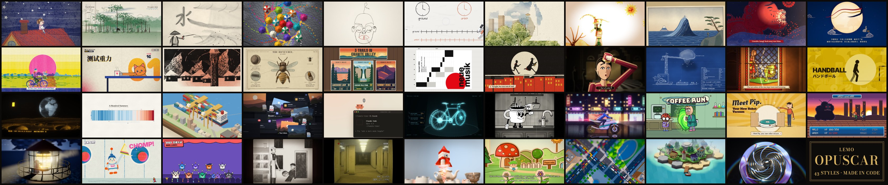
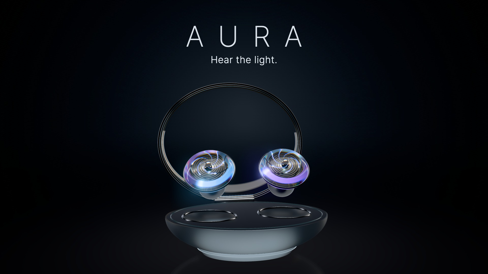
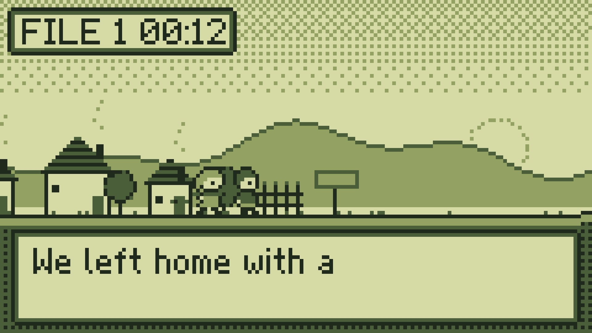

# Inside Lemo-Opuscar: Not 43 Prompts, but a Frame-by-Frame Film Studio for Claude Code

> **Bottom line:** Lemo-Opuscar is neither a video-generation model nor a collection of style adjectives pasted into Claude. It turns 43 visual styles into executable production specifications, then organizes a coding agent around directing rules, deterministic browser rendering, a shared timeline, TTS, procedural music, sound effects, subtitles, and FFmpeg mixing. The public source and films establish that the core pipeline is real. Reproducibility is uneven across the 43 demos, however, and the green CI workflow validates the gallery release rather than rebuilding every film from source.



The user-linked [`donghaozhang/lemo-opuscar`](https://github.com/donghaozhang/lemo-opuscar) is a synchronized fork of [`lemomo-ai/lemo-opuscar`](https://github.com/lemomo-ai/lemo-opuscar), not an independent implementation. This audit pins both to commit [`227e00a`](https://github.com/lemomo-ai/lemo-opuscar/tree/227e00adfbbec1ef4b7065a4189c2e1c8be2fef4), dated October 12, 2026.

It would be easy to dismiss the project as “43 style prompts and some Claude Opus 5.5 marketing films.” The more useful question is how it turns aesthetic language into a system an agent can execute, inspect, and deliver repeatedly.

---

## 01 | It is not a video model: the picture is a function of time

Lemo-Opuscar does not call a text-to-video model or assemble stock footage. Each film is a web page that exposes a small rendering contract:

```js
window.DUR = 54.2;
window.render = (t) => { /* draw the exact frame at time t */ };
window.READY = true;
window.EV = [{ t, type }];
```

Headless Chromium calls `render(t)` at every frame, captures Canvas 2D, Three.js, or WebGL2 output, and encodes the frames into video. The default is 1920×1080 at 24 fps; the same renderer accepts `--size` for vertical and other formats.

This differs fundamentally from diffusion-based video generation:

| Video model | Lemo-Opuscar |
|---|---|
| Samples pixels and motion from a prompt | The agent writes deterministic scene and animation code |
| Exact reproduction is difficult | Any time point can be rendered independently |
| A revision often means regenerating a segment | Objects, shots, timing, or isolated intervals can be edited |
| Continuity lives in hidden model state | Continuity lives in character rigs, scenes, and timelines |
| Sound is usually a separate generation pass | Picture, sound, and subtitles share events and musical beats |

The cost moves rather than disappears. There is no “generate a few clips and pick one” shortcut. The agent must write the drawing, animation, camera, score, and mix, shifting production time and token use toward software engineering.

---

## 02 | A `STYLE.md` is a production contract, not an adjective list


Every `styles/<slug>/STYLE.md` breaks a style across the same decision surface:

- what the medium is and is not;
- materials, rendering, colour, and typography;
- motion quality, camera grammar, and sound palette;
- native moves that only this medium should perform;
- recurring failure modes and implementation notes;
- story, character, opening, and ending choices that must remain project-specific.

Chinese Ink Wash, for example, does not stop at “black ink on rice paper.” Its specification defines five ink densities, wet and dry layers, flying white, negative-space ratios, depth rules for landscape, character animation on twos, ink-bloom transitions, and a relationship between guqin, xiao, drums, and paper-like foley. The style becomes inspectable rather than impressionistic.



The 43 production styles span painting, printmaking, typography, data stories, animation, games, and 3D product work. All 43 audited directories contain a `STYLE.md`, `DEMO.md`, `style.json`, poster, and demo source, totaling 1,267 demo files. This is an executable design system with reference implementations, not merely a catalog of names.

---

## 03 | Demos prove the grammar, but the workflow tries to prevent copying

Prompt libraries often describe attractive outcomes without demonstrating that an agent can actually produce them. Lemo-Opuscar pairs every formal style with a completed short film and publishes its picture code, events, subtitles, score, and asset credits.

It also imposes a meaningful order of operations:

1. The agent proposes three structures for the user's topic.
2. It writes an original `TREATMENT.md`, shot list, beat sheet, and sound design.
3. It proves the look with real drawing code.
4. Only then may it open the demo to learn a brush, rig, shader, or mixing technique.
5. Before delivery, the new film is compared with the demo; at least four of structure, opening, signature shot, camera path, score shape, and ending must differ.

That is not an automatic legal guarantee of originality, but it makes “do not copy the demo” an ordered production rule. The demo proves the technique; the new project must rebuild its subject, narrative, staging, and shots.

---

## 04 | The complete system is about sound and rhythm, not only rendering

The project defines film production around one shared timeline:

```text
timeline
  ├─ picture: render(t) → Chromium → frames → video
  ├─ voice: TTS/recording → ASR check → word timings
  ├─ music: samples + synthesis → stems
  ├─ sound: procedural foley at event times
  └─ subtitles: SRT + burned-in captions
mix → FFmpeg two-pass loudnorm → final MP4
```

`DIRECTOR.md` ranks judgment in the order **sound, rhythm, camera, directing**; attractive frames are only the starting point. The agent writes a cue map first, placing cuts, actions, captions, and musical hits on one beat grid. Every visible action should have foley. The final mix targets roughly −14 LUFS and goes through two-pass loudness normalization with a true-peak ceiling.

Voice is not accepted merely because a file was generated. English can use local Kokoro, while Chinese can use online edge-tts; faster-whisper then transcribes each line back for comparison. Captions are exported as `.srt` and burned into the picture as part of the style. The review guidance also covers black frames, reading duration, 0.2-second action strips, and final loudness.

Lemo-Opuscar is therefore closer to a production harness than a renderer. It tells the agent how a film should be heard, understood, and accepted, not only how it should look.

---

## 05 | The skill is an entry point into the studio, not the engine itself

The Claude Code plugin's `SKILL.md` is deliberately short. It:

1. clones or updates the shared library under `~/lemo-opuscar`;
2. installs core, voice, and music dependencies in tiers;
3. hands control to `AGENTS.md`, `DIRECTOR.md`, `TECHNIQUE.md`, and the selected `STYLE.md`.

This is not simply a Remotion skill. Remotion supplies a React video framework; Lemo-Opuscar uses its own Playwright/Chromium, Canvas, Three.js, WebGL, and FFmpeg stack, then adds a style library, directing method, audio tools, and delivery contract around it.

Nor is it a new agent. Claude Code or another coding agent still has to interpret the topic, direct the story, write the implementation, fix rendering failures, and exercise aesthetic judgment. The repository gives those decisions an order, a toolchain, examples, and a defined handoff.

---

## 06 | What I independently verified

I checked out commit `227e00a` on an Apple M4 Pro Mac and installed only the core dependencies, without voice models or instrument libraries:

| Check | Result | Evidence boundary |
|---|---|---|
| 43-style directory audit | 43/43 include specification, demo notes, metadata, poster, and demo directory | Establishes that the library is more than a README list |
| `styleboard/build.py --site` | Succeeded; reported 43 styles, 43 with film, roughly 44 minutes total | Rebuilds the catalog, poster, and gallery structure |
| Core setup | Node and Python core dependencies installed successfully | Excludes voice and music expansion models and packs |
| `pixel-rpg` stills | Frames at 1.5 and 12 seconds rendered successfully | Executes a demo page through the public browser renderer |
| Complete `pixel-rpg` picture render | 54.5 seconds, 1920×1080, 24 fps, 1,308 H.264 frames, finished in about 17 seconds | Validates the picture-rendering loop, not a rebuild of the final audio mix |
| Event export | 151 events across 54.5 seconds | Confirms that page events can be exported from the shared timeline |



Two negative results matter just as much:

- `pixel-rpg` does not implement the newer `window.TEXTS(t)` contract, so `readcheck.mjs` explicitly returned **NOT CHECKED**. This was not a readability pass.
- `ink-wash` requested real TTF files that are not included in the repository, and its still render stopped on a font/network error. The repository keeps OFL notices, while `TECHNIQUE.md` tells users to download the fonts themselves.

The latest upstream [GitHub Pages workflow](https://github.com/lemomo-ai/lemo-opuscar/actions/runs/38245847827) is green, but it builds the gallery, downloads 720p release MP4s, and verifies links. It does not rerender all 43 demos from source. Green CI establishes a complete published site, not universal one-command film reproducibility.

---

## 07 | The 43 styles and OPUSCAR 98 operate at different granularity


Two numbers appear prominently on the project page:

- **43 styles** are the formal production library. Each has a complete `STYLE.md`, demo, poster, metadata, and source project.
- **OPUSCAR 98** is a 6:31 film in which one Clawd passes through all 98 Best Picture winners from 1927 to 2025, with a separate visual treatment for each. Its public stylebook provides a 2D/2.5D/3D label, frame, reusable prompt, and shot-direction notes for every segment: 77 are 2D, four are 2.5D, and 17 are 3D.

Those 98 records are genuinely public style and directing material, but they are not 98 additional full skill packages with separate reusable engines, demos, and QA contracts. The clean interpretation is that the 43 are reusable production templates, while the 98 are film-specific style studies and directing notes exposed from a long-form showcase.

---

## 08 | Its strengths are inseparable from its limits

The important advance is not that Claude can write animation code. Lemo-Opuscar packages one-off experience into four reusable layers:

1. **Style grammar:** colour, material, camera, sound, native moves, and failure modes.
2. **Directing discipline:** brief, treatment, style frames, optional storyboard, production, and final review.
3. **Execution tools:** deterministic frame rendering, event export, voice, music, foley, captions, and mixing.
4. **Proof:** 43 films, source projects, posters, credits, and a public gallery.

That gives “make a film with an agent” more structure than a long prompt. Its boundaries remain important:

- it targets new film production, not editing or converting existing videos;
- styles are tuned for Claude Opus 5.5, with no guarantee that other models reproduce the same quality;
- the reported 30–60 minute production time and film quality are project experience, not an independent benchmark;
- complex 3D, voice, instruments, and fonts still require downloads, GPU capacity, or network access;
- QA works only when a project implements the contract and actually runs the checks;
- the MIT licence covers project code, while third-party fonts, sound, and demo assets retain their own terms, and users remain responsible for their material.

The fairest conclusion is: **Lemo-Opuscar is not another model competing with video generators. It is a production system joining a coding agent, executable style specifications, and frame-by-frame browser rendering. Its advantage is editability, determinism, and a complete sound workflow; its cost is more code, dependencies, tokens, and human review.**

---

## Primary sources

- [The user-linked `donghaozhang/lemo-opuscar` fork](https://github.com/donghaozhang/lemo-opuscar)
- [Official upstream `lemomo-ai/lemo-opuscar`](https://github.com/lemomo-ai/lemo-opuscar)
- [Audited commit `227e00a`](https://github.com/lemomo-ai/lemo-opuscar/tree/227e00adfbbec1ef4b7065a4189c2e1c8be2fef4)
- [Online style and film gallery](https://lemomo-ai.github.io/lemo-opuscar/)
- [`AGENTS.md`: the agent workflow](https://github.com/lemomo-ai/lemo-opuscar/blob/227e00adfbbec1ef4b7065a4189c2e1c8be2fef4/AGENTS.md)
- [`DIRECTOR.md`: directing and delivery criteria](https://github.com/lemomo-ai/lemo-opuscar/blob/227e00adfbbec1ef4b7065a4189c2e1c8be2fef4/DIRECTOR.md)
- [`TECHNIQUE.md`: rendering, sound, and QA](https://github.com/lemomo-ai/lemo-opuscar/blob/227e00adfbbec1ef4b7065a4189c2e1c8be2fef4/TECHNIQUE.md)
- [Claude Code skill entry point](https://github.com/lemomo-ai/lemo-opuscar/blob/227e00adfbbec1ef4b7065a4189c2e1c8be2fef4/plugin/skills/lemo-opuscar/SKILL.md)
- [OPUSCAR 98 stylebook](https://lemomo-ai.github.io/lemo-opuscar/opuscar98)

*Audited on October 12, 2026. Stars, forks, release downloads, and code will continue to change; technical conclusions are pinned to commit `227e00a`. Claims about Claude Opus 5.5, production time, and how the demo films were made are treated as project-reported. The independently reproduced scope is limited to the directory audit, gallery build, stills, event export, and picture-only video listed above.*
