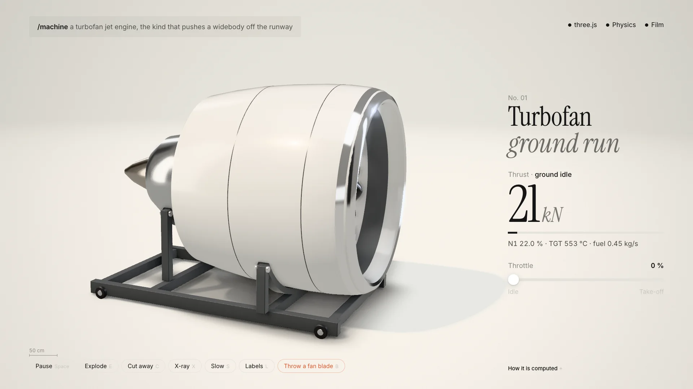
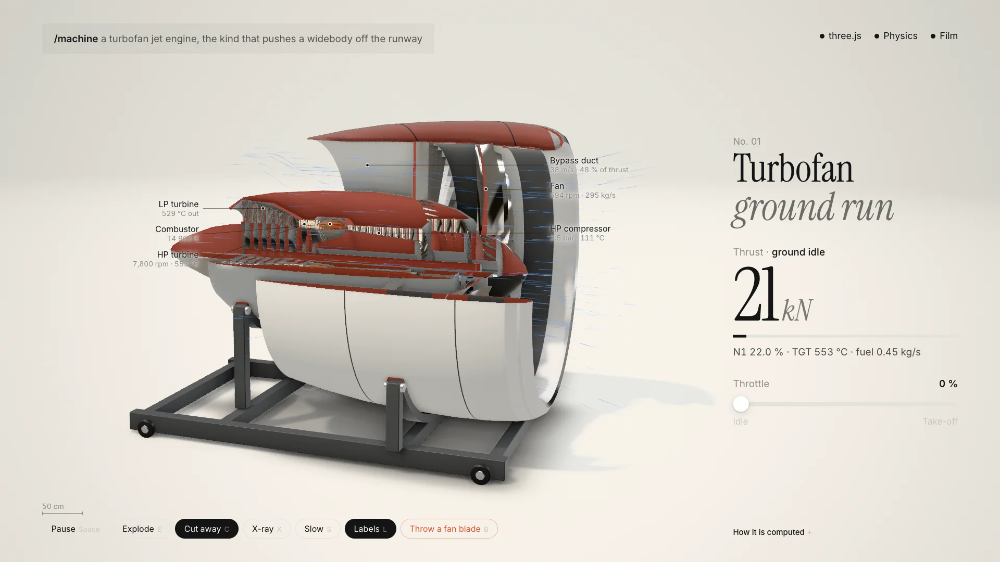
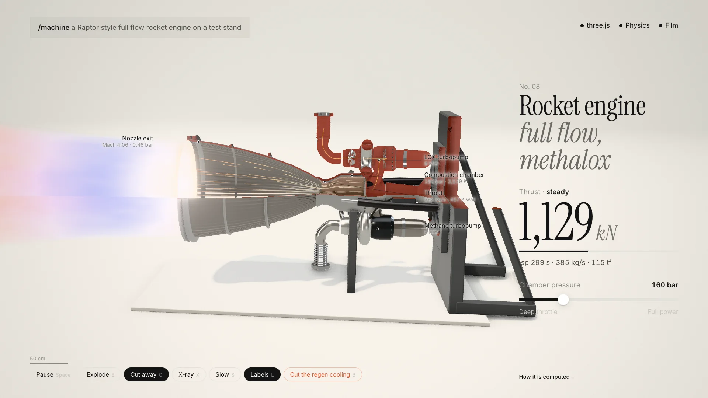
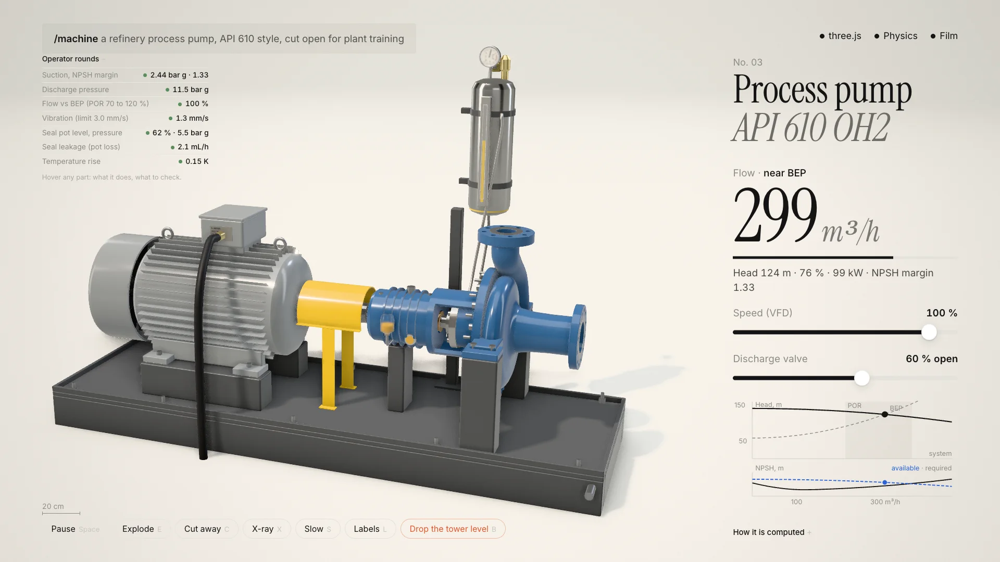

# Machine Skill 源码审计：它不是 3D 生图，而是把机械仿真、剖切讲解与成片合成一个 HTML

> **结论先行：** [Machine Skill](https://github.com/AirsupHQ/machine-skill) 不是文生 3D 模型，也不是给 Claude Code 加一句“画得像工程图”的 Prompt。它是一套可执行的 Agent Skill：先研究真实尺寸和工作点，再用程序化 Three.js 几何搭机器，用一个小型物理求解器驱动转速、推力、流量、温度与故障，最后把同一页面变成可交互剖切图和确定性短片。它最值得学的不是“输入一句话”，而是让**几何、物理、讲解 UI 和发布视频共享同一份可运行源码**。



- **来源帖：** [Konstantin Saifoulline on X](https://x.com/konstantinsaifo/status/2109782163591721100)
- **官方仓库：** [AirsupHQ/machine-skill](https://github.com/AirsupHQ/machine-skill)
- **在线实验室：** [Airsup Machine Skill Lab](https://airsup.ai/lab/skill)
- **固定审计提交：** [`e0bd066`](https://github.com/AirsupHQ/machine-skill/tree/e0bd066ac5beaf48512935de2fc0f0e55636853a)
- **来源发布时间：** 2026-10-12
- **审计时间：** 2026-10-15

## 一句话到底生成了什么

来源帖给出的安装方式很简单：

```sh
npx skills add AirsupHQ/machine-skill -g -a claude-code
```

随后用户可以要求 Claude Code 生成涡扇、机械表、心室辅助泵或水轮机。真正的输出不是一张图片，而是两类制品：

1. 一个机器专属的 HTML 页面，可旋转、调节、剖切、爆炸、X-ray、慢放、加标签并触发故障；
2. 一条由该页面逐帧录制的 20–30 秒视频，可输出横屏、方形或竖屏。

官方仓库目前附带四个完整示例：涡扇发动机、甲烷火箭发动机、API 610 工艺泵和 API 617 多级离心压缩机。在线版本与固定提交中的四个 HTML 在本文核查时 SHA-256 完全一致，因此画廊展示的不是另一套不可见的服务端结果，而是仓库中可以直接检查的页面。

## 它不只是一份 Skill，而是五层小型制作系统

仓库只有约 19MB，但关键层级很清楚。

| 层 | 主要文件 | 作用 |
|---|---|---|
| Agent 规程 | `SKILL.md` | 规定研究、建模、求解、四轮视觉复核和交付标准 |
| 页面运行时 | `kit/lab-kit.js` | 约 1,500 行 Three.js 工具，提供工作室灯光、材质、几何、剖切、爆炸与时间线 |
| 物理配方 | `references/solvers.md` | 提供燃气轮机、火箭、活塞机、手表、泵、转子和电机等简化方程 |
| 机器实现 | `examples/*.html` | 每台机器自己的尺寸、零件、求解器、交互与故障逻辑 |
| 质检与成片 | `scripts/shot.mjs`、`record.mjs`、`pinkscan.mjs` | 截图复核、逐帧录制、粉屏检测与视频输出 |

所以 Claude 不是在一个固定 3D 模型里换名字。它要为每台机器写一段新的“机器程序”：定义真实比例、部件、材质、状态量、方程、控制输入和故障条件，再接到共享运行时上。

## 第一层突破：几何不是装饰，而是计算输入

Machine Skill 要求所有尺寸在机器坐标中使用米。旋转体、壳体、管路、齿轮、弹簧、螺栓和叶片由程序化几何生成；重复叶片、齿和紧固件会被计入部件数。

这套几何不只是为了画面：

- 风扇迎风环面积会进入空气质量流量计算；
- 叶片体积乘以钛密度和中空系数，得到飞脱叶片质量；
- 叶片质心半径、转速和质量共同算出不平衡载荷；
- 火箭喷管的喉部与出口面积决定面积比、出口马赫数和推力系数；
- 切面 shader 使用闭合实体的背面绘制金属断面与剖面纹理。

这让“看起来像发动机”和“页面里的数字来自这台可见模型”发生了联系。它仍然不是 CAD，但比把几个常数硬填进仪表盘更诚实。



## 第二层突破：每台机器都有一个小而透明的求解器

官方没有假装在浏览器里运行 CFD 或 FEA。它采用的是 0D 或集中参数模型，把最重要的一组因果关系跑起来。

### 涡扇：Brayton 循环驱动一切

涡扇示例从静态海平面 ISA 状态开始，按 N1 计算进口马赫数、质量流量、涵道比、风扇压比、总压比和涡轮前温度。压气机升温、燃油空气比、涡轮功平衡与两个喷口速度最终产生推力；转子用一阶滞后来模拟加速和减速。

页面显示的推力、N1、涡轮燃气温度和燃油流量来自该求解器。触发“甩掉一片风扇叶片”后，页面用几何估算叶片质量，再通过 `F = mω²r` 计算不平衡载荷，并让发动机振动和减速。

### 火箭：喷管解决定推力，热模型决定烧穿

火箭示例使用甲烷/液氧混合物的燃烧室近似、特征速度、喉部质量流量、等熵面积比和推力系数。用户调节燃烧室压力，页面实时给出推力、比冲、质量流量、出口马赫数与涡轮泵功率。

“切断再生冷却”也不是只播放一段红光动画：铜衬里的热容量和热流让壁温随时间上升，到达 1,356K 后触发烧穿和关机。这个热模型很粗，但因果链可以在代码中追溯。



## 第三层突破：同一个状态同时服务交互教学与短片

普通 3D 演示往往有两套工程：一套给网页交互，一套进 Blender、After Effects 或 Remotion 做视频。Machine Skill 则给页面加一个确定性电影时钟。

在 `?film=1` 模式下，页面只有在录制器调用 `step(1/fps)` 时才前进。`record.mjs` 逐帧等待 WebGL 完成，再把 PNG 流交给 FFmpeg。默认 28 秒叙事固定为：

1. 打出一句机器需求；
2. 零件按装配顺序飞入；
3. 拖动控制量，让求解器开始工作；
4. 剖开机器并显示实时标签；
5. 爆炸分解；
6. 触发一个由求解器决定的故障。

这不是传统意义上的视频剪辑器，而是**可交互仿真的导演模式**。同一状态机决定屏幕读数、部件运动、镜头事件和故障结果，因此页面更新后可以重新录制，不必手工同步视频文案。

项目还专门处理无头 Chromium 在 GPU 压力下偶发的纯洋红帧：截图 guard 会重试，`pinkscan.mjs` 则把成片缩小后扫描高比例粉色或突然出现的洋红闪帧。这个细节很小，却说明作者真正用它生产过视频，而不是只写了一个录屏命令。

## 工艺泵展示了它不只是社交媒体玩具

1.1.0 增加了炼厂培训示例。API 610 泵页面不只显示漂亮的蓝色泵体，还把泵曲线、系统曲线、BEP、NPSH available/required、密封泄漏、振动与操作员巡检表放进同一个状态里。用户改变 VFD 速度和出口阀开度，运行点与指标随之变化；降低塔位会让模型进入汽蚀状态。



这指出了比“发一条炫酷视频”更实际的方向：设备培训、维护讲解、方案评审和销售工程。它不能取代高保真数字孪生，但可以把一本静态手册变成能够操纵、拆开和故障演练的浏览器解释器。

## 它与 Anatomy 的关系：同源灵感，两种目标

仓库明确感谢 [Anatomy](https://github.com/wheresryan22/anatomy)，并说明编号式短片受到其启发。两者都把 Agent Skill、程序化几何、浏览器渲染和视觉复核组合起来，但重心不同。

| | Anatomy | Machine Skill |
|---|---|---|
| 主要对象 | 把抽象概念发明成可解释的物理机器 | 重建现实中已有的机器与工作点 |
| 主要输出 | SVG/WebGL/实验性 3D 技术视觉 | Three.js 交互仿真 + 自动短片 |
| 核心约束 | 语义隐喻、几何账本、碰撞/端点/深度审计 | 真实尺寸、程序化实体、小型物理求解器、产品摄影质感 |
| 验证强项 | 自动几何和浏览器交互审计更完整 | 截图复核、性能统计、确定性录屏与粉屏检测 |
| 当前弱点 | 复杂作品制作慢，3D 仍是 beta | 缺少同等级的自动几何测试和跨机器数值回归 |

可以把 Anatomy 理解为“如何让结构承担解释”，把 Machine Skill 理解为“如何让一台真实机器的结构、数值和镜头共用一个运行时”。后者不是替代前者，而是沿着机械工程和发布成片方向做了更专门的产品化。

## 本次实际验证

本文在 Apple Silicon Mac 上检出固定提交，安装仓库声明的 Playwright 依赖，并使用项目自己的 `shot.mjs` 和 `record.mjs` 实跑官方示例。

| 检查 | 本次结果 | 证据边界 |
|---|---|---|
| 涡扇默认与剖切截图 | 3,597 parts、644,188 triangles、21 materials、约 61fps | 项目脚本在本机一次运行的报告，不是跨设备基准 |
| 火箭剖切截图 | 57 parts、118,920 triangles、26 materials、约 61fps | 只验证官方示例能加载和交互状态能切换 |
| 工艺泵截图 | 281 parts、377,094 triangles、39 materials、约 61fps | 未校准数值到真实 API 610 设备 |
| 在线画廊一致性 | 四个线上 HTML 与固定提交中的示例 SHA-256 一致 | 证明核查时部署与仓库示例一致 |
| 确定性录制 | 生成 960×540、15fps、2秒 H.264；完整解码通过 | 只做短片段管线验证，不代表整条 28 秒成片质量 |
| 粉屏扫描 | `pinkscan clean` | 只覆盖本次两秒输出 |

## 三个不能被“real”掩盖的边界

### 1. 这是真方程，但不是工程认证

README 自己写得很清楚：求解器是 small honest model，不是 CFD 或 FEA；数字只与公开工作点做 sanity check，不是认证数据。涡扇的 0D 循环无法描述叶片级流场，火箭集中热模型也不能代替冷却通道与结构热应力分析。

因此它适合解释“输入变化为什么导致这个结果”，不适合据此设计能飞、能承压或能植入人体的设备。

### 2. 一个 HTML 文件不等于完全离线

项目会把自己的 `lab-kit.js` 内联进输出，但页面仍从 jsDelivr 加载 Three.js 0.170 和 addons，从 Google Fonts 取字体，并可从 Poly Haven 拉 HDRI。它是“单文件交付、无需构建”，不是“把全部依赖封进一个离线文件”。长期归档或内网使用仍需把外部依赖本地化。

### 3. QA 更像制作规程，还不是测试系统

Skill 要求至少四轮截图复核，`shot.mjs` 会报告帧率、部件数和三角面数，录制器也有实用 guard；但仓库没有 GitHub Actions，也没有自动测试命令。`evals/evals.json` 目前是五条 Prompt 和期望输出描述，不会自动验证生成物的几何、方程或数值。

截至审计时，上游还有一个关于零长度法线导致 NaN 与 bloom 黑块的开放 issue，以及 Windows ANGLE、resize offset 和 OpenCode 支持的开放 PR。这些并不否定官方示例，却说明项目仍处于很早的工程阶段。

## 对 AI 创作工具真正有启发的地方

Machine Skill 让一个常被分散处理的流程收敛到同一份“可执行说明书”：

- 研究材料写进源码注释和可见的 How it is computed；
- 几何既负责外观，也提供面积、体积和质心；
- 求解器同时驱动数字、颜色、运动与故障；
- 交互状态直接成为镜头事件；
- 发布视频由页面确定性重演，而不是另做一份时间线。

这对教学可视化、工业销售、设备培训和技术内容生产都很有价值。它减少的不是所有建模工作，而是**同一知识在 CAD 示意、网页交互、讲解文案和短视频之间反复重做的成本**。

## 结论

Machine Skill 最强的地方不是 Claude 能凭一句话画出一个像发动机的东西。真正的产品是一个严格的输出契约：机器必须有真实比例、可辨认部件、材料差异、一个能解释主指标的小型求解器、一个由计算触发的故障，以及一条可以重复录制的视觉叙事。

它比普通 Three.js Prompt 多出了共享运行时、机械几何、物理配方、批评轮次和成片管线；比专业 CAD/CAE 又轻得多，也不追求制造级精度。

**最准确的定位，是一间给 Coding Agent 使用的浏览器机械演示工作室：把机器做成可运行的解释，再从这份解释直接拍成片。**

## 主要来源

- [来源帖 - X](https://x.com/konstantinsaifo/status/2109782163591721100)
- [AirsupHQ/machine-skill](https://github.com/AirsupHQ/machine-skill)
- [固定审计提交 `e0bd066`](https://github.com/AirsupHQ/machine-skill/tree/e0bd066ac5beaf48512935de2fc0f0e55636853a)
- [Machine Skill Agent instructions](https://github.com/AirsupHQ/machine-skill/blob/e0bd066ac5beaf48512935de2fc0f0e55636853a/SKILL.md)
- [Shared Three.js runtime](https://github.com/AirsupHQ/machine-skill/blob/e0bd066ac5beaf48512935de2fc0f0e55636853a/kit/lab-kit.js)
- [Solver recipes](https://github.com/AirsupHQ/machine-skill/blob/e0bd066ac5beaf48512935de2fc0f0e55636853a/references/solvers.md)
- [Deterministic recorder](https://github.com/AirsupHQ/machine-skill/blob/e0bd066ac5beaf48512935de2fc0f0e55636853a/scripts/record.mjs)
- [Live Machine Skill Lab](https://airsup.ai/lab/skill)
- [Open rendering issue #4](https://github.com/AirsupHQ/machine-skill/issues/4)
- [Anatomy](https://github.com/wheresryan22/anatomy)

*本文审计固定到提交 `e0bd066ac5beaf48512935de2fc0f0e55636853a`。四张图片均由本文在本机运行该提交的官方示例后截取，不是生成式宣传图。帧率和统计仅代表这台机器与本次运行；物理模型没有经过独立工程校准，不能用于安全关键设计或认证。*
