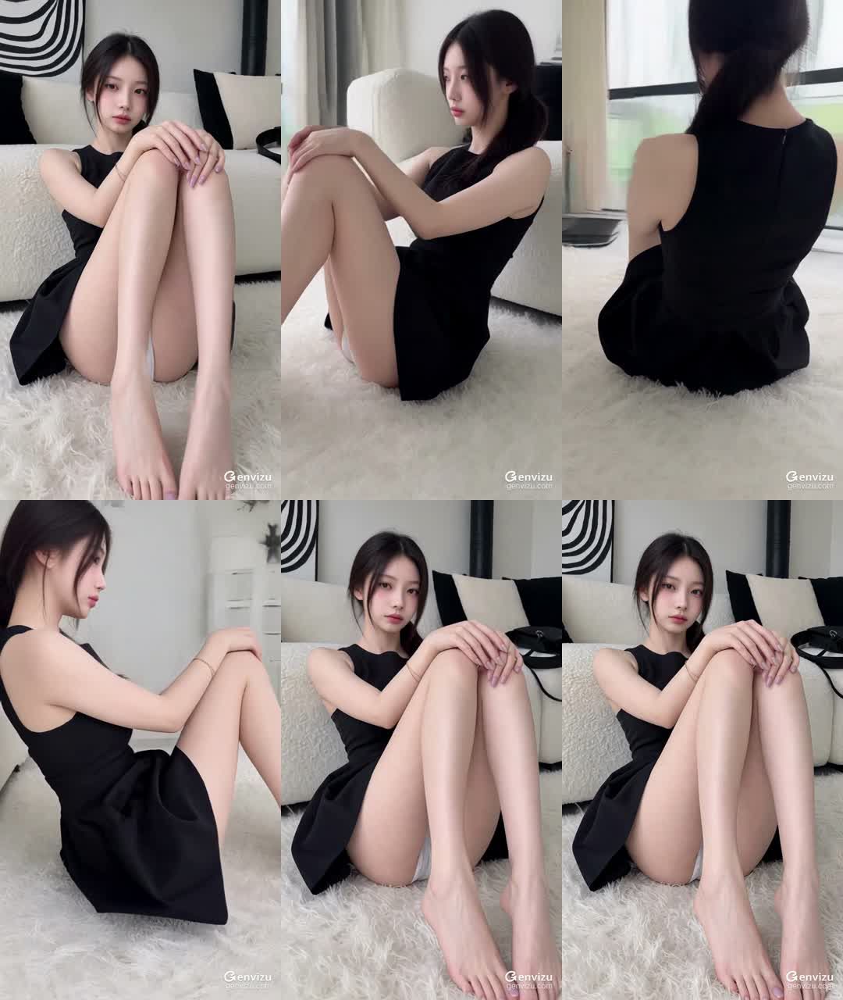
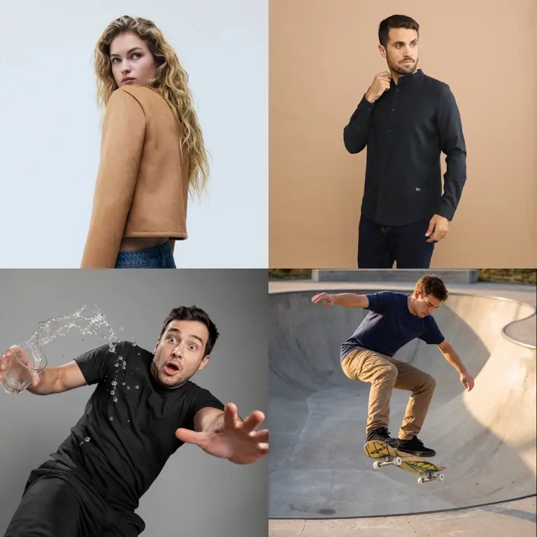
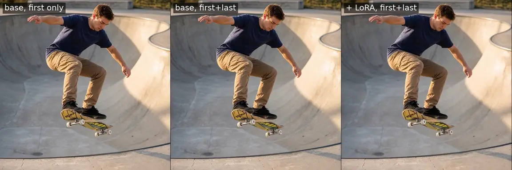
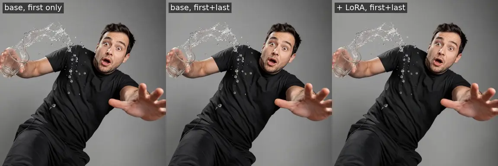

# MiniMax H3 360° Orbit LoRA 拆解：28 条 3D 轨迹，如何把“环绕运镜”压进 155 MB 权重

> **结论先行：** `MiniMax-H3-360-Orbit-LoRA` 不是新的 3D 重建模型，也不是一条更长的运镜提示词。它把 28 条由静态 Gaussian Splat 渲染的环绕视频训练成一个 rank-16 LoRA，再借助 MiniMax H3 的首尾帧模式，把同一张图片同时钉在第 1 帧和最后一帧。结果是：场景尽量冻结、相机完成一圈运动，并回到接近起点的画面。真正值得关注的，是 LoRA 开始封装的不只是画风和人物，而是一段可复用的电影镜头语法。

2026 年 10 月 12 日（UTC），[huangserva 的转发帖](https://x.com/servasyy_ai/status/2109659653827342479)把一段单图 360° 环绕视频带入中文 AI 视频圈，并直接指向 Pablo Dawson 发布的 [MiniMax H3 360° Orbit LoRA](https://huggingface.co/pablodawson/MiniMax-H3-360-Orbit-LoRA)。被转发的[原始演示](https://x.com/listudio/status/2109558699668963636)来自 leolee：一张人物照片被扩展成约 3 秒的环绕镜头，最后回到正面。

这段视频很抓眼球，但“从一张照片看到人物背面”也最容易造成误解。它没有从照片里恢复出真实背面，更不是先建立精确 3D 模型再转动相机；模型是在训练到的几何先验中，**为不可见区域生成一个看起来连续的答案**。

---

## 01 | 它解决的是首尾帧模式里的一个矛盾

MiniMax H3 的 `FL2VA` 变体支持首帧与尾帧条件。若只给首帧，基础模型可以生成相机运动，但终点不可控，画面常常漂离起始构图；若把同一张图片同时放在首帧和尾帧，两个端点虽然被固定，基础模型又容易把任务理解成“整段保持静止”。

这个 LoRA 学习的是两种约束之间缺失的轨迹：

1. 第 1 帧与最后一帧使用同一张图片；
2. 中间帧必须完成一圈连续环绕；
3. 人物、衣服、液体与背景尽量保持冻结；
4. 视差成为画面唯一显著运动；
5. 终点重新靠近起始视角，便于循环或拼接。

换句话说，首尾帧负责**锚定边界**，LoRA 负责**填入一条有意义的相机路径**。单靠提示词很难稳定解决这个冲突，因为提示词只表达意图，并没有给模型反复展示“同一张首尾帧之间应该怎样绕一圈”。

---

## 02 | 28 条训练视频为什么也能学会一个镜头动作

训练集小得惊人：只有 28 条人物为主的正方形视频，每条 768×768、73 帧、24 fps。它们不是普通真人视频，而是从人工筛选的 **Gaussian Splat 静态 3D 场景**中渲染出来的环绕轨迹。

这让数据具备一个普通视频很难保证的性质：

- 三维场景从头到尾不发生动作；
- 相机轨迹可以严格控制；
- 每一帧的几何关系来自同一个场景；
- 训练信号几乎只包含“相机移动”，而不混入表情、肢体或物体运动。

因此，28 条视频并不是在教模型认识世界，而是在给已经拥有大量视觉先验的 H3 注入一个非常窄的运动方向。LoRA 只需学会“哪些注意力与前馈层的变化会把首尾锚点连接成环绕轨迹”，不需要重新训练整套视频生成能力。

这次训练的公开参数包括：

| 项目 | 数值 |
|---|---:|
| LoRA 文件 | 155,111,424 字节（约 155 MB） |
| Rank / Alpha | 16 / 16 |
| 覆盖模块 | 208 个 Transformer 线性模块，不含 `adaln_proj` |
| 训练步数 | 3,000，约 107 个 epoch |
| 优化器 | AdamW 8-bit，学习率 `1e-4` |
| 精度 | BF16，gradient checkpointing |
| 训练硬件 | 1 × NVIDIA A100 80 GB |
| 训练时间 | 10 小时 24 分钟 |

小数据在这里不是自动等于低质量，而是说明任务被刻意压缩成了一个单一、干净、可重复的视觉操作。不过，这种成功也不能外推成“28 条视频足以训练任意视频 LoRA”：环绕、冻结与回到起点比角色表演、物理交互或复杂叙事窄得多。

---

## 03 | 官方对比真正证明了什么

模型卡用同一输入、随机种子、提示词、分辨率和步数比较三种方案：

| 方案 | 典型结果 |
|---|---|
| 基础模型，只给首帧 | 相机会移动，但容易漂移，无法回到起点 |
| 基础模型，相同首尾帧 | 端点稳定，但中间几乎不动 |
| 基础模型 + LoRA，相同首尾帧 | 出现完整环绕，并重新接近起始画面 |

最关键的提升不是单帧美感，而是**时间结构变得可预测**：从起点出发、经过背面、回到起点。对于剪辑来说，这比“每次随机生成一个漂亮运动”更有价值，因为它可以作为循环镜头、转场段、产品展示或 bullet-time 风格片段的固定积木。

水花样片也说明了这个训练思路的优势：输入本身带有强烈动作感，但目标要求水、手、身体和表情都停留在同一个瞬间。训练数据来自静态 3D 场景，因此模型得到的是“动作冻结、相机继续”的明确监督。

---

## 04 | “回到完全相同的帧”并不是逐像素事实

模型卡使用了“lands back on the exact frame”这样的表述。公开 Space 的维护者进一步测得，默认输出首尾帧的平均绝对像素差为 2.48，而首帧与中间环绕帧的差值为 82.95。这证明闭环行为显著存在，但也说明首尾不是无损复制。

为了检查社交媒体演示是否符合这一点，我解码了四个官方 LoRA MP4 和 X 演示视频，并直接比较第 1 帧与最终帧：

| 文件 | 首尾帧 SSIM（整体） |
|---|---:|
| 官方 `girl2` | 0.959 |
| 官方 `man2` | 0.969 |
| 官方 `man` | 0.987 |
| 官方 `skate` | 0.956 |
| X 转发所用演示 | 0.930 |

`1.000` 才代表解码后的像素完全一致。这组结果支持“视觉上重新落回原构图”，但不支持把它写成逐像素相同或绝对无缝。视频压缩会制造一部分差异，生成过程中的脸部、纹理和背景漂移也仍然存在。

这次检查是**公开成片审计**，不是在本地重新运行模型，因此它能验证交付视频的闭环程度，不能证明任意输入都能达到同样稳定性。

---

## 05 | 155 MB LoRA 不等于 155 MB 就能跑

适配器本身很小，但它依附的是 MiniMax H3。官方 H3 是一个 33B 参数的稠密单流 Transformer，并使用 Qwen3-VL-32B 作为编码器。LoRA 的公开 Space 文档称，完整 BF16 模型约 195.9 GiB，超过 ZeroGPU Space 的 150 GB 存储上限，因此部署被拆成两半：

- 当前 Space 运行约 40.24 GB 的 AdaLN-pruned Transformer 分区和两个 VAE；
- 约 62.14 GiB 的 Qwen3-VL conditioner 在另一个 Space 生成条件嵌入；
- 每次请求需要两次 GPU 配额；
- 默认 768×768、73 帧任务实测约 107–139 秒完成。

这意味着下载 155 MB LoRA 只是最后一步。真正本地运行还需要 H3 的 FL2VA 基础权重、文本编码器、VAE、兼容推理栈和足够显存。ComfyUI 社区提供了 pruned 与 int8 ConvRot 重打包版本，但“有量化权重”仍不等于普通笔记本可以轻松实时生成。

最省事的试用入口是作者提供的 [Hugging Face Space](https://huggingface.co/spaces/pablodawson/minimax-h3-360-orbit)：上传一张图片即可使用预设工作流。它提供的默认配方是：

| 设置 | 推荐值 |
|---|---:|
| 首帧 / 尾帧 | 同一张图片 |
| 分辨率 | 768 × 768 |
| 帧数 | 73（24 fps，约 3.04 秒） |
| 采样步数 | 28 |
| LoRA 强度 | 1.0 |
| CFG / negative prompt | 不使用 |
| 音频 | 关闭 |

提示词也不是自由发挥。训练时 28 条视频使用同一段 caption，核心意思是：只有相机做连续 360° 环绕，人物与物体的位置、方向、形状、姿势、液体和背景全部冻结，不要剪切、变焦、变形或新增物体。

---

## 06 | 单图环绕的背面是“合理发明”，不是“真实看见”

Gaussian Splat 只出现在**训练数据生产**阶段。推理时用户上传的仍是一张普通二维照片，没有多视角捕捉、相机标定、深度扫描或真实 splat 文件。

因此，当镜头转到照片看不到的一侧时，模型只能根据人物类别、服装结构、发型和背景先验生成隐藏内容。它可能非常顺滑，却不能用于：

- 检查商品真实背面或结构；
- 还原人物真实发型、纹身、服装开口或配饰；
- 证明某个空间在相机外实际存在什么；
- 替代多视图摄影、NeRF、Gaussian Splatting 或摄影测量。

更准确的产品定义是：**以首图身份和构图为约束，合成一段视觉可信的环绕镜头。** 它是摄影语言生成器，不是事实恢复工具。

---

## 07 | 适用范围仍然很窄

作者明确列出两项限制：训练集只有 28 条人物中心、正方形、73 帧视频；其他主体、画幅和时长尚未验证，而且人物仍可能出现轻微眨眼或细小动作。

数据来源也需要单独标记。模型卡只说这些人物 Gaussian Splat 是从互联网人工筛选而来，没有发布逐条数据清单、原始来源、授权状态或人物同意记录。公开权重并不自动解决训练素材的权利问题，商业团队仍需自行完成数据与输出风险评估。

实际生产还应额外检查：

- **遮挡关系：**手臂、头发、衣服与背景在背面是否互相穿插；
- **身份连续性：**脸、手和服饰细节是否在 90° 与 270° 视角发生重绘；
- **背景闭合：**原图以外的房间或景观是否出现不一致结构；
- **循环接缝：**首尾附近的曝光、锐度、压缩和构图是否跳变；
- **速度曲线：**固定约 3 秒转一圈是否符合镜头节奏；
- **非人物素材：**产品、车辆、建筑和复杂反光表面是否仍然稳定。

因此，它最适合作为社交短视频、音乐视觉、时尚图、角色海报和视觉转场的快速镜头模块。若任务要求产品真实性、连续叙事或可测量三维结构，仍应使用多视图或真实 3D 流程。

---

## 08 | 权重可下载，但许可证不是宽松开源许可

LoRA 和基础模型都采用 MiniMax H3 Community License，而不是 Apache、MIT 或其他常见宽松开源许可。审计日期下，协议包括这些重要条件：

- 许可地域排除美国、欧盟、英国和韩国；
- 在排除地域部署需要另行联系 MiniMax 获取授权；
- 年收入超过 2,000 万美元的商业产品需要事先书面授权；
- 商业产品界面需要显著展示 `MiniMax H3`；
- 不得用 H3、衍生模型或输出改进其他 AI 模型；
- 公开环境中的生成内容需要清楚标识为机器生成。

所以它应被描述为**公开可下载权重**，而不是无条件开源。准备把 LoRA 集成进产品的团队，需要先检查部署地域、收入门槛、下游条款、内容标记与安全机制。本文不构成法律意见。

---

## 结语：LoRA 正在从“风格包”变成“镜头动作包”

MiniMax H3 360° Orbit LoRA 最有价值的地方，不是又生成了一段人物环绕视频，而是证明了一个更普遍的设计方向：**把边界明确的影视操作训练成小型适配器，再由基础视频模型提供世界知识与画面质量。**

以后可以被封装的未必只有 360° 环绕，还可能包括推轨、升降、甩镜、希区柯克变焦、时间冻结、角色定点转身，甚至一组可组合的镜头轨迹。对视频工具而言，这比要求用户反复碰运气写提示词更接近真正的“镜头控制层”。

但这次实验同样提醒我们：稳定镜头不等于真实几何，视觉闭环不等于像素闭环，小权重也不等于小系统。把这三层区分清楚，才是正确使用这类运镜 LoRA 的前提。

---

## 主要来源

- [huangserva 转发帖](https://x.com/servasyy_ai/status/2109659653827342479)
- [leolee 原始演示帖](https://x.com/listudio/status/2109558699668963636)
- [MiniMax H3 360° Orbit LoRA 模型卡](https://huggingface.co/pablodawson/MiniMax-H3-360-Orbit-LoRA)
- [MiniMax H3 360° Orbit LoRA 在线 Space](https://huggingface.co/spaces/pablodawson/minimax-h3-360-orbit)
- [MiniMax H3 官方模型卡](https://huggingface.co/MiniMaxAI/MiniMax-H3)
- [Comfy-Org MiniMax H3 重打包权重](https://huggingface.co/Comfy-Org/MiniMax-H3)
- [Ostris AI Toolkit](https://github.com/ostris/ai-toolkit)
- [MiniMax H3 Community License](https://huggingface.co/MiniMaxAI/MiniMax-H3/blob/main/LICENSE)

*审计日期：2026 年 10 月 15 日。下载量、Space 状态、推理时间和许可证可能继续变化。本文保存了 X 演示帧及模型卡官方对比素材；公开视频 SSIM 检查不等于重新运行模型。*
