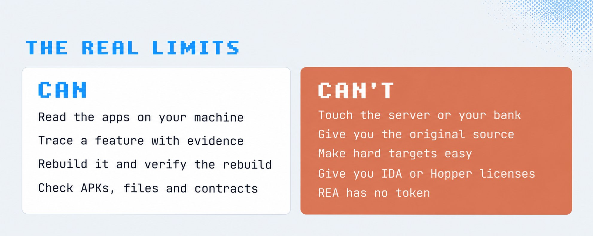

# “免费重建任何付费功能”是真的吗？审计 0xCodila 的 REA 完整教程

> **TL;DR：** 0xCodila 的教程抓住了 REA 最重要的价值：让 Agent 调用真实逆向工具，围绕 Evidence 形成“调查、写规格、独立实现、验证”的闭环。但标题里的“任何 App”“任何付费功能”“免费”都不能按字面理解。REA 能帮助理解**已经交付到本地、且允许研究的客户端行为**；它看不到未下发的服务器源码、私有模型、专有数据和网络服务，也不会免除模型费用、分析工具许可、工程时间、测试维护与法律审查。更准确的说法是：**REA 降低了从二进制行为到可验证规格的成本，却没有把商业软件变成免费源码。**

- **来源帖：** [0xCodila on X](https://x.com/0xCodila/status/2109623431763292649)
- **长文标题：** *Reverse Engineering: How to Get Anything for FREE With Most Dangerous Repo & Opus 5.5 (Full Course)*（嵌在来源帖中）
- **官方项目：** [morluto/rea](https://github.com/morluto/rea)
- **发布时间：** 2026-10-12
- **查阅时间：** 2026-10-15

## 为什么还要单独审计这篇教程

此前的[REA 源码审计](../2026-10-09/2026-10-09-rea-evidence-ledger-agentic-reverse-engineering-runtime.md)回答了“REA 到底是什么”，[三页提示词拆解](../2026-10-14/2026-10-14-rea-three-page-prompts-evidence-workflow.md)解释了“Prompt、Skill、MCP 和分析引擎怎样配合”。

这篇文章处理的是第三个问题：**一套严谨的逆向 Agent 工作流，能不能被等同于“把任何付费功能免费重建出来”？**

这不是措辞洁癖。教程把 REA 的真实能力、官方案例、外部 AI 编程项目、社交媒体演示和美国法律案例放在同一条叙事线上，很容易让读者把“能理解一个本地行为”误读成“能低成本复制整个商业产品”。两者之间至少隔着目标可见性、证据完整度、实现成本和法律边界四道门。

## 教程讲对了什么

先说结论：它不是一篇毫无价值的夸张文章。下面几部分相当扎实。

### 1. REA 不是聊天式猜代码，而是工具编排层

教程正确地把 REA 描述成 CLI、MCP、Skill 与多个分析 provider 的组合。Agent 负责制定下一步、解释结果和维护调查状态；真正读取 Electron 包、APK 或原生二进制的，是 JavaScript analyzer、JADX、Ghidra、Hopper、IDA 等工具。

这比把二进制文件直接扔给一个通用模型可靠得多，因为工具返回的函数、引用、字符串、反编译结果和运行观察可以成为可追溯证据，而不只是语言模型的印象。

### 2. “调查 → 规格 → 构建 → 验证”是正确主线

教程中最值得保留的不是“免费”，而是这条 Pro Loop：

1. 调查原始行为；
2. 把确认过的行为写成 `SPEC.md`；
3. 根据规格做独立实现；
4. 用同一组测试验证原实现与新实现。

它还强调“test your tests”：先确认测试能稳定描述目标，再拿测试去验收重建版本。这是很成熟的工程判断。否则 Agent 很容易实现一个看起来相似的页面，再用同一套主观印象宣布成功。

### 3. 教程自己其实写出了真实限制

文章后半部分承认：REA 不能触碰服务器端、不能恢复原始源码、不能让困难目标自动变简单，也不会赠送商业工具许可证或模型 Token。这些限制与 REA 官方说明是一致的。

问题在于，它们与封面和标题的承诺并不一致。若限制成立，“任何功能免费重建”就只能是传播口号，而不能是产品能力声明。

## 四个核心主张，逐项审计

| 教程主张 | 审计结论 | 更准确的表述 |
|---|---|---|
| 能逆向任何 App | **不成立** | 能在 provider、格式、权限和主机环境支持时分析部分已交付制品 |
| 能重建任何付费功能 | **不成立** | 可能独立实现部分可观察、可规格化的客户端行为 |
| 可以免费获得 | **不成立** | 可降低探索成本，但仍有模型、工具、人工、数据、测试与维护成本 |
| 叫“clean room”就合法 | **不成立** | Clean-room 是隔离、来源控制和留痕流程，不是给同一 Agent 的一句提示词 |

### “任何 App”为什么不成立

REA 的目标矩阵很广，不等于覆盖无限。真实可分析性取决于：

- 文件格式和 CPU 架构是否被当前 provider 支持；
- 代码是否混淆、加壳、剥离符号或经过完整性保护；
- 目标能否在当前主机合法运行并接受受限观察；
- 功能是否真的存在于客户端制品中；
- 许可证和使用条件是否允许分析。

即使同为 Electron，ASAR 布局、source map、native addon、版本差异、fuse 与混淆方式也会不同。“所有 Electron App 都一样”至多是入门类比，不是可复现的工程保证。

### “任何功能”为什么不成立

客户端只能泄露客户端拥有的东西。一个功能如果依赖以下任意部分，单看本地包就无法恢复完整产品：

- 服务器业务逻辑与数据库；
- 私有训练模型、推理服务或专有权重；
- 付费数据源、行情、素材版权库；
- 协作网络、反欺诈、账号信誉和运营系统；
- 长期积累的用户数据与人工流程。

这形成三个完全不同的目标层级：

| 层级 | 能回答的问题 | 难度与含义 |
|---|---|---|
| Understand | 这个客户端功能大概怎样工作？ | REA 最擅长帮助降低证据整理成本 |
| Reimplement | 能否独立实现相同行为？ | 需要规格、代码、测试、合法输入和边界处理 |
| Replace | 能否替代原商业产品？ | 还需要后端、数据、可靠性、安全、维护与产品设计 |

从第一层跨到第三层，并不是多写几个 Prompt 就能完成。

### “免费”忽略了总成本

教程中的多个案例恰好证明这不是零成本工作。高质量重建通常要支付：

- Codex、Claude 或其他模型的订阅与 Token；
- Ghidra/Hopper/IDA/JADX 等工具、许可证或安装维护；
- 工程师调查、复核、实现和测试的时间；
- 测试设备、数据、API 和持续集成；
- 上游版本变化后的再分析与维护；
- 安全、隐私和法律评估。

例如被教程引用的《Super Mario Sunshine》PC 移植公开说明使用 Claude 与 Codex，累计约 365 Agent 工时和 173 亿 Token，而且仍是进行中的工程。这证明 AI 可以放大工程吞吐，却不支持“免费、即时复制”的结论。

### “Clean Room”不是一句咒语

严格意义上的 clean-room reconstruction 是**组织流程**。常见做法是让分析人员只输出行为规格和公开接口描述，再由未接触受保护表达的独立实现人员编码，同时保存来源、传递内容和测试记录。

如果同一个 Agent 在同一上下文里读到反编译输出，随后直接生成新代码，仅把任务称为 clean room，并不会自动形成隔离。即使功能思想通常不等同于受版权保护的表达，也仍可能涉及：

- 合同与服务条款；
- 专利、商标和商业秘密；
- 技术保护措施与反规避规则；
- 隐私、账号和数据访问权限；
- 不同司法辖区的差异。

教程引用的 *Sega v. Accolade*、*Sony v. Connectix* 以及美国《版权法》17 U.S.C. §1201(f)，确实为特定事实下的互操作性研究提供重要背景，但它们不是全球通用的“付费功能克隆许可证”。§1201(f) 本身就要求合法取得副本，并把行为限定于识别与分析实现互操作性所必要、此前无法轻易获得的信息，且后续使用不得侵权。本文不是法律意见。

## “本地运行，绝不上传”也需要加限定词

REA 官方 README 的准确说法是：**目标分析在本地进行，但 Agent 会收到工具结果，而模型提供方有自己的数据政策。**

这与“你的 App 从不上传到任何地方”不是同一句话。二进制本体可能留在机器上，但函数名、字符串、反编译片段、资源元数据、运行日志或调查摘要可能进入 Agent 上下文。处理专有软件、客户数据或恶意样本时，仍需确认：

- Agent 使用本地模型还是远程 API；
- 工具结果会发送什么；
- 提供方保留、训练和审计政策是什么；
- 项目是否允许把这些内容交给第三方处理。

因此，“local analysis”是架构事实；“完全私密”则需要结合模型和组织配置逐项证明。

## 教程里的案例不能放在同一个证据等级

教程列出 Adobe、Office、TradingView 和多款游戏，看起来像 REA 已经逐一完成了商业产品重建。实际应分为四层。

| 证据层级 | 示例 | 能证明什么 | 不能证明什么 |
|---|---|---|---|
| A：REA 官方、可追踪案例 | DX-Ball、Notion、Aegis、Touhou | REA 能围绕特定版本和有限目标形成静态/运行证据与验证 | 不能外推为任何 App、任何功能 |
| B：公开 AI 辅助逆向项目 | SMS PC Port、Tomba static recompiler | Claude/Codex 与传统工具能显著扩展工程能力 | 未必使用 REA，也不代表免费或快速 |
| C：独立 AI 编程产品 | ArtCraft、WordCraft、GridCraft、DeckCraft | AI 可以协助构建相似品类的独立应用 | 没有证据表明这些产品由 REA 逆向生成 |
| D：社交媒体演示 | TradingView 风格终端 | 作者展示了一个自建界面或工作流 | 没有公开制品、测试和证据包时，无法审计功能等价性 |

### 官方案例很强，但边界都很窄

- [DX-Ball showcase](https://rea.tools/showcase/dx-ball/)展示了针对一个声音平移函数的 3,205 个行为案例和 63 个匹配编译字节；项目总计维护 55 个 C 函数，游戏整体仍在继续。
- [Notion showcase](https://rea.tools/showcase/notion/)分析的是 Notion Desktop 7.6.1 中一个聚焦的剪贴板路径，不是复制整个 Notion。
- [Aegis showcase](https://rea.tools/showcase/aegis/)从 3,077 个类缩小到 TOTP 相关方法，并用公开 RFC 案例验证。
- [Touhou reconstruction](https://rea.tools/blog/touhou-reconstruction/)报告了一个范围很大的重建结果，但仍是特定版本、特定项目与官方自述，不能自动代表其他商业软件。

这些案例的价值正来自它们写清版本、范围、Evidence 和剩余工作。把这些限定词拿掉，反而削弱了 REA 最先进的部分。

### ArtCraft 证明 AI 能做产品，不证明 REA 克隆了 Adobe

[Storytold 的公开项目](https://github.com/storytold)确实存在，也把 VectorCraft 等工具描述为开源、clean-room 的创作软件。但教程引用的公开说法是它们使用 Claude Opus 构建；当前证据不足以认定 REA 对 Adobe 应用做了完整逆向，更不足以证明 Adobe 的付费功能被等价复制。

从零做一个向量编辑器和逆向复制 Illustrator 是两件事。前者可以借鉴公开交互范式和文件标准，后者则需要证明具体行为来自何处、是否等价、哪些表达被隔离，以及哪些后端能力根本不存在于客户端。

## 判断一个功能是否适合合法重建的八个问题

面对一个真实目标，不要先问“REA 能不能克隆它”，先问：

1. 研究对象是否属于自己，或已明确获授权？
2. 目标文件的版本、哈希和来源能否固定？
3. 关键行为是否真实存在于本地，而不是服务器端？
4. 它是否依赖私有模型、专有数据、账号网络或付费内容？
5. 当前 provider 能否读取该格式，并区分静态推断与运行观察？
6. 能否把观察结果收敛成不复制受保护表达的独立规格？
7. 是否有另一套实现流程、来源记录和可重复测试？
8. 加上模型、工具、人工、维护与法律成本后，重建仍然值得吗？

只要其中几项答案是否定或未知，“任何功能免费重建”就应立即降级为一个待验证假设。

## 最值得学的不是“免费”，而是“证据”

这篇教程真正有价值的部分，是把逆向从“让 AI 猜一个实现”提升成可管理的工程循环：

- 先限定版本和问题；
- 用真实工具收集证据；
- 明确 observation、inference 与 unknown；
- 只有必要时做受限运行观察；
- 从行为规格而不是反编译文本直接实现；
- 用可重复测试验收，并保留失败和未知。

这套方法可以用于互操作性、软件保存、安全研究、故障诊断和对自己软件的迁移。它的价值是让封闭软件更可理解，让 Agent 的结论更可复查，而不是让所有订阅失去意义。

## 结论

0xCodila 的完整教程是一篇很强的入门导览，也是一篇把边界放在正文、把无限承诺放在标题里的传播文章。

REA 确实比直接让 Codex“看看这个二进制”先进很多：它给模型接上专业工具、会话、Evidence 和验证流程。但它最可靠的产物通常是**一份有证据边界的行为理解或独立规格**，不是原始源码，更不是一键可替代的商业产品。

因此，最准确的总结不是“用 REA 免费获得任何东西”，而是：

**用 REA，可以更快判断一个已授权目标里哪些行为真的可见、哪些能够被独立规格化、哪些仍然未知，以及重建是否值得。**

它把黑盒变得更可读；它没有把成本、服务与权利一并抹掉。

## 参考资料

- [0xCodila source post](https://x.com/0xCodila/status/2109623431763292649)
- [REA official repository](https://github.com/morluto/rea/tree/cf0a38ad9774ee9acff3164052688f7a58a1c72c)
- [REA DX-Ball showcase](https://rea.tools/showcase/dx-ball/)
- [REA Notion showcase](https://rea.tools/showcase/notion/)
- [REA Aegis showcase](https://rea.tools/showcase/aegis/)
- [REA Touhou reconstruction](https://rea.tools/blog/touhou-reconstruction/)
- [17 U.S.C. §1201, including subsection (f)](https://www.govinfo.gov/content/pkg/USCODE-2024-title17/html/USCODE-2024-title17-chap12-sec1201.htm)
- [U.S. Copyright Office summary of Sony v. Connectix](https://www.copyright.gov/fair-use/summaries/sony-connectix-9thcir2000.pdf)
- [Sega Enterprises Ltd. v. Accolade, Inc.](https://www.courtlistener.com/opinion/2144879/sega-enterprises-ltd-v-accolade-inc/)
- [chasem-dev/sms-pc-port](https://github.com/chasem-dev/sms-pc-port)
- [Storytold open-source projects](https://github.com/storytold)

*本文核对的 REA 官方仓库提交为 `cf0a38ad9774ee9acff3164052688f7a58a1c72c`，查阅时间为 2026-10-15。三张配图来自来源长文并保存于本仓库。本文只讨论合法、获授权的互操作性研究、软件保存、调试与安全分析，不构成法律意见，也不提供破解付费功能或规避技术保护措施的操作指导。*
