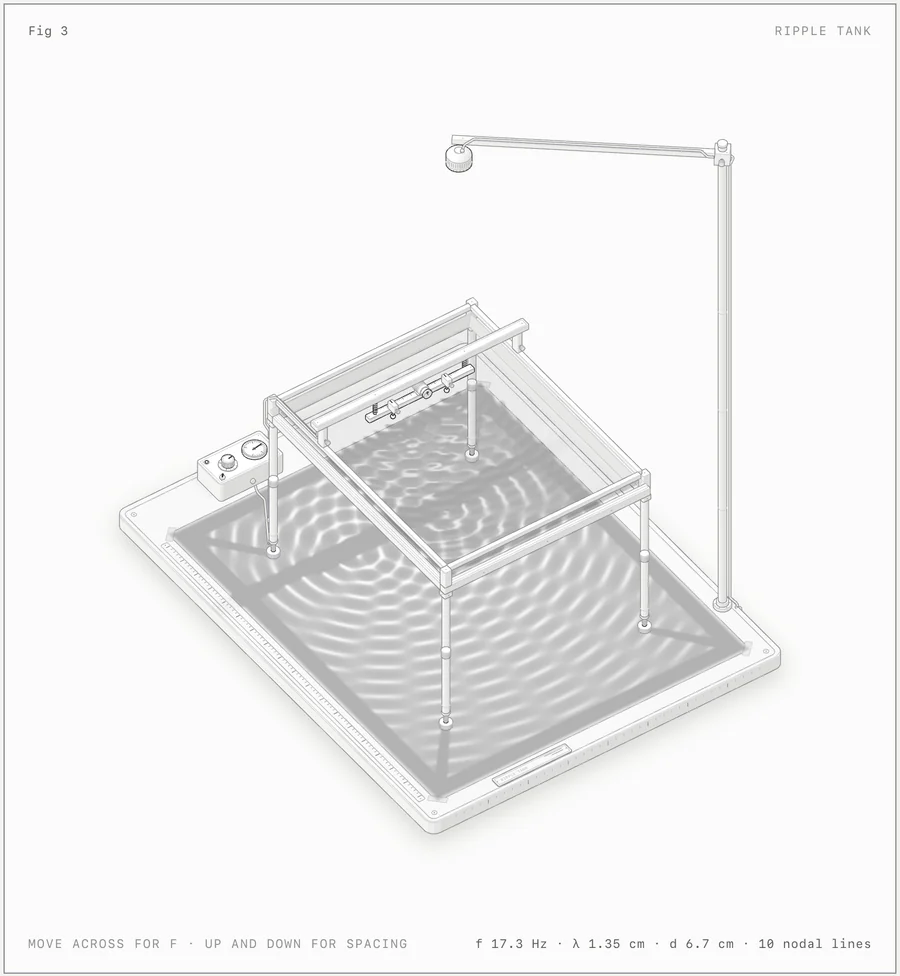
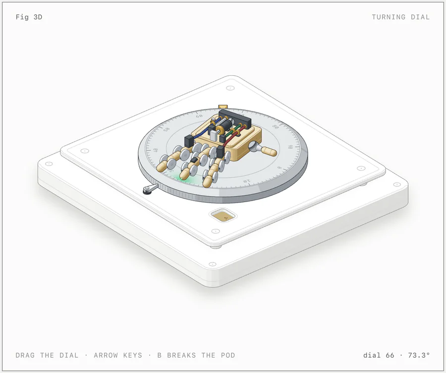

# Anatomy 源码拆解：它不是插画 Prompt，而是给 Agent 配了一套可验收的等距机器制图系统

> **结论先行：** [`donghaozhang/anatomy`](https://github.com/donghaozhang/anatomy) 不是新的图像模型，也不是输入一句话就返回插画的 SaaS。用户提供的仓库是 [`wheresryan22/anatomy`](https://github.com/wheresryan22/anatomy) 的同步 fork；它真正交付的是一份 Agent Skill、一套无框架 JavaScript/TypeScript 几何工具和一组浏览器验收脚本。Claude Code、Codex 或其他 Coding Agent 先把抽象概念改写成一台“能解释自己”的物理机器，再生成 SVG、WebGL 或实验性的可旋转 3D 页面，并用真实几何、浏览器交互和截图反复检查。它不是替 Agent 作画，而是在约束 Agent 如何把解释做成可以审计的代码。

本文固定审计 2026 年 10 月 13 日的提交 [`454a0ef`](https://github.com/wheresryan22/anatomy/tree/454a0ef801b6d9b905f08309d094491c7085b3dd)。审计时，用户给出的 fork 与上游 `main` 指向同一提交；上游有 6,389 stars、456 forks，最新发布版为 [`v1.1.0`](https://github.com/wheresryan22/anatomy/releases/tag/v1.1.0)。这些数量会变化，技术结论以固定提交为准。

---

## 01 | 它最关键的规则：物体本身就是解释

普通技术插画很容易退化成彩色方框、箭头和标签。Anatomy 的 [`SKILL.md`](https://github.com/wheresryan22/anatomy/blob/454a0ef801b6d9b905f08309d094491c7085b3dd/SKILL.md) 刻意反过来要求 Agent：不要先画流程图，而要先发明一个物理对象，让结构和运动承担语义。

- token bucket 可以变成真的漏斗、储罐和阀门；
- GPU context 可以变成龙门架、载台与显存仪表；
- cache key 可以变成锁芯与弹子；
- 调度或反馈系统可以变成带传送、回流和读数机构的试验台。

这就是它与“赛博朋克等距插画 Prompt”的根本区别。Prompt 主要规定风格；Anatomy 规定的是**解释模型、零件结构、坐标系统、遮挡关系、交互状态和验收方式**。一个好结果不是看起来像机器，而是读者能从机器的形态和动作中理解原概念。

---

## 02 | 它更像一条小型“视觉编译管线”

Anatomy 把制作过程拆成接近编译器的阶段：

1. **定规格。** 先选 Figure、Hero 或 Epic 规模，确定画布、信息密度和动效深度；
2. **找事实。** 收集真实数字、状态、限制和因果关系，不允许只有空泛概念；
3. **发明机器。** 选择一个能映射这些关系的物理装置，而不是用方框箭头替代；
4. **列零件。** Hero/Epic 通常先写出 40 个以上可见部件，再规划世界坐标；
5. **建一次几何。** 同一份几何同时用于绘制、碰撞、遮挡和审计，避免视觉与检查逻辑分叉；
6. **排绘制顺序。** 依据等距投影和深度关系确定 painter order；
7. **加状态。** 读数、控制、悬停、拖动、键盘与 motion 都必须反映同一套内部状态；
8. **浏览器验收。** 在明暗主题、桌面、手机、缩放、hover 与 reduced motion 条件下截图和操作。

所以它不是“生成器里塞了一些模板”。最终作品仍由 Agent 写代码，Skill 只是把自由创作变成一条有中间产物和验收门的工程流程。代价也很直接：仓库明确说这种工作故意很慢，复杂图不会像文生图那样几秒钟出结果。

---

## 03 | 三条输出路线：SVG、WebGL 和自研 3D

第一条路线是纯 SVG：可以交付独立 HTML、单独 SVG，或 React 组件。`iso-kit` 负责等距相机、基础实体、页面和样式；`lathe` 生成旋转体；`tube` 负责管线与线缆。React 只用于 React 交付物，核心工具本身没有 `package.json` 和运行时框架依赖。

第二条路线是 SVG + WebGL。机械骨架、标签和控制仍由 SVG 表达，火焰、排气、水波、焦散和光照等连续效果放在前后 SVG 层之间的 Canvas 中。WebGL 不可用时，SVG 结构仍应保持可读，而不是整张作品变黑。

第三条是 beta 状态的 3D runtime。它没有引入 Three.js，而是让零件在每一帧重新投影和着色，再叠加轨道相机、关节和深度审计。仓库目前把这条路线定位为示例和测试能力，不是成熟的通用 3D 引擎。

---

## 04 | 真正有价值的不是画法，而是“几何账本”

最值得复用的是 [`kit/audit.mjs`](https://github.com/wheresryan22/anatomy/blob/454a0ef801b6d9b905f08309d094491c7085b3dd/kit/audit.mjs)。绘制实体时，工具同时记录真实边界、面、管线、端点、支撑和深度关系；审计器随后检查：

- 零件间距与实体穿透；
- 管线端点、悬空线、支撑和折叠；
- 自重叠、轮廓抖动、管线拥挤和落座关系；
- 形状覆盖、占位替身与 painter depth order；
- 3D 关节、动态部件与不同相机角度下的遮挡。

这比在 Prompt 里写“不要穿模”强很多，因为检查对象是 Agent 实际画出的几何，而不是模型的一句自我保证。

但这套账本也有明确边界。装饰线条可能直接写在 SVG markup 里，不进入几何记录，所以仓库另用 [`scripts/lines.mjs`](https://github.com/wheresryan22/anatomy/blob/454a0ef801b6d9b905f08309d094491c7085b3dd/scripts/lines.mjs) 在无头 Chrome 中检查悬空线端。即使全部自动检查通过，也只能说明“被记录的几何符合已实现的规则”，不能证明机器隐喻正确、物理过程真实或画面审美优秀。

---

## 05 | 浏览器不是预览器，而是第二层测试仪

[`capture.mjs`](https://github.com/wheresryan22/anatomy/blob/454a0ef801b6d9b905f08309d094491c7085b3dd/scripts/capture.mjs) 会在桌面、移动端、hover、zoom 和 reduced-motion 等状态下截图，同时报告控制台错误、横向滚动和读数问题。[`drive.mjs`](https://github.com/wheresryan22/anatomy/blob/454a0ef801b6d9b905f08309d094491c7085b3dd/scripts/drive.mjs) 则真的发送鼠标、键盘和拖拽事件，等待状态改变，还能检查无 WebGL 回退、线条与 3D orbit。

Skill 并没有把截图任务当成形式：它要求 Agent 打开 contact sheet，并以 4 倍放大检查明暗主题下的接缝、悬空、碰撞和文字。这里的人眼复核很重要，因为自动化能发现结构错误，却不知道“这台机器有没有把概念讲明白”。

---

## 06 | 它比直接让 Codex 画图好多少？

如果只是画一张装饰图，直接让 Codex 写 SVG 或调用图像模型更快。Anatomy 的优势出现在需要**可重复、可交互、可回归**的技术视觉时：

| 直接提示 Coding Agent | 使用 Anatomy |
|---|---|
| 风格与结构通常混在一次生成里 | 先建立语义隐喻、零件表和坐标计划 |
| 画面与碰撞检查可能是两套逻辑 | 同一份几何同时驱动绘制与审计 |
| “看起来没问题”常由 Agent 自述 | 有几何、浏览器、交互和截图证据 |
| 修改局部容易破坏遮挡或响应式布局 | 深度、端点、手机、缩放与降级路径可回归 |
| 结果可能只是一张图 | 结果是可读源码、独立网页或 React 组件 |

不过它不会自动提升模型的审美，也不会把普通 Agent 变成机械工程师。Agent 仍要做最难的两件事：发明恰当的物理隐喻，并把几十到几百个部件写对。Anatomy 提高的是**过程下限和错误可见性**，不是保证每次都产出官方示例级作品。

---

## 07 | 发布系统认真处理了复现，也带来隐私提醒

社区发布只会在用户明确同意后运行。发布脚本复制作品源码，记录作者、标题、许可证、Agent/模型、最多 600 字符的提示词，以及可选耗时和 token 数；kit fingerprint 用来说明作品基于哪套工具。画廊会在锁定沙箱中重建，并拒绝网络、`eval`/`new Function`、frame/cookie、环境变量读取、目录外导入、非确定性输出和 reduced-motion 下仍强制播放的动画。

这套设计让作品更接近“可复现源码”，但也意味着发布元数据可能泄露原始提示词、模型选择和工作量。真正发布前应该先看 dry run，而不是把 `publish` 当普通上传按钮。

---

## 08 | 我实际验证了什么

我在 Apple Silicon Mac 上检出固定提交 `454a0ef`，使用仓库 CI 指定的测试依赖运行测试，并重建多个官方示例。结果如下：

| 检查 | 本次结果 | 证据边界 |
|---|---|---|
| 测试套件 | 38 个测试文件，245/245 通过，0 失败，约 57.9 秒 | 本机结果，不代表所有 Chrome/OS 环境 |
| Arcade Cabinet 几何审计 | 349 items、243 solids、15 tubes；1,290 条 overlap/order 规则；clearance、terminal、loose end、depth、self-overlap、wobble、saddle、stand-in、crowding 均为 0，审计通过 | 证明当前示例满足已编码规则，不证明设计语义 |
| Raptor Engine 几何审计 | 478 items、267 solids、80 tubes；检查 1,707,703 组 overlaps 与 4,292 条 order 规则，失败类计数均为 0；168.3 秒通过 | 展示复杂场景的检查深度，也说明完整审计并不轻量 |
| Turning Dial 3D verify | 88 parts；锁、旋钮与机械手动态层完成验证，构建约 0.9 秒 | 只是仓库示例规模，不是通用 3D 性能测试 |
| 示例重建 | Dial Indicator、Ripple Tank、Arcade Cabinet、Turning Dial 输出可重复，重建后 Git 工作区保持无差异 | 证明固定输入的构建确定性 |
| 官方最新 `main` CI | 245 项中 244 通过、1 失败；失败发生在 `drive preserves a successful wait condition` 的 Chrome `until` 等待 | 当前主分支不能写成“CI 全绿” |

最新官方失败需要单独解释：它前一个主分支提交和 `v1.1.0` 发布提交均通过；从前一个绿色提交到当前提交只修改了 Skill 中的时间描述和 changelog，没有改浏览器驱动。本机同一提交 245 项全部通过。因此现有证据更像一个环境相关或偶发的浏览器等待问题，而不是已经确认的渲染回归；但在上游重新变绿前，红色状态仍然是真实未关闭风险。

仓库自报的小型 3D 示例可达 60fps，380 部件压力测试约为桌面 20fps、节流手机 13–15fps；这些数字来自项目方，本文没有独立复现，不应当作跨设备性能基准。

---

## 09 | 最准确的定位

Anatomy 最适合机器、仪器、工具、家具和能被空间结构表达的技术系统；它不适合数据图表、精确地图、人物叙事，也不适合追求立即出图的任务。WebGL 效果需要浏览器 GPU，3D 仍是 beta，复杂 3D orbit 审计按官方说明可能需要 15–20 分钟。

所以，最准确的理解不是“Remotion for diagrams”，也不是“一个等距插画 Skill”。它更像一套面向 Coding Agent 的**视觉工程规范 + 几何运行时 + 浏览器验收工具**：让 Agent 交付的不只是漂亮截图，而是一件由源码定义、可以操作、可以降级、可以重建，也能指出自己哪里可能出错的技术视觉作品。

---

## 主要来源

- [用户提供的 fork：`donghaozhang/anatomy`](https://github.com/donghaozhang/anatomy)
- [上游仓库：`wheresryan22/anatomy`](https://github.com/wheresryan22/anatomy)
- [固定审计提交 `454a0ef`](https://github.com/wheresryan22/anatomy/tree/454a0ef801b6d9b905f08309d094491c7085b3dd)
- [Skill 主流程](https://github.com/wheresryan22/anatomy/blob/454a0ef801b6d9b905f08309d094491c7085b3dd/SKILL.md)
- [工具结构说明](https://github.com/wheresryan22/anatomy/blob/454a0ef801b6d9b905f08309d094491c7085b3dd/references/kit.md)
- [浏览器验证说明](https://github.com/wheresryan22/anatomy/blob/454a0ef801b6d9b905f08309d094491c7085b3dd/references/verify.md)
- [3D beta 说明与性能数字](https://github.com/wheresryan22/anatomy/blob/454a0ef801b6d9b905f08309d094491c7085b3dd/references/3d.md)
- [发布、沙箱与元数据说明](https://github.com/wheresryan22/anatomy/blob/454a0ef801b6d9b905f08309d094491c7085b3dd/references/publish.md)
- [当前主分支 CI run `38317963428`](https://github.com/wheresryan22/anatomy/actions/runs/38317963428)
- [`v1.1.0` 发布页](https://github.com/wheresryan22/anatomy/releases/tag/v1.1.0)

*审计日期：2026 年 10 月 13 日。仓库规模、stars、forks、版本、CI 与性能会继续变化；技术结论固定到提交 `454a0ef`。示例图片来自该提交的官方仓库并保存为本地资产。性能数字已明确标注为项目方自报；本文没有独立验证跨设备帧率、任意 Agent 的成品质量或社区发布服务的生产安全。*
