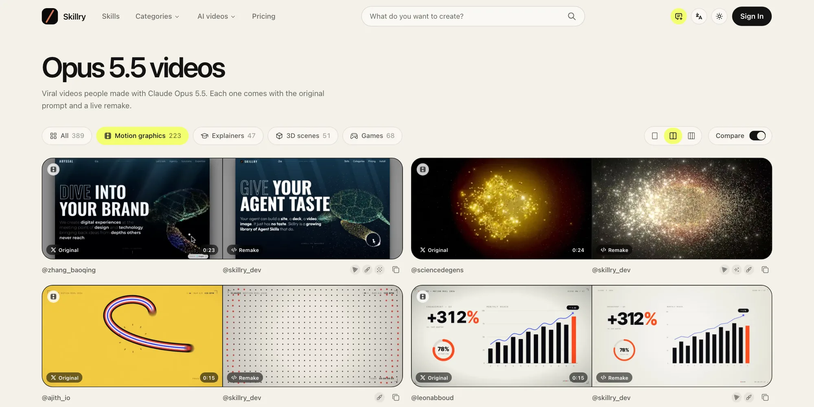
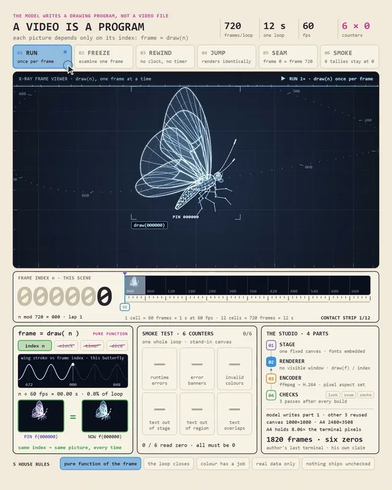

# Inside Awesome Opus 5.5 Videos: 703 Viral Prompts Form an Agent Visual Corpus, Not a Video Source Repository

> **TL;DR:** `awesome-opus5-5-videos` collects 703 prompts and source posts associated with Claude Opus 5.5 video projects. Of those, 418 have an independent remake on Skillry. Its real value is not proof that one sentence reliably produces a viral film. It turns a burst of community experimentation into searchable evidence: creators are using Canvas, SVG, Three.js, shaders, and GSAP to make video behave like inspectable, rerenderable, sometimes interactive software. The repository does not contain the HTML or JavaScript projects, video files, assets, execution logs, or a controlled evaluation. It also marks 207 prompts as partial. This is a strong inspiration library and capability corpus, not a reproducible production archive.


- **User-provided repository:** [donghaozhang/awesome-opus5-5-videos](https://github.com/donghaozhang/awesome-opus5-5-videos)
- **Upstream repository:** [yihui-dev/awesome-opus5-5-videos](https://github.com/yihui-dev/awesome-opus5-5-videos)
- **Audited snapshot:** [`92aee2f`](https://github.com/yihui-dev/awesome-opus5-5-videos/tree/92aee2f586ac0715cb3cbcb6384834f98a33383d)
- **Latest dataset update:** October 13, 2026
- **Reviewed:** October 18, 2026

## One-sentence verdict

**This is not an Opus 5.5 video generator. It is a visual-agent corpus connecting original posts, prompts, technical labels, and third-party remakes.**

The repository gathers work scattered across X, lets readers move from an output back to a prompt, and then points to an attempt made in a different execution environment. That creates four useful evidence layers:

```text
creator's published video
        ↓
published or reconstructed prompt
        ↓
independent Skillry remake
        ↓
medium and technology labels
```

Those layers do not form a reproducible build pipeline. The creator's source project, agent transcript, external assets, model settings, and manual changes are usually absent.

## What the repository actually contains

At snapshot `92aee2f`, the source tree contains four meaningful content types: `README.md`, `LICENSE`, `data/videos.json`, and Markdown cards under `prompts/`. There are no HTML, JavaScript, Python, or Blender project files, no video binaries, no test suite, and no GitHub Actions workflow.

A local consistency audit produced the following inventory:

| Item | Count | Meaning |
|---|---:|---|
| JSON records | 703 | Author, source post, category, prompt, poster, remake status, and related metadata |
| Markdown prompt files | 703 | One human-readable file for every JSON slug |
| Skillry remakes | 418 | Records with an external remake page and technology labels |
| No remake yet | 285 | Prompt cards without a Skillry remake link |
| Prompts marked partial | 207 | About 29.4% of the dataset |
| Prompts under 50 characters | 31 | Closer to requests than production specifications |
| Duplicate slugs | 0 | Stable record identities |
| JSON or Markdown orphans | 0 | Both representations align completely |

The data organization is good. Machines can filter `videos.json`, while people can open and copy individual Markdown cards. What is missing is the generation process itself.

## What 703 records say about the medium

The full dataset breaks down as follows:

| Category | Count |
|---|---:|
| Motion graphics | 369 |
| 3D scenes | 117 |
| Explainers | 116 |
| Games and interactive | 101 |

Among the 418 remade entries, the most frequent technology labels are Canvas at 267, SVG at 183, Three.js at 131, shaders at 92, and GSAP at 86. The labels overlap, so they do not sum to the number of videos. They also describe the Skillry remake stack, not necessarily the original creator's implementation.

Even with those caveats, the pattern is clear. Much of the "AI video" in this collection is not a diffusion model returning an MP4. An agent writes a deterministic or semi-deterministic browser scene, then the page is played, recorded, or rendered frame by frame.

## Video is becoming a program

Browser-native media works well for agents for practical reasons:

- Canvas can express every frame as a drawing function;
- SVG keeps shapes, text, and paths addressable;
- Three.js exposes cameras, lights, materials, and space as parameters;
- shaders handle particles, fluids, glow, and procedural textures;
- GSAP makes timing and easing inspectable in code;
- Web Audio can keep interaction and sound inside one runtime.

A generative video model produces pixels. A code-video system first produces scene rules. The former is strong at photographic texture and natural motion. The latter is strong at exact text, brand colors, charts, loops, interaction, and revision. This repository documents a concentrated expansion of that second path.

## Original-versus-remake is useful, but it is not a controlled benchmark



Skillry places a creator's original beside an independent remake. That makes composition, rhythm, and retained visual language easy to inspect. It is more informative than reading a prompt alone because it tests whether an instruction transfers to another execution environment.

The comparison still cannot support a model ranking:

- original and remake may use different model versions, tools, and time budgets;
- the original prompt may depend on attachments, private skills, local paths, or APIs;
- durations can differ substantially, including long originals paired with shorter remakes;
- iteration count, human repair, failures, cost, and elapsed time are not standardized;
- there is no shared pixel, motion, audio, interaction, or human-preference score.

The collection is better understood as a behavioral gallery. It shows that a class of visual task was completed and that another agent could create a recognizable counterpart. It does not tell us which model is strongest or what the one-pass success rate was.

## A prompt is not a production recipe

Prompt length has a median of roughly 221 characters. The longest record exceeds 15,000 characters, while the shortest contains only 11. The field therefore mixes at least four different artifacts:

1. a one-line wish, such as asking for a Tron game;
2. a creative brief with style and duration constraints;
3. a production specification covering technology, shots, typography, and acceptance checks;
4. a full agent assignment that depends on files, APIs, existing skills, and extensive private context.

A static keyword scan found at least 23 prompts that explicitly mention attachments, local paths, MP4 files, or reference inputs. Another 224 mention external APIs or tools such as Blender, Remotion, FFmpeg, Three.js, or GSAP. The scan is not full provenance analysis, but it is enough to show why copying text is often only the first step.

One long music-video prompt, for example, asks the agent to inspect local material, reuse an audio track, call ElevenLabs and Seedance, generate characters and sets, review the film repeatedly, and verify sync. The Markdown preserves the assignment, but not the inputs, API state, generated candidates, or editorial decisions. Pasting that prompt elsewhere can produce a new work in the same direction; it cannot deterministically reconstruct the original.

## The most useful engineering example: deterministic frames



One of the strongest ideas in the collection is to define video as `frame = draw(n)`: a frame depends only on its frame index, never on the wall clock or uncontrolled randomness.

That contract changes the workflow:

- an agent can inspect frame 720 without replaying from the beginning;
- rerendering the same frame should reproduce the same pixels;
- a loop can compare its first and last frames directly;
- a typography fix requires a rerender, not another generative draw;
- a headless browser can capture frames for FFmpeg encoding;
- scripts can detect overflows, blank frames, runtime errors, and bad seams.

This is the difference between a live web animation and a reliable video renderer. A page only needs to move now. A renderer must reconstruct frame `n` every time. Model quality matters, but stable delivery often depends on this engineering contract.

## What the corpus does and does not establish

**Reasonably supported:**

- Opus 5.5 can organize Canvas, SVG, Three.js, and animation libraries across many visual tasks;
- code generation can cover motion graphics, explainers, 3D scenes, and lightweight games;
- the same prompt can produce recognizable counterparts across execution environments;
- a single-file web experience is an effective visual-agent deliverable;
- structured curation is more useful for learning than isolated social posts.

**Not established by this repository alone:**

- all 703 results were completed in one prompt;
- every project used only Opus 5.5, without external models, assets, or human edits;
- copying a prompt reproduces the same quality;
- a Skillry remake faithfully reproduces the original implementation;
- Opus 5.5 beats other models under controlled conditions;
- the source code behind the displayed films is open.

That final boundary matters most: the repository opens the catalog and prompt text, not 703 video projects.

## How this could become a real visual-agent benchmark

The collection already resembles a promising task bank. Adding the following evidence would turn it into a much stronger benchmark:

| Additional evidence | Problem it solves |
|---|---|
| Fixed model identity and run date | Prevents version mixing |
| Complete prompts, attachments, and asset hashes | Separates public text from hidden context |
| Generated HTML/JS and lockfiles | Makes remakes inspectable and runnable |
| Agent transcripts, tool calls, and human interventions | Measures success rate and repair cost |
| Fixed viewport, fps, fonts, and browser | Reduces rendering variance |
| Frame outputs, audio, and interaction recordings | Covers failures a screenshot cannot reveal |
| Automated QA plus blind human review | Tests engineering correctness and visual quality |

An ideal record would look like this:

```text
task + input assets + environment manifest + agent trace
     + source code + deterministic render settings + output
     + automated checks + human evaluation
```

Only then can differences between original and remake be explained rather than merely watched.

## The best way for creators to use it

Start with the medium and acceptance criteria, not the most viral wording:

1. filter by `motion`, `explainer`, `3d`, or `interactive`;
2. inspect the technology labels and choose Canvas, SVG, Three.js, or a mixed stack;
3. extract duration, aspect ratio, shots, typography, palette, pacing, and interaction constraints;
4. list missing attachments, licensed assets, fonts, and audio as explicit inputs;
5. require source code, a frame contract, an export script, and a QA report, not only a screen recording;
6. preserve the environment and revision history so the work remains rerenderable;
7. use human review for story, brand fit, and taste instead of treating "the page runs" as completion.

The repository is excellent at answering "what else has been tried?" It does not define when a new production is ready to ship.

## The license boundary

The repository root uses the MIT License, while the README states that each video and prompt belongs to its creator. The conservative interpretation is that MIT covers the repository's own compilation and related material. It should not be treated as a blanket sublicense for every third-party video, soundtrack, brand asset, or original prompt.

Users should preserve creator attribution and source links. Commercial adoption also requires separate checks for footage, music, fonts, trademarks, and likeness rights. Publicly visible does not mean unrestricted to republish.

## Conclusion

`awesome-opus5-5-videos` is easy to misread as a book of 703 magic phrases. A source audit suggests a more useful description: it turns a fast-moving community experiment into a searchable prompt corpus and a map of visual-agent capabilities.

It demonstrates the breadth of Opus 5.5 across browser graphics and explains why code video is so agent-friendly: elements are addressable, time is parameterized, frames can be rebuilt, and outputs can remain interactive. But the model name alone does not explain the best work. References, tools, assets, taste, iteration, and export QA often matter more than the prompt that survives in the archive.

As an inspiration library, this repository is unusually valuable. As a reproducible source archive, it is incomplete. As the prototype for a visual-agent benchmark, it is worth extending.

## References

- [donghaozhang/awesome-opus5-5-videos - user-provided fork](https://github.com/donghaozhang/awesome-opus5-5-videos)
- [yihui-dev/awesome-opus5-5-videos - upstream](https://github.com/yihui-dev/awesome-opus5-5-videos)
- [Skillry Opus 5.5 video collection](https://skillry.dev/ai-videos/opus-5-5)
- [Machine-readable dataset](https://github.com/yihui-dev/awesome-opus5-5-videos/blob/92aee2f586ac0715cb3cb6384834f98a33383d/data/videos.json)
- [Deterministic frame-based rendering prompt](https://github.com/yihui-dev/awesome-opus5-5-videos/blob/92aee2f586ac0715cb3cbcb6384834f98a33383d/prompts/0xkarmi-129839.md)
- [Blender previs prompt](https://github.com/yihui-dev/awesome-opus5-5-videos/blob/92aee2f586ac0715cb3cb6384834f98a33383d/prompts/tonysurix-596746.md)

*Audited on October 18, 2026. The user-provided repository is a fork of `yihui-dev/awesome-opus5-5-videos`; both `main` branches pointed to SHA `92aee2f586ac0715cb3cbcb6384834f98a33383d` at review time. Counts come from local parsing of `data/videos.json` and the 703 Markdown files. Dependency counts are a static keyword scan, not full runtime provenance. The three images come from the repository README and its linked Skillry media.*
