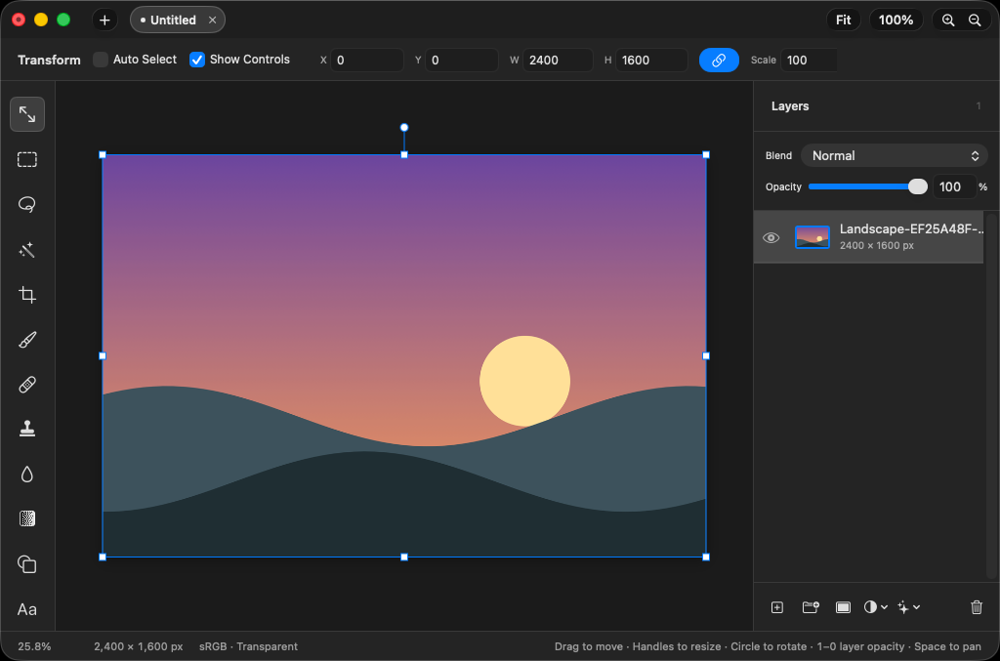
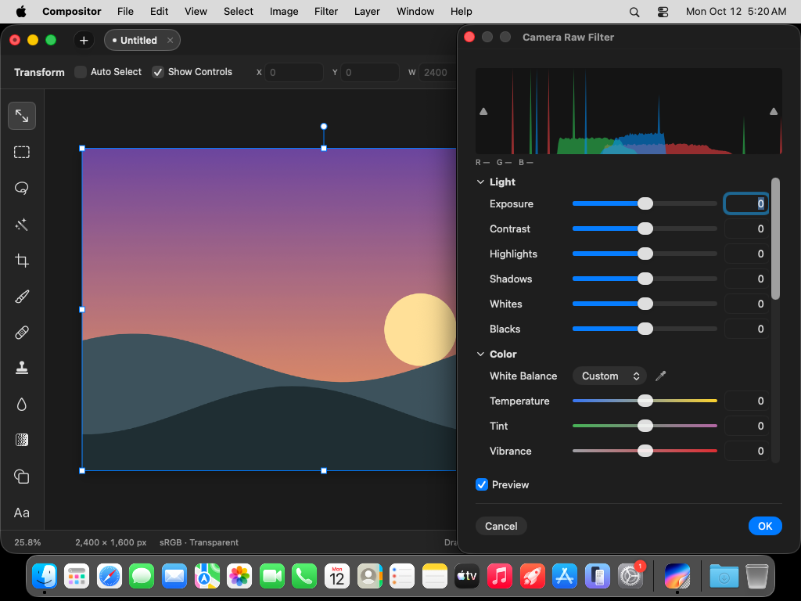
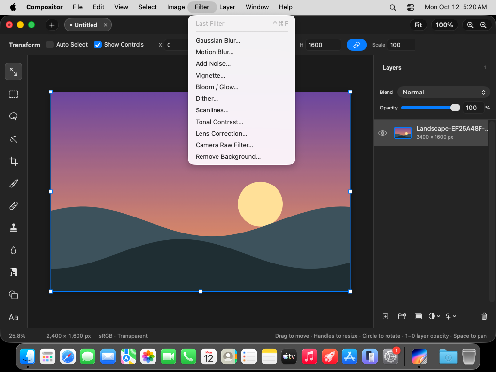

# Compositor Source Audit: Not “AI Photoshop,” but a Native Mac Editor That Opens Layered Projects as a Filesystem Protocol

> **Bottom line:** [`robbietilton/Compositor`](https://github.com/robbietilton/Compositor) is first a working native Mac image editor: it can paint, retouch, import PSD, develop RAW, and preserve 16-bit or HDR layers. It is not an AI product wrapped around a chat panel. Its unusual design choice is to make a `.comp` project an open directory of image files plus a JSON manifest. Codex, Claude Code, or an ordinary script can create and modify editable layers by writing files, while the app observes filesystem events and reloads the canvas after roughly 300 milliseconds. The handoff between agent and person is a set of ordinary layers, not an opaque flattened image.



This audit is pinned to commit [`f5ae5ba`](https://github.com/robbietilton/Compositor/tree/f5ae5bad0b25b32dda9f254e62d2f07f59478698), dated October 11, 2026. At review time the repository had 451 commits, [`v1.4.10`](https://github.com/robbietilton/Compositor/releases/tag/v1.4.10) was the latest release, and the corresponding main-branch CI run had passed. The conclusions below apply to that snapshot.

---

## 01 | Despite the name, this is not a video compositor

Compositor has no timeline, keyframes, node graph, or video encoding pipeline. It should not be compared with After Effects, Nuke, Remotion, or HyperFrame. The author's positioning is simpler: a free, open-source image editor built around the Photoshop-style compositing and post-processing workflow.

The source contains substantive implementations for:

- layers, folders, opacity, and Photoshop's full ordered blend-mode set;
- layer, folder, and clipping masks, plus non-destructive transforms;
- adjustment layers including Curves, Levels, Exposure, Gradient Map, and blur;
- brushes, erasing, clone stamp, spot healing, Content-Aware Fill, and selections;
- editable text and basic shapes;
- Camera Raw, RAW development, color work, and lens correction;
- JPEG, PNG, HEIC, TIFF, WebP, SVG, camera RAW, PSD/PSB, EXR, and Radiance HDR input.

These are not merely README promises. The UI suite launches the app and captures the editor, filter menu, Image Size, Hue/Saturation, Camera Raw, and multi-tab states. The following Camera Raw image is an artifact from the successful CI run for the audited main commit.



---

## 02 | The key idea: `.comp` is a writable protocol, not a black box

A minimal project looks like this:

```text
Example.comp/
├── manifest.json
└── images/
    ├── <layer-uuid>.png
    └── <layer-uuid>.mask.png
```

The manifest records canvas dimensions, resolution, the active layer, bottom-to-top layer order, and each layer's placement, scale, rotation, flips, sampling, opacity, blend mode, parent folder, mask, adjustment, text, and effects. Pixels remain ordinary PNG files; 16-bit layers use 16-bit PNG, while HDR layers use EXR.

That gives one project three useful identities:

1. To Compositor, it is the native editable document.
2. To Finder, Git, and backup tools, it is an ordinary directory.
3. To a coding agent, it is a structured output protocol with no SDK requirement.

An agent writes image assets first, then atomically renames a temporary manifest over `manifest.json`. Compositor watches the package, manifest, and images directory with `DispatchSource`. After writes settle for 300 milliseconds, it compares content digests and reloads a valid change in the same tab, preserving zoom, scroll, and any selection that still exists. If the user has unsaved work, the app asks them to choose between Revert and Keep Mine instead of silently overwriting it.

This is more robust than having an agent click through Photoshop menus, and more editable than asking a model for one PNG. Compositor opens **the project state itself**, not an automation surface layered over the UI.

---

## 03 | Why this helps Codex, without turning into magic

Codex already knows how to write PNG, JSON, and directories, so it does not require a dedicated Compositor skill. The project's [`writing-comp-files.md`](https://github.com/robbietilton/Compositor/blob/f5ae5bad0b25b32dda9f254e62d2f07f59478698/docs/writing-comp-files.md) acts as the protocol specification: after reading it, an agent can compose a scene layer by layer, add masks or adjustments, and let a person take over at any point.

Compared with generating a flat image, this has four concrete advantages:

- **The result can be decomposed.** Background, subject, type, grade, and effects can remain separate.
- **The result can be inspected.** The manifest exposes placement, blend behavior, and relationships.
- **The result can be taken over.** A person can move, erase, mask, or tune opacity directly in the app.
- **Progress can be observed.** The open canvas can refresh after every one or two layers instead of waiting for a final export.

Compositor does not generate good pixels for the agent, and it does not expose a semantic command such as “move the person left.” The agent still needs an image generator, raster code, or existing assets, then must maintain UUIDs, filenames, dimensions, and a valid manifest. This is a strong editable destination, not an aesthetic model.

---

## 04 | The renderer is more nuanced than “Metal accelerated”

Compositor uses a hybrid stack. AppKit and SwiftUI provide the native interface; Core Graphics handles much of the layer rendering; Core Image supplies filters and blend modes that Core Graphics lacks or renders incorrectly; Metal powers the GPU canvas, brush coverage, Liquify/Smudge, noise, and layer effects. Several pixel kernels are implemented in C.

Two choices are particularly practical:

- edits are represented as tiles and patches, with downsample caches at low zoom, rather than rebuilding an entire large image after every stroke;
- several GPU-backed effects retain CPU/Core Graphics fallbacks, so “Metal is present” is not misrepresented as “everything runs on the GPU.”

The blend-mode implementation also tests platform behavior rather than trusting the API name. Source comments document incorrect translucent edges from Core Graphics Color Burn and Color Dodge, while modes such as Linear Burn, Vivid Light, Hard Mix, Subtract, and Divide have no native equivalent. Those modes move through Core Image and are forced into the same sRGB gamma space as the canvas to better match Photoshop semantics.



---

## 05 | PSD, 16-bit, and HDR support are real, with explicit limits

PSD and PSB import is limited to 8-bit RGB and does not support CMYK. Folders, masks, blend modes, filled rectangles and ellipses, and simple horizontal text can remain editable. More complex vectors and vertical text are rasterized. The app presents a conversion report before applying the import. This is best understood as a structure-preserving migration path, not a promise of perfect Photoshop round trips.

The project format has reached version 13. Version 12 added 16-bit PNG layers; version 13 added EXR layers using half-float extended sRGB. Highlights can survive supported adjustments and export paths, but the current display path and many editing tools still operate through an 8-bit proxy clipped to white and dithered on load. A destructive operation that does not understand deep data may turn the layer into 8-bit pixels.

There is also visible documentation drift. `ProjectManifest.current` is 13, while the opening paragraph of the format document still says new saves use version 12, and the agent quickstart uses version 11 while describing 8-bit PNGs. The later format sections do describe versions 12 and 13. An external writer that needs 16-bit or HDR should pin an app version and follow the current code plus the complete schema, not copy the quickstart mechanically.

---

## 06 | The filesystem protocol has meaningful validation

The loader does not blindly trust package contents. It caps a side at 30,000 pixels, a document at 10,000 layers, a manifest at 4 MiB, and an encoded asset at 512 MiB, while calculating the total pixel budget from the Mac's memory. Assets must stay inside the package and filenames must match layer UUIDs. Duplicate IDs, invalid hierarchies, mask cycles, corrupt images, and unsupported versions are rejected before replacing the live document.

Saving uses `NSFileCoordinator` and atomic package replacement. External-change detection compares manifest contents plus image names and sizes instead of relying on modification times that sync clients may disturb.

Three operational limits still matter:

1. An invalid external write is ignored and the current canvas remains intact, but the app does not display the validation error.
2. An external reload preserves the viewport and selection but clears undo history.
3. Replacing an image with another file of exactly the same byte size also requires a manifest change, or the digest may treat it as unchanged.

---

## 07 | What I verified

I checked out `f5ae5ba` on an Apple Silicon Mac running macOS 26.6.2 and completed `build-for-testing` with Xcode 27. The only locked external Swift Package dependency is Sparkle 2.10.0. I then ran the complete unit suite through the repository's own CI script: all four groups completed, with 613 tests passed and none failed or skipped.

| Check | Result | Evidence boundary |
|---|---|---|
| Codebase | 235 Swift files and about 52,985 lines of Swift | Establishes a substantial native app, not maturity of every feature |
| Local tests | 82 unit-test files; 613 tests passed across four groups, with none failed or skipped | A test count is not a count of independent product scenarios |
| Local build | `build-for-testing` succeeded | Local Xcode was 27; project CI pins Xcode 26.6 |
| Official main CI | Unit and screenshot jobs passed for `f5ae5ba` | The screenshot job is informational and does not fail if a screen cannot be reached |
| Release | v1.4.10 ships a DMG from a documented signing and notarization pipeline, with a published SHA-256 digest | I did not independently audit Apple's notarization chain or the update service |

The first launch attempt was blocked before any test ran because Xcode 27's temporary signing left Sparkle and the app with different Team IDs. After ad-hoc deep-signing the local app bundle, the same suite executed and passed in full. Compilation and tests show that this snapshot builds and has broad regression coverage around project files, PSD, rendering, and editing. They do not prove perfect compatibility with arbitrary production PSDs, nor do they replace long-session performance and color-management acceptance.

---

## 08 | Who should use it, and who should not

Compositor is most relevant to three groups: Mac users who want a lighter Photoshop-style editor; people converting PSD, RAW, and ordinary images into layered working files; and agent-workflow builders who want Codex or Claude to deliver something a human can continue editing.

It is not a fit for users who require Windows or Linux, CMYK prepress, the Photoshop plugin ecosystem, complete smart-object round trips, collaborative cloud documents, or a video/motion timeline. The system requirement is also narrow: Apple silicon with macOS 26.0 or later, and Xcode 26 or later for source builds.

The fairest summary is: **Compositor does not use AI to perform image editing for you. It designs a real native layer editor around an open project format that agents can read and write. The important innovation is not a chat box; it is a transparent, verifiable, human-editable layer state shared by person and agent.**

---

## Primary sources

- [Repository and README](https://github.com/robbietilton/Compositor)
- [Audited commit `f5ae5ba`](https://github.com/robbietilton/Compositor/tree/f5ae5bad0b25b32dda9f254e62d2f07f59478698)
- [Writing `.comp` projects for agents and scripts](https://github.com/robbietilton/Compositor/blob/f5ae5bad0b25b32dda9f254e62d2f07f59478698/docs/writing-comp-files.md)
- [Project format versions 1-13](https://github.com/robbietilton/Compositor/blob/f5ae5bad0b25b32dda9f254e62d2f07f59478698/docs/project-format.md)
- [Project loading, validation, and atomic saves](https://github.com/robbietilton/Compositor/blob/f5ae5bad0b25b32dda9f254e62d2f07f59478698/Compositor/IO/ProjectStore.swift)
- [External file changes and hot reload](https://github.com/robbietilton/Compositor/blob/f5ae5bad0b25b32dda9f254e62d2f07f59478698/Compositor/IO/ProjectController%2BExternalChanges.swift)
- [GPU canvas](https://github.com/robbietilton/Compositor/blob/f5ae5bad0b25b32dda9f254e62d2f07f59478698/Compositor/Rendering/GPUCanvas.swift)
- [Main-branch verification workflow](https://github.com/robbietilton/Compositor/actions/runs/38207213985)
- [v1.4.10 release](https://github.com/robbietilton/Compositor/releases/tag/v1.4.10)

*Audited on October 13, 2026. Stars, forks, releases, features, and documentation will continue to change; technical conclusions are pinned to `f5ae5ba`. UI images come from that commit's successful CI screenshot artifact. I did not independently validate large commercial PSD files, a print color pipeline, Apple notarization, or long-term production stability.*
