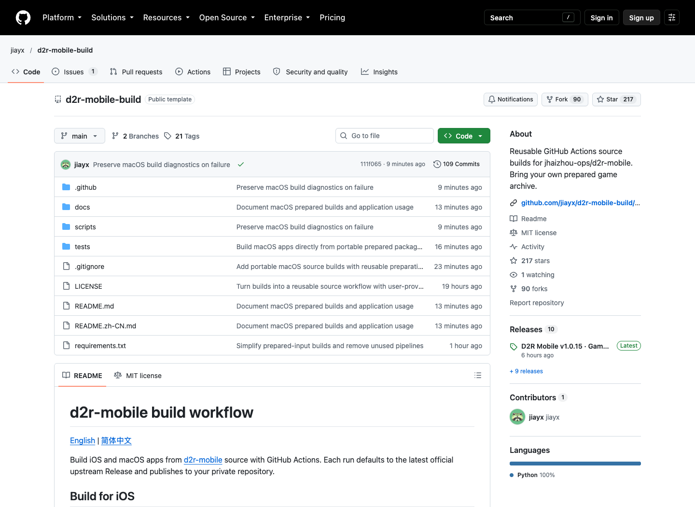
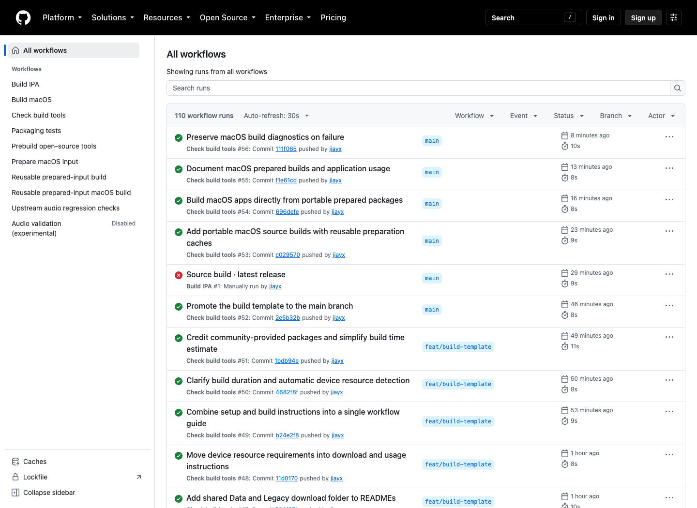
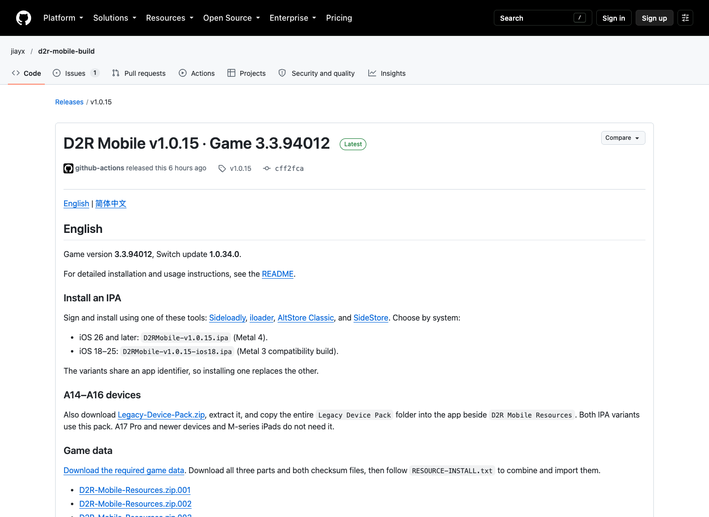

# D2R Mobile Build Audit: A Reusable Delivery Pipeline, but Green Actions Do Not Prove a Playable Device Build

> **Bottom line:** [`jiayx/d2r-mobile-build`](https://github.com/jiayx/d2r-mobile-build) is not another D2R Mobile compatibility layer. It is delivery infrastructure around the upstream source: select an exact source revision, verify a prepared input, compile two iOS variants on a GitHub-hosted macOS runner, and publish checksums and build reports to the user's own private Release. What it removes is the need to prepare Xcode, toolchains, and packaging scripts on a local Mac. It does not remove Xcode from the system, nor does it solve code signing, rights to game data, or physical-device validation. A legacy pipeline did produce the public `v1.0.15` IPA assets, but the Release explicitly says they have not been verified on hardware. The first run of the new source-build path also failed during preparation on October 15. This is a fast-moving and thoughtfully engineered delivery project, not a case where a CI badge can be treated as product acceptance.

On October 13, 2026, X user [`@quc1z`](https://x.com/quc1z/status/2109825251966394654) replied that the linked repository provided packaged IPA and data files. That addresses the practical gap left by my earlier [D2R Mobile source audit](../2026-10-12/2026-10-12-d2r-mobile-switch-arm64-ios-compatibility-layer-en.md): a real compatibility layer does not automatically become a reproducible installable product.

This audit pins the current source to commit [`111f065`](https://github.com/jiayx/d2r-mobile-build/tree/111f065d85f42630eb042f7b868c2f3387225d2f) on October 15 and separately examines the public `v1.0.15` Release and its Actions history. The repository changed substantially in two days, so the original packaged-file post, the released legacy workflow, and today's template must be treated as three different snapshots.

---

## 01 | It supplies the last mile, not the compatibility layer

The upstream [`jhaizhou-ops/d2r-mobile`](https://github.com/jhaizhou-ops/d2r-mobile) repository contains the hard runtime work: ARM64 program rewriting, host services, NVN-to-Metal translation, shaders, touch controls, and game-specific logic. `d2r-mobile-build` does not recreate those components. It organizes delivery around them:

1. Resolve the latest upstream Release, or a branch, tag, or commit selected by the user.
2. Download a SHA-256-identified Prepared Input and verify its structure, file manifest, game programs, shader chain, and compatibility with the selected source.
3. Compile iOS 26 and iOS 18–25 variants on GitHub Actions `macos-26` runners.
4. Validate the IPA identities and digests, then publish both packages, `SHA256SUMS.txt`, and `build-report.json` to a private Release owned by the user.

The relationship is therefore closer to a reusable build-and-release system. Upstream explains how the compatibility layer runs; this repository tries to make its artifacts versioned, traceable, and repeatable.

---

## 02 | “No local Xcode” is accurate; Xcode has moved to the cloud

The current recommended flow asks the user to create a **private repository** from the template, add a `PREPARED_INPUT` Secret, and manually dispatch `Build IPA`. The user does not need to install Xcode locally or execute the generation scripts by hand.

The workflow itself still runs on `macos-26`, selects macOS 26 and iOS 26.4+ SDKs, and invokes native Apple build tools. The accurate boundaries are:

- It can be Xcode-free for the person dispatching or downloading the build.
- It is not Xcode-free as a build system.
- The result remains an unsigned IPA that must be signed through a tool such as Sideloadly, AltStore Classic, or SideStore.
- Runtime still requires matching Data, plus a separate Legacy resource package on A14–A16 devices.

These distinctions locate failures correctly. Cloud compilation does not prove that user signing works. Successful signing does not prove resource import. Resource recognition does not prove long-session stability.

---

## 03 | Prepared Input is the strongest design in the system

The redesigned workflow does not regenerate every derivative from original commercial game files on every run. It condenses expensive and sensitive intermediates into a schema-governed Prepared Input containing:

- `prepared.json`, with format version, game versions, producer source commit, and per-file sizes and SHA-256 values;
- `source-payload.zip`, with generated programs, interface resources, overlays, and precompiled Metal libraries;
- `shader-chain.lock`, carrying shader toolchain fingerprints;
- `resource-manifest.json`, identifying matching Data files by name, size, and digest;
- a small set of generated headers and native artwork source required at compile time.

Validation goes beyond a top-level archive digest. The code rejects unexpected files, path traversal, unsupported file types, oversized expansion, payload digest mismatches, and any payload that still requires shader compilation on the phone. It also compares `producer.source_commit` against source-level generation dependencies. Ordinary native runtime changes can reuse the input; changes to generation rules require a new one.

That is materially better than downloading an opaque IPA. Source revision, derived input, build identity, and final package now form an auditable relationship. It is also more practical than pushing more than 5GB of game resources through every CI run.

---

## 04 | There are meaningful supply-chain controls, not complete provenance

Several controls in the pinned source are worth preserving:

- Most official GitHub Actions are pinned to full commit SHAs rather than mutable tags.
- The entry workflow calls `pack.yml@main`, but `resolve-tools` reads the run's `referenced_workflows`, resolves the exact 40-character commit, and checks out tooling from that revision.
- `require_private()` refuses to access Prepared Input or publish game builds from a public destination repository.
- Intermediate native inputs have three-day retention and are deleted after successful publication.
- Uploaded IPAs are checked again against GitHub's reported size and SHA-256 digest.
- Both OS variants must agree on source commit, payload, shader chain, resource manifest, and build identity.

SHA-256 still establishes byte identity, not authorship, safety, or the right to distribute the bytes. The current README supplies a fixed community Prepared Input and points to community-hosted Data totaling 5.42GB plus an approximately 1.02GB Legacy package. The public `v1.0.15` notes also link a corresponding data Release. I did not download, decrypt, or redistribute any of those materials.

This exposes an important mismatch. The repository description says “Bring your own prepared game archive,” while the default documentation hands users a community package configuration. Private repositories, short artifact retention, and digest checks reduce accidental disclosure and corrupted transfer. They do not resolve copyright, provenance, trust in the package producer, or the fact that a third-party runner processes derivative game material.

---

## 05 | Release success, passing Actions, and playable hardware are three different claims

At audit time, the Actions page showed 110 workflow runs. Many green entries were `Check build tools`, which executes Python unit tests for input parsing, cache budgets, Prepared Input handling, publication, and Xcode selection. I also ran the same suite locally at pinned commit `111f065`; all 24 tests passed. That is useful regression evidence for the tooling. It is not evidence that the complete game ran on a phone.

The legacy [`v1.0.15`](https://github.com/jiayx/d2r-mobile-build/releases/tag/v1.0.15) pipeline provides stronger artifact evidence. `Build unsigned IPA #41` completed in roughly 11 minutes on October 15, with steps for downloading, decrypting, and validating game inputs, generating two IPAs, reusing or publishing Data, and uploading reports. Both IPA assets are about 140MB and carry SHA-256 digests calculated by GitHub.

Yet the same Release explicitly says that the current packages have **not been verified on physical devices**. Its “about six minutes on an iPhone 17 Pro Max” first-launch shader figure is a reference from the project, not a measurement reproduced here.

The newly promoted `Source build · latest release #1` then failed after nine seconds on October 15. Its preparation job stopped at the step that resolves the exact tools revision; source selection, Prepared Input validation, native compilation, and publication were all skipped. Tool unit tests continued to pass afterward, which localizes the gap to reusable-workflow runtime behavior rather than proving that the end-to-end path works.

The evidence should therefore be read in layers:

| Layer | Current evidence | Supported conclusion |
|---|---|---|
| Tooling | Repeated unit-test success | Input, cache, and publishing functions work against their test fixtures |
| Legacy delivery | `v1.0.15` workflow published two IPAs | The legacy pipeline produced downloadable artifacts |
| New delivery | First Source Build failed during preparation | The current template lacks a public successful end-to-end run |
| Device acceptance | Release states that hardware is unverified | Installation, first launch, long play, and performance remain unconfirmed |

---

## 06 | Two IPAs plus external Data separate program updates from content updates

`v1.0.15` offers two variants under the same application identifier: Metal 4 for iOS 26+, and a Metal 3 compatibility build for iOS 18–25. Installing one replaces the other. Data remains separate, and matching resources already imported into the app can be reused when only native code changes.

That separation matters operationally. Program code, shaders, Data, and legacy-device textures no longer have to move as one indivisible package. Build reports preserve the source commit and resource digests, creating a basis for matching a program build to its Data revision.

It also creates user-side state. OS version, IPA variant, signing identity, application identifier, Data revision, Legacy package, and save data must stay aligned. The workflow has not removed the version matrix; it has made that matrix explicit.

---

## 07 | The project already targets Mac, but the original post did not establish that capability

On the audit date, main added Apple-silicon builds for macOS 15–25 and macOS 26. They use a private Prepared Input and publish ad-hoc-signed apps. On first launch, users select a RomFS folder containing `data/build_manifest.psv`.

That work shows the repository evolving from an iOS package share into a cross-Apple-platform build template. Those commits arrived after the X post, however, and the public Actions history does not yet offer macOS publication evidence equivalent to the iOS `v1.0.15` Release. It is a documented direction, not a capability the October 13 post had already demonstrated.

---

## 08 | The most accurate product judgment

The important achievement is not simply that somebody uploaded an IPA. The project is turning an ad hoc build into a process with source identity, digests, caching, compatibility checks, a two-OS matrix, and private publication. For developers, that is more reliable than manually reproducing an experimental no-Xcode guide. For ordinary users, it trades local Xcode setup for a template, a Secret, and one workflow dispatch.

It has not made the legal and validation costs disappear. The origin and rights of game-derived inputs still need independent judgment. Cloud builds still use Xcode. Unsigned IPAs still require signing. Hardware experience still requires actual installation and extended testing. During rapid development, README, Release, and main can describe different generations of the pipeline.

The most accurate one-line conclusion is: **D2R Mobile Build advances the project from “can this source be packaged?” to “can the delivery process be repeated and audited?” It has not yet advanced “CI produced an IPA” to “anyone can legally and reliably play it on hardware.”**

---

## Primary sources

- [Original X post linking the IPA and Data repository](https://x.com/quc1z/status/2109825251966394654)
- [`jiayx/d2r-mobile-build`](https://github.com/jiayx/d2r-mobile-build)
- [Pinned audit commit `111f065`](https://github.com/jiayx/d2r-mobile-build/tree/111f065d85f42630eb042f7b868c2f3387225d2f)
- [Prepared Input format](https://github.com/jiayx/d2r-mobile-build/blob/111f065d85f42630eb042f7b868c2f3387225d2f/docs/PREPARED_INPUT.md)
- [Reusable iOS build workflow](https://github.com/jiayx/d2r-mobile-build/blob/111f065d85f42630eb042f7b868c2f3387225d2f/.github/workflows/pack.yml)
- [`v1.0.15` Release](https://github.com/jiayx/d2r-mobile-build/releases/tag/v1.0.15)
- [Successful legacy run: Build unsigned IPA #41](https://github.com/jiayx/d2r-mobile-build/actions/runs/38657699261)
- [First failed new run: Source build #1](https://github.com/jiayx/d2r-mobile-build/actions/runs/38691613808)
- [Upstream `jhaizhou-ops/d2r-mobile`](https://github.com/jhaizhou-ops/d2r-mobile)

*Original post published October 13, 2026. Source and live-state review performed October 15, 2026. The repository is changing quickly; code findings are pinned to `111f065`, while Release findings are pinned to `v1.0.15`. This audit did not download or distribute game Data, Prepared Input, keys, or commercial game content, and it is not legal advice.*
