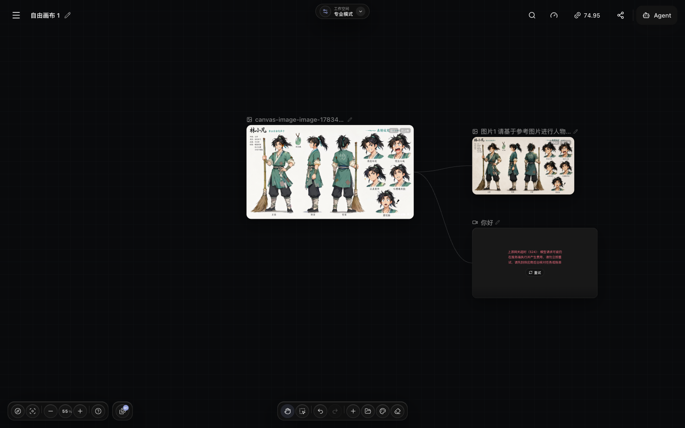

# Yingce open-ai-canvas Source Audit: Not an AI Image Whiteboard, but a Production Graph for Film Assets, Generation Jobs, and Agents

> **Bottom line:** Yingce is not a front-end demo that arranges AI images on an infinite canvas. It is a self-hostable AI film workbench: a custom node canvas carries scripts, characters, storyboards, images, video, and audio; a Go backend manages asset ownership, asynchronous jobs, model channels, billing, and synchronization; Agent, 3D previs, and timeline editing operate on the same project state. It is not a new video model. External providers still generate the media, while the project's own documentation says that important paths such as real-model Agent writes and billing, 3D previs, and some export flows still require live-environment acceptance.


The user-linked [`donghaozhang/open-ai-canvas`](https://github.com/donghaozhang/open-ai-canvas) is a fork of [`ddcat-ai/open-ai-canvas`](https://github.com/ddcat-ai/open-ai-canvas), not an independent implementation. This audit pins the fork to commit [`27c8066`](https://github.com/donghaozhang/open-ai-canvas/tree/27c8066e6da9f0d4754dc0e5c40097049fe730cf), dated October 12, 2026. At audit time, upstream was already two commits ahead, including another canvas-sync fix. The technical claims below therefore describe that fixed snapshot rather than pretending the fork is the latest upstream state.

---

## 01 | “Canvas” is the interface, not the product boundary

A typical AI canvas places nodes, draws edges, and calls models. Yingce extends each action into a production workflow:

- text, scripts, characters, scenes, styles, storyboards, images, video, audio, and drawings are semantically distinct nodes;
- edges carry operational meaning, including references, first and last frames, audio references, and generation context;
- generation jobs have queues, progress, logs, cancellation, retry, quotes, billing, and asset persistence;
- projects retain chapters, character assets, storyboard tables, 3D previs, timelines, and version state;
- administration covers model channels, logical models, pricing, credits, object storage, users, and operations data.

The result is closer to a **production graph**. Canvas nodes expose production objects that people can inspect and revise, while backend jobs, assets, and permissions keep those objects durable and executable.


This is also the crucial difference between Yingce and “tldraw with model buttons.” The main production canvas is not tldraw. The source implements its own pan and zoom behavior, touch gestures, box selection, node movement, edge hit testing, spatial indexing, stack order, level of detail, and render budgets. tldraw 5.2.5 and Excalidraw 0.18.1 are **embedded editors inside drawing nodes**. New drawings default to Excalidraw; old tldraw documents remain readable, while production creation with tldraw requires a separately configured license key.

---

## 02 | The important abstraction is not “many models,” but durable model output

The browser does not treat an arbitrary URL returned by a provider as a completed asset. Requests pass through a shared task layer. Output is persisted as a resource owned by the current user and then attached to a node and the asset library. Generated video does not become successful until the resource cache is complete, and the backend checks business references before deleting media.

That closes three common breaks in AI film tools:

1. a provider returned media, but the canvas cannot find it after refresh;
2. a multi-image response was collapsed into or overwritten by its first result;
3. the canvas rendered a temporary Blob URL that fails during export, synchronization, or reuse.

Provider support is not hard-coded into individual pages. The audited snapshot contains **102 `.yingce-plugin` protocol packages**, spanning text, image, video, audio, and payment integrations. A plugin manifest declares capabilities, authentication, endpoints, request mapping, polling, and response normalization. The host supplies channel configuration, logical models, capability checks, jobs, billing, and persistence.

This does not mean the repository contains 102 models. Model weights and commercial services remain external. Operators still need their own providers, keys, quotas, and contractual rights. Yingce supplies the adapter layer that turns heterogeneous APIs into one production-job system.

---

## 03 | Canvas synchronization resembles a small database protocol, but it is not real-time collaboration

Early infinite canvases often overwrite one large JSON document. Yingce's current [`canvas-operations-sync`](https://github.com/donghaozhang/open-ai-canvas/blob/27c8066e6da9f0d4754dc0e5c40097049fe730cf/docs/content/docs/backend/canvas-operations-sync.mdx) instead sends operations at object and field granularity:

```text
browser draft
  ├─ add / update / delete node
  ├─ add / update / delete connection
  └─ set top-level production field
          ↓ mutationId + base version + field baseline
server transaction
          ↓ ownership / conflict / quota / reference validation
receipt + new version
```

Each mutation has a unique `mutationId`, so a client can replay the same ID and payload after a lost response. Concurrent edits to different fields may merge, while conflicting baselines on the same field fail explicitly. A late update cannot resurrect an object that has already been deleted. The browser retains confirmed baselines and unconfirmed mutations, then resumes submission after connectivity returns.

This is substantially safer than last-writer-wins document replacement, but the documentation is explicit: it does **not** provide multi-user real-time collaboration. It addresses recovery, idempotency, local conflict, and deletion safety rather than Figma-style cursors or CRDT coediting.

---

## 04 | The Agent's meaningful advance is controlled mutation, not a chat panel

Yingce's Agent is more than a question-answer bot reading the canvas. The code contains persistent conversations, SSE event replay, plans, skills, memory, canvas summaries, structured reads, mutation operations, media generation, approval, and recovery. Before a write, the server can check:

- whether the user owns the target canvas and resources;
- whether the run still matches the canvas snapshot it observed;
- whether a node type and field are allowed by the capability registry;
- whether approval is required and its `callHash` remains valid;
- whether a paid generation was quoted, approved, and submitted through the job system;
- whether a retry could duplicate a generation that has already incurred cost.

That is much safer than asking a language model to emit a replacement canvas JSON document. The Agent can read a bounded summary before inspecting selected nodes, submit structured operations, separate paid generations from ordinary canvas edits, and preserve execution records in conversation history.

One apparently contradictory boundary must remain visible. The README still summarizes the cloud Agent as being in a “current read-only stage,” while the feature documentation describes approved writes and generation infrastructure but says that live model billing and browser integration remain unaccepted. The conservative interpretation is: **the mutation infrastructure exists in source, but the maintainers have not yet made end-to-end production behavior a stable promise.** I did not configure paid models or a real user account, so this audit does not turn code presence into proof of a completed live workflow.

---

## 05 | Film workflow is not a label: previs and editing have separate execution layers



The repository includes two downstream paths that many products marketed as an “AI canvas” omit.

The first is a **3D director stage**. Three.js, React Three Fiber, and Drei place actors, proxy poses, lights, cameras, and shots in a browser scene. A previs clip is not merely an LLM description: the browser records the real viewport and writes the result back as a canvas video node. The documentation calls this a 3D-BOX core MVP and deliberately leaves complex scene authoring, semantic Agent writes, and multishot editing to later stages.

The second is a **timeline editor**. The project defines its own command protocol and plugin boundary for arrangement, splitting, trimming, transcription, preview, and server export. The browser handles low-latency preview; the server is responsible for reproducible final rendering, while Whisper transcription and render work enter the shared task center. It is not yet a reason to replace Premiere or Resolve, but it goes beyond downloading disconnected MP4 files.

The architectural value is shared asset identity. An approved shot on the canvas can enter the timeline, while previs can return to the canvas as input for another generation. The workflow no longer depends entirely on manually moving anonymous files between three unrelated tools.

---

## 06 | The administration console reveals the larger ambition: an operable generation platform


Looking only at creation makes Yingce resemble an open-source AI whiteboard. The administration surface exposes a broader product:

- system channels and logical models map one display model to multiple provider routes;
- pricing tiers, cost snapshots, credits, orders, and reconciliation support internal or commercial operation;
- request logs, success rates, latency, queues, and anomaly analysis support production diagnosis;
- local disk, OSS, COS, and S3-compatible storage deliver media;
- feature flags, registration policy, announcements, branding, and per-user storage quotas support a multi-user instance.

The stack follows that objective. React 19, Zustand, localForage, and SSE power the workspace. Gin and GORM organize the backend around handler, service, and repository layers. Local installations may use SQLite, while deployments can use PostgreSQL and Redis. Nginx exposes only the web entry point. `yingce-agent` can run in a separate container so an Agent-process failure does not take down the main API.

This is approaching an open foundation for a generative creative SaaS. It is correspondingly heavier than a personal whiteboard: migrations, object storage, queues, secrets, quotas, backups, and upgrades become operator responsibilities.

---

## 07 | What I independently verified

I checked out commit `27c8066` on an Apple Silicon Mac and used the project's pinned Bun 1.3.9 with local Go 1.26.3:

| Check | Result | Evidence boundary |
|---|---|---|
| Repository structure | 4,187 tracked files, 1,014 files under `web/src`, and 941 backend Go files | Establishes substantial implementation, not quality |
| Protocols and skills | 102 `.yingce-plugin` packages and 71 built-in `SKILL.md` files | Includes payment protocols; does not mean 102 free models |
| Front-end dependencies | `bun install --frozen-lockfile` succeeded | Establishes lockfile installation only |
| Front-end static checks | TypeScript typecheck and ESLint passed | Does not validate every browser interaction |
| Front-end tests | 2,207 passed, 0 failed, across 304 test files | Limited to repository automation coverage |
| Production bundle | Vite build succeeded | Compilation is not a real generation workflow |
| Backend tests | Installed the `backend/agent-runtime/pi` production dependencies used by CI, then `go test -timeout=20m ./...` passed in full | Local run did not provision the CI PostgreSQL DSN and Redis dependency gates |
| Agent runtime dependency audit | `npm audit --omit=dev` reported two high-severity entries | Direct `undici 7.28.0` and transitive `brace-expansion 5.0.9`; fixed versions are available |

The front end contains roughly 177,600 lines of TypeScript/TSX and the backend roughly 197,300 lines of Go; the repository contains 373 Go test files. Running the README's short `go test ./...` command first caused five Cloud Agent E2E tests to fail because `undici` was missing. The CI workflow actually runs `npm ci --omit=dev --ignore-scripts` inside `backend/agent-runtime/pi` before Go tests. After adding that prerequisite, the failed `internal/app` package passed on rerun, followed by another full backend test run that also passed. The discrepancy matters because the README's minimal verification command does not fully express the Agent runtime prerequisites.

Dependency scanning also produced a result worth preserving. At audit time, the locked Agent runtime production tree triggered two high-severity entries: direct dependency [`undici 7.28.0`](https://github.com/advisories/GHSA-w293-vg96-wgc3) and transitive [`brace-expansion 5.0.9`](https://github.com/advisories/GHSA-qhr7-859c-m2p7) beneath `@earendil-works/pi-coding-agent`. npm reported that fixes were available. This audit does not prove that either advisory is exploitable through Yingce's specific call paths, but public operators should upgrade, retest, and rescan before deployment.

The code and test counts demonstrate engineering effort, not product acceptance. I did not independently validate paid image or video providers, actual billing, object storage, multi-user load, 3D film quality, long timeline export, or public deployment rollback.

---

## 08 | Where it advances beyond an ordinary AI canvas, and what that costs

| Dimension | Typical node canvas | Yingce open-ai-canvas |
|---|---|---|
| Nodes | Generic text, image, and model calls | Scripts, characters, storyboards, media, drawings, batch tables, and production state |
| Output | Temporary URL or downloaded file | Job, resource, library asset, references, and versions remain bound |
| Agent | Chat or whole-document JSON mutation | Summary reads, structured operations, approval, snapshots, and billing gates |
| Models | Provider logic inside the UI | Declarative protocol packages, channels, logical models, and capability checks |
| Downstream | Stops at generated media | 3D previs, captions, timeline, and server rendering |
| Deployment | Static site or light service | Database, queue, object storage, Agent container, and operations console |

The advance is not feature count. It is that **one production state has explicit ownership, transactional behavior, task identity, and review boundaries**. Longer workflows become easier to recover, trace, and continue editing.

The cost is equally real. The system is harder to deploy and more sensitive to provider contracts and database migrations. The front-end bundle is large. Real media remains constrained by cost, network conditions, and provider reliability. Agent, previs, and editing acceptance has not fully converged. The product is best suited to a team willing to operate private AI film infrastructure, not someone who occasionally wants one image from a browser tab.

---

## 09 | Four boundaries to understand before deployment

1. **Do not expose the default instance directly to the public internet.** The project instructs operators to register the first administrator on a controlled network, disable public registration, configure explicit CORS, use HTTPS, and keep backend port 8080 private.
2. **Open source does not grant unconditional use of every dependency.** The main project is MIT, but third-party components retain their own terms. Production tldraw use requires the operator's own license key, which is why new drawings default to Excalidraw.
3. **Plugin count is not model ownership.** API keys, quotas, model availability, and output rights remain the operator's responsibility.
4. **Passing tests is not passing a film review.** Unit tests and builds validate software contracts, not a real paid generation, a long export, character continuity, or final aesthetic quality.

The fairest one-line description is: **Yingce does not merely place model buttons on an infinite canvas. It tries to turn AI film objects, jobs, assets, costs, and Agent actions into a recoverable, approvable, continuously editable production graph. The engineering skeleton is already substantial, but “deploy it and it makes a film” still depends on real-model, operational, security, and creative acceptance.**

---

## Primary sources

- [The user-linked `donghaozhang/open-ai-canvas` fork](https://github.com/donghaozhang/open-ai-canvas)
- [Official upstream `ddcat-ai/open-ai-canvas`](https://github.com/ddcat-ai/open-ai-canvas)
- [Audited commit `27c8066`](https://github.com/donghaozhang/open-ai-canvas/tree/27c8066e6da9f0d4754dc0e5c40097049fe730cf)
- [README, architecture, and deployment boundaries](https://github.com/donghaozhang/open-ai-canvas/blob/27c8066e6da9f0d4754dc0e5c40097049fe730cf/README.md)
- [Feature inventory and live-environment acceptance notes](https://github.com/donghaozhang/open-ai-canvas/blob/27c8066e6da9f0d4754dc0e5c40097049fe730cf/docs/content/docs/overview/features.mdx)
- [Canvas operations synchronization protocol](https://github.com/donghaozhang/open-ai-canvas/blob/27c8066e6da9f0d4754dc0e5c40097049fe730cf/docs/content/docs/backend/canvas-operations-sync.mdx)
- [Agent HTTP contracts and approval boundaries](https://github.com/donghaozhang/open-ai-canvas/blob/27c8066e6da9f0d4754dc0e5c40097049fe730cf/docs/content/docs/backend/http-api.mdx)
- [Timeline editor integration boundary](https://github.com/donghaozhang/open-ai-canvas/blob/27c8066e6da9f0d4754dc0e5c40097049fe730cf/docs/adr/0001-editor-integration-boundary.md)
- [Security policy](https://github.com/donghaozhang/open-ai-canvas/blob/27c8066e6da9f0d4754dc0e5c40097049fe730cf/SECURITY.md)
- [Front-end dependencies and verification commands](https://github.com/donghaozhang/open-ai-canvas/blob/27c8066e6da9f0d4754dc0e5c40097049fe730cf/web/package.json)

*Audited on October 13, 2026. Features, stars, forks, releases, and upstream commits will continue to change; technical conclusions are pinned to commit `27c8066`. Product-capability descriptions come from project source and documentation. Claims involving real-model quality, billing, 3D previs, or long-form delivery were not independently validated in a commercial environment.*
