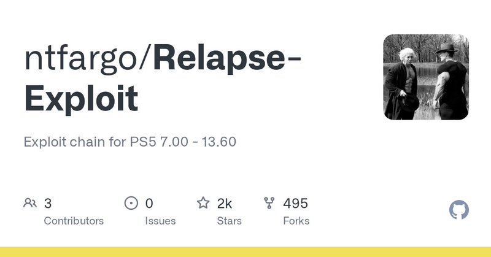
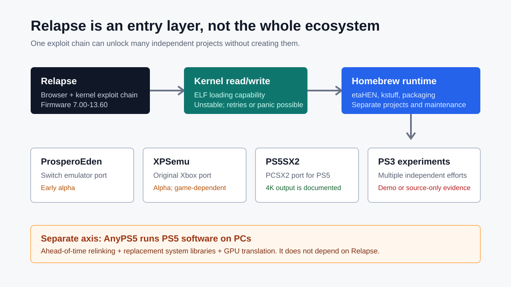
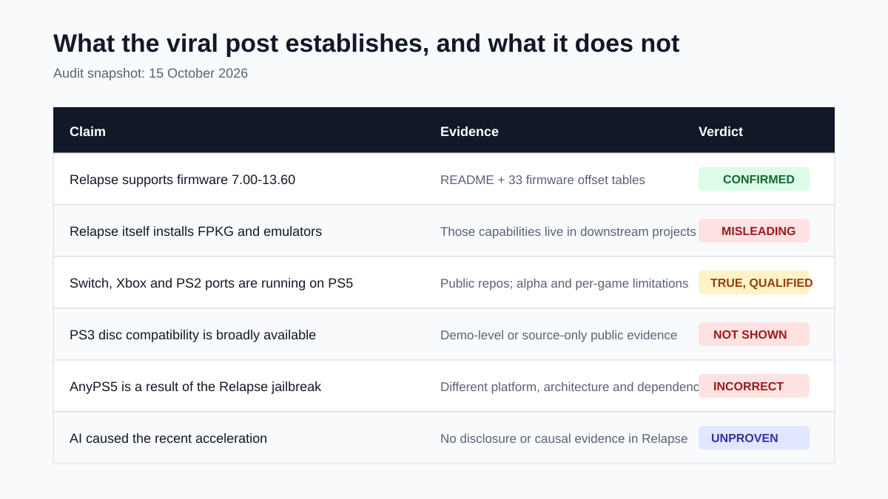

# Auditing the PS5 Relapse Wave: The 7.00-13.60 Kernel Entry Is Real, but “Total Collapse” and AI Acceleration Are Not Established

> **Bottom line:** [MrWhite's post](https://x.com/neuronxwhite/status/2109987887945248960) identifies a real acceleration in PS5 homebrew. Relapse does extend its public exploit chain across firmware 7.00-13.60, while Switch, Xbox, PS2, and PS3 projects appeared or advanced around the same time. But the post compresses an **exploit entry, homebrew runtime, independent emulators, a PC compatibility layer, and used-hardware pricing** into one causal story. A better reading is that the PS5 scene gained a broadly shared foundation. It did not suddenly compromise every PS5, and Relapse did not itself deliver FPKG installation, four generations of emulation, and native PC execution.

On October 13, 2026, the post declared that the “PS5 defenses had fallen.” It cited FPKG installation, Switch and original Xbox emulation, 4K PS2 games, a PS3 disc demonstration, Dead Cells through AnyPS5 on PC, and a $1,399 used PS5 Pro at GameStop. Two days later, I fixed the Relapse audit at commit [`dd8e4e0`](https://github.com/ntfargo/Relapse-Exploit/tree/dd8e4e0914c5e9d066ee1f9b056be76cb992c8e0) and cross-checked the downstream projects.

The key distinction is simple: **Relapse provides an entry; downstream projects provide capabilities.**

---

## 01 | What Relapse Actually Ships

The Relapse repository explicitly supports firmware **7.00 through 13.60**. Its source contains 33 corresponding firmware offset tables, from 7.00 and 7.01 through 13.60. The public chain combines browser and kernel stages, establishes kernel read/write, and provides the entry needed to load homebrew programs.

That confirms the post's central technical fact. This is not a concept diagram; it is a public, auditable exploit chain covering several firmware generations.

The repository also states the limits. The browser stage may require retries, while the kernel stage can hang or panic the console. Use can introduce instability, data loss, and account bans. A support range does not mean that “everything below 14.00 automatically works”: the exact firmware, environment, downstream components, and stability all matter.

---

## 02 | Why It Still Matters

Relapse matters because it reduces the cost of finding a common entry point, not because it turns into an app store. Fragmented firmware, exploits, and loaders previously split developers into small islands. When 7.00-13.60 can converge around similar kernel read/write and program-loading paths, emulators, drivers, SDKs, homebrew shells, and debugging tools can share infrastructure and testers more easily.

The repositories reveal at least four separate layers:

1. **Relapse:** browser and kernel exploit chain;
2. **Runtime:** independent projects such as etaHEN, kstuff, and ShadowMountPlus;
3. **Graphics and development foundation:** PS5 Mesa/RADV, Vulkan, payload SDKs, and packaging tools;
4. **Applications:** ProsperoEden, XPSemu, PS5SX2, and early PS3 efforts.

It is reasonable to observe that many projects became visible after a common foundation arrived. It is not accurate to say Relapse implemented all of them.

---

## 03 | Claim by Claim

| Claim | Current evidence | Audit verdict |
|---|---|---|
| Relapse supports 7.00-13.60 | README and 33 firmware offset tables agree | **Confirmed** |
| Relapse installs FPKG and emulators | Those capabilities belong to downstream runtime and application projects | **Possible outcome, incorrect attribution** |
| A Switch emulator runs on PS5 | [ProsperoEden](https://github.com/blackbearreloaded/ProsperoEden) publishes source and confirms video, audio, input, and saves | **Confirmed, still early alpha** |
| Original Xbox and Halo 2 at 60 FPS | [XPSemu](https://github.com/ZiZc3/XPSemu) is a real xemu port with patch support; its repository does not qualify “stable 60 FPS in Halo 2” as an acceptance result | **Project confirmed, specific frame-rate claim under-evidenced** |
| PS2 games at 4K | [PS5SX2](https://github.com/Swordpdf/PS5SX2) documents up to 6x internal resolution, 4K output, and per-game tests | **Confirmed with game-dependent limits** |
| A physical PS3 disc boots GT5 | The source post includes no demonstration media; public [KB-RPCS3](https://github.com/kamb205/KB-RPCS3) is source-only, has no PS5 binary, and does not list GT5 in its verified table | **At most demo-level evidence, not reproducible broad compatibility** |
| AnyPS5 runs PS5 games on PC | AnyPS5 is an independent PC relinking and compatibility project | **Direction is real; no causal dependency on Relapse** |
| AI accelerated the entire wave | Relapse's README, history, and credits disclose no such causal role | **Unproven** |

The table exposes a recurring problem in viral summaries: **a demonstration is not a reproducible release, a repository is not mature compatibility, and events in the same week do not necessarily share a cause.**

---

## 04 | The Emulator Wave Is Real, but Maturity Varies Widely

ProsperoEden ports Eden to the PS5 and uses a Mesa/RADV Vulkan path on the console. It offers rendering from 0.5x to 4x and 1080p, 1440p, or 2160p output. Its own repository calls it an early alpha and warns that compatibility and performance vary by game. Users must provide legally dumped keys, firmware, and games.

XPSemu brings xemu's Xbox CPU, NV2A GPU, audio, and controller systems to the PS5. Its repository labels the project Alpha 2. It has a patch system and resolution scaling, but the public README does not establish that Halo 2 sustains 60 FPS throughout play. Combining a patch, a peak in one scene, and whole-game performance into one sentence erases the relevant test conditions.

PS5SX2 has the strongest public evidence. It documents PCSX2's recompilers, its Vulkan renderer, up to 6x internal resolution, 4K output, and a game table recording console model, firmware, resolution, and frame rate. That does not mean every PS2 game runs at 4K and full speed, but each result has a traceable test boundary.

PS3 work is visibly earlier. KB-RPCS3 Alpha 0.1.0 currently publishes source only; an unresolved license combination prevents a downloadable PS5 binary. Its public verification covers LIMBO, WWE '12, and GTA IV, and it says genuine hardware captures are still pending. It cannot substantiate the post's GT5 physical-disc demonstration or a claim of mature PS3 backward compatibility.

---

## 05 | AnyPS5 Is a Different Axis, Not a Relapse “Consequence”

Relapse asks: **How can a PS5 on a supported older firmware obtain a homebrew execution foundation?**

AnyPS5 asks: **How can a PS5 x86-64 executable be relinked into a Windows or Linux process, with replacement system libraries and Vulkan translation bridging the platform differences?**

Their target platforms, inputs, and engineering problems differ. AnyPS5 does not need Relapse to be developed on a PC. The `OverkillLabs/DeadCells-PS5-Native` repository cited around the claim was indexed by GitHub search as a standalone Windows program built on AnyPS5, but it returned 404 during the October 15 audit. It should therefore not be treated as a continuously reproducible public release.

For a closer explanation of what “native” means in AnyPS5 and why its percentages are not game-completion metrics, see the earlier [full source audit](../2026-10-01/2026-10-01-anyps5-native-relinker-progress-metrics-audit-en.md).

---

## 06 | Old Firmware Is Not a Free Upgrade

Relapse stops at 13.60 while Sony continues to release system software. Preserving an older firmware may mean giving up minimum versions required by later games, PSN functionality, security fixes, and the normal update path. Updating to a patched release can remove the current entry.

“13.60 and below has a public entry” cannot be translated into “buy any PS5 and get every capability.” Firmware, network history, console model, runtime, and each project's compatibility table all affect the result. The exchange is explicit: **homebrew research access in return for official-ecosystem currency and stability.**

---

## 07 | The $1,399 Price Was Real, but It Does Not Prove Jailbreak Demand

[Tom's Hardware](https://www.tomshardware.com/video-games/playstation/used-ps5-pros-now-cost-usd1-399-at-gamestop-50-percent-more-than-new-ones-retailer-bumps-price-of-refurbished-consoles-as-brand-new-units-remain-out-of-stock) recorded GameStop listing used or refurbished PS5 Pro units at $1,399.99 on October 6. The post's number therefore had contemporaneous support.

The increase also occurred amid new-unit shortages, a higher official price, and rising demand ahead of GTA VI. No sales-composition data ties the $500 premium to Relapse or homebrew. It is a real market event, not a causal measure of exploit impact.

[Rockstar's official page](https://www.rockstargames.com/VI) lists November 19, 2026 as GTA VI's release date. Existing evidence cannot responsibly predict when it might be compromised: the game, console firmware, keys, online services, and anti-tamper systems are separate problems.

---

## 08 | “Jailbreaking Is Illegal in the US” Is Also Too Absolute

Section 1201 of the US Digital Millennium Copyright Act generally restricts circumvention of access controls, but “all jailbreaking is illegal” is not an accurate summary. The US Copyright Office's current [37 CFR §201.40](https://www.copyright.gov/title37/201/37cfr201-40.html) contains tightly purpose-bound exemptions, including qualifying good-faith security research. Game preservation and console repair exemptions also exist within narrow scopes. The current console-repair provision is limited to optical-drive repair or replacement and requires restoration of the circumvented protections.

These exemptions do not authorize piracy, immunize a person from other laws, or automatically cover ordinary homebrew use. The accurate statement is that **legal consequences depend on how the device was acquired, the purpose of circumvention, subsequent use, copying and distribution, and jurisdiction.** This article is not legal advice.

---

## 09 | AI May Reduce Porting Cost, but Causation Is Not Established Here

AI coding tools can plausibly help developers inspect porting failures, complete build scripts, organize logs, or iterate on compatibility code. Public AnyPS5 discussions even mention assistants being used for setup or measurement. That establishes individual workflows, not that AI discovered the Relapse vulnerabilities or caused several independent emulators to appear.

The evidence supports a less dramatic explanation: a broad firmware entry, mature open-source emulators, PS5 Mesa/RADV graphics work, payload SDKs, homebrew runtimes, and more testable consoles converged at the same time. AI may be one accelerator, but the post does not establish it as the principal cause.

The most accurate summary is therefore: **the PS5 did not “collapse overnight.” It gained a shared research foundation spanning firmware 7.00-13.60, making it easier for several long-running open-source efforts to converge on real hardware. The genuine breakthrough is lower ecosystem coordination cost, not universal access across every game, firmware, and use case.**

---

## Primary Sources

- [Original post by MrWhite](https://x.com/neuronxwhite/status/2109987887945248960)
- [Relapse Exploit repository](https://github.com/ntfargo/Relapse-Exploit)
- [Audited snapshot `dd8e4e0`](https://github.com/ntfargo/Relapse-Exploit/tree/dd8e4e0914c5e9d066ee1f9b056be76cb992c8e0)
- [ProsperoEden](https://github.com/blackbearreloaded/ProsperoEden)
- [XPSemu](https://github.com/ZiZc3/XPSemu)
- [PS5SX2](https://github.com/Swordpdf/PS5SX2)
- [KB-RPCS3](https://github.com/kamb205/KB-RPCS3)
- [AnyPS5](https://github.com/boykopovar/AnyPS5)
- [US Copyright Office, 37 CFR §201.40](https://www.copyright.gov/title37/201/37cfr201-40.html)
- [PlayStation 5 system software support](https://www.playstation.com/en-us/support/hardware/ps5/system-software/)
- [Rockstar Games: GTA VI](https://www.rockstargames.com/VI)

*Audited October 15, 2026. Repositories, compatibility tables, firmware support, and retail prices will continue to change; technical findings are fixed to the audit snapshot named above. This article verifies public source and claims only. It does not provide exploit, payload execution, FPKG installation, key extraction, or piracy instructions.*
