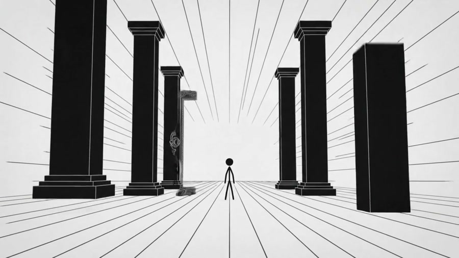
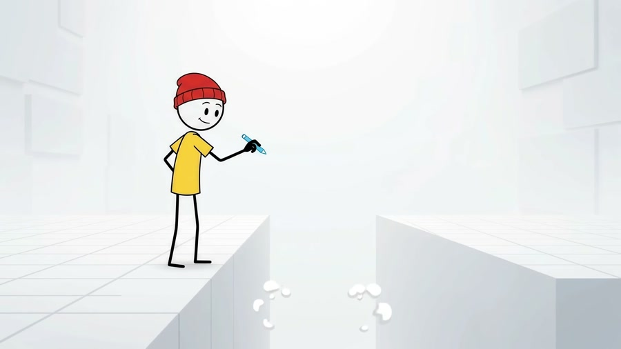
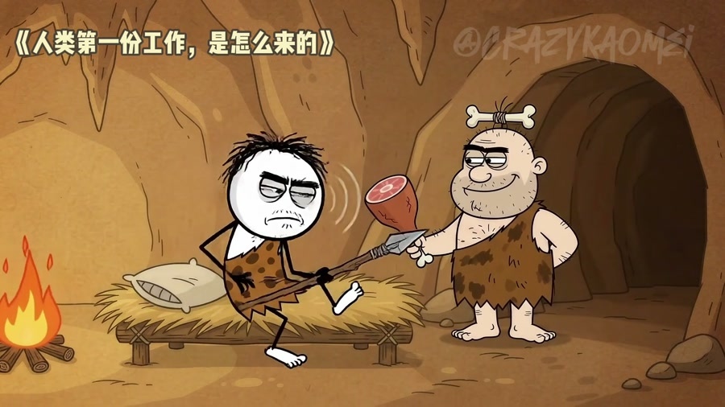

# Inside Stickman Video Director: Not a Video Generator, but a Codex-to-Gemini Prompt Production Line

> **Bottom line:** [`donghaozhang/stickman-video-director`](https://github.com/donghaozhang/stickman-video-director) neither renders video nor calls Gemini directly. The supplied URL is a synchronized fork of [`kaomei/stickman-video-director`](https://github.com/kaomei/stickman-video-director); its core consists of one Codex Skill and six production references. The Skill asks a coding agent to turn copy into a director's proposal, wait for approval, and then emit a set of standalone prompts for roughly ten-second Gemini Omni Flash clips. A human still generates, selects, stitches, and subtitles the footage. This is not a Remotion-style rendering engine. It is a pre-production line connecting copy, directorial decisions, cross-clip continuity, and model prompts.

This audit is pinned to the October 13, 2026 commit [`544254d`](https://github.com/kaomei/stickman-video-director/tree/544254ddf6430c7d0c35aca4c42211586e39efb0). At audit time, the user fork and upstream `main` resolved to the same commit. Upstream had 1,849 stars and 284 forks, used the MIT license, and had no version tag or GitHub Release. Counts and status will change; technical conclusions below are tied to the pinned source.

---

## 01 | Start with the boundary: it emits prompts, not video

There is no React or Remotion project, Canvas renderer, FFmpeg pipeline, Gemini API integration, Flow automation, MCP server, timeline editor, or stitching code in this repository. After installing and invoking `$directing-stickman-videos` in Codex, the deliverables are:

- a director's proposal with title, narrative arc, English voiceover, reference translation, shots, camera, transitions, music, and sound effects;
- N standalone English generation prompts, each targeting roughly ten seconds, where `N = total duration / 10`;
- a stitching guide that matches every clip to the next;
- a voice and music continuity note;
- optional post-production subtitle guidance, kept outside the generation prompts by default.

Actual generation remains in Google Flow or another tool that supports the relevant model. Generation fees, retries, account actions, and public uploads are outside the Skill. The committed MP4s and GIFs are demonstration footage, not artifacts rendered by local repository code.

Its relationship to Remotion is therefore straightforward. Remotion turns React code into deterministic frames; Stickman Video Director turns source copy into a directorial package for a probabilistic video model. One controls pixels, while the other controls intent.

---

## 02 | The core is not the stick figure, but a two-phase approval gate

An unconstrained agent can receive only a topic, silently choose `9:16`, a visual style, and a narrator, then deliver a large final prompt. This Skill deliberately inserts two gates.

The **Setup Gate** requires source material, a `16:9` or `9:16` ratio, and an explicit style. Only duration may default to 60 seconds. Urgency, generation cost, client pressure, or a request to “pick normal settings” cannot waive the missing choices.

The **Approval Gate** divides work into two phases:

1. Phase A produces only a director's proposal and stops.
2. Phase B loads the full prompt contract and produces generation prompts only after explicit approval of that current proposal.

If the user changes ratio, duration, style, narration, or global direction, the old approval becomes invalid. Replacing the string `9:16` with `16:9` is not a valid revision: landscape requires lateral staging and tracking, while portrait requires depth, stacked motion, and a mobile safe area. The agent must recompose and seek approval again.

The value is not simply more process. It places the cheapest review before the most expensive mistake: users approve text before sending six prompts to a paid video model.

---

## 03 | Sixty seconds is six independent worlds, not one prompt

A default one-minute project becomes six roughly ten-second jobs, and each job contains `[0–3s]`, `[3–7s]`, and `[7–10s]` action beats. Every prompt must stand alone because the video model does not automatically remember a previous generation.

This creates a concrete engineering question: **how do you replicate state across six stateless requests?** The Skill does not rely on “same character.” It repeats critical state in every prompt:

- the complete character anchor, line weight, palette, and environment;
- ratio, duration, 720p/24 FPS targets, and negative constraints;
- the inherited first-frame state and outgoing final-frame state;
- a complete frozen narrator block rather than “continue the previous voice”;
- instrumentation, tempo, and emotional direction inherited from clip one;
- exact English dialogue, treated as audio only and forbidden from being rewritten or drawn as subtitles.

In effect, the project uses natural language as a form of state serialization. Each request carries a snapshot of character, voice, scene, and transition state. That cannot force a diffusion model to comply, but it is much more inspectable than relying on chat context or a one-line continuity reminder.

---

## 04 | Five implemented options, while six more remain a roadmap

The current Skill implements these visual branches:

| Style | Visual contract | Suitable content |
|---|---|---|
| Style 1 Light | White background, black line art, up to three accents | Science, psychology, business, and concept explainers |
| Style 1 Dark | Black background, white line art, frozen full character anchor | High-contrast stories and abstract explanation |
| Style 2A Modern Studio Tech | Red beanie, yellow shirt, white studio, cyan/blue UI | AI, technology, and product explanation |
| Style 2B Cinematic Story | The same character in full-color cinematic environments | Growth stories, life topics, and emotional narratives |
| Style 3 Prehistoric Dark Comedy | Hand-drawn prehistoric cast, earthy settings, story-specific identity locks | Workplace satire, dark comedy, and children's stories |

Style 2A and 2B share character DNA, so the repository calls these four style families. README ideas for Styles 4–9, including realistic 3D backgrounds, classroom explanation, picture books, fighting, two-person comedy, and card-based progression, are explicitly roadmap items. They have no corresponding contract, example, or test and should not be counted as supported features.

Style 3 is not merely a cave background applied to the classic figure. It overrides the generic five-stage emotional engine with setup, escalation, and ironic payoff; allows faces and held reaction beats; and requires cast cards, scene layout, and prop ownership. A stone must have a known starting point, transfer, and destination across clips so it does not duplicate or teleport.

---

## 05 | Why freeze a full voice profile instead of writing “same narrator”

When six clips are generated independently, “same narrator” has no shared reference object. The repository therefore expands the narrator into identity and age, accent, timbre, register, resonance, rasp, breathiness, delivery, pace, and recording treatment, then repeats the approved English block verbatim in every prompt.

This is a sensible prompt-engineering correction, but its evidence boundary matters. The repository documents one three-clip Style 2A male-voice comparison. The user listened and judged the revised clips to sound like one person; the agent did not receive the audio for independent listening and no speaker-embedding similarity score was calculated. Female, older, cross-style, different-topic, and longer-form voices lack the same provider-backed test.

A complete voice block is therefore a stronger control condition, not voice cloning. Where exact identity matters, the repository itself recommends a supported audio reference or replacing generated narration and music with one continuous external track in post-production.

---

## 06 | What it adds beyond directly asking Codex for prompts

The persuasive part is not prompt length. The Skill converts common shortcuts into explicit invariants:

| Directly ask Codex for video prompts | Use Stickman Video Director |
|---|---|
| The agent may silently choose ratio and style | Missing setup stops the workflow and is requested in one message |
| Topic approval may be treated as prompt approval | The current Phase A requires separate approval |
| A ratio change may become string replacement | The composition must be rebuilt and approved again |
| Every segment says “same character/voice” | Every segment repeats complete character and voice state |
| Clips simply end | Final frames are recorded and matched to the next opening |
| The model draws captions, often badly | Visible text is forbidden by default and moved to post |
| Failures can trigger open-ended retries | Start with a small test and stop on material identity/action drift |

This makes the Skill behave more like an executive producer and storyboard director than a new model. It improves planning, inspectability, and pre-generation error discovery. Whether a character remains stable, a door deforms, or a voice actually matches still depends on the video model and human acceptance.

---

## 07 | Testing is unusually serious for a prompt repository, but it is not video CI

I ran all three executable checks at pinned commit `544254d`:

| Check | Local result | What it actually proves |
|---|---|---|
| `verify-readmes.sh` | Contract passed for six READMEs | Language navigation, sections, installation, and 12 demo assets are present |
| `verify-classic-character.sh` | Passed | The current classic character anchor and prompt contract contain specified constraints |
| `verify-voice-continuity.py` | Passed | Complete voice blocks match in example prompts, while abbreviations and conflicting profiles are rejected |
| Six official MP4s | All decoded with FFprobe; four are about 10 seconds and two about 30 seconds, H.264 at 720p/1080p | Playable examples exist; it does not prove the Skill generated them automatically |

The repository also preserves a project-authored behavioral evaluation. Its August 2026 report says that, without the Skill, all five fresh-context Codex runs silently chose settings and skipped the gate. With the Skill, all five requested missing choices and stopped, improving the setup-gate result from 0/5 to 5/5. Later proposal, approval, recomposition, and long-source scenarios were also reported as passing.

These reports are not continuously rerun CI for the current commit. The repository has no GitHub Actions workflow. Historical reports still include `1:1`, which the current Skill does not accept, plus hexadecimal colors and visible text that the current contract now forbids. On `main`, the voice test compares examples with `origin/main` as its “old version,” so it validates current structure but does not independently demonstrate a historical voice-only diff in this environment.

The precise conclusion is: **the repository has made a real investment in instruction regression, but automated checks mostly validate text structure; it does not yet have unified visual, audio, or cross-clip similarity testing for final video.**

---

## 08 | The official examples expose model limits too

The current contract describes Style 1 Light as a flat, digitally pure-white canvas without texture, gradients, or 3D depth. Yet the official Light demo clearly contains a perspective floor, volumetric pillars, and shading. That does not necessarily mean the current Skill failed, since the demo may predate the stricter contract, but it means the demo is not evidence that every current rule passed a regression run.

The Style 3 film contains a title and Chinese subtitles, while the current contract says generated frames should contain no writing. The project report explains that the user added subtitles while assembling the clips. This usefully demonstrates that the final film still has a post-production layer; not everything visible in the MP4 came from the generation prompt.

The repository is commendably restrained elsewhere. The classic dark character was accepted only on one three-clip anxiety sample, door and prop deformation remains unresolved, and Style 3 has one 30-second workplace satire with user visual acceptance. Repeating prompt text does not guarantee matching faces, voices, or music. The storyboard document's “60%+ completion rate” ambition also has no platform analytics behind it and should be read as a creative framework, not a measured growth result.

---

## 09 | The most accurate positioning

Stickman Video Director suits teams already planning to generate short-form video with Gemini/Flow but unwilling to throw an entire minute of copy directly at the model. It is especially relevant to educational, motivational, psychology, technology, and light narrative content: the user controls narrative and art direction first, and the agent compiles the approved plan into connected generation requests.

It does not fit work that requires deterministic pixels, an editable timeline, automated batch generation, subtitle rendering, final export, or one-click publishing. Those jobs still need Remotion, QCut, CapCut, FFmpeg, Flow automation, or manual editing downstream.

What is worth copying is not the stick-figure look, but three process choices: **approval before generation, complete state replication across stateless clips, and a strict separation between prompt compliance and footage acceptance.** In plain terms, this is not video software. It is a production protocol that teaches Codex to act like a director before an expensive video model enters the room.

---

## Primary sources

- [User-supplied fork: `donghaozhang/stickman-video-director`](https://github.com/donghaozhang/stickman-video-director)
- [Upstream repository: `kaomei/stickman-video-director`](https://github.com/kaomei/stickman-video-director)
- [Pinned audit commit `544254d`](https://github.com/kaomei/stickman-video-director/tree/544254ddf6430c7d0c35aca4c42211586e39efb0)
- [Core Skill contract](https://github.com/kaomei/stickman-video-director/blob/544254ddf6430c7d0c35aca4c42211586e39efb0/skills/directing-stickman-videos/SKILL.md)
- [Director's proposal contract](https://github.com/kaomei/stickman-video-director/blob/544254ddf6430c7d0c35aca4c42211586e39efb0/skills/directing-stickman-videos/references/storyboard-template.md)
- [Omni Flash prompt contract](https://github.com/kaomei/stickman-video-director/blob/544254ddf6430c7d0c35aca4c42211586e39efb0/skills/directing-stickman-videos/references/omni-flash-prompt-contract.md)
- [Voice continuity contract](https://github.com/kaomei/stickman-video-director/blob/544254ddf6430c7d0c35aca4c42211586e39efb0/skills/directing-stickman-videos/references/voice-continuity.md)
- [No-Skill baseline report](https://github.com/kaomei/stickman-video-director/blob/544254ddf6430c7d0c35aca4c42211586e39efb0/tests/reports/baseline.md)
- [Project-authored forward-test report](https://github.com/kaomei/stickman-video-director/blob/544254ddf6430c7d0c35aca4c42211586e39efb0/tests/reports/forward.md)
- [Style 3 evidence boundaries](https://github.com/kaomei/stickman-video-director/blob/544254ddf6430c7d0c35aca4c42211586e39efb0/tests/reports/style-3.md)

*Audit date: October 13, 2026. Stars, forks, model names, the Flow interface, repository contracts, and examples will change; technical findings are pinned to commit `544254d`. Article images are local frames extracted from official MP4 demos at that commit. I did not invoke Gemini for a new paid generation or independently validate completion rate, cross-topic character consistency, speaker similarity, or commercial production reliability.*
