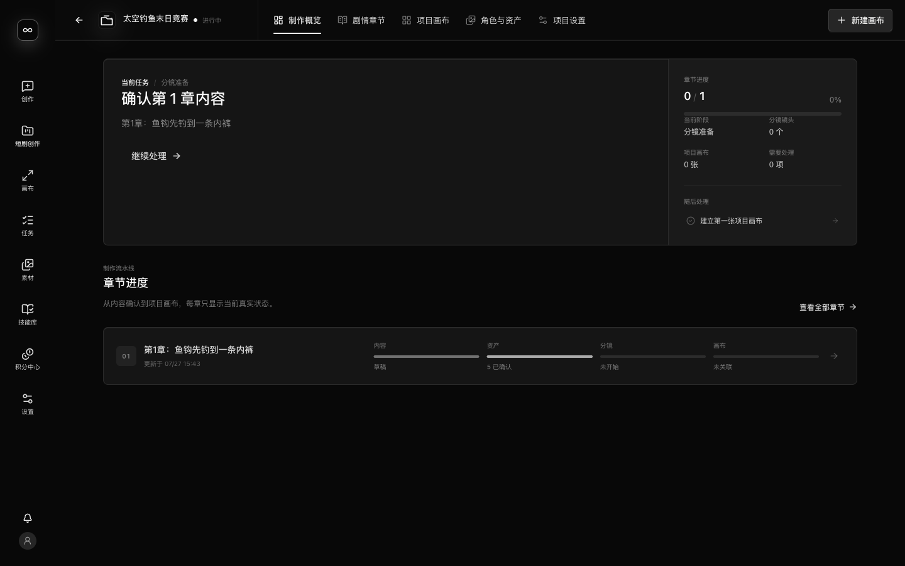
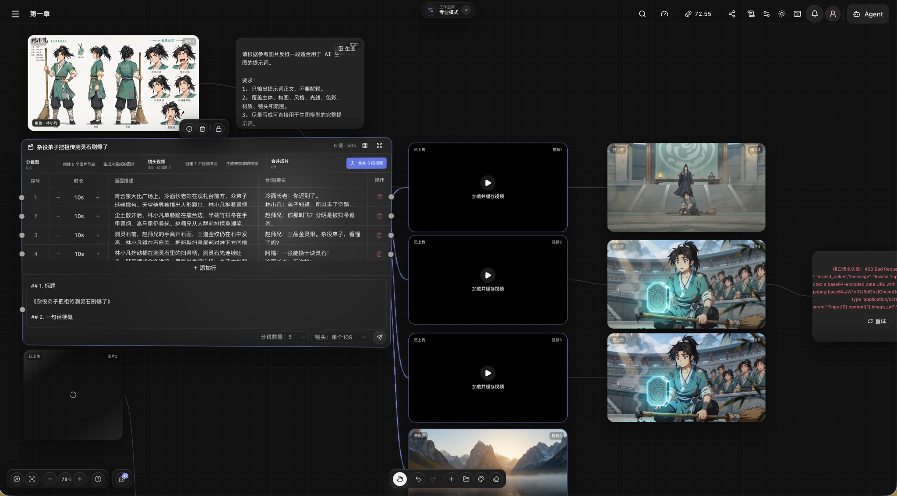
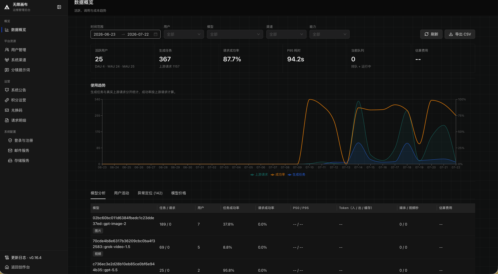

# Inside Yingce's UI: AI Filmmaking Needs an Advancing Production Map, Not More Buttons

> **Bottom line:** the most interesting part of Yingce `open-ai-canvas` is not its dark infinite canvas or the number of models it can connect. It is the attempt to reorganize “making a film” into visible, advancing interface state: projects contain chapters, chapters contain shots, shots reference character and scene assets, outputs enter a job and asset system, Agent actions pass through approval, and accepted shots continue into 3D previs and the timeline. The UI is designed around a production chain that may last days or weeks, not a single prompt.

This is the UI and product-workflow companion to the [Yingce `open-ai-canvas` source audit](2026-10-13-open-ai-canvas-ai-film-production-graph-en.md). It does not repeat the backend, plugin protocol, or test inventory. The analysis is pinned to commit [`27c8066`](https://github.com/donghaozhang/open-ai-canvas/tree/27c8066e6da9f0d4754dc0e5c40097049fe730cf) in the user-supplied fork. As of October 13, 2026, that fork remained on this commit while upstream was seven commits ahead. Every conclusion below describes the pinned snapshot, not the latest upstream release.

---

## 01 | The Production Overview Answers “How Far Along Is the Film?”

Yingce does not drop users directly onto an empty canvas. The production overview first presents the current task, chapter progress, confirmed assets, pending storyboards, and next actions. That sequence matters: the central question in a film project is usually not “which model can I call?” but “what is still missing from this chapter?”

The interface organizes state into several levels:

- the project level stores the work, aspect ratio, default models, and overall progress;
- the chapter level stores text, shot count, asset confirmation, and storyboard progress;
- the shot level stores description, action, dialogue, framing, camera, duration, and continuity;
- the generation level stores jobs, versions, quotes, progress, failures, and results;
- the delivery level moves approved shots into previs or the timeline.

“Continue processing” therefore becomes a concrete action rather than a memory exercise. The overview functions as a **project re-entry interface**, helping creators recover context after an interruption.

---

## 02 | Projects, Chapters, Assets, and Canvases Form One Navigation Chain

The top project navigation uses domain language: production overview, story chapters, project canvases, characters and assets, and project settings. Inside a canvas, the project sidebar still exposes chapters, previews their content, and lets users insert a chapter or project asset into the center of the workspace.

The value of this information architecture is that an asset is not merely an isolated image. A character belongs to the project, chapters reference that character, shots keep referencing its versions, and canvas media retains relationships to jobs and resources. Users see who an asset represents, which chapter uses it, and which shot depends on it, rather than only a filename.

That ownership matters more than a model selector in a long production. Models and providers can change, but characters, scenes, and shots must retain stable identities or every generation loses context again.

---

## 03 | The Canvas Is a Three-Layer Workspace, Not an Empty Container

The Yingce canvas can be understood in three layers:

1. **Spatial layer:** pan, zoom, marquee selection, drag, connections, stacking, and a minimap organize complex relationships.
2. **Workspace layer:** the left workspace panel exposes nodes, assets, jobs, and history; the project sidebar handles chapters and project media; top and bottom toolbars hold global actions.
3. **Domain-node layer:** characters, scenes, text, storyboards, images, video, audio, drawing, 3D previs, and timeline entry points carry their own state and operations.

The source-level `CanvasWorkspacePanel` is not a decorative drawer. Its node list searches and focuses objects, the asset panel inserts media, the task panel exposes generation state, and history supports review. `CanvasProjectSidebar` keeps chapter previews and project assets adjacent to the canvas.

The canvas therefore does more than arrange cards. It lets creators see **materials, relationships, jobs, and next actions** at the same time.

---

## 04 | The Storyboard Node Turns a Table Into an Executable Production Sheet

Yingce's most distinctive object is a storyboard table capable of holding multiple shots. It can contain shot duration, dialogue, narration, generation progress, and batch actions in addition to visual descriptions. A storyboard becomes an executable production sheet rather than a planning document that humans merely read.

This addresses a recurring break in AI filmmaking: scripts, shot descriptions, references, and generated results tend to scatter across documents, chat histories, and download folders. Yingce allows them to point to one another in a shared space. Character references feed the storyboard, storyboard rows initiate shot jobs, and image or video results return to the canvas.

The cost is equally visible. Large table nodes, images, video cards, and error cards create a dense field. Text becomes unreadable when zoomed out, while zooming in hides the global relationship map. Real long-form projects will need stronger hierarchy collapse, stage filters, node summaries, and focus modes to keep this UI legible.

---

## 05 | Agent UX Is About Plans, Context, and Approval

Yingce does not reduce its Agent to a question-and-answer rail. `CanvasCloudAgentPanel` manages conversations, plans, questions, context usage, skills, connectors, reasoning mode, permissions, and approval state. Canvas nodes can also use “Send to Agent” to attach an explicit object to the working context.

For users, the important questions are not whether the Agent can produce an eloquent answer. They are:

- Which nodes, chapters, and resources is it reading?
- Which steps does it plan to execute?
- Which canvas mutations or paid generations require approval?

The interface already provides context scopes, plan bars, pending questions, approval cards, maximum credit limits, maximum generation-task counts, and video-second limits. Agent capability is therefore placed inside a manageable execution boundary.

That direction is strong, but the UI burden is significant. Chat, history, settings, skills, connectors, plans, and approvals all converge in the Agent area. A more mature presentation would reveal complexity progressively: show the current goal and next approval by default, then expose context, event traces, and advanced limits only when needed.

---

## 06 | Jobs, Failures, and Versions Stay Visible

Generative interfaces often create an illusion: click a button, wait for a spinner, and treat the result as complete. Yingce models generation as a job with a lifecycle. Users can see queue state, running time, failure, cancellation, retry, quotation, and result versions.

The error cards visible in the screenshots are not elegant, but they reveal an important design choice: failure remains part of the production graph. It does not quietly disappear and make the user wonder whether a shot was ever submitted. The failed object retains its position, input relationships, and retry path. For a long workflow, recoverability matters more than momentary cleanliness.

The shot workbench also allows users to switch between the latest output and history, choose the current artifact, and attach character, scene, or audio references explicitly. A failure, rerun, and final selection become part of shot state rather than temporary outputs overwriting one another.

---

## 07 | 3D Previs and the Timeline Give the Canvas an Exit

If every node ultimately stops on the canvas, the product is still only a space for arranging generated results. Yingce adds two downstream paths: 3D previs and the timeline.

The previs workbench can handle actors, poses, lighting, cameras, viewports, and shot sequences, with captured previews returning as canvas nodes. The timeline handles clip arrangement, trimming, subtitles, preview, and server-side export. Their most important contribution is not feature count. They answer the question: “Once this storyboard is approved, where does it go?”

From a UI perspective, the canvas becomes a production hub rather than a destination. Characters and scenes are established upstream, storyboards organize shots, previs validates space and rhythm, generated media enters the timeline, and revisions can return upstream.

The pinned snapshot still shows clear MVP boundaries around 3D and long-form editing. The interface expresses a complete direction, but complex scenes, long-timeline performance, cross-stage rollback, and commercial model calls still require live deployment validation.

---

## 08 | The Operations Console Reveals the Other Half of the UI

The creator interface advances the work; the operations console keeps the platform running. Model providers, logical models, prices, credits, orders, request logs, storage, users, and feature flags all enter one administrative surface.

Yingce therefore serves two distinct roles. Creators care whether a shot generated, whether a character remains consistent, and whether the result can continue downstream. Operators care which provider handled the call, what it cost, why it failed, and whether the event can be audited and reconciled.

Both surfaces share job, resource, model, and cost identities. That is an important part of the product loop, and it also explains the system's weight. This is not only a web canvas; it is a production platform that must be deployed, configured, monitored, and upgraded.

---

## 09 | UI Strengths and Current Costs

| Dimension | UI strength | Current cost |
|---|---|---|
| Project re-entry | The overview exposes the next action | Quality depends on complete project state |
| Chapters and assets | Domain objects have explicit ownership | Many concepts create onboarding cost |
| Canvas | Media, jobs, relationships, and results coexist | Large nodes create very high visual density |
| Storyboards | Planning tables can execute generation | Global and local views require constant switching |
| Agent | Context, plans, skills, and approvals are visible | Progressive disclosure remains limited |
| Recovery | Failures and historical versions stay traceable | Error states add more canvas noise |
| Previs and editing | Generated shots have downstream destinations | Complex production still needs live validation |
| Operations | Providers, cost, jobs, and users are manageable | Deployment and operating responsibility increase |

Yingce is not a lightweight UI, nor does it optimize exclusively for instant consumer simplicity. It first expresses production relationships, then has to manage the resulting complexity. That choice fits teams working with chapters, character continuity, shot versions, and production roles. It may be excessive for someone who only wants to generate an occasional image.

---

## 10 | Final Judgment

Yingce's most valuable UI proposition is simple: **AI filmmaking must record production state, not only prompts.**

A film is not complete because one generation succeeded. Characters must retain identity across shots; chapters must become shot lists; shots pass through draft, reference, generation, failure, retry, selection, previs, and editing. Yingce turns these stages into visible objects and lets projects, canvases, Agent actions, jobs, assets, and downstream editors share them.

The next UI improvements should not be more entry points. They should reduce simultaneous density, strengthen stage focus, simplify progressive Agent interaction, and make state changes across chapters, shots, and downstream tools easier to understand.

The most accurate product description is therefore not “an open-source AI infinite canvas.” It is **a visual workbench attempting to turn fragmented AI generation into a recoverable, approvable, and traceable film-production process.**

---

## Primary Sources

- [User-supplied `donghaozhang/open-ai-canvas` fork](https://github.com/donghaozhang/open-ai-canvas)
- [Pinned analysis commit `27c8066`](https://github.com/donghaozhang/open-ai-canvas/tree/27c8066e6da9f0d4754dc0e5c40097049fe730cf)
- [Canvas entry](https://github.com/donghaozhang/open-ai-canvas/blob/27c8066e6da9f0d4754dc0e5c40097049fe730cf/web/src/pages/canvas/index.tsx)
- [Production workbench](https://github.com/donghaozhang/open-ai-canvas/blob/27c8066e6da9f0d4754dc0e5c40097049fe730cf/web/src/pages/projects/detail/workflow-production-workbench.tsx)
- [Canvas workspace panel](https://github.com/donghaozhang/open-ai-canvas/blob/27c8066e6da9f0d4754dc0e5c40097049fe730cf/web/src/components/canvas/canvas-workspace-panel.tsx)
- [Project chapter sidebar](https://github.com/donghaozhang/open-ai-canvas/blob/27c8066e6da9f0d4754dc0e5c40097049fe730cf/web/src/components/canvas/canvas-project-sidebar.tsx)
- [Canvas Agent panel](https://github.com/donghaozhang/open-ai-canvas/blob/27c8066e6da9f0d4754dc0e5c40097049fe730cf/web/src/components/canvas/canvas-cloud-agent-panel.tsx)
- [3D previs workbench](https://github.com/donghaozhang/open-ai-canvas/blob/27c8066e6da9f0d4754dc0e5c40097049fe730cf/web/src/components/canvas/previs/canvas-previs-workbench.tsx)
- [Timeline integration boundary](https://github.com/donghaozhang/open-ai-canvas/blob/27c8066e6da9f0d4754dc0e5c40097049fe730cf/docs/adr/0001-editor-integration-boundary.md)

*Analysis date: October 13, 2026. This article is based on public source, a pinned commit, and project screenshots. It does not independently validate paid model calls, multi-user production load, complex 3D scenes, or long-form timeline delivery in a commercial environment.*
