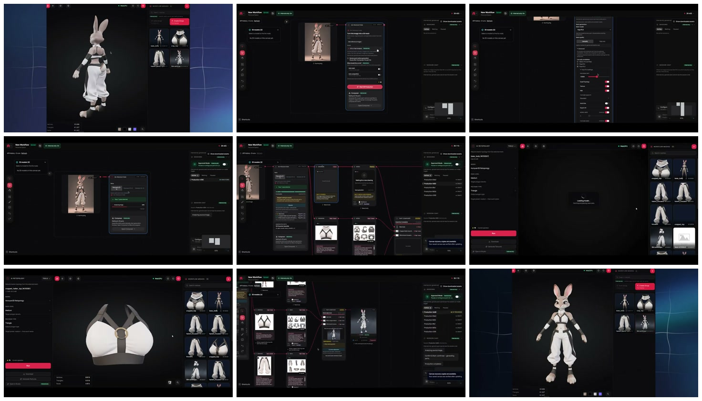
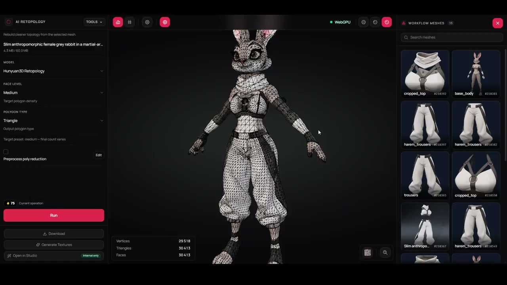

# AssetHub V5 Deep Dive: AI Is Not Replacing Blender; It Is Turning Character Generation into an Editable Parts Pipeline

> **TL;DR:** AssetHub's V5 Agent matters less as a way to generate a complete 3D character than as a way to decompose one into independent body, clothing, hair, and equipment meshes, route each part through an appropriate model, constrain polygon density, and assemble the results. The output is not one difficult-to-edit AI mesh. It is a modular asset whose parts can be replaced, regenerated, and refined. The 54-second post emphasizes that Blender was never opened, but the full 15-minute test shows inflation, scale, fit, and hidden-geometry problems on complex characters. The tester ultimately opens Blender to inspect and adjust them. The accurate claim is that V5 can automate a valuable modular first pass, not that it eliminates DCC work, topology review, rigging, animation, or engine QA.



- **Source post:** [Stefan 3D AI on X](https://x.com/Stefan_3D_AI/status/2110376391686619155)
- **Full test:** [You Can Now Create Modular 3D Character Without Blender](https://www.youtube.com/watch?v=CFA8Pfw6OIs)
- **Product:** [AssetHub](https://app.assethub.io/)
- **Official production service:** [AssetHub Studio](https://assethub.io/studio)
- **Official CLI / SDK:** [AssetHub-inc/assethub-cli](https://github.com/AssetHub-inc/assethub-cli)
- **Published:** 2026-10-14
- **Accessed:** 2026-10-15

## One-sentence verdict

**AssetHub V5 does not teach AI to finish a character. It lets an Agent orchestrate a production chain from one concept image to an editable modular first pass.**

The distinction matters. A monolithic image-to-3D model can already produce an attractive character, but if hair, body, clothing, and weapons are fused into one mesh, changing a shirt may require generating the entire character again.

AssetHub reframes “generate an object” as “plan and assemble a set of parts”:

```text
One character concept
        ↓
Identify logical body, clothing, hair, and equipment parts
        ↓
Produce part references and multi-view images
        ↓
Select 3D models, quality, and polygon constraints per part
        ↓
Generate independent meshes
        ↓
Adjust position, scale, and fit
        ↓
Return an assembled character, separate parts, and a run report
```

The important artifact is not only the final preview. It is the structure retained in the middle.

## What the 54-second demo actually shows

The source video demonstrates a humanoid rabbit character. Its visible sequence is:

1. Start from a complete concept image.
2. Let the Agent form a production plan and decomposition strategy.
3. Generate the body, top, trousers, and other elements along separate workflow branches.
4. Use Part Composer to assemble the meshes into one character.
5. Retain each mesh independently in the asset panel.
6. Inspect the result in shaded and wireframe views.

The most informative frames in the contact sheet are not the opening and closing beauty shots. They are the workflow nodes in the middle. They show that the result is not a whole character sent through one model. It passes through decomposition, generation, and composition stages. Multiple body, shirt, and trouser candidates remain visible in the asset panel, so a weak part can be rerun without discarding the rest.

## “The Agent picks the polycount” needs a more precise reading

The X post says the Agent chooses polycount. The full video reveals a more useful division of responsibility: the creator explicitly names the model in the CLI prompt and sets an approximate ceiling of 5,000 polygons per part.

There are therefore two decision layers:

- **The human sets boundaries:** model, quality tier, maximum geometry, desired part count, and garments that must remain separate.
- **The Agent plans within them:** decomposition, routing, generation, assembly, and retries.

That is closer to a production system than the idea that AI decides everything. A lead sets delivery and budget constraints; the Agent chooses actions within those constraints. A 5,000-polygon ceiling per part also does not prove that the finished character is optimized. Several parts, hidden body geometry, material count, and skinning cost still determine the total runtime budget.

## Why this is stronger than ordinary image-to-3D

| Monolithic generation | AssetHub's part-based Agent |
|---|---|
| One image becomes one mesh | Plans logical body, clothing, and equipment parts first |
| A bad local region can force a full reroll | Regenerates or replaces only the failed part |
| Clothing and body may fuse together | Keeps each element as an independent mesh |
| Outputs are difficult to reuse | Approved parts can accumulate into an IP library |
| Generation is the end of the process | Composition, refinement, rigging, and engine review follow |
| Model selection is often fixed | Models can be routed by part and quality requirement |

That is why modularity matters more than one prettier render. A game character is not a final picture. It must change clothing, deform under animation, fit LOD and performance budgets, and survive repeated art-direction feedback.

## Part Composer is an Agent workflow, not one 3D model

Public materials show that AssetHub exposes a canvas, CLI, hosted MCP endpoint, and TypeScript SDK. In the full video, the creator gives an API key to an Agent and invokes the workflow through short prompts. The official CLI exposes the stages as structured operations with persistent run records.

The current public CLI can express:

- `parts split` to extract parts from a concept image;
- `production analyze` to run character-production analysis and assembly;
- `production run --image` to wrap split, mesh generation per part, and composition into one task;
- `composer run` to assemble existing parts;
- `composer refine` to continue from a previous composition;
- `runs get / watch / resume` to inspect, wait for, or resume long operations;
- MCP access so Codex, Claude Code, or Cursor can use the same capabilities from an Agent session.

The “V5 Agent” is therefore not a single end-to-end neural network that swallows a concept and emits a finished character. It is closer to a control plane. It calls several image, 3D, retopology, and assembly capabilities, while retaining lineage, run state, and candidate assets.

## The full video defeats a literal “no Blender” interpretation

The 15-minute test is much more cautious than the social headline.

### Simple character: the automatic first pass is already useful

The first rabbit is separated into a body, top, and trousers. The first composition has visible artifacts; a second attempt fits better. The creator says it can save time, but also proposes bringing the GLB into Blender for small corrections.

The value is real, but so is stochastic variation. If the second run is materially better than the first, production needs candidate comparison, spending limits, and a rollback path.

### Complex character: fit and proportion remain difficult

Later characters show local inflation, scale mismatch, and poor contact between parts. The tester calls it one of the strongest AI-only results he has seen, while still opening Blender to inspect and adjust it.

This is a structural difficulty. Each part is generated independently, so its model does not know the true contact surface, cloth thickness, or occluded body geometry of neighboring parts. An assembly Agent can estimate placement and fit, yet still land at a visually plausible rather than topologically reliable result.

### Mobile games: hidden geometry still needs cleanup

The video also notes that body geometry permanently hidden under clothing should be removed. Otherwise, every part may meet its own polygon target while the assembled character still carries invisible triangles, additional overdraw, and intersections.

Independent meshes are necessary for modularity. They are not proof of completed optimization.

## A wireframe is useful evidence, but not proof of game readiness



The short video ends with a wireframe view and visible vertex, triangle, and face counts. This is good inspection design: the user can check density rather than seeing only a shaded render.

A wireframe screenshot still cannot establish:

- deformation-friendly edge loops around joints;
- absence of clipping under extreme poses;
- consistent UVs and texel density;
- compatible materials, normals, and tangents across parts;
- correct skeleton hierarchy, skin weights, collision, and root motion;
- acceptable LODs, draw calls, texture sizes, and mobile performance;
- reliable animation and lighting after Unity or Unreal import.

AssetHub's current CLI documentation makes a similar distinction. A composed GLB is a triangulated preview, not proof of quad topology. `completed` or `reviewed` means execution finished, not that the creator approved the result. Unresolved work can return `needs_review` with the best available assembly.

## Why V5, V5.1, and V6 appear together

The source video calls the tested capability V5. The public CLI inspected for this article already contains several related labels:

| Name | Meaning in the current public documentation |
|---|---|
| V4 / V5 Character Assembly | Gated production Agents that plan parts, generate meshes, and run assembly |
| V5.1 Skill assembly | A Character Assembly Skill executed inside a Blender sandbox |
| V6 Auto assemble | An automatic composition path that pairs each mesh with its part reference image |

Availability remains subject to account and server rollout. A CLI alias does not grant every workspace access. The repository also changes quickly, so the V5 shown in a social demo, the version presented in the canvas, and the newest CLI model identifiers should not be assumed to represent one fixed model.

The defensible workflow is to inspect current workspace capabilities, production agents, and composer models before choosing a path, rather than hard-coding an identifier from a video.

## The cost is not the price of one generation

AssetHub's pricing page lists image-to-3D operations at 25 to 140 credits. A modular character generates several parts separately and may also use decomposition, reference-image creation, retopology, composition, and retries. Total cost therefore grows with part count and candidate count rather than equaling one 3D generation.

The current CLI offers `production run --estimate` before submission and a `--max-cost` ceiling. Its documentation also acknowledges that part extraction does not yet have a complete dry-run price source, so the estimate marks that line unknown rather than inventing a number.

That is a more consequential Agent feature than a claim of full automation. Paid actions should be estimable, capped, resumable, and idempotent, so retrying the same operation ID does not silently start and charge for another run.

## What this changes in 3D production

AssetHub V5 is currently better positioned to replace repetitive work before and inside Blender than to replace Blender itself:

1. Manually listing parts from concept art.
2. Preparing references and multi-view images for each part.
3. Repeating submissions across several image-to-3D models.
4. Downloading, naming, and tracking every mesh.
5. Roughly scaling and positioning the parts on one character.
6. Rerunning only the failed branch.
7. Producing a report that tells an artist what remains unresolved.

This changes the DCC from a place where a person executes every step into a place where a person reviews and finishes an Agent's first pass. AssetHub's own Studio page uses the same framing: AI first pass plus artist finish, not an AI-only final asset.

## How to evaluate it before adoption

A real evaluation should not stop at a front-facing neutral pose. Keep the concept fixed, repeat several runs, and measure:

- whether decomposition consistently retains jewelry, shoes, inner hair layers, and weapons;
- whether meshes preserve useful scale, origin, orientation, and naming;
- whether contact areas intersect, especially under motion;
- per-part and total triangle, material, texture, and draw-call budgets;
- whether replacing one garment truly leaves approved parts unchanged;
- credits consumed by retries and whether a failed run resumes in place;
- structural fidelity after GLB or FBX import into Blender, Maya, Unity, or Unreal;
- rigging, animation, LOD, and profiler acceptance against the project's own standard.

This article did not spend credits on an independent V5 run, so the three creator-selected samples are not treated as a general success rate. What can be verified is that the short demo visibly contains a multi-stage graph, independent assets, a composed result, and wireframe inspection. The full video also discloses reruns, defects, Blender review, and manual correction.

## Conclusion

AssetHub V5 points in a more production-relevant direction than “one-click prettier 3D.”

It changes a character from a disposable monolithic output into a set of traceable, replaceable, independently rerunnable parts. CLI, MCP, and Agent orchestration then connect decomposition, model routing, polygon constraints, generation, composition, and reporting into one long-running job. For swappable outfits, batches of NPCs, and games with continuous art-direction feedback, that structure matters more than a single model score.

The headline “without Blender” is defensible only for initial decomposition and rough assembly. Both the full test and AssetHub's own production material point to the same reality: **AI can already eliminate many trips into Blender, but it cannot yet guarantee that the team never opens Blender.**

The real advance is starting from an editable Agent first pass instead of manually assembling every piece from zero.

## References

- [Stefan 3D AI source post - X](https://x.com/Stefan_3D_AI/status/2110376391686619155)
- [You Can Now Create Modular 3D Character Without Blender - YouTube](https://www.youtube.com/watch?v=CFA8Pfw6OIs)
- [AssetHub app](https://app.assethub.io/)
- [AssetHub AI-native 3D production](https://assethub.io/studio)
- [AssetHub official CLI and TypeScript SDK](https://github.com/AssetHub-inc/assethub-cli)
- [CLI snapshot inspected for this article](https://github.com/AssetHub-inc/assethub-cli/tree/25666419b0204bff5e147fddffa25d932c91fa9e)
- [AssetHub pricing](https://assethub.io/pricing)
- [Theron production workflow](https://assethub.io/theron-workflows-2)

*Sources were accessed on 2026-10-15. The inspected CLI snapshot was `25666419b0204bff5e147fddffa25d932c91fa9e`, where the CLI package version was 0.1.52. Model names, workspace eligibility, pricing, and server rollouts will change. The images are local frame extracts from the 54-second source video; analysis of the complete test also used its public captions and visible footage.*
