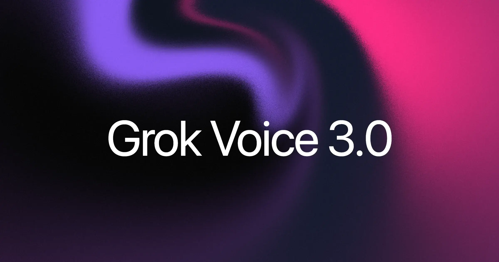
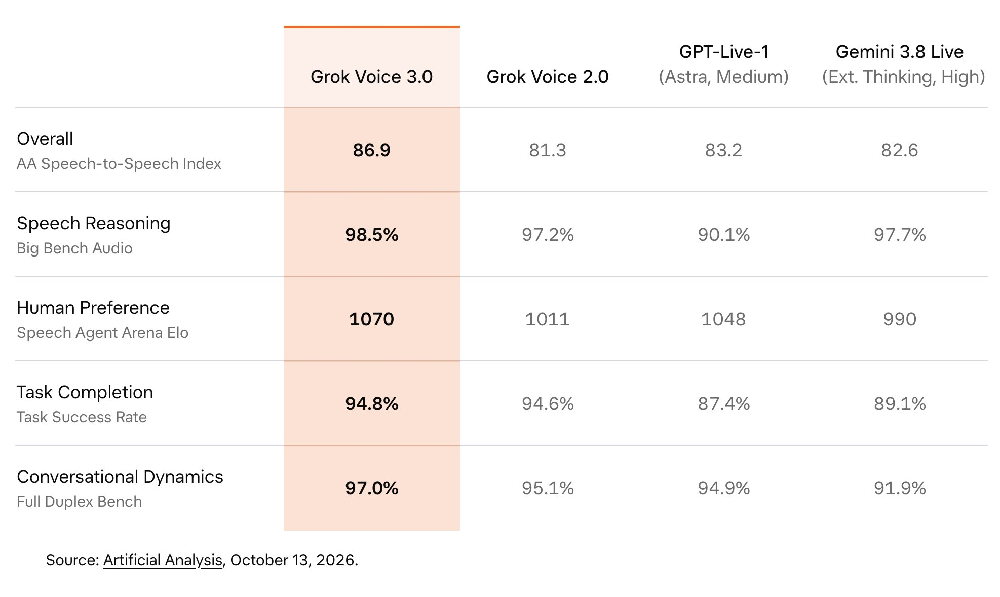

# Grok Voice 3.0 Deep Dive: Voice Agents Are Moving from Sounding Human to Completing Work

> **TL;DR:** xAI released Grok Voice 3.0 on October 14, 2026 and moved the `grok-voice-latest` alias to the new model at the same price. It scores 86.9 on Artificial Analysis' composite Speech-to-Speech Index, responds in roughly 0.81 seconds, and posts strong results in task success, full-duplex interaction, and customer-service scenarios. The important change is not merely more natural speech. Voice is becoming an enterprise execution layer that must listen, speak, call tools, change system state, recover from interruptions, and finish the job. Grok does not lead every component, however, and xAI's production figures remain vendor-reported rather than independently audited.

- **Social source:** [SpaceX Super Intelligence on X](https://x.com/SpaceXSI/status/2110416580899168305)
- **Canonical announcement:** [Grok Voice 3.0 - xAI](https://x.ai/news/grok-voice-3)
- **Independent leaderboard:** [Speech-to-Speech Leaderboard - Artificial Analysis](https://artificialanalysis.ai/speech-to-speech)
- **API documentation:** [Speech-to-Speech - xAI Docs](https://docs.x.ai/developers/model-capabilities/audio/speech-to-speech)
- **Published:** 2026-10-14
- **Accessed:** 2026-10-15

## One-sentence verdict

**Grok Voice 3.0 matters because it brings listening, speaking, interruption handling, tool use, and business outcomes into one realtime runtime, not because it simply makes an AI phone agent sound more human.**

Voice models used to be judged mainly by transcription accuracy, naturalness, and time to first audio. This launch moves the exam up a level: Can the user interrupt naturally? Can the model operate tools during a continuous conversation? Does the customer-service task actually reach the correct outcome? Can the economics support deployment at scale?

That makes Grok Voice 3.0 closer to an Agent runtime with a voice than to a better TTS system.

## What the X post compresses into three claims

The launch post focuses on three ideas: Grok is strong at resolving customer calls, responds in under a second, and costs less than other frontier models. Each captures part of the product story, but each needs scope.

The “under a second” claim comes from Artificial Analysis' time-to-first-audio test, where Grok Voice 3.0 records roughly **0.81 seconds**. That is a model result in a standardized harness, not a guarantee for every geography, telephone network, tool chain, or application.

The cost claim is also comparative rather than universal. In the leaderboard's fixed workload, Grok costs **$4.80 per hour of input audio**, below GPT-Live-1 Astra Medium at $5.83 but above Gemini 3.8 Live Extended Thinking High at $3.50. Production calls may add telephony, retrieval, tool execution, storage, and infrastructure costs.

Finally, “most intelligent” refers to the leading 86.9 composite score. It means Grok has the strongest combination of audio reasoning, preference, task success, and agentic performance under this methodology. It does not mean Grok wins every component.

## What does 86.9 actually measure?

Artificial Analysis' Speech-to-Speech Index is not a single question-answer accuracy score. It equally combines four families of evidence:

| Dimension | Grok Voice 3.0 | What it tests |
|---|---:|---|
| Speech Reasoning / Big Bench Audio | 98.5% in the launch snapshot | Understanding and reasoning directly over audio |
| Arena Elo | 1070 in the launch snapshot | Blind human preference between spoken responses |
| Task Success | 94.8% | Completion of voice tasks with explicit goals |
| Agentic / τ-Voice | 71.6% | Tool use and correct database end state in customer-service scenarios |
| Full Duplex Bench | 97.0% | Pauses, turn-taking, interruptions, and backchannels |
| Composite index | **86.9** | Combined ranking across the core categories |

The most revealing part is not the number itself, but the definition of intelligence behind it.

Big Bench Audio contains 1,000 audio questions adapted from Big-Bench Hard. τ-Voice simulates customer-service workflows and checks whether the system leaves a database in the one valid final state. Full Duplex Bench examines whether a model understands that a speaker is still thinking, accepts interruption, supplies appropriate backchannels, and recovers after overlapping speech.

This benchmark therefore treats a voice model as a system that completes work during realtime interaction, not merely as a spoken-answer generator.

## Composite leadership is not leadership everywhere

The launch graphic can be read as blanket superiority. The component results tell a more useful story.

- Grok Voice 3.0 is strong on the composite index, task success, and conversational dynamics.
- GPT-Live-1 Astra Medium scores **74.5%** on τ-Voice agentic performance, above Grok's 71.6%.
- Gemini 3.8 Live Extended Thinking High is cheaper on the leaderboard's standardized workload.
- Other models lead individual reasoning, conversational-dynamics, or response-time measurements.
- Grok Voice 2.0 reaches first audio in roughly 0.70 seconds versus 0.81 seconds for 3.0, suggesting that the upgrade trades a small amount of speed for broader capability.

The launch image is also an October 13 snapshot. Arena Elo and other live metrics can move, and the current Artificial Analysis page rounds some percentages. Any ranking should therefore carry a date, model configuration, and benchmark name instead of being presented as a permanent fact.

## The real product change: voice becomes the execution layer

xAI's Speech-to-Speech API runs over a realtime WebSocket. The model does not need to finish transcription, hand text to a separate LLM, and then pass a response to TTS. It can consume an audio stream, generate audio, maintain session state, and invoke tools within the same live interaction.

The documentation includes:

- PCM, PCMU, PCMA, and Opus, with PCM sample rates from 8 kHz to 48 kHz;
- dynamic session configuration through `session.update`;
- BCP-47 language hints that can change during a session;
- up to 100 keyterms for brands, products, and specialized vocabulary;
- file search, web search, X search, remote MCP, and custom functions;
- resumption through `conversation_id`, with prior turns replayed from cache;
- short-lived ephemeral tokens for browser clients instead of exposed long-term API keys.

The important point is not that the API accepts audio. Speech, session state, and tool execution live on the same realtime path. A customer-service Agent can hear a request to rebook, ask for missing information, call the order system, and explain the result. The resulting database state, not the fluency of the explanation, determines whether the job succeeded.

This places Grok Voice 3.0 on the same architectural trajectory as the [OpenAI GPT-Live system analyzed earlier](../2026-07-08/2026-07-08-openai-gpt-live-full-duplex-voice-agent-runtime-en.md): the voice model is becoming a realtime control layer. Grok Voice 3.0's launch is especially concrete because the API, tool protocol, price, and migration path are available together.

## A no-code-change upgrade is both a feature and a risk

xAI kept the price at **$0.08 per minute, or $4.80 per hour**. The `grok-voice-latest` alias now resolves to 3.0, the API contract is unchanged from 2.0, and the older model is deprecated.

For developers, this reduces migration friction. Protocols, prompts, and tool definitions do not need an immediate rewrite. For xAI, it is a powerful distribution mechanism because applications pinned to `latest` receive the new behavior automatically.

An unchanged API does not mean unchanged behavior, however. More proactive tool use, different pause judgments, new speaking rhythms, and altered interruption policies can all change the customer experience. Production teams should still:

1. canary a controlled share of traffic across the old and new models;
2. track task success, false interruptions, tool errors, and human handoff rates;
3. make consequential writes idempotent and require confirmation where appropriate;
4. regression-test accents, noise, long pauses, and adversarial instructions;
5. retain model version, session events, and tool traces for diagnosis and accountability.

The most dangerous voice-Agent failure is not an inelegant answer. It is confidently saying “that's done” while changing an order, refund, or account incorrectly.

## The deployment numbers are impressive, but vendor-reported

xAI says its voice systems handle millions of conversations per day across Tesla and SpaceX. It also reports that Starlink call centers process about 20,000 calls per day, resolve roughly 70% without a human, and convert about one in four sales calls into a purchase.

Those deployments matter. Real phone traffic exposes accent diversity, background noise, line latency, customer reversals, tool failures, escalation, and compliance requirements that polished demos do not.

But the figures come from xAI's own announcement. The company does not publish the experimental design, baseline, sample distribution, confidence intervals, or an independent audit. They support the claim that the system is operating at meaningful scale; they should not be converted into a guaranteed ROI for unrelated enterprises.

xAI likewise cites a 74% joint accuracy-and-experience result on ServiceNow EVA-Bench. EVA is a real open-source enterprise voice benchmark with 213 scenarios and separate accuracy and experience metrics. This article did not independently rerun Grok Voice 3.0. The precise statement is that **xAI reports this launch result on ServiceNow's evaluation framework; it is not our reproduction.**

## Five lessons for voice-Agent teams

### 1. Do not optimize only time to first audio

Eight hundred milliseconds matters, but one false interruption may damage the interaction more than an extra 300 milliseconds. A production dashboard should also measure stop latency, user interruption, useless backchannels, long-pause tolerance, and recovery.

### 2. Validate business state, not just recordings

A call that sounds excellent may still fail. Refund amount, order status, booking time, and CRM fields are the real acceptance criteria for enterprise Agents.

### 3. Tool permissions should be narrower than model capability

Support for MCP, custom functions, and search does not justify granting every session every permission. High-risk operations need least privilege, parameter validation, approval gates, and audit logs.

### 4. Price the whole call, not only model audio

Actual unit economics include telephony, recording storage, retrieval, tool services, retries, human escalation, and compliance. The benchmark's $4.80 per hour is a useful standardized comparison, not a complete cost model.

### 5. Treat an automatic model upgrade as a product release

The `latest` alias reduces operations work, but the model controls both conversational timing and action. Every upgrade still deserves call sampling, task replay, segmented testing, and a rollback path.

## What remains unproven

Grok Voice 3.0 has a stronger public evidence package than many voice-model launches, but several operational questions remain:

- end-to-end task success across languages, dialects, and strong accents;
- resilience to packet loss, echo, and overlapping speakers on telephone networks;
- memory drift and tool-state consistency during long sessions;
- compensation, undo, and human takeover after an incorrect write;
- independent reproduction of the Starlink operating figures and EVA result;
- full cost after telephony, search, MCP, storage, and human escalation.

These questions do not fit in a leaderboard image, but they determine whether a system can move from a test harness into banking, healthcare, insurance, and public services.

## Conclusion

Grok Voice 3.0 is a substantial voice-Agent release. It combines strong audio reasoning, full-duplex interaction, tool execution, enterprise-oriented evaluation, and explicit pricing in one deployable product without raising the previous generation's model price.

The accurate conclusion is not that it is the world leader at everything. It is that **Grok leads a composite evaluation spanning reasoning, preference, task completion, and realtime interaction, while offering a low-friction production path.**

The next phase of voice Agents will not be decided only by which system sounds most human. It will be decided by whether the system understands a messy live situation, can safely change real software, and gets the job right before the call ends.

Grok Voice 3.0 matters because it puts those three requirements on the same scorecard.

## References

- [Grok Voice 3.0 - xAI](https://x.ai/news/grok-voice-3)
- [Grok Voice 3.0 release notes - xAI Docs](https://docs.x.ai/developers/release-notes)
- [Speech-to-Speech API - xAI Docs](https://docs.x.ai/developers/model-capabilities/audio/speech-to-speech)
- [xAI API pricing](https://docs.x.ai/developers/pricing)
- [Speech-to-Speech Leaderboard - Artificial Analysis](https://artificialanalysis.ai/speech-to-speech)
- [EVA: Enterprise Voice Assistant Benchmark - ServiceNow](https://github.com/ServiceNow/eva)
- [Grok Voice Agent Builder - xAI](https://x.ai/news/grok-voice-agent-builder)
