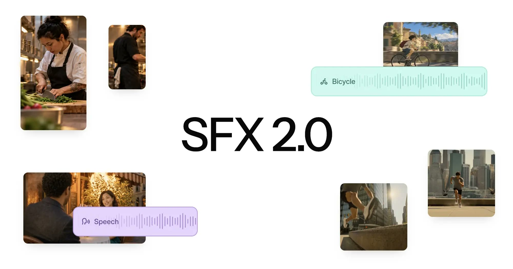
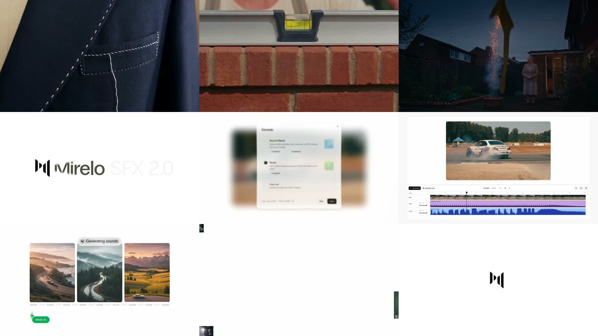

# Mirelo SFX 2.0 Deep Dive: AI Video Sound Can Finally Be Rebuilt After Picture Lock

> **TL;DR:** Mirelo SFX 2.0 is not merely a sound-effect generator for silent clips. It targets a structural problem in AI video: picture and sound are often baked into one generation. The model takes a finished video, and Mirelo says it can preserve dialogue, remove unwanted music, then generate action-synchronized Foley, effects, and ambience that remain coherent across cuts. Studio and the API support edits up to ten minutes. Its real value is moving sound after picture lock, so a creator or Video Agent does not need to regenerate a good shot just to repair its soundtrack. The current release still produces a single mix rather than separate stems, does not support the 1.6 extend/inpaint workflows, and relies on vendor-run listening tests rather than independent evaluation.



- **Social source:** [Mirelo on X](https://x.com/MireloAI/status/2110360787780800611)
- **Canonical announcement:** [Mirelo SFX 2.0: change the sound, keep the video](https://mirelo.ai/blog/mirelo-sfx-2-0)
- **Product page:** [Mirelo SFX 2.0](https://mirelo.ai/sfx)
- **API documentation:** [Mirelo API Reference](https://mirelo.ai/api-docs)
- **Published:** 2026-10-14
- **Accessed:** 2026-10-15

## One-sentence verdict

**SFX 2.0 matters less as a way to generate sound than as a way to separate a finished AI video's valuable dialogue performance from the sound world that needs replacing.**

Native-audio video models solved the silent-film problem, but introduced a new coupling. Accepting a strong shot may also mean accepting unsolicited music, discontinuous ambience, or Foley that misses the action. Re-prompting can repair the soundtrack while changing the actor, expression, composition, or camera move.

Mirelo moves the audio decision downstream. Lock the picture, preserve the spoken performance where possible, and rebuild the rest. That turns sound into an independent revision layer after an AI video already exists.

## The problem is not silence; it is baked-in audio

Conventional AI Foley often starts with a silent short clip. A model watches the image and creates footsteps, impacts, wind, and room tone. SFX 2.0 addresses the harder case: the video already has an audio track containing both dialogue worth keeping and music or environmental sound that should be removed.

Mirelo's claimed process can be summarized as:

```text
Finished edit with native audio
        ↓
Detect and preserve dialogue
        ↓
Remove unwanted music and non-dialogue sound
        ↓
Regenerate Foley, effects, and ambience from the picture
        ↓
Duck around speech and maintain continuity across cuts
        ↓
Return a new full mix
```

Compared with text-to-SFX, this requires three extra forms of understanding: what must survive from the old soundtrack, when visual events happen, and how the same environment should sound across multiple shots.

## Four production changes that matter

### 1. Keep the chosen performance instead of rerolling the picture

If dialogue, lip movement, expression, and camera work are all usable but the music is poor, regenerating the whole video is the most expensive repair. Mirelo says SFX 2.0 detects and separates existing speech, carries it into a new mix, then generates effects and ambience around it.

This is not a new synthetic performance. It operates on the spoken performance already present in the source. For ads, narrative shorts, and dialogue-driven AI video, that distinction matters because character continuity is usually harder to recover than a background sound.

### 2. Let effects follow the picture instead of manually spotting every event

Text-to-SFX can produce “footsteps on wet concrete” or “a metal door closing,” but it does not know which frame contains the footfall. An editor must audition, trim, align, and repeat that work for every event.

SFX 2.0 conditions on the video itself, reading visible action, timing, and environment. Mirelo's launch reel moves across fabric, construction, vehicles, landscape, and its editing interface. The point is not one unusually attractive sound; it is sound landing with visual events.



This contact sheet samples the launch video every eight seconds. It establishes the range of demonstrated scenes and workflows, but a static image cannot validate synchronization or listening quality. Those require playback or independent generation tests.

### 3. Upgrade from per-clip Foley to a soundtrack pass over the finished edit

AI video is usually generated in short clips. When each clip receives sound separately, the most obvious failure is often not an unrealistic footstep. It is the abrupt jump in room tone, wind, reverb, and loudness at every cut.

SFX 2.0 processes an assembled edit and claims to maintain effects and ambience across cuts. Mirelo Studio and the API accept videos up to ten minutes, while Enterprise customers can request longer runs.

That makes the product closer to an automated sound pass than a sound library. The distinction is useful for AI shorts, ads, and trailers that have reached picture lock without the budget for shot-by-shot Foley and ambience design.

### 4. Take music selection back from the video model

Many native-audio models insert music even when it was not requested. It may make one demo feel complete, but stitching several generations creates conflicting tempo, key, genre, and loudness.

Mirelo's product logic is to remove baked-in music, preserve dialogue and the chosen visual take, then create a clean effects-and-ambience bed. The filmmaker or Agent can select music later, at the level of the complete edit.

For autonomous video systems, this matters more than marginally better Foley. An Agent can finish the picture, apply one coherent sound pass, and make a deliberate music decision instead of inheriting a random soundtrack from every upstream video model.

## The listening results are promising, but 72% is not a 72% win rate

Mirelo published two groups of blind listening comparisons. Each matchup used 30 videos and 25 crowd workers pre-screened on audio listening tests. Listeners compared two soundtracks for audio quality and synchronization, with “tie” available as a third choice.

### Against video-to-SFX models

| Competitor | SFX 2.0 preferred | Competitor preferred | Tie |
|---|---:|---:|---:|
| Sony Woosh | 81% | 9% | 10% |
| Kling Foley | 63% | 18% | 19% |
| Sonilo | 46% | 33% | 21% |

### Against native video-model audio

| Native audio source | SFX 2.0 preferred | Native audio preferred | Tie |
|---|---:|---:|---:|
| Veo 3.1 Fast | 57% | 21% | 22% |
| MiniMax H3 Max | 49% | 30% | 21% |
| Flux 3 | 48% | 23% | 29% |
| Seedance 2.5 | 47% | 28% | 25% |
| Kling | 45% | 30% | 25% |

The announcement says SFX 2.0 was “as good as or better” than Seedance 2.5 in 72% of cases. That figure is **47% preferred plus 25% ties**, not a 72% head-to-head win rate. Its advantage over Sonilo is likewise much narrower than the headline result against Woosh.

The experiment is more informative than a hand-picked demo because Mirelo discloses the video count, listener count, and three outcome shares. It is still a vendor-designed test. The company does not publish the 30 clips, source prompts, normalization procedure, raw votes, confidence intervals, or an independent reproduction. The results demonstrate competitiveness on this sample, not universal superiority across every language, genre, and sound event.

## The API is live, but 2.0 is not every 1.6 feature combined

Mirelo's v3 API exposes the model as `sfx-2.0` for both text-to-SFX and video-to-SFX. Both modes support up to 600,000 milliseconds, or ten minutes. Speech preservation is on by default for video requests; disabling it returns generated sound without retaining speech.

SFX 2.0 accepts a negative prompt of up to 1,000 characters. The documentation is unusually clear about its limits: `input.prompt` and `input.negative_prompt` are experimental guidance for video-to-SFX, and the model may not follow them strictly. The negative prompt also had only a weak effect in Mirelo's internal text-to-SFX tests.

The missing capabilities matter just as much:

| Capability | Current SFX 2.0 status |
|---|---|
| Ten-minute text/video-to-SFX | Available |
| Speech preserved by default | Available |
| Single coherent mix | Available |
| Separate speech/effect stems | **Unavailable; stem variant is marked coming soon** |
| Audio extension | **Not served by 2.0; remains a 1.6 workflow** |
| Audio inpainting | **Not served by 2.0; remains a 1.6 workflow** |
| Strict prompt control over video sound | **Not guaranteed; experimental steering** |

The current release is therefore optimized for generating one better overall soundtrack, not delivering dialogue, footsteps, impacts, ambience, and room tone as independently adjustable production stems. Teams that require editable deliverables should retain the source audio, add a separate isolation step, or wait for the stem variant.

## Cost scales with output seconds and sample count

Mirelo's API documentation lists SFX 2.0 at 15 credits per generated second per variant, temporarily discounted to 10 credits. Fal expresses the launch pricing directly as **$0.01 per second**, later returning to **$0.015 per second**. Multiple samples are charged on their combined output duration.

At Fal's introductory rate:

| Workload | One sample | Two samples |
|---|---:|---:|
| 10-second clip | $0.10 | $0.20 |
| One-minute edit | $0.60 | $1.20 |
| Ten-minute full edit | $6.00 | $12.00 |

Those figures rise by 50% at the standard rate. Mirelo and Fal describe the promotion end date one day differently, so production software should read current pricing rather than hardcode this launch snapshot.

Mirelo Studio also sells monthly credit plans. Its current estimator assigns roughly 8, 40, 200, 700, and 2,400 minutes of one-variant SFX 2.0 output to the Free, Creator, Studio, Scale, and Business plans under the discounted rate. Generating alternatives multiplies usage directly, which matters for teams that routinely audition several takes.

## What this changes for Video Agents

SFX 2.0 belongs near the end of a generation pipeline, after picture lock:

1. generate the visual clips;
2. verify character, camera, and narrative continuity;
3. assemble and lock the edit;
4. run one unified SFX 2.0 sound pass;
5. check dialogue integrity, event synchronization, and ambience across cuts;
6. add deliberate music, narration, and final mastering.

This order avoids using expensive image regeneration as an audio-editing tool. It also separates responsibilities: the video model makes shots, the SFX model creates picture-driven sound, the music layer handles score, and final mixing controls loudness and delivery.

Until separate stems arrive, an Agent should treat the result as a candidate mix rather than an immutable final master. A damaged line of dialogue, a missed event, or music leakage may require a full rerun or manual repair.

## What a real evaluation should test

A 73-second launch reel cannot establish production reliability. Adoption testing should include:

- speech-separation artifacts such as watery texture, metallic tone, or lost high frequencies;
- quiet speech, overlapping speakers, and several languages;
- ambience continuity over a full ten-minute edit;
- synchronization error for footsteps, impacts, and non-mouth actions;
- actual negative-prompt compliance for requests such as “no music”;
- run-to-run variance in event coverage, quality, and loudness;
- failed or partial jobs, expiring downloads, retries, and billing behavior;
- compatibility with later editing, loudness standards, rights, and asset retention.

This article did not spend API credits to generate an independent sample, so it does not treat Mirelo's demo quality as reproduced evidence. The public launch, API schema, ten-minute limit, default speech preservation, pricing, and current feature gaps are all independently visible in the company's documentation.

## Conclusion

Mirelo SFX 2.0 points in the right direction. AI video production is beginning to separate into post-production layers: picture can be locked, sound can be replaced, dialogue can be retained, and music can be chosen last.

The release is not yet a complete professional sound workstation. A single mixed output, missing stems, experimental prompt control, and vendor-run tests still require human review and a recovery path.

But it turns one important operation into a product: **disliking an AI video's sound no longer has to mean throwing away the picture you liked.**

For creators, that removes an expensive reroll. For Video Agents, it creates a final-stage operation that can be automated, evaluated, and retried independently.

## References

- [Mirelo SFX 2.0 launch post - X](https://x.com/MireloAI/status/2110360787780800611)
- [Mirelo SFX 2.0: change the sound, keep the video](https://mirelo.ai/blog/mirelo-sfx-2-0)
- [Mirelo SFX 2.0 product page](https://mirelo.ai/sfx)
- [Mirelo API Reference](https://mirelo.ai/api-docs)
- [Mirelo pricing](https://mirelo.ai/pricing)
- [Mirelo SFX 2.0 Video-to-Audio on Fal](https://fal.ai/models/mirelo-ai/sfx2.0/video-to-audio)
