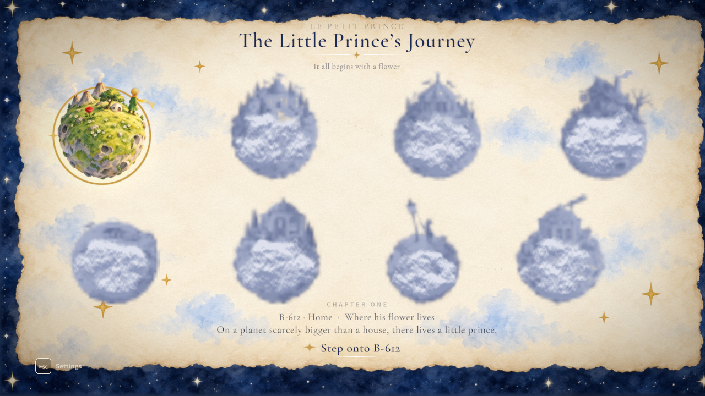
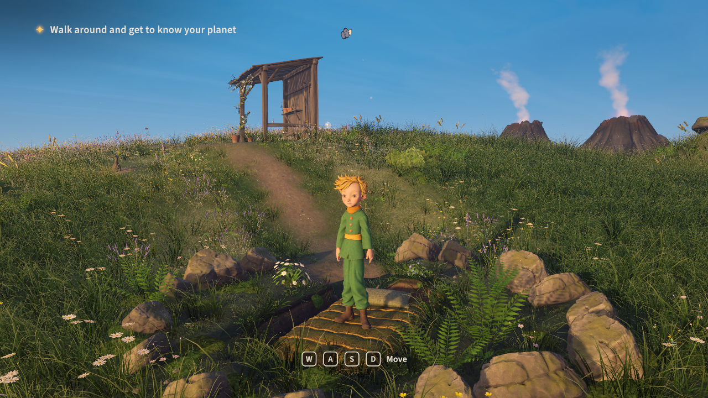
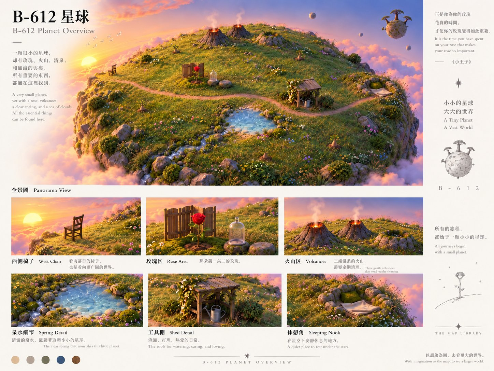
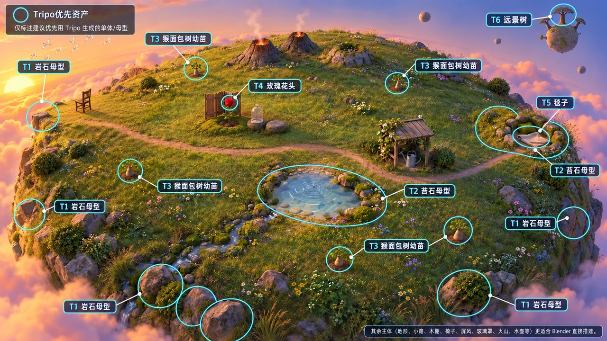
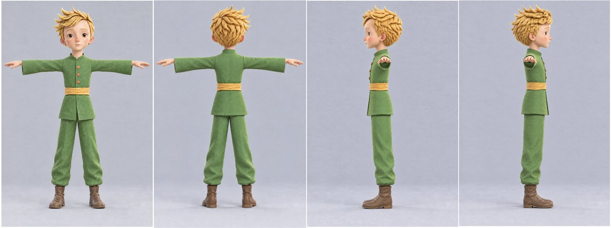
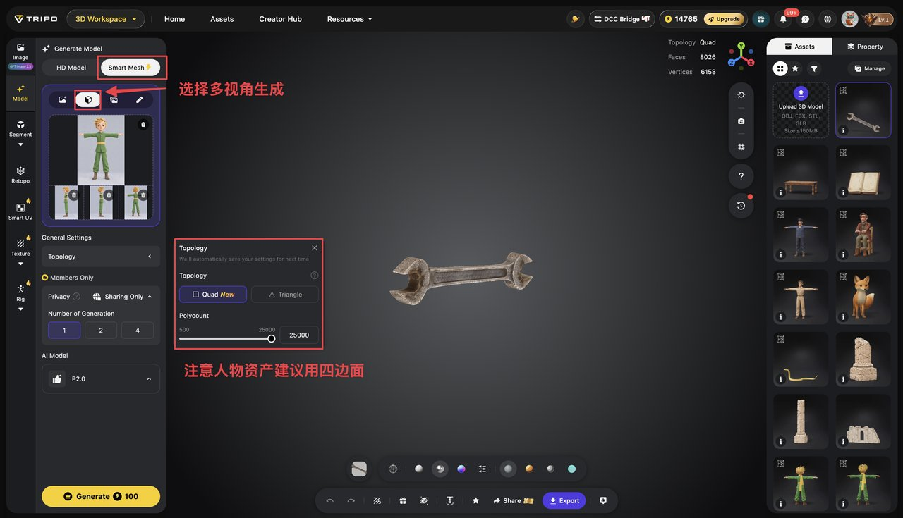
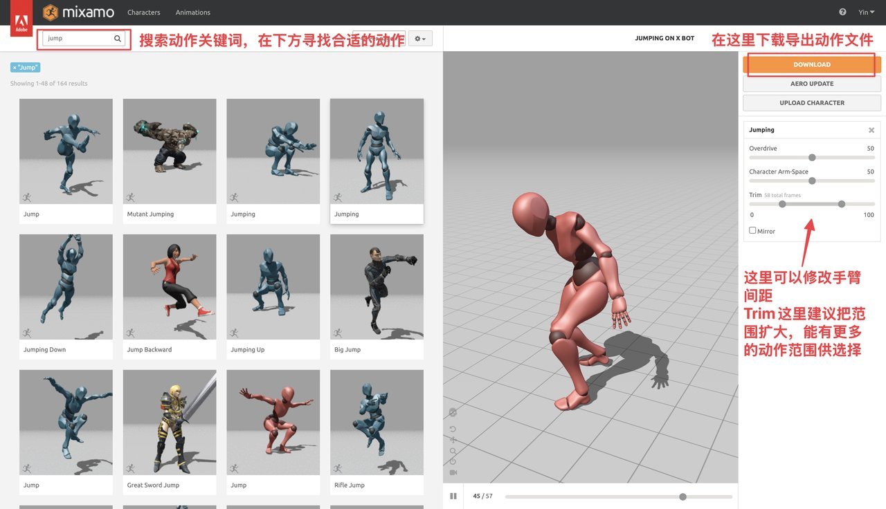

# 《小王子》AI 3D 游戏拆解：16 天不是一键生成，而是把资产、引擎与验收串成生产线

> **TL;DR：** Sac 用 16 天做出的《小王子》3D 游戏，真正值得关注的不是“AI 一个人做完游戏”，而是它把策划、视觉参考、3D 资产、绑定动画、Unity 场景和多机位验收拆成了可以交给不同模型与工具的连续工序。GPT Image 负责定义视觉目标，Tripo 生成适合的 3D 首稿，Blender 处理结构与绑定，Opus 5.5 通过 CLI/MCP 驱动 Blender 和 Unity，Astra 继续迭代和修错。笔者实际加载了游戏的章节地图与第一颗星球，确认它是可以移动角色的 Unity WebGL 作品，而不只是宣传视频；但作者承诺的完整源码尚未公开，因此目前能验证的是成品和方法说明，还不能验证提交历史、成本、成功率与可复现性。


- **制作复盘：** [Sac on X](https://x.com/Saccc_c/status/2110694725640474759)
- **首发帖：** [The Little Prince game launch](https://x.com/Saccc_c/status/2109962425512734739)
- **可玩版本：** [littleprince.dev](https://littleprince.dev/)
- **发布时间：** 2026-10-15
- **查阅时间：** 2026-10-16

## 一句话判断

**这不是“一句话生成一款游戏”，而是一个人借助 Agent，把原本跨策划、美术、技术美术和客户端开发的工作压缩成了一条可连续执行的个人生产线。**

作者把整个过程概括为：

```text
Fable 5.1：PRD、核心场景、角色与故事线
        ↓
GPT Image 2.5：场景和角色视觉参考
        ↓
Tripo：核心 3D 资产首稿
        ↓
Blender：结构优化、绑定、蒙皮和动画适配
        ↓
Opus 5.5：核心代码，并通过 CLI/MCP 驱动 Blender 与 Unity
        ↓
Astra：继续迭代、修复 Bug
        ↓
独立审查 Agent：多机位截图、检查和返工
```

这里最先进的部分不是其中某个模型，而是模型之间存在明确的交接物：PRD、参考图、拆件表、可编辑网格、骨骼、动画、Unity 场景和验收截图。只要交接物不清楚，再强的模型也只是在反复猜测。

## 先确认：它确实是一款能玩的游戏

笔者在桌面浏览器中实际打开了网站，而不是只观看 X 视频。启动页进入后，游戏先显示八颗星球组成的章节地图；进入第一章并完成资源加载后，页面出现实时 3D 场景、小王子角色和 `WASD` 移动提示。





这足以确认它不是一段预渲染演示，而是一个可交互的 Unity WebGL vertical slice。不过，本次查阅只验证了启动、章节选择、首个场景加载和基础移动，没有完成八章通关测试，因此不能把“能进入第一关”扩大为“所有章节都没有问题”。

网站还给出了很具体的运行边界：它面向桌面浏览器，推荐 Chrome 或 Edge，需要 WebGPU 与 BC 纹理压缩，不支持手机和平板。启动界面提供英语、法语、西班牙语、德语、巴西葡萄牙语、简体中文、日语和韩语八种语言。

## 参考图不是装饰，而是资产合同

许多 AI 游戏演示从一句模糊 Prompt 直接跳到最终画面。这个项目更接近真实制作：先用图像模型把场景、角色和道具的目标外观定下来，再让 Agent 判断各部分应该交给 Tripo 还是 Blender。



一张好的场景参考图至少同时规定了：

- 空间布局：角色、火山、花朵、岩石和地表的相对位置；
- 造型语言：低多边形程度、圆润比例、边缘与表面细节；
- 色彩关系：主体、地面、天空和交互物的主次；
- 可拆资产：哪些对象需要独立网格、碰撞和交互；
- 验收目标：最终 Unity 场景从不同机位看，是否仍保持相同构图语言。

这使 GPT Image 的输出从“灵感图”升级成了可执行规格。后续模型不必重新发明美术方向，而是围绕一个共享目标工作。

## 最关键的判断，是哪些交给 Tripo，哪些留给 Blender

作者没有把整张场景图一次性丢进 image-to-3D。Agent 会先分析画面，拆出需要独立制作的资产，再根据对象性质选择路线。



Tripo 更适合具有明确体积和表面细节的独立物体，例如岩石、道具、家具或雕塑；Blender 更适合需要精确轮廓、简单程序化构造、地形组织或大量重复实例的部分。这样的路由比“全部 AI 生成”更成熟，因为不同资产的失败成本完全不同。

一个背景小石块即使拓扑一般，也可能足够；主角脸部、会动的四肢、需要接触地面的脚和频繁互动的道具，则必须保留更强的结构可控性。**Agent 的价值不是替人点击同一个生成按钮，而是把任务送到合适的工具，并知道何时需要返工。**

## 角色流程显示了“生成”和“可动画”之间的距离

角色不是有一个漂亮模型就结束。作者先用 GPT Image 2.5 生成 T-pose 四视图，再把多视图交给 Tripo Smart Mesh P2.0，要求更规整的四边形拓扑与较高精度。





之后还要经过：

1. 检查或修改纹理与网格；
2. 使用 Blender 和 Auto-Rig Pro 绑定、蒙皮；
3. 从 Mixamo 取得动作；
4. 让 Opus 适配骨骼与动作数据；
5. 对握持、脚底接触等容易穿插的动作，用 Blender 和 IK 继续精修。



这段流程揭示了当前 3D AI 的真实边界：**图生 3D 可以大幅加快造型首稿，但“看起来像角色”不等于“可以稳定表演”。** 四边形拓扑、关节变形、skin weight、骨骼映射、root motion 和物体接触仍属于必须验收的工程层。

## Opus 5.5 的作用不是写几段脚本，而是控制两个生产环境

作者让 Opus 5.5 负责核心代码，并通过命令行控制 Blender 与 Unity。Unity 这部分并非自制的脆弱点击脚本：Unity 已经提供官方的 CLI、Pipeline package 和 MCP，让 Claude Code、Codex 等第三方 Agent 可以读取项目状态、调用编辑器能力和执行流水线任务。

因此，Agent 得到的不是“替人按按钮”的屏幕坐标，而是一组更接近工程 API 的结构化动作：创建或修改场景、导入资产、设置组件、运行任务、读取结果。官方 Unity 文档还说明，CLI/Pipeline 能覆盖 MCP 的同类用例，并更适合脚本化和批量执行。

这也是该项目能在 16 天内推进的核心原因：

- **Blender 负责资产状态；**
- **Unity 负责游戏状态；**
- **Agent 通过 CLI/MCP 修改状态；**
- **截图和运行结果把状态重新暴露给 Agent；**
- **失败不必从头生成，而是回到具体资产或场景继续修。**

模型再聪明，如果只能看到一张最终截图，也很难定位“是 mesh 错了、骨骼错了、材质丢了，还是 Unity 组件没有挂上”。结构化工具把这些故障拆开了。

## 多机位验收，可能比“自动生成”更值得复制

作者还使用独立审查 Agent 从多个摄像机角度检查场景。这一点很容易被漂亮成片掩盖，却是整套方法中最适合迁移到其他项目的设计。

单一导演机位可能隐藏：

- 模型背面的破洞和悬空；
- 角色脚底穿地或离地；
- 道具碰撞体与视觉位置不一致；
- 镜头外的错误资产、灯光和材质；
- 只在某个角度成立的“纸片式”布景。

主 Agent 负责实现，独立 Agent 负责质疑，多机位截图负责提供证据。它并不保证质量，但比让同一个会话生成后立即宣布成功更可靠。对于 3D、游戏和视频制作，Agent 系统的上限往往取决于验收回路，而不是第一次生成的惊艳程度。

## 成品背后仍是一套不轻的交付架构

网站源码表明它是 Unity WebGL/WebGPU 构建。其传输清单索引了 114 个按内容组织的资源包，编码后合计约 1.70 GB、解码后约 2.07 GB，其中绝大多数使用 Brotli 压缩。最大的单个场景包超过 100 MB。

这不代表进入首页就会一次下载 1.70 GB；资源包按场景和需要加载。但它解释了为什么项目限定桌面、高带宽和较新的图形能力，也说明“一个人用 AI 做游戏”没有消除传统游戏的部署问题：资源切包、压缩、加载等待、显存、浏览器兼容和缓存仍然存在。

这里的成品更适合被称为精心完成的叙事型 vertical slice，而不是已经解决规模化发行的轻量网页游戏。

## 哪些结论现在还不能下

来源文章封面写着“开源完整 AI 3D 游戏的制作流程”，正文则说完整源码和更详细教程会在下一周发布。截至本文查阅时，文章没有给出对应 GitHub 仓库，公开搜索也没有找到可以确认属于该项目的源码。

因此目前不能独立验证：

- 16 天内每天的具体投入和人工占比；
- Opus、Astra、Tripo 与图像模型的总调用成本；
- 失败资产、被舍弃候选和重试次数；
- Unity 工程结构、Prompt、自动化脚本与提交历史；
- 八个章节的完整测试、性能曲线和浏览器覆盖；
- 同一流程换题材后是否还能稳定复现。

首发帖提到作品在多个平台获得接近 300 万次观看，这是作者报告的传播数据，本文没有独立平台后台可供核验。复盘末尾也包含 Tripo 推荐链接和 500 credits 优惠，因此它同时具有经验分享与商业推广背景。两点都不否定作品价值，但应与已验证的技术事实分开。

## 对个人 AI 游戏制作最有用的启发

这套流程最值得复制的不是模型名单，因为模型版本会很快过时，而是下面六个组织原则：

1. **先做 PRD，再做资产。** 让模型知道每一章、每个对象和交互为什么存在。
2. **用参考图冻结视觉目标。** 不让不同 Agent 在每一步重新解释风格。
3. **先拆件，再路由工具。** 按资产性质选择 Tripo、Blender 或程序化构造。
4. **把可编辑性当成交付标准。** 网格、骨骼、动画和场景必须能继续修改。
5. **让 Agent 直接操作生产环境。** CLI/MCP 比自然语言转述和鼠标模仿更稳定。
6. **把验收 Agent 与制作 Agent 分开。** 通过多机位、运行状态和截图证据触发返工。

如果只拿走一句话，那就是：**AI 游戏开发的突破，不是模型能生成更多东西，而是每件东西都能以明确格式交给下一道工序，并在失败时回到正确的节点。**

## 结论

《小王子》项目已经证明，一名创作者可以借助多个 Agent 与生成工具，在 16 天内做出有统一美术方向、章节地图、实时 3D 场景和角色控制的可玩作品。实际浏览器验证也说明，它不是只为社交媒体录制的概念片。

但它并没有证明游戏可以被一个 Prompt 自动完成。恰恰相反，复盘展示的是大量传统制作判断：怎样写 PRD，怎样拆资产，什么交给 Tripo，什么留在 Blender，怎样绑定和修动作，怎样让 Unity 接收资产，以及怎样从多个机位发现错误。

所以，这个项目最准确的定位不是“AI 替代游戏团队”，而是：**一个熟悉生产流程的人，用 Agent 把小团队的多个岗位压缩进了一套可以交接、执行和检查的工具链。**

等完整源码真正公开后，最值得审计的也不是 Prompt 写得多漂亮，而是资产合同、任务日志、失败恢复、成本控制和验收脚本能否让第二个人复现同样的结果。

## 参考资料

- [Sac: 手把手教你用 Opus 5.5 / Astra + Tripo 制作 3D 游戏 - X](https://x.com/Saccc_c/status/2110694725640474759)
- [The Little Prince game launch - X](https://x.com/Saccc_c/status/2109962425512734739)
- [The Little Prince playable site](https://littleprince.dev/)
- [Unity AI and official Agent integrations](https://unity.com/features/ai)
- [Unity CLI release notes](https://docs.unity.com/en-us/unity-cli/release-notes)
- [A beginner's guide to Unity CLI and the Pipeline package](https://unity.com/resources/a-beginners-guide-to-unity-cli-and-the-pipeline-package)
- [Blender](https://www.blender.org/)
- [Mixamo](https://www.mixamo.com/)
- [Tripo](https://www.tripo3d.ai/)

*本文查阅于 2026-10-16。站点实测范围为启动页、章节地图、第一章实时场景与基础移动；没有进行完整通关、性能基准或源码审计。站点资源包体积来自公开构建清单，代表被索引的按需内容总量，不等于首次访问下载量。文中模型版本与工作流名称按作者原文记录。图片来自来源文章与可玩站点的本地留档截图。*
