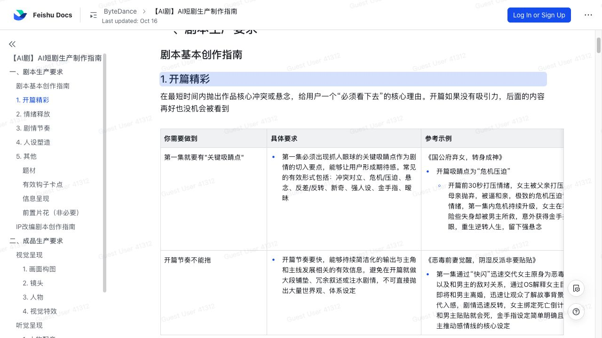
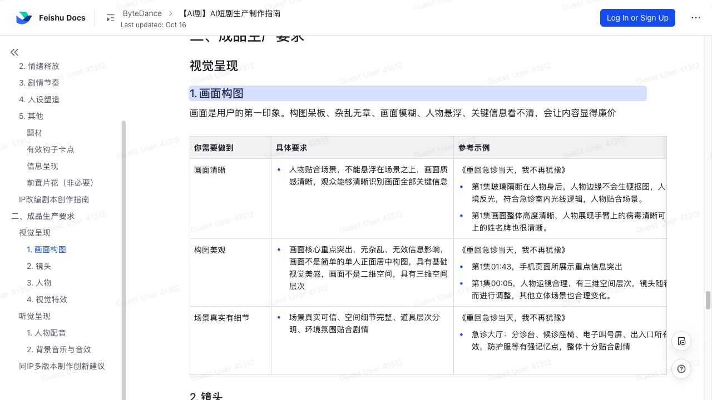
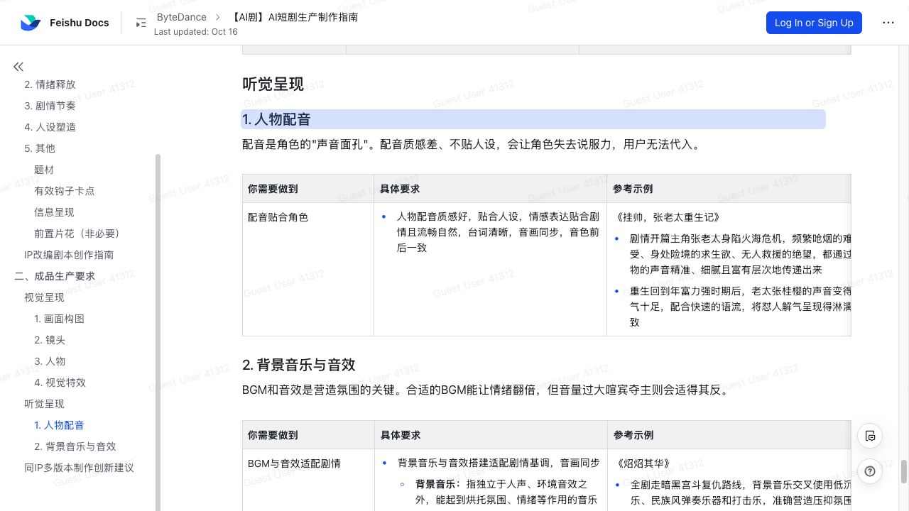

# 字节 AI 短剧生产指南拆解：平台要的不是“AI 感”，而是可追更的情绪工程与连续性 QA

> **TL;DR：** 字节跳动公开的《AI短剧生产制作指南》几乎不讨论使用哪个模型、怎样写 Prompt，反而用大量篇幅规定开篇钩子、逐集情绪、剧情增量、人设辨识度、IP 改编、画面空间、人物动作、穿模透视、配音与音效。它释放的信号很直接：AI 短剧已经不能靠几张漂亮截图或一段炫技视频交差，平台开始按“观众会不会追下一集”和“成片能不能稳定成立”验收。真正需要建设的不是更长的生成提示词，而是从情绪曲线、角色状态到声画同步的连续生产与 QA 系统。



- **来源：** [《AI短剧生产制作指南》- ByteDance Lark](https://bytedance.larkoffice.com/docx/WQJMdTrQZowlmvxpDS9c9OfWn2d)
- **适用对象：** AI 短剧合作编剧与制作方
- **页面更新时间：** 2026-10-16
- **查阅时间：** 2026-10-17

## 一句话判断

**这不是一份“怎样用 AI 做短剧”的教程，而是一份“无论用什么 AI，最后都必须像合格短剧一样工作”的内容验收合同。**

文档把要求分成两大部分：

```text
剧本生产
  ├─ 第一集关键吸睛点
  ├─ 逐集情绪释放与起伏
  ├─ 剧情增量、钩子和信息清晰度
  ├─ 人设与角色化台词
  └─ IP 改编与多版本创新

成品生产
  ├─ 构图、空间和场景细节
  ├─ 镜头叙事与 Bug 控制
  ├─ 人物建模、动作和微表情
  ├─ 光影、色调和剧情特效
  └─ 配音、BGM、音效与声画同步
```

这套结构把“用户为什么继续看”与“画面为什么不会出戏”放在同一份标准里。前者解决留存，后者解决 AI 生成内容最常见的可信度崩塌。

## 第一集不是世界观介绍，而是一份继续观看的承诺

指南要求第一集必须出现“关键吸睛点”，可来自冲突、危机、悬念、反转、新奇设定、强人设、金手指或暧昧关系；同时开篇不能用大量世界观、体系设定和背景铺垫消耗观众耐心。

这里最值得注意的不是“前 30 秒要刺激”这句常识，而是它隐含的叙事顺序：

1. 先让观众感到人物正处于必须解决的问题中；
2. 再用最少信息解释人物、处境与规则；
3. 第一集内继续升级危机或兑现一次反转；
4. 给下一集留下明确期待，而不是只留下未讲完的背景。

指南给出的自检方法很朴素：找没读过剧本的人试读第一集，只问“你想不想继续看第二集？”它没有规定复杂的模型评分，却准确抓住了开篇的唯一业务目标。

对 AI 编剧来说，这意味着 PRD 不能只列世界观和角色卡。每集都需要一个可验证的 **观看理由**，并且这个理由要在分镜和成片中真正出现，不能停留在故事梗概里。

## 文档把短剧情绪写成了可编排的波形

指南明确说，观众看短剧不是为了“了解信息”，而是为了“体验情绪”。每集至少要有一个愤怒、爽感、震惊、悬疑、恐惧、甜宠或虐心等情绪点，而且不能沿一条平线推进，要形成“压抑 → 释放 → 再压抑 → 再释放”的循环。

这比“多写几个爽点”更接近生产方法。它要求创作者在集级和段落级同时管理情绪：

| 层级 | 应保存的生产信息 |
|---|---|
| 整季 | 主线目标、主要压迫来源、核心释放节点 |
| 单集 | 主情绪、起点、峰值、回落与集尾状态 |
| 场景 | 谁压迫谁、谁发起行动、发生什么实质结果 |
| 镜头 | 表演、景别、运动、声音如何放大当前情绪 |

对 Agent 工作流而言，情绪曲线应该成为结构化资产，而不是写在 Prompt 末尾的形容词。一个更可靠的制作系统需要知道第 4 集是“甜中带危机”，而不是只知道全剧属于“甜宠”。

## “每集都有增量”是比时长更有用的剪辑标准

指南用一个很有效的问题检查剧情节奏：如果删除这一集不影响理解，那么这一集就是无效的。

所谓增量可以是：

- 主角目标前进或改变；
- 新信息被揭示；
- 人物关系发生变化；
- 地位、能力或资源发生变化；
- 一条伏笔得到推进或回收；
- 反派施压或主角反击产生不可逆结果。

这给 AI 生成流程提出了一个比“每集 60 秒”更严格的要求。系统需要追踪 **状态变化**，否则模型很容易反复生成争吵、误会、回忆和表态，看似每一集都有事件，实际上主线停在原地。

集尾钩子也不是机械地每集剪在半句话上。文档强调在关键节点放入悬念、险情、反转、秘密或正面冲突，并明确“不要求每集必有”。有效钩子改变了观众对下一步的预期；单纯把一个完整场景从中间截断，只是未完成，不是钩子。

## 人设不是角色卡，而是能从台词和选择中被辨认出来

指南对人物提出三类要求：主角有辨识度、符合题材受众期待、台词精准且贴合角色。

其中一个自检方法尤其适合 Agent：把剧本中的说话人名字删掉，只看台词，是否还能判断是谁在说？如果所有角色都使用相同句式、解释方式和情绪词，人设图再漂亮也只是不同皮肤下的同一个声音。

这要求角色系统同时保存：

- 身份、年龄、成长背景和社会位置；
- 核心目标、底线和典型决策方式；
- 说话长度、词汇、语速、礼貌程度和情绪表达习惯；
- 面对不同人物时的关系姿态；
- 已发生事件如何改变其行为。

所谓“人设稳定”因此不只是脸不变。一个外弱内强、善于利用规则的角色，如果下一场突然只会情绪化喊叫，即使视觉完全一致，角色连续性也已经断裂。

## 信息要尽早落地，但不能把情绪蓄力一起删掉

指南要求世界背景、主角处境、主角设定和剧情主线四类前置信息尽量在前五集落地，同时保持主角叙事视角稳定。它鼓励精简复杂等级、合并概念、删掉无效支线，却反复提醒不要为了加速而切断情绪链路。

文档给出的完整反馈链是：

```text
打压情绪
  → 主角主动发起反击
  → 产生实质行为与伤害
  → 反派、配角或主角对后果作出反应
```

缺少最后一步，观众会看到一个动作，却得不到情绪落点。缺少前面的蓄力，反击又会变成没有重量的快速打脸。

这也是 AI 压缩长篇 IP 最容易犯的错误：模型能删掉大量文本，却不知道哪些段落承担因果、哪些段落承担情绪。真正的改编不是“保留剧情摘要”，而是保留核心故事骨架与情绪反馈结构。

## IP 改编的原则是换外壳，不要误删核心回报

指南分别总结了女频和男频的常见改编方式：女频更强调保留原著、删减提速、放大情绪与必要的剧情重构；男频更强调高光前置、爽点密度和复杂设定精炼。

这里不应被理解成僵硬公式，但它说明平台在检查两件事：

1. 改编是否降低理解成本；
2. 改编是否仍向原目标受众交付同一种情绪回报。

同 IP 多版本可以切换画风、时代或世界背景，例如把古代宅斗迁移到现代豪门；但核心矛盾和情绪骨架必须保留。如果背景变化连门第压力、时代束缚和人物选择一起消失，项目得到的不是创新版本，而是挂着原 IP 名字的另一部作品。

## 成片验收首先检查“人物是否真的在这个空间里”



视觉部分没有要求某种热门模型或电影感 LUT。它先检查最基础、也最容易让 AI 画面露馅的事情：

- 人物不能像抠图一样悬浮在背景上；
- 边缘、环境反光和场景光线要形成同一空间逻辑；
- 关键道具和信息必须清晰可读；
- 构图不能永远是单人正面居中；
- 前、中、后景需要形成三维层次；
- 场景要有真实可信的功能细节，而不是泛化背景。

这意味着“角色一致性”已经不够。人物的脚是否接地、身体是否受到环境光影响、玻璃和镜面关系是否正确、道具是否在连续镜头保持状态，才决定观众是否相信这个角色真的生活在场景里。

## 镜头不能只是动起来，每一镜都要有叙事职责

指南要求景别、运镜和机位服务当下剧情。远景交代规模，中近景呈现反应，特写留给关键信息；平静时镜头稳，危机时可以手持或加快；未知威胁可以通过低机位或仰视放大。

同时，它直接点名三类 AI 镜头 Bug：

- **穿帮：** 不该出现的东西出现，或对象状态前后矛盾；
- **穿模：** 肉体、衣服和道具在空间中互相扎入；
- **透视错误：** 肢体比例、建筑结构或几何关系扭曲。

这三类问题不能靠挑一张好看的 keyframe 解决。它们需要逐镜检测、相邻镜头状态比较和运动过程审查。AI 视频的质量单位因此必须从“单帧”提升为“镜头”，再从镜头提升为“场景连续性”。

## 人物质量的终点是表演，而不是建模图

文档要求人物建模清晰、造型有辨识度，但紧接着就检查动作和微表情：拥抱、对视、争执、开门、拿物与战斗是否符合物理关系；开心、委屈、震惊和难过是否能从面部动作被读出。

这是一条重要分界线。角色设定图解决的是身份，表演解决的是叙事。一个角色可以在所有镜头保持同一张脸，却仍然因为视线不对、接触失败、动作没有目的和面部情绪漂移而无法成立。

视觉特效也被放回相同原则：光影、粒子、打击和施法应该强化剧情与爽点，不能糊脸、杂乱或只展示生成能力。平台验收的是“特效有没有让这一刻更成立”，而不是“用了多少层效果”。

## 声音第一次被写进 AI 短剧的成品标准



指南把配音称为角色的“声音面孔”，要求音色贴合人设、情绪自然、台词清楚、音画同步并且前后一致。BGM 和音效需要匹配剧情基调，脚步、关门、耳光、破碎、风声、提示音和转场声都被视为构建场景与情绪的必要层。

这说明 AI 短剧不能再把声音当成画面生成后的背景附件。角色换了音色、口型对不上、情绪峰值没有声音反馈，都会直接破坏连续性。

不过，文档给出的“BGM 与音效控制在人声的 30%-50%”更像创作提示，不是可执行的混音标准。不同声源的峰值、平均响度和频谱掩蔽无法用一个播放音量百分比统一表达。真正交付仍需要 LUFS、true peak、对白可懂度、动态范围、声画偏移和编码后复检等量化门槛，而这些在指南中没有出现。

## 最有意思的是：全文几乎没有模型名称

文档不规定使用哪家图像、视频、语音或音乐模型，也没有给 Prompt 模板。这个缺席本身就是信号：工具会变化，但验收目标相对稳定。

对制作团队来说，更稳妥的系统架构应该围绕交付物而不是模型组织：

```text
IP / 原创设定
      ↓
分集状态表：目标、信息增量、情绪曲线、集尾钩子
      ↓
角色 Bible：外观、台词、声音、关系、历史状态
      ↓
场景与镜头合同：叙事职责、空间、道具、动作、光线
      ↓
模型路由与生成
      ↓
连续性 QA：身份、状态、穿模、透视、物理交互
      ↓
声音 QA：音色、口型、对白、BGM、音效与同步
      ↓
人工验收：审美、情绪、文化与受众适配
```

当模型替换时，上面的合同和验收仍然可以保留。反过来，如果团队只有 Prompt，没有状态账本与 QA，换成更强模型也只会得到更漂亮但不连续的镜头。

## 哪些要求可以转成机器检查

| 指南要求 | 可保存的证据 | 可自动化的检查 |
|---|---|---|
| 每集有剧情增量 | 集前/集后状态差异 | 目标、关系、信息和资源是否发生变化 |
| 情绪有起伏 | 场景级情绪曲线 | 是否存在峰值、释放和回落，是否长期平线 |
| 人设与台词稳定 | 角色语言画像 | 去名台词分类、禁用词和语气漂移检测 |
| 人物贴合场景 | 深度、mask、接触点、光照参考 | 脚底接触、边缘、阴影与环境反光 |
| 无穿模与透视错误 | 连续帧、人体关键点、物体轨迹 | 几何穿插、肢体比例突变和对象跳变 |
| 镜头服务叙事 | shot intent 与 cue | 关键台词、动作、景别和机位是否对齐 |
| 配音和声画同步 | 角色 voice ID、音素与帧时间 | 音色漂移、lip sync、对白缺失和偏移 |
| BGM/音效不压人声 | stems 与最终编码 | LUFS、dBTP、对白相对电平和频谱掩蔽 |

机器检查不能代替导演，但可以在人工看片前排除大量低级错误，并把问题定位到具体集、镜头和时间码。

## 这份指南还缺什么

它是一份内容与观感指南，不是完整交付规范。公开页面没有说明：

- 画幅、分辨率、帧率、码率、编码和单集时长；
- 字幕格式、安全区、字体和可访问性；
- 对白响度、true peak、声道、采样率和声画偏移阈值；
- 角色一致性、lip sync 与穿模的量化通过线；
- AI 内容标识、模型来源、训练数据或素材版权要求；
- IP 授权、肖像、音乐、声音克隆和生成素材的权利链；
- 提交、评分、返修、申诉和版本管理流程；
- 列举案例的完整链接与可复查片段。

页面顶部显示 ByteDance，目标对象是合作编剧和制作方，并标注内容包含 Doubao Work 生成内容。它可以作为很有价值的生产方向与审稿清单，但不应被扩大解释为所有字节产品、所有地区或所有 AI 短剧的法律与技术政策。

## 结论

《AI短剧生产制作指南》真正重要的地方，不是教创作者怎样制造更多 AI 镜头，而是承认短剧的最终产品单位从来不是镜头。

观众追的是人物和情绪，平台验收的是剧情是否推进、角色是否成立、镜头是否服务叙事、人物是否真的处在空间里、动作和声音是否连续。AI 只是生产手段，不能成为节奏拖沓、信息混乱、人物悬浮、穿模和配音失真的免责理由。

对 AI 影视团队来说，下一阶段的竞争也不会只发生在模型榜单。更关键的是谁能把分集情绪、角色状态、镜头职责、视觉连续性与音频 QA 变成一条可追踪、可返工、可验收的生产线。

**能生成短剧已经不是终点。能让观众相信、理解并点开下一集，才是这份指南真正定义的合格线。**

## 参考资料

- [《AI短剧生产制作指南》- ByteDance Lark](https://bytedance.larkoffice.com/docx/WQJMdTrQZowlmvxpDS9c9OfWn2d)

*本文查阅于 2026-10-17。页面显示 `Last updated: Oct 16`，未提供首次发布日期、版本号或具体适用平台名称。文档为公开匿名只读页面，顶部显示 ByteDance，并标注包含 Doubao Work 生成内容。配图为对应原文表格的浏览器截图；原文没有独立可下载的正文插图。*
