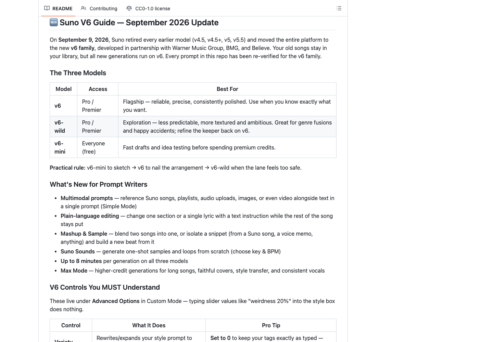
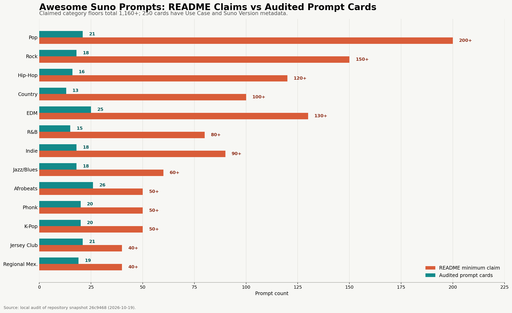
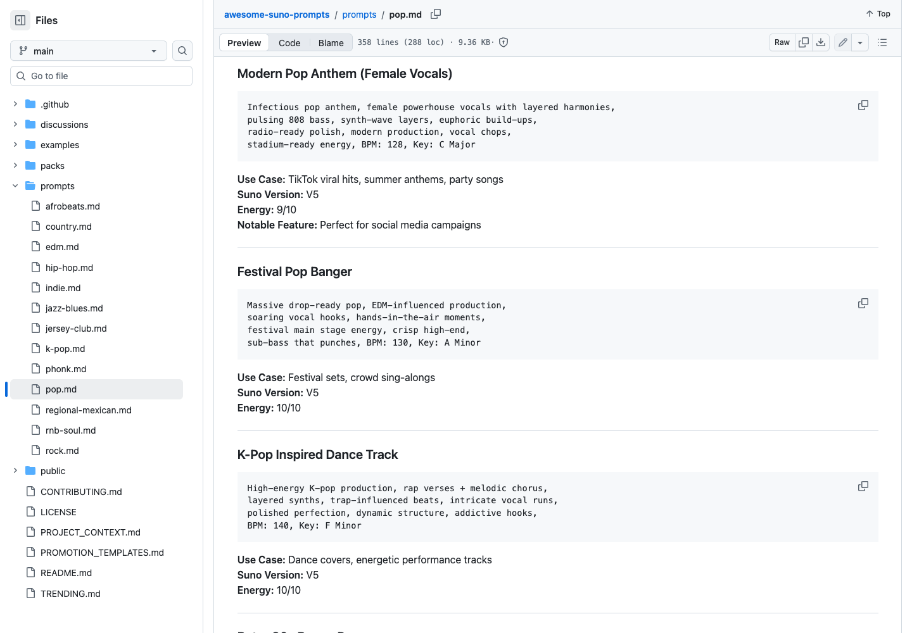

# Awesome Suno Prompts Source Audit: Not 2,000 Verified Recipes, but 250 Useful Style Cards

> **TL;DR:** The best part of `awesome-suno-prompts` is not the README's claim of “1000+” or “2,000+” tested prompts. It is the **250 countable, structured music-prompt cards** spread across 13 genre files. They turn genre, instrumentation, vocal delivery, BPM, key, arrangement, production texture, use case, and energy into a style grammar that is useful for lookup and remixing. The repository contains no audio, Suno song links, generation settings, or blind evaluations. All 250 cards still label `Suno Version` as V4.5, V5, or Both, which conflicts with the claim that everything was re-verified for v6. Treat it as a style dictionary, not yet as an evidence-backed v6 recipe library.



- **Repository:** [naqashmunir21/awesome-suno-prompts](https://github.com/naqashmunir21/awesome-suno-prompts)
- **Audited snapshot:** [`26c9468`](https://github.com/naqashmunir21/awesome-suno-prompts/tree/26c9468de96980d3c40d0250775ef8936cb18dd2)
- **License:** CC0-1.0
- **Repository created:** January 16, 2026
- **Audited:** October 19, 2026

## One-sentence verdict

**This is a useful Suno style handbook, but it is not a prompt benchmark backed by generated audio.**

The repository does one practical thing well. Instead of listing loose adjectives such as “cinematic,” “emotional,” and “epic,” it decomposes a music request into several controllable dimensions. The problem is that it wraps those entries in stronger labels such as “battle-tested,” “chart-quality,” and “fully re-verified for v6” without preserving the outputs or experiment records needed to support those labels.

The two layers should therefore remain separate:

```text
Reusable style language: yes, and organized well
Reproducible generation evidence: largely absent
```

## What the repository actually contains

The source is lightweight: 13 genre prompt files, four thematic packs, one file presented as a complete pack, plus examples, workflow notes, and documentation. There is no application, SDK, training code, or audio archive.

For this audit, a prompt card was defined as a block containing both `Use Case` and `Suno Version`. The resulting inventory is:

| Item | Audited result |
|---|---:|
| Genre files | 13 |
| Countable prompt cards | 250 |
| `Use Case` fields | 250 |
| `Suno Version` fields | 250 |
| `Energy` fields | 250 |
| `Notable Feature` fields | 54 |
| Audio files in the repository | 0 |
| `suno.com/song/...` links | 0 |

Counting all third-level headings produces 309, but 59 are sections, production tips, or explanations rather than prompts. Meanwhile, the README's per-category minimums sum to 1,160+, and a later statistics block says 2,000+. The three counting methods do not reconcile.



| Genre | README minimum | Actual cards |
|---|---:|---:|
| Pop | 200+ | 21 |
| Rock | 150+ | 18 |
| Hip-Hop | 120+ | 16 |
| Country | 100+ | 13 |
| EDM | 130+ | 25 |
| R&B / Soul | 80+ | 15 |
| Indie | 90+ | 18 |
| Jazz / Blues | 60+ | 18 |
| Afrobeats | 50+ | 26 |
| Phonk | 50+ | 20 |
| K-Pop | 50+ | 20 |
| Jersey Club | 40+ | 21 |
| Regional Mexican | 40+ | 19 |
| **Total** | **1,160+** | **250** |

That does not make 250 cards worthless. It means users should not treat the promotional number as the dataset size.

## The prompt grammar is the part worth learning

A typical card is neither a complete lyric nor a magic incantation. It compresses several musical dimensions:

```text
genre / subgenre
+ era and scene
+ instrumentation and timbre
+ vocalist type and delivery
+ BPM / key
+ sections and dynamic movement
+ production, mix, and spatial texture
+ use case, energy, and exclusions
```

A “modern pop anthem” entry, for example, constrains bright synthesizers, strong drums, vocal character, emotional escalation, a wide chorus, and radio-oriented production. That is more useful than stacking abstract mood words because each phrase roughly maps to an audible decision.

The best workflow is to treat cards as parts rather than copy them verbatim:

1. keep the target genre and core instrumentation;
2. replace vocal delivery, groove, era, or regional cues;
3. specify song structure and emotional turns;
4. remove production adjectives that conflict;
5. record current Suno controls separately;
6. generate multiple candidates and use listening plus audio QA to learn which terms mattered.

Recombining attributes also reduces the tendency to produce generic templates or direct imitations of a named artist.

## A v6 guide in the README is not a migrated corpus



The README now contains a substantial Suno v6 guide. It describes v6, v6-wild, and v6-mini, and recommends setting Variety to 0 when strict adherence to style tags matters. Suno's official documentation supports those platform-level points: pre-v6 models have been retired from the current generation lineup; the v6 family is current; Variety at 0 follows style tags more exactly; Max Mode targets long songs, covers, style transfer, and consistency-heavy work; and v6 supports songs up to eight minutes.

The data layer has not undergone the same migration. Across all 250 cards, `Suno Version` contains only:

- V4.5;
- V5;
- Both.

No card is marked V6. The repository also does not record the date, v6 variant, control settings, generated audio, or reviewer behind a successful re-verification.

The precise description is therefore: **the repository added v6 usage guidance while retaining a prompt corpus labeled for older models.** Compatibility with the new models is a reasonable hypothesis to test. “Fully re-verified” requires output evidence.

## What “battle-tested” would need to prove

There are no audio files or playable Suno song URLs in the repository. `examples/viral-hits.md` reports millions of plays, chart placements, NFL use, and other outcomes without linking the relevant songs, platform pages, or independent coverage. Those claims cannot be verified from the repository alone.

The history contains a useful boundary. Commit [`9d01635`](https://github.com/naqashmunir21/awesome-suno-prompts/commit/9d01635) says it removed fake example Suno song links from the README, JSON packs, and documentation. Removing placeholder links is responsible maintenance, but real output evidence was not added in their place.

An evidence-backed prompt record would need at least:

| Evidence | Question answered |
|---|---|
| Fixed prompt and lyric revision | What was actually submitted? |
| Model, date, Variety, Style Influence, Weirdness | Under what conditions was it generated? |
| Max Mode and reference-asset hashes | Did it depend on additional context? |
| Both original candidates and a selection note | Are we only seeing a lucky sample? |
| Playable song or lossless export | Does the result exist? |
| Structure, duration, loudness, peak, and listening review | Did it meet musical and delivery standards? |

Without those artifacts, the repository contains author-curated text recipes rather than repeatable experiments.

## Green CI validates formatting, not music

At audit time, the current GitHub Actions runs for automatic promotion, link checking, and prompt validation were green. Automation is present and running, but each check must be interpreted according to what it actually tests.

Running the validator locally showed that it mainly ensures every `prompts/*.md` file has at least eight non-heading lines. It does not verify:

- whether every prompt card has complete metadata;
- whether README counts match the source;
- whether version labels were migrated to v6;
- whether links lead to playable audio;
- whether structure, lyrics, mix, or listening quality pass review.

The auto-promotion workflow's `regenerate-packs` step currently only prints a placeholder message. It does not rebuild the JSON packs. A green workflow means the scripts passed their own rules; it does not establish that a musician listened to and approved the prompts.

## The JSON packs have drifted as well

The repository offers four thematic packs: cross-genre fusion, gym and workout, heartbreak and emotion, and short-form video. Parsing them yields 44 objects, but only 33 unique IDs after deduplication across packs. Their actual sizes are 11, 10, 13, and 10, while the pack README claims 10, 12, 15, and 15.

`complete-starter.json` is not an array containing 50 or 200 prompts. It is a manifest with `total_prompts: 200` and references to other packs, including a missing `summer-2026.json`. A program expecting prompt objects will encounter the wrong structure.

The right repair is a real build task: generate packs from the Markdown cards, enforce unique IDs, reject missing references, and write audited counts back into the README automatically.

## A better v6-native record

To turn the library into a dependable workflow, each prompt card could become an experiment card:

```yaml
id: modern-pop-anthem-001
prompt: "..."
lyrics_mode: custom
model: v6
controls:
  variety: 0
  style_influence: 80
  weirdness: 35
  max_mode: false
references:
  audio_sha256: null
generations:
  - song_url: "..."
    selected: true
    notes: "chorus lands; verse diction still weak"
qa:
  duration_seconds: 184
  integrated_lufs: -13.8
  true_peak_db: -1.2
  human_review: pass_with_notes
```

Those numbers need not become universal defaults. The important change is to keep inputs, runtime conditions, candidate outputs, and acceptance notes in the same record. That would make behavior across v6, v6-wild, and v6-mini comparable, and reveal whether a success was stable or simply the best of ten draws.

## CC0 is not a blanket license to imitate

CC0 allows the repository author to waive rights in material they control as fully as possible. Many prompts, however, name artists, producers, or bands as style references. CC0 cannot erase third-party trademark, likeness, voice-imitation, lyric, recording, or other rights, and it does not prove that every referenced element belonged to the repository author.

A safer production practice is to translate celebrity-style references into observable musical attributes: era, groove, harmony, instrumentation, vocal behavior, space, and mix treatment. This reduces risk and usually produces a more controllable prompt.

## Conclusion

`awesome-suno-prompts` is worth bookmarking, but under a more accurate label.

It is not a library of 2,000 songs already verified by listening on v6, nor evidence that copying a prompt produces chart quality. It is a set of 250 well-structured cards across 13 musical categories and a useful vocabulary framework for people learning how to describe music to Suno.

For quickly answering “how else can I describe this kind of song?”, the repository is already useful. For commercial production, model comparison, or agent automation, it still needs versioned settings, real audio, candidate history, generated statistics, and listening-based acceptance. Prompts choose a search direction; output evidence determines whether a recipe works.

## References

- [naqashmunir21/awesome-suno-prompts](https://github.com/naqashmunir21/awesome-suno-prompts)
- [Audited snapshot `26c9468`](https://github.com/naqashmunir21/awesome-suno-prompts/tree/26c9468de96980d3c40d0250775ef8936cb18dd2)
- [Suno: Introducing v6](https://www.suno.com/blog/introducing-v6)
- [Suno Help: v6 FAQ](https://help.suno.com/en/articles/13924481)
- [Suno Help: Current Models](https://help.suno.com/en/articles/13924737)
- [Suno Help: What's New in v6](https://help.suno.com/en/articles/13924801)
- [Suno Help: Creative Sliders](https://help.suno.com/en/articles/6141377)
- [Commit `9d01635`, removing fake example links](https://github.com/naqashmunir21/awesome-suno-prompts/commit/9d01635)

*This audit uses repository snapshot `26c9468de96980d3c40d0250775ef8936cb18dd2` from October 19, 2026. Counts come from local parsing of the 13 `prompts/*.md` files and `packs/*.json`. GitHub state, commit history, and official Suno product information were checked on the audit date. I did not run paid Suno generations or independently reproduce the repository's streaming and chart claims, so those marketing figures are not presented as verified facts.*
