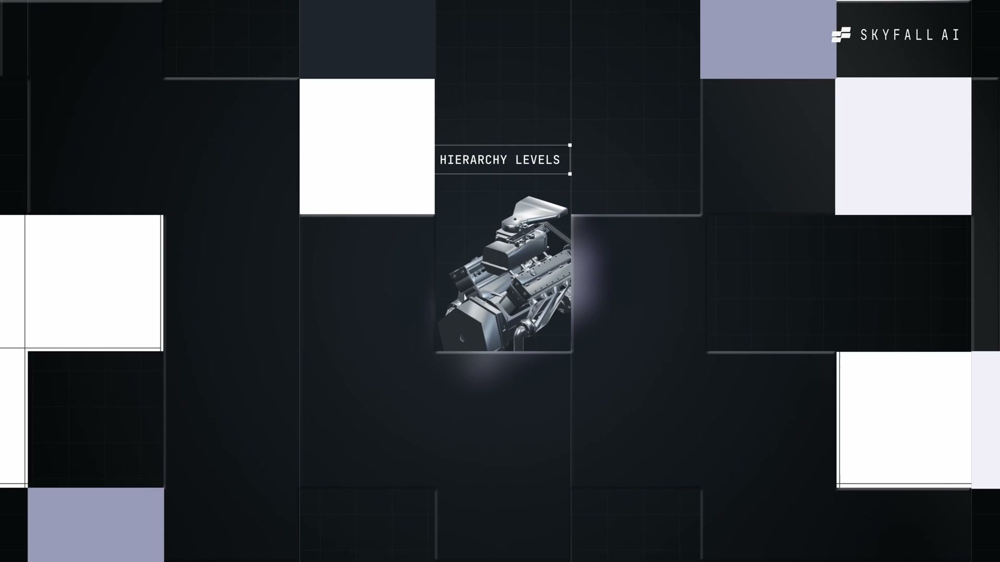
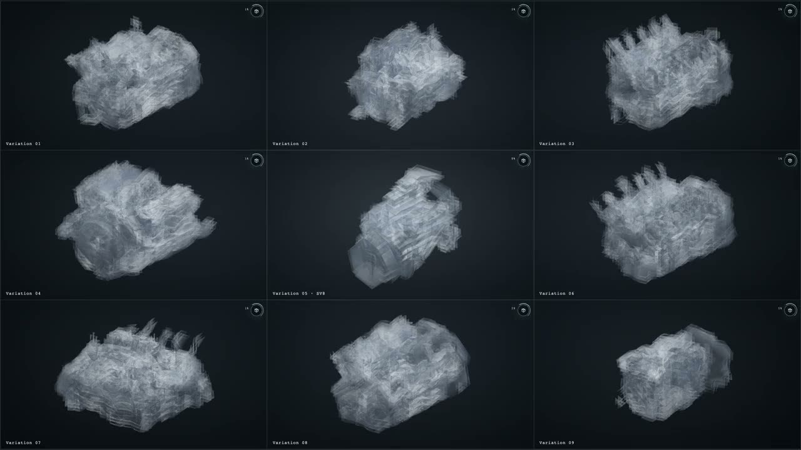
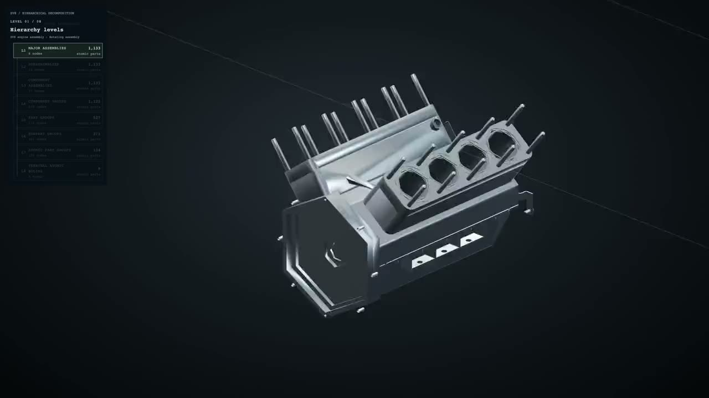
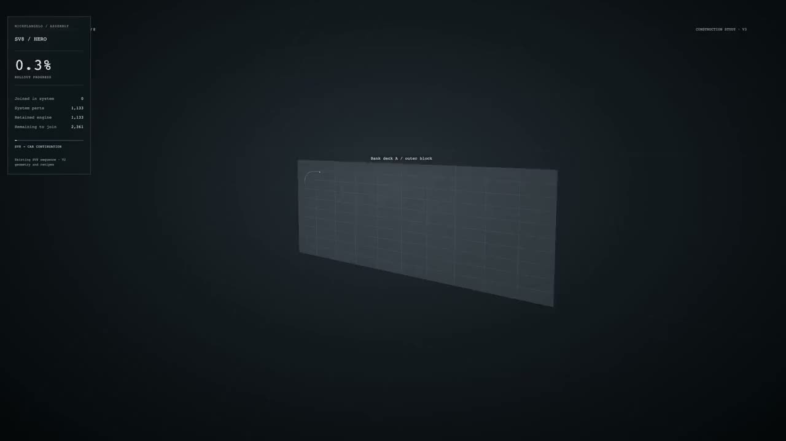
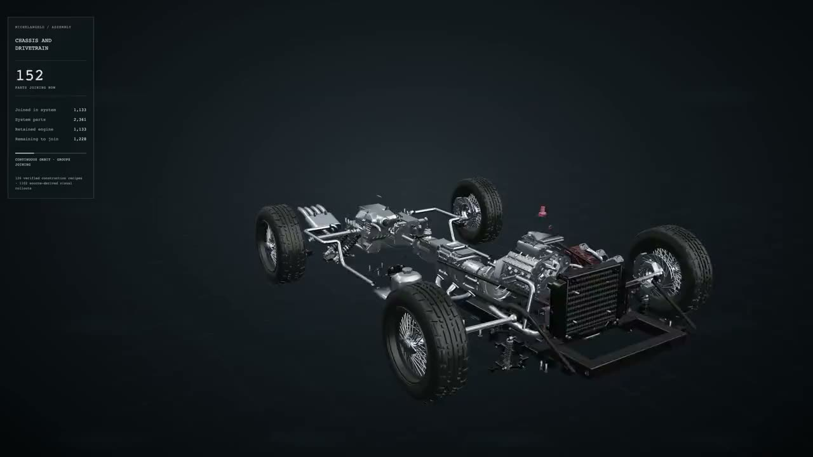
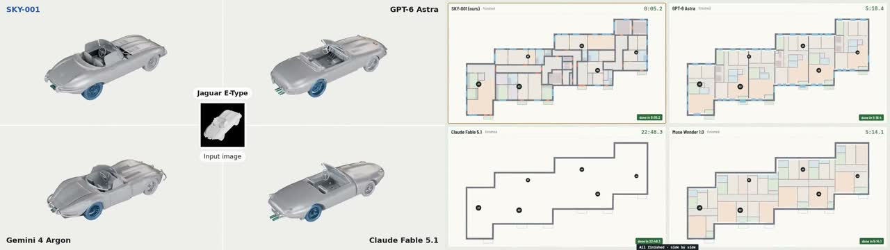

# Inside SKY-001: Not Another Text-to-3D Model, but a System Learning How Engineered Objects Are Built

> **TL;DR:** Skyfall AI introduced SKY-001 on October 19, 2026 and calls it the first Engineering World Model. It differs from systems such as Tripo and Meshy that primarily generate the visible mesh. SKY-001 first explores rough alternatives from text or an image, recursively decomposes a selected object into parts, constructs each part through 2D sketches and operations such as extrusion or cutting, then assembles the result hierarchically. The important move is from “what does it look like?” toward “what is it made of, and in what sequence is it constructed?” It is not yet evidence of autonomous manufacturing. The public release provides no technical report, test-set size, native CAD format, parametric feature tree, tolerance model, materials, load analysis, or manufacturing validation. Access is still waitlist-based, and the speed, cost, and IoU results are vendor-reported.

- **Source post:** [Skyfall AI: Introducing SKY-001](https://x.com/skyfallai/status/2112246201437553045)
- **Official page:** [SKY-001 · Skyfall AI](https://skyfall.ai/sky-001)
- **Released:** October 19, 2026
- **Current status:** Research preview; waitlist access
- **Public artifacts:** No model weights, training code, or independently runnable benchmark harness

## One-sentence verdict

**SKY-001 is not competing with Tripo and Meshy solely on who can make a prettier model faster. It is trying to generate an engineering construction plan that explains part relationships, modeling actions, and assembly order.**

That distinction matters. A conventional text-to-3D or image-to-3D product normally delivers an appearance asset: mesh, texture, materials, and perhaps topology or an automatic rig. It answers, “What does this object look like?”

SKY-001 is organized around a different set of questions:

- Which subassemblies make up the object?
- How are those components arranged hierarchically?
- Which 2D sketches and 3D operations can produce each part?
- In what order should the parts be assembled again?

That makes it closer to a **generative engineering planner** than a conventional 3D asset generator.

## The important part of the launch video is not the car

The reel shows a sports car, an engine, mechanical systems, and building plans. The finished models attract attention, but the intermediate representation matters more. Objects are separated into bodies, wheels, engines, pipes, and progressively smaller parts while the interface tracks hierarchy levels and construction steps.

Skyfall is therefore presenting a 3D object as a **recursively expandable part tree**, not one monolithic surface. A complete appearance may be enough for concept art or film previs. Engineering requires component relationships because they determine whether the object can be modified, assembled, inspected, and manufactured.

The launch reel is still a product demonstration, not an engineering acceptance test. Part counts, hierarchy labels, and polished assembly animations do not establish correct dimensions, constraints, materials, joints, or manufacturability.

## The four-stage SKY-001 pipeline

The product page divides the workflow into four stages. Together, they define its main difference from one-shot prompt-to-model systems.

### 1. Explore several candidates before committing

SKY-001 turns a text prompt or 2D reference into several rough 3D alternatives. A user selects a direction before the system invests in detail. This resembles early industrial-design form exploration more than delivery of a finished asset.

### 2. Recursively decompose the design

After selection, the model breaks large structures into increasingly small components. Skyfall's description extends the claim down to screws and fasteners. In principle, that organization would let a team revise the engine subtree instead of regenerating an unexplained car-shaped whole.

### 3. Recover modeling actions from 2D sketches

Each part begins as a 2D sketch and becomes 3D through operations such as extrusion, cutting, or shaping. “Actions” are the interesting part. In real CAD, editability lives in sketches, dimensions, constraints, and feature history, not in the final triangle surface.

The release explains this generative logic, but it does not establish that the output contains a native, editable Fusion, SolidWorks, or Onshape feature tree.

### 4. Assemble the complete object hierarchically

The final stage combines the components layer by layer and visualizes the result in a standard 3D viewer. Skyfall's press release mentions Autodesk Fusion, but the public page does not specify STEP, IGES, Parasolid, `.f3d`, IFC, or another delivery format, nor does it show assembly constraints arriving intact in a CAD application.

What can currently be confirmed is a structured generation and visualization pipeline. What cannot yet be confirmed is delivery of a fully parametric, editable, manufacturable CAD project.

## How it differs from Tripo and Meshy

| Dimension | SKY-001 | Systems such as Tripo and Meshy |
|---|---|---|
| Primary goal | Decomposition, construction, and assembly planning | Rapid generation of visible 3D assets |
| Core intermediate form | Part hierarchy, 2D sketches, modeling actions, assembly sequence | Mesh, topology, UVs, textures, materials |
| Strongest claim | Long-horizon spatial planning and structural consistency | Appearance, editable mesh, and asset export |
| Public delivery today | Website visualization and research preview | Commonly GLB, FBX, OBJ, USDZ, and related formats |
| Main unknown | Native CAD, constraints, tolerances, simulation, manufacturing validation | Precise engineering semantics and complex assembly reasoning |

SKY-001 is therefore not simply “a more advanced Tripo.” The products operate at different layers. Tripo and Meshy are closer to producing a visible asset. SKY-001 wants to produce the object's **construction program**.

The two approaches could eventually complement one another: SKY-001 could propose the hierarchy and operations, while specialized mesh, CAD, simulation, and rendering systems execute and validate the result. The release does not yet demonstrate that complete handoff.

## The benchmark is striking, but IoU is not a manufacturing certificate

Skyfall publishes two comparisons covering 3D CAD and BIM. The figures below are company-reported:

| Task | SKY-001 | Comparison | Reported difference |
|---|---:|---:|---|
| 3D CAD IoU | 79.7% | GPT-6 Astra 79.1% | 0.6 percentage points higher |
| 3D CAD time | 3.9 seconds | GPT-6 Astra 199 seconds | About 51x faster |
| 3D CAD cost | $0.005 | GPT-6 Astra $0.75 | About 150x lower |
| BIM IoU | 43.6% | Best LLM 42.3% | 1.3 percentage points higher |
| BIM time | 1.22 seconds | GPT-6 Astra about 144.6 seconds | About 119x faster |
| BIM cost | $0.0024 | GPT-6 Astra about $0.446 | About 186x lower |

The page's current numeric table and its still-active comparison-video thumbnails do not use exactly the same baseline model names, suggesting that the benchmark and media assets were updated on different schedules. This article uses the currently readable table values, but that version drift makes independent reproduction even more important.

These numbers support a plausible hypothesis: on a constrained reconstruction task, a specialized visual world model may be substantially more efficient than a general-purpose language model repeatedly invoking modeling tools.

They do not establish that SKY-001 is already a better general engineer than every frontier model:

1. **The benchmark size and sample composition are not public.** Complex assemblies, unusual inputs, and long-tail parts may not be represented.
2. **There is no independent harness.** The release does not fully document tool access, prompting, time measurement, or cost normalization for the baselines.
3. **IoU measures geometric overlap.** It does not evaluate tolerances, hole placement, interference, material strength, loads, regulation, or manufacturing process.
4. **The absolute BIM result remains limited.** A lead at 43.6% still leaves substantial room before reliable structural reconstruction.

IoU can show that a shape overlaps a reference. It cannot prove that parts fit, a building can be constructed, or a product will pass safety review.

## Why Skyfall calls it a world model

Skyfall argues that engineering design is not language continuation. It is a sequential problem requiring geometric abstraction, persistent state, and long-horizon decisions. SKY-001 therefore does not compress a complete design into one prompt response. It keeps an object hierarchy and construction state in latent space, then recursively selects what to make next.

This meaning of “world model” also differs from the term in generative video. SKY-001 is not primarily predicting the next video frame. It is trying to predict **which component should be created next, which operation should create it, and how the result should rejoin the whole design**.

The promising implication is local correction. If a wheel is wrong, the system could theoretically revisit the wheel subtree rather than regenerate the entire car. Engineering value will depend on whether such revisions remain stable and whether upstream changes propagate correctly through dependent parts.

## What remains between this preview and autonomous manufacturing

The launch points SKY-001 toward autonomous manufacturing, but concept-to-factory delivery still requires several layers:

- real parametric dimensions and sketch constraints;
- assembly mates, motion envelopes, and interference checks;
- material, structural, thermal, fluid, and fatigue analysis;
- design rules for CNC, injection molding, sheet metal, or additive manufacturing;
- bills of materials, procurement, revision control, and quality traceability;
- engineering signoff and physical prototype testing.

SKY-001 currently demonstrates the front of that pipeline: concept, decomposition, construction, and visualization. “Product concept to factory” is a legitimate roadmap. It should not be mistaken for an already closed production loop.

## Where it is useful first

Before independent validation, the most credible uses are in early engineering exploration rather than unsupervised design of safety-critical parts:

1. **Industrial-design exploration:** turn one reference into several component-aware directions;
2. **Mechanical concept planning:** give engineers a reviewable decomposition tree and modeling order;
3. **BIM drafting:** translate plan intent into a hierarchical spatial proposal for further inspection;
4. **Agent tool planning:** generate construction steps for execution and validation through CAD APIs;
5. **Training and explanation:** use part trees and staged assembly to explain complex products.

All of these uses permit human review at critical gates and do not require the first result to meet manufacturing standards.

## How to test the real product

An early-access evaluation should go beyond the sports car and tower examples. Use objects with known acceptance criteria:

| Layer | Acceptance question |
|---|---|
| Geometry | Are dimensions, holes, axes, symmetry, and curvature correct? |
| Parametrics | Can sketches, constraints, and feature history be edited? |
| Assembly | Are hierarchy, mates, movement, and interference correct? |
| Formats | Does the result survive import into Fusion, SolidWorks, Onshape, Revit, or Blender? |
| Engineering | Are material, load, tolerance, regulation, and manufacturing rules checked? |
| Iteration | Does one upstream parameter change update all dependent components consistently? |
| Agent workflow | Are failures recoverable, and does every action leave auditable evidence? |

The persuasive test is not whether the model can render a complete-looking sports car. It is whether an engineer can change wheelbase, wheel diameter, or suspension position and see all affected sketches, parts, assemblies, and checks update correctly.

## Conclusion

The significance of SKY-001 is not that AI can generate 3D. That is no longer novel. Its deeper question is whether a generative model can learn the **construction grammar of engineered objects**, rather than only their final appearance.

The public demonstration turns parallel exploration, hierarchical decomposition, sketch-to-3D actions, and layered assembly into a coherent product pipeline. It also reports unusually strong efficiency.

The evidence remains at launch-stage quality. Without a technical report, open model, complete benchmark methodology, or documented native CAD delivery, the most accurate description is not “AI general engineer” or “autonomous manufacturing system.” It is:

**a research preview of an engineering world model trying to upgrade image-to-3D into generation of part trees and construction steps.**

If SKY-001 eventually produces editable feature trees, preserves complex assembly constraints, and survives simulation and manufacturing checks, it will be much closer to engineering automation than mesh generation alone. For now, it has drawn a compelling route to the factory, but it has not passed factory acceptance.

## References

- [Skyfall AI X launch post](https://x.com/skyfallai/status/2112246201437553045)
- [SKY-001 official product page](https://skyfall.ai/sky-001)
- [Skyfall AI unveils SKY-001 press release](https://www.webwire.com/ViewPressRel.asp?aId=363053)
- [Skyfall AI research blog](https://skyfall.ai/blog)

*This article is based on Skyfall AI's October 19, 2026 X video, the SKY-001 product page and press release, and benchmark data accessible on October 20. Images come from the official X video and product page. Speed, cost, and accuracy figures are vendor-reported. I did not receive SKY-001 weights, a technical report, the test set, an independent benchmark harness, or early access, and I do not treat the 3D visualization in the launch as proof of native CAD, manufacturability, or engineering safety.*
