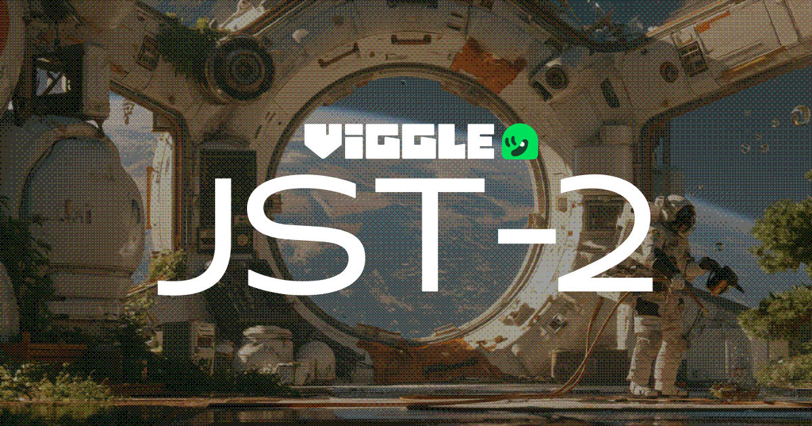
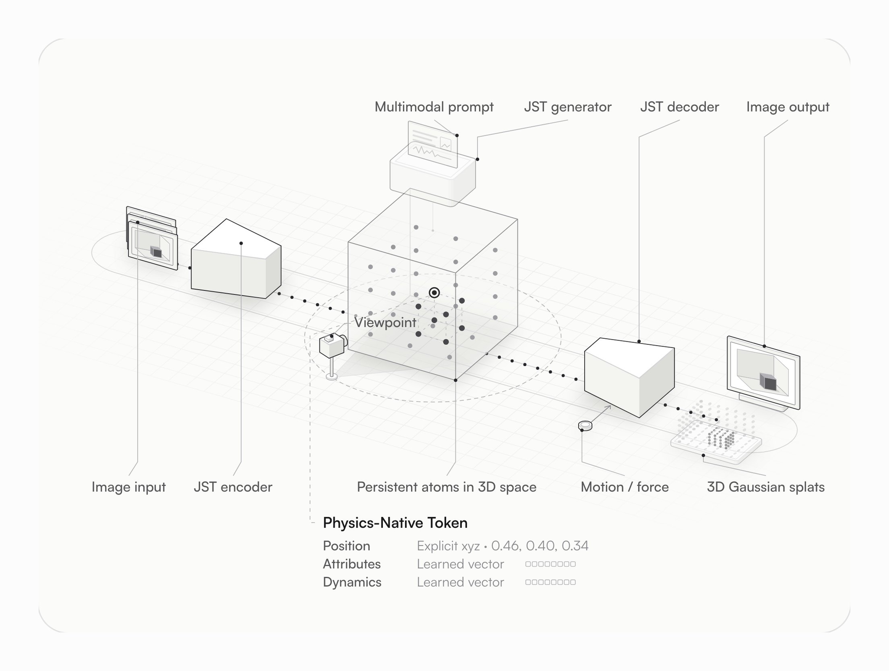
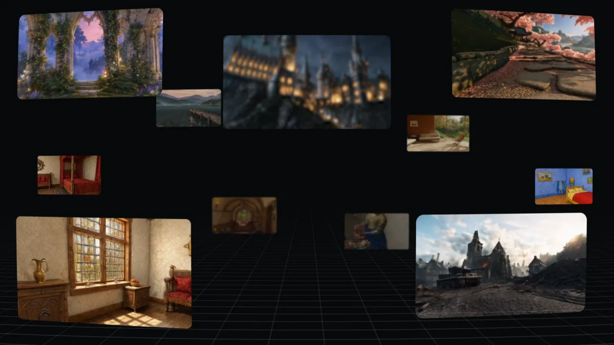

# Viggle JST-2 深度拆解：它不是又一个视频模型，而是把场景、角色与动作装进同一套 3D Token

> **TL;DR：** Viggle 在 2026 年 10 月 19 日发布 JST-2，称其为“物理原生世界基础模型”。它最值得关注的不是某一段生成视频，而是统一表示：场景、角色和动作都被编码成带显式 XYZ 坐标、属性向量与动力学向量的 `Physics-Native Tokens`，再由解码器输出图像或 3D Gaussian splats。这样，镜头移动不必重新生成视频，角色也能带着可动画的运动信息进入 PINOC、API 或 MCP 工作流。不过，“physics-native”不等于已经学会完整物理。JST-2 的角色运动使用学习动力学，场景碰撞和物体交互仍依赖规则引擎；速度与 benchmark 也都来自 Viggle 自测，尚未由第三方复现。



- **原始 X 帖：** [ViggleAI：Physics-Native Token 架构说明](https://x.com/ViggleAI/status/2112202244779061382)
- **官方发布页：** [Introducing Viggle JST-2](https://viggle.ai/jst2)
- **发布时间：** 2026-10-19
- **可用入口：** PINOC 浏览器应用、API、MCP
- **模型状态：** 托管服务；发布页未提供 JST-2 权重或训练代码

## 一句话判断

**JST-2 的野心不是生成一条更漂亮的视频，而是让 Agent 拿到一个可以换视角、加角色、套动作并继续扩展的 3D 世界状态。**

传统视频模型通常把世界压在像素或时空 latent 里。它们可以生成看起来合理的画面，但“椅子在哪里”“角色的手被遮住后怎样运动”“镜头转过去时房间还是否存在”等结构，需要从外观中间接推断。

JST-2 选择另一条路线：先表示世界里的持久对象，再决定从哪个视角看、施加什么动作或力、最后解码成图像或 3D 结果。Viggle 把这种基本单元称为“原子”，但它不是化学原子，而是代表某块物质或对象部件的可学习 token。

这让 JST-2 更像一个**生成式场景运行时**，而不只是视频渲染器。

## X 帖中的那张图，到底在表达什么



原帖只写了两段话，核心都在这张架构图里。完整链路可以拆成三条路径：

```text
真实图像 → JST Encoder ┐
                       ├→ Physics-Native Tokens
多模态提示 → JST Generator ┘

Physics-Native Tokens
  + 视角
  + 动作 / 力
        ↓
    JST Decoder
        ↓
图像 或 3D Gaussian splats
```

每个 token 至少包含三类信息：

| 组成 | 作用 |
|---|---|
| 显式 `xyz` | 说明对象部件在三维空间中的位置 |
| Attributes 向量 | 编码外观、材质或其他可学习属性 |
| Dynamics 向量 | 编码它在动作下如何移动或形变 |

Encoder 让模型从一个或多个真实视图反推出这些 token；Generator 则直接从多模态提示生成 token。Decoder 接收同一组世界 token，再根据视角和动作条件输出画面或 splats。

关键不在“3D”三个字，而在**同一状态可以被重复读取**。场景生成后，用户移动镜头时，浏览器本地重渲染 splats；只有扩展新内容时才再次调用模型。这比每换一个镜头就重新抽一条视频，更接近真正可编辑的空间资产。

## 为什么 Gaussian splats 很适合这条路线



3D Gaussian Splatting 用大量带位置、颜色、透明度、尺度与方向的高斯点表示场景。它的优势是渲染快，适合在浏览器里自由转动视角，也容易保留由图像学习到的外观质感。

这与 JST-2 的 token 设计天然相配：

- token 负责表达持久空间状态；
- decoder 把状态变成可显示的 splats；
- 浏览器负责实时观看，不必每帧访问生成模型；
- 新视图可以继续加入上下文，逐步扩展世界。

Viggle 称 JST-2 最多支持 64 个输入视图作为空间上下文窗口。与单次生成一张 360 全景图相比，这更像一段可延续的建图过程：每增加一个视图，后续生成都能参考已有空间。

但 splats 也解释了当前限制。它们不是干净的拓扑网格，近距离表面细节、关节附近的孔洞或融合、复杂遮挡和精确碰撞都可能出问题。对于影视预演和快速游戏原型，它们很灵活；对于需要精确 UV、可雕刻拓扑、碰撞体和最终级资产的生产环节，还不能直接替代传统网格流程。

## “1 秒生成 3D 场景”应该怎样理解

Viggle 报告称，JST-2 的前馈架构可以在约 1 秒内直接产生 3D 场景，单次推理成本低于 0.01 美元，并将其与 Marble 的约 5 至 6 分钟作比较。

这里必须保留三个限定条件：

1. 约 1 秒是在 **NVIDIA B200** 上测量的模型推理时间；
2. 这个数字明确不包含网络延迟、排队、加载和浏览器渲染；
3. 官方页面没有给出一套足以复跑的统一测试脚本，用来保证与 Marble 的质量、分辨率、输入和扩展范围完全对齐。

所以这项数据支持的结论是：JST-2 的 feed-forward 设计具有交互式生成潜力。它不能直接推导出“任何电脑一秒完成高质量 3D 世界”，也不是已经独立验证的行业速度冠军。

真正重要的是工作流变化。如果每次扩展场景只需要秒级推理，而已有场景可以在本地反复观看，那么 Agent 可以把“生成—观察—选择新视角—继续扩展”做成循环，而不是等待一段长视频渲染完再判断。

## 角色不是一张贴图，而是带着运动信息生成

JST-2 的第二个关键变化，是把角色外观与运动动力学放在同一种表示里。官方称，模型可以从文字或单张图像生成完整全身角色，即使输入被裁切、遮挡或只露出上半身，也会补全其余身体。

Dynamics 向量描述角色部件在不同动作下如何形变，因此 JST-2 原生角色无需再经过独立的 rigging 和 skinning 阶段，就能应用模型生成的动作。这不是说骨骼概念完全消失了，而是说传统的手工绑定步骤被模型吸收进生成过程。

这里还要区分两种交付物：

- **JST-2 角色**是可绑定动作的 Gaussian splat 角色，公开 MCP 文档使用 `.vsplat`，需要 Viggle Splat Engine 在网页或 Unity 中渲染；
- **JST-2 动作**可以导出 GLB、FBX 或 USDZ，也能驱动标准 3D rig，更容易进入 Blender、Unity、Unreal 等现有管线。

因此，“一张图直接得到可动画角色”很有价值，但不等于“一张图直接得到任意 DCC 都能自由编辑的标准高质量网格”。角色外观与动作数据的开放程度并不相同。

## 文本和视频，都可以变成全身 3D 动作

JST-2 支持两类动作输入：

- 文本生成动作，例如闪避、翻滚、踢腿、舞蹈或开门；
- 视频还原动作，从可见表演恢复全身 3D 运动，并推断被遮挡部位。

模型生成的动作可以直接应用于 JST-2 角色，无需单独 retarget，也兼容标准 rig。这一层比“角色替换视频”更接近生产资产：输出不只是最终像素，而是可以重新配角色、修改镜头和进入游戏引擎的运动数据。

这也是 Viggle 从 Meme Maker 走向 PINOC 的真正产品升级。前者解决“把某个角色放进一段视频”；后者开始解决“给游戏、动画和预演管线提供角色与动作资产”。

## Benchmark 看起来很强，但仍是厂商自测

Viggle 公布了角色、动画就绪度和动作三组盲测。官方说明中，参与比较的模型接收相同输入，资产通过各厂商 API 批量生成；`Average Score` 是各项指标与 Overall Preference 的等权平均，平局按半胜计算，50% 表示持平。

| 任务 | 对手 | JST-2 Average Score |
|---|---|---:|
| 单图生成角色 | Meshy 7.1 | 58.4% |
| 单图生成角色 | Tripo H3.1 | 73.2% |
| 动画就绪度 | Meshy 7.1 | 73.8% |
| 动画就绪度 | Tripo H3.1 | 88.9% |
| 文本生成动作 | Cartwheel Swing | 74.8% |
| 文本生成动作 | HY-Motion-1.0 | 80.0% |
| 视频还原动作 | Cartwheel Comic 4 | 58.1% |
| 视频还原动作 | DeepMotion Animate 3D | 89.1% |

这些数字可以说明 Viggle 做了比精选 demo 更系统的内部比较，尤其手部、脚部接触、形变和动作平滑度被单独评估。但它们仍然来自发布方：公开页面没有提供模型权重、完整测试集、逐项输出、评审人数和可独立运行的 benchmark harness。

因此，合理写法是“Viggle 的盲测显示 JST-2 领先这些基线”，而不是“JST-2 已被证明是最强 3D 模型”。其中对 Meshy 的角色生成与对 Cartwheel 的视频动作成绩只略高于持平线，也比 80% 以上的项目更值得实际测试。

## MCP 把它从网站功能变成 Agent 工具

JST-2 发布页明确支持 Codex、Claude Code 和其他 MCP 客户端。公开的 PINOC MCP 能让 Agent：

- 浏览并取得预制动作；
- 从文字生成动作；
- 从视频提取 3D 动作；
- 从照片或描述生成角色；
- 等待异步任务并下载资产；
- 查询积分，并在消耗前区分只读与写入权限。

这比“让 Agent 打开网页点按钮”更可靠，因为生成、等待和取回文件被定义成工具调用。一个同时连接 PINOC MCP 与 Blender、Unity 或 Unreal 工具的 Agent，可以先生成动作，再把 GLB/FBX 放进项目并完成预演。

不过，当前公开 PINOC MCP 页面重点列出的是角色和动作工具，并没有把 JST-2 发布页展示的完整 Scene 生成与世界扩展能力逐项列成 MCP 工具。发布页说 JST-2 可通过 API 或 MCP 使用，不应被扩展理解为整套世界编辑功能已经全部开放给 Agent。

## “物理原生”最容易被误读的地方

Physics-Native Token 意味着表示层显式关心空间位置和动力学，不意味着模型已经成为通用物理模拟器。

Viggle 自己列出的边界很重要：

- 关节、腋下和指缝可能出现 Gaussian 孔洞、粘连或塌陷；
- 头发、服装和材质在近景中会变软；
- 非常规人体比例和非人形轮廓可能导致关节错位；
- 衣物、头发和配件会随身体形变，但尚不真正模拟惯性与相互碰撞；
- 场景碰撞和物体交互仍然依赖规则物理。

Viggle 把用学习动力学替代这些规则交互列为 JST-3 的目标。这句话反过来也定义了 JST-2：它已经学会了一部分“怎样动”，尚未学会完整的“物体怎样相互作用”。

## 对创作者和开发团队，真正可落地的价值

JST-2 当前最适合四类工作：

1. **游戏原型与 NPC blocking：** 快速生成角色、动作和可探索场景，在正式建模前验证玩法与镜头；
2. **影视预演：** 用手机动作或文字动作快速排演走位、打斗和镜头，不必先完成角色资产；
3. **互动内容：** 同一空间状态可换视角、加内容，比固定视频更适合网页体验与可玩的营销项目；
4. **Agent 资产生产：** MCP 把动作和角色变成可查询、可生成、可下载的结构化工具，而不是人工搬运的网页结果。

机器人仿真、自动驾驶、建筑和“physical AI experience engine”则仍属于更长期方向。官方展示了从稀疏观察重建环境的潜力，但没有公开机器人策略训练、物理精度或 sim-to-real 结果，不能仅凭空间外观一致就宣称它已经是可靠的仿真器。

## 团队应该怎样验收 JST-2

如果把它引入生产，不要只看发布片。至少做一组固定输入的端到端测试：

| 环节 | 应检查什么 |
|---|---|
| 场景 | 新视角结构是否一致；扩展后旧区域是否漂移；近景 splat 是否破碎 |
| 角色 | 遮挡补全、手脸细节、非常规体型、关节形变 |
| 动作 | 节奏、脚底接触、手指、快速旋转、遮挡动作恢复 |
| 管线 | GLB/FBX/USDZ 导入、坐标系、骨骼命名、循环接缝与 retarget |
| Agent | MCP 权限、积分确认、超时、失败退款、下载链接过期与任务恢复 |
| 商用 | 输入人物、动作视频、IP 角色、训练素材与输出资产的使用权 |

速度也要拆开记录：模型推理、服务排队、上传、任务等待、下载、本地导入和人工修复分别花了多久。只有这样，官方的“1 秒”才能转换成团队自己的真实交付时间。

## 结论

Viggle 的那条 X 帖看起来只是在介绍一种 token，背后却是一条很清楚的产品路线：从像素级角色替换，走向共享 3D 状态，再把场景、角色和动作交给浏览器、游戏引擎与 Agent。

JST-2 最有意义的地方不是宣称自己“物理原生”，而是把空间位置、外观属性和运动动态放进同一种可生成表示。这样，生成结果不必停留在一段视频里，而可以继续被观察、组合和驱动。

但它仍不是完整的 learned-physics 世界模拟器，也不是开放权重研究项目。当前证据主要来自 Viggle 官方页面与厂商盲测；Gaussian 角色、近景细节、复杂形变、场景碰撞和工具开放范围都有现实边界。

更准确的定位是：**JST-2 已经跨过“生成世界的画面”，开始生成“可以继续工作的世界状态”；而从可工作的状态走到可信的物理世界，还需要 JST-3 和独立验证。**

## 参考资料

- [ViggleAI X post: Physics-Native Tokens](https://x.com/ViggleAI/status/2112202244779061382)
- [Introducing Viggle JST-2](https://viggle.ai/jst2)
- [JST-2 Character benchmark](https://viggle.ai/research/jst2-character)
- [JST-2 Motion benchmark](https://viggle.ai/research/jst2-motion)
- [PINOC MCP Server](https://viggle.ai/pinoc/mcp)
- [PINOC product overview](https://viggle.ai/pinoc)
- [Viggle Research index](https://viggle.ai/research)

*本文基于 2026-10-19 发布的官方 X 帖、JST-2 发布页、角色与动作评测页，以及 2026-10-20 可访问的 PINOC/MCP 文档。配图来自 Viggle 官方 X 与官网。速度、成本、用户量与 benchmark 均为 Viggle 报告值；本文没有获得 JST-2 权重、训练数据或独立 benchmark harness，也没有进行付费生成，因此没有把这些指标写成第三方复现结果。*
