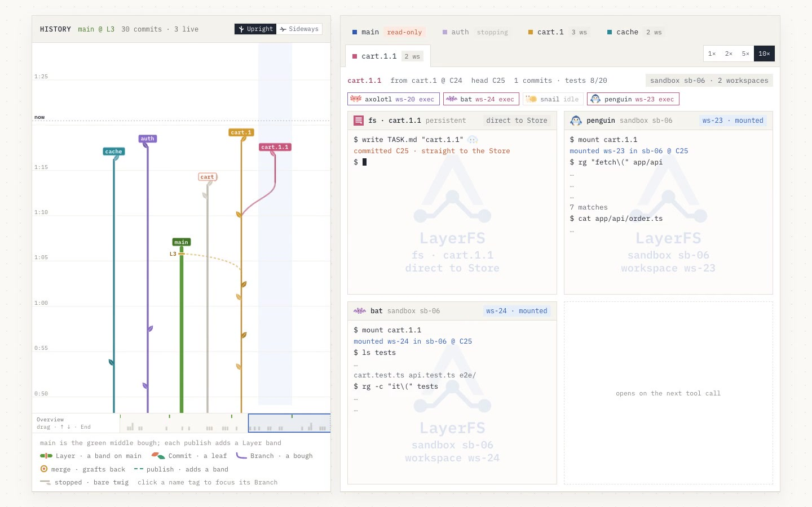
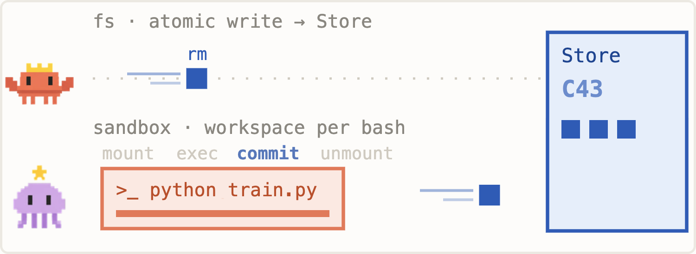
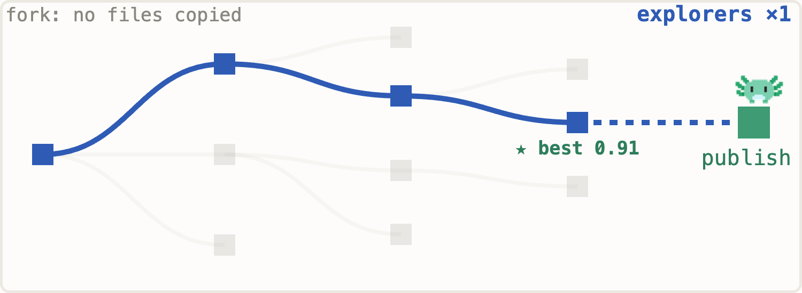
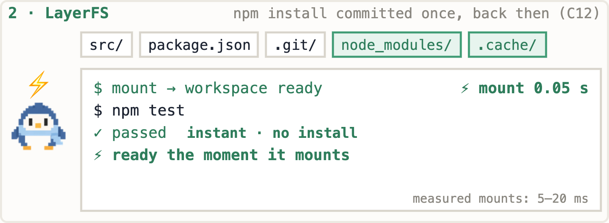
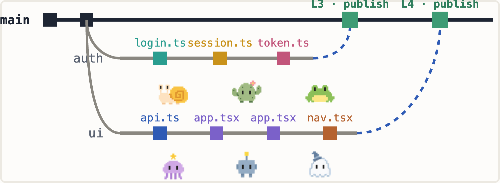
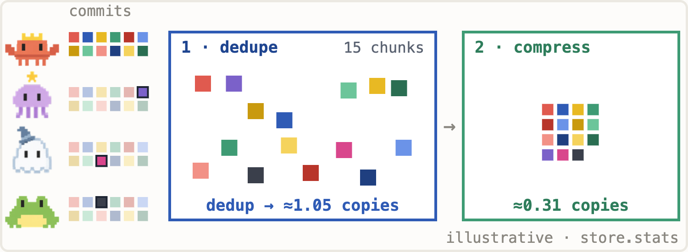

# Inside LayerFS 1.0: Shared Filesystem History for Branching AI Agent Work

Five agents modifying one project quickly create practical questions. How are their directories isolated? Must dependencies be installed five times? Which step can a failed experiment restart from? How should their changes come together?

On October 21, 2026, Yifan Xu announced the MIT-licensed LayerFS v1.0.0. It keeps project files, dependencies, and changes in a shared Store, then exposes writable workspaces for individual attempts. The model handles reasoning; LayerFS organizes the state that work produces.

**Its useful combination is cheap branching, captured dependencies, and fine-grained file history.** The current release has material constraints: Store access must share one Linux kernel, macOS runs through Docker, and only the Disposable profile is enabled, without host-crash or power-loss durability.



*Frame at eight seconds from the official website demonstration. Its branches, commits, and terminal activity are simulated to explain the interface, not evidence of completed parallel tasks or measured performance.*

- Announcement: [Yifan Xu: LayerFS v1.0.0](https://x.com/yifanxu_ephai/status/2112876555907064008)
- Release: [v1.0.0](https://github.com/Ephemeral-AI-Lab/layerfs/releases/tag/v1.0.0), tag commit `2aaf2552ce21154928b9f9c83582e41a637f5910`
- Website: [layerfs.ai](https://layerfs.ai/)
- Reviewed October 22, 2026: release-tag source, SDK, release notes, and current website documentation. No runtime installation or independent benchmark reproduction was performed.

## How a Bash call becomes history

LayerFS provides two paths into the filesystem.

Reads, searches, and edits can use the JavaScript SDK directly against the SQLite Store. They do not need a container for each operation. A write that changes state can create a Commit; a read or unchanged operation does not create a checkpoint just because a tool was called.

Bash, tests, and builds use a mounted Workspace. Programs see a complete writable directory, while changes enter a private overlay. An explicit commit saves them into shared history before the caller unmounts the workspace.



*Official concept illustration: file writes go directly to the Store; command execution follows mount, exec, commit, and unmount.*

Using the v1.0.0 API names, the lifecycle is:

```text
fs.write / fs.edit → changed files and a Commit

workspace.mount(branch)
  → workspace.exec(workspace, command)
  → workspace.commit(workspace)
  → workspace.unmount(workspace)
```

Checkpointing every meaningful tool step depends on the harness implementing that lifecycle. Returning from `exec` does not itself commit. File history also does not automatically preserve stdout, process memory, or a running service.

The announcement's estimate that agents spend roughly 80% of their time thinking motivates this design; it is not a measured law for all agent workloads. The release SDK also reuses containers: a Sandbox can hold up to 16 Workspaces for its image and shuts down after roughly two idle minutes. An ephemeral workspace therefore does not imply that every command immediately releases all computing resources. [Release SDK](https://github.com/Ephemeral-AI-Lab/layerfs/blob/v1.0.0/sdk/js/README.md)

## Five concepts that fit together

| Concept | Responsibility | Example |
|---|---|---|
| Store | Shared file content, trees, and history | A project's SQLite Store |
| Branch | A writable line of experimentation | `fix-login` or `try-cache` |
| Commit | A saved filesystem state | A checkpoint after editing tests |
| Workspace | A writable view for ordinary programs | The directory used by `npm test` |
| Layer | A state published to `main` | A result accepted after review |

A fork records its starting point without copying the whole project. Existing content remains shared; a branch stores additional changes as it produces them. An agent can try approach A, fork A1 and A2 from a checkpoint, test both, and retain a useful result.



This makes state management attractive for search, repeated repairs, and multiple candidates. Tests, evaluators, or people still decide which candidate is better. The filesystem does not supply acceptance criteria.

## Capturing dependencies changes workspace preparation

Initialization captures the project tree, including `.git`, `node_modules`, caches, and files ignored by `.gitignore`. Subsequent branches can see those files without reinstalling dependencies from source each time.



*The timing in this official concept image illustrates the workflow. It is not an installation or mount measurement made for this article.*

This addresses the gap between source control and an executable project environment. Git worktrees already share Git objects, but a new directory does not automatically receive every untracked dependency. LayerFS includes those files in versioned working state.

The benefit depends on the existing workflow. Container images, shared dependency caches, and filesystem snapshots can already avoid repeated installation. Mounting is also lazy: opening files still incurs I/O, and native modules must match the runtime image and architecture.

The larger capture scope has a direct consequence: ignored does not mean excluded. An `.env` file or local credential in the imported directory may enter history. Preparing the experiment directory requires an explicit decision about what belongs in the shared Store.

## What multi-agent coordination actually covers

Workspaces can operate in parallel, then reconcile changes with the current Branch head when committing. The Store still has a brief single-writer publication step; expensive preparation and builds can happen alongside one another.



The post summarizes conflicts as refusing same-file clashes. The release source is more precise: it compares a common base with both sides, identical bytes do not cause conflicts, and text has a three-way merge path. Incompatible changes require resolution. Agents must inspect diagnostics and the new head rather than assume concurrent edits are automatically correct. [Merge implementation](https://github.com/Ephemeral-AI-Lab/layerfs/blob/v1.0.0/core/crates/layerfs-content/src/merge/decide.rs)

The root `/.lww` file provides last-writer-wins rules. Matching paths retain the side with the newer modification time, favoring ours on a tie, and record the decision. This can suit regenerable output and caches. Applying it to source or lockfiles requires accepting that one side's work can disappear. A newer lockfile does not necessarily include dependencies added independently on both branches. [Rule implementation](https://github.com/Ephemeral-AI-Lab/layerfs/blob/v1.0.0/core/crates/layerfs-content/src/merge/lww.rs)

These mechanisms preserve file and history consistency. Application correctness still requires testing the merged result.

## How far decentralization reaches today

The launch post describes agents on different computers sharing one Store. Current platform documentation places a narrower bound on direct access: every Store-opening process and daemon must share one Linux kernel, and the Store must live on local ext4, xfs, or btrfs. NFS, virtiofs, and macOS directory bind mounts are unsupported.

The confirmed deployment is therefore shared access within one Linux host or Docker Linux VM. Remote agents could use an additional host-side service, but placing SQLite on a NAS does not provide supported cross-host coordination by itself.

On macOS, LayerFS × DSH uses Docker Desktop. The Host executes Store operations in a Linux container, with the persistent volume inside the Linux filesystem. This is not a direct FUSE mount over an APFS project directory. [Platform documentation](https://layerfs.ai/docs/platform/)

## Reading the storage numbers correctly

Content addressing stores identical data once. Chunking and delta representations let small changes reuse old content. Zstd compresses the stored data further.



*The approximately 1.05-copy and 0.31-copy figures belong to a concept illustration. The Core Ideas page and asset documentation identify such demonstration numbers as illustrative.*

The release supplies a separate set of measured results with methods and records:

| Suite | Official result | Interpretation |
|---|---|---|
| `fs-bench` | 5.20 seconds versus 8.88 seconds, about 1.71× | Same-image comparison with Cloudflare Computer's filesystem suite; faster in 10 of 12 scenarios |
| `dsh-dedup` | 157 snapshots in a 100.1 MB Store versus 1,994.6 MB for Btrfs + zstd | About 19.9× smaller for this project's history; 156/156 subsequent snapshots read back |
| `pjdfstest` | No unexpected failures; about 76% of overlayfs's passing assertions retained | Declared format limits account for other differences; this is not complete POSIX compatibility |
| `fsx` / `fsstress` | 14/14 pass with no byte miscompares; 3,755/3,755 entries match after commit and remount | Data-correctness evidence, not power-loss recovery evidence |
| `fio` | Sequential writes at about 0.31× the FUSE baseline | Storage savings do not mean every I/O pattern is faster |

These are author-run release measurements at `e5c7aaae05`, using an arm64 Mac, Docker Desktop `linux/arm64`, eight CPUs, and about 8.3 GB of memory. Each case ran once. They were not reproduced here and do not establish that complete agent tasks become 1.71× faster or that arbitrary files shrink 19.9×. [Benchmark methods and records](https://layerfs.ai/benchmarks/)

## Retained history and power-loss durability are different promises

The release source defines both Durable and Disposable persistence profiles, but its installation path accepts only Disposable. That profile uses SQLite WAL with `synchronous=OFF`.

This reduces commit waiting, while leaving recent history vulnerable to an OS crash or power loss, potentially including Store damage. Immutable objects prevent normal operations from overwriting prior objects; they do not replace disk synchronization and recovery guarantees. [Persistence configuration](https://github.com/Ephemeral-AI-Lab/layerfs/blob/v1.0.0/core/crates/layerfs-persistence/src/backend/sqlite/profile.rs)

History currently has no garbage collection. Deleting a file removes it from newer snapshots while older commits can retain its content. Shared branches can be cheap, yet retaining all newly produced changes still grows storage over time.

The sensible present use is reconstructable agent working state and experimental history. Results requiring long-term preservation should also reach a Git remote or another independent store.

## What adopting 1.0 requires

Version 1.0.0 is source-only: no npm package, prebuilt binary, or public runtime image. The SDK native addon and Linux daemon must be built from the same tag, followed by a Docker runtime image. The DSH integration also needs Node 22.19+, pnpm, and a DeepSeek Harness checkout.

At review time, parts of the website still describe the older `sandbox.*` lifecycle and a 1 MiB output cap. The release notes and tagged SDK use `workspace.*`, with large output handled through paging. Integration should follow the release-tag SDK and notes, keeping the JavaScript package, addon, and daemon aligned. [v1.0.0 SDK](https://github.com/Ephemeral-AI-Lab/layerfs/blob/v1.0.0/sdk/js/README.md)

LayerFS does not automatically take over an existing coding agent's tools. A harness must route file operations and the Bash lifecycle through it. LayerFS × DSH is the principal documented route today; the website lists Pi integration as planned.

## Where an evaluation is most useful

| Workload | Potential benefit | Cost to measure |
|---|---|---|
| Branching repairs and candidate search | Reuse starting states and preserve attempts | Merge correctness, evaluation, and scheduling |
| Heavy dependencies and frequent fresh environments | Share installed files | First reads, runtime images, and architecture matching |
| Agent training and debugging | Resume from specific file states | Logs and model context need separate capture |
| A small project with one agent | Some history and isolation benefits | Whether build and runtime management pay off |

LayerFS presents an interesting direction for agent infrastructure: make attempts themselves branchable file states, bring execution environments into use on demand, and preserve failed experiments for inspection. Adoption should follow measured preparation costs, branching needs, and recovery experience, rather than the speed of the animated history tree.

## Sources and evidence

- [Launch post](https://x.com/yifanxu_ephai/status/2112876555907064008) and [v1.0.0 release](https://github.com/Ephemeral-AI-Lab/layerfs/releases/tag/v1.0.0)
- [MIT source repository](https://github.com/Ephemeral-AI-Lab/layerfs) and [tagged SDK](https://github.com/Ephemeral-AI-Lab/layerfs/blob/v1.0.0/sdk/js/README.md)
- [Core Ideas](https://layerfs.ai/docs/core-ideas/), [Platform and Limits](https://layerfs.ai/docs/platform/), and [LayerFS × DSH](https://layerfs.ai/docs/integrations/dsh/)
- [Benchmark index](https://layerfs.ai/benchmarks/) and [dsh-dedup](https://layerfs.ai/benchmarks/dsh-dedup/)
- [Official asset notes](https://github.com/Ephemeral-AI-Lab/layerfs/blob/v1.0.0/docs/assets/official_release/README.md), identifying the history visualization as a simulation and its numbers as illustrative

*This is a review of official material and source code. No local LayerFS deployment, benchmark reproduction, or failure-recovery experiment was completed; upstream results are not presented as independent measurements.*
