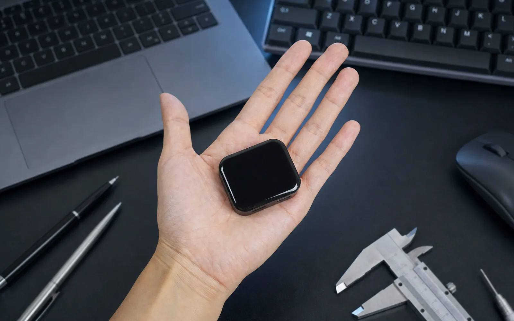
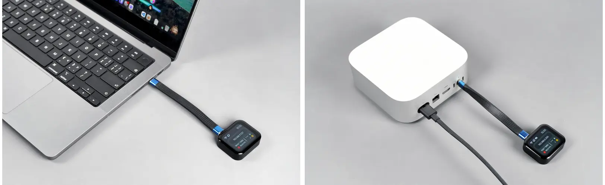
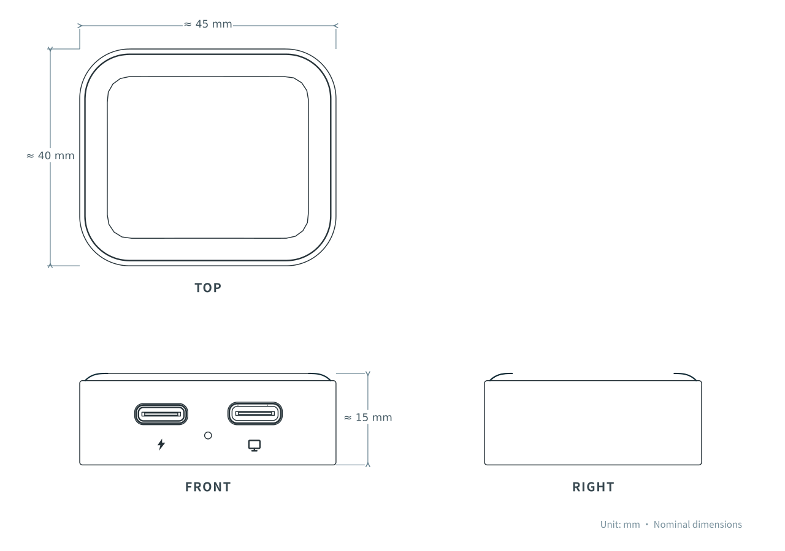
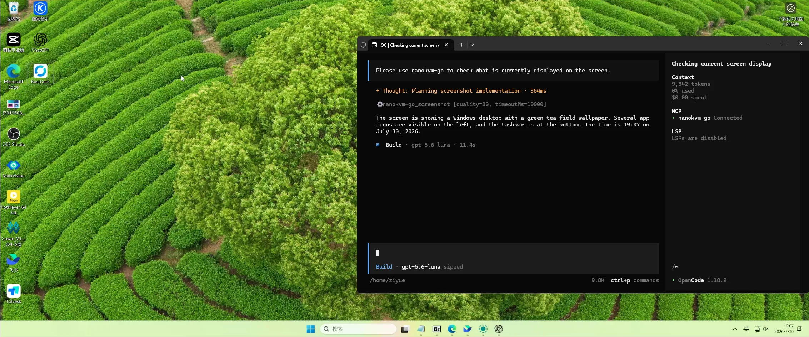
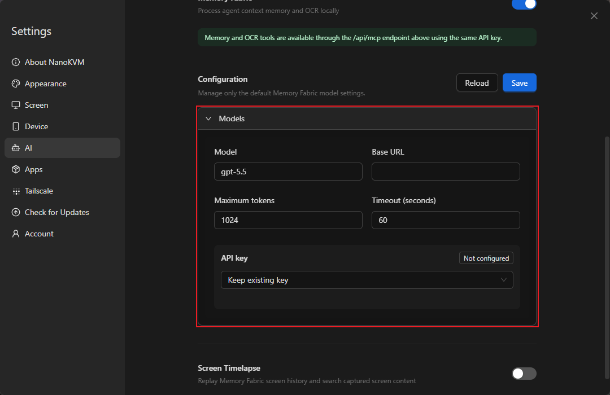

# Inside NanoKVM Go: A Hardware Control Bridge Shared by Humans and AI Agents

> **TL;DR:** NanoKVM Go compresses an IP-KVM into a roughly 45 × 40 × 15 mm device and carries display capture, keyboard and mouse emulation, virtual storage, a virtual network adapter, Wi-Fi 6, and browser control through one full-featured USB-C connection. Unlike ordinary remote-desktop software, it does not need a client on the target. It can remain usable before the OS starts, when the target network is down, or while the machine is stuck in UEFI/BIOS. More unusually, it exposes an MCP server so an AI agent can observe screenshots and operate a real device through USB HID. The important caveats are equally concrete: Go+ Memory Fabric still requires an external OpenAI-compatible model service, while the Go-specific repository and firmware remain early. This is a compelling physical-device control bridge, not yet a hands-off AI operations platform.

- **Official introduction:** [NanoKVM Go - Sipeed Wiki](https://wiki.sipeed.com/hardware/en/kvm/NanoKVM_Go/introduction.html)
- **Shared software repository:** [sipeed/NanoKVM](https://github.com/sipeed/NanoKVM)
- **Go-specific repository:** [sipeed/NanoKVM-Go](https://github.com/sipeed/NanoKVM-Go)
- **Audit date:** October 21, 2026
- **Audit scope:** The official introduction, Quick Start, MCP, Memory Fabric and 2FA documentation, plus the current default branches and public issues of both GitHub repositories

## One-sentence verdict

**NanoKVM Go matters because it removes screen observation, input, and installation media from the target operating system, then makes that hardware layer available to both a browser user and an AI agent.**

Remote desktop, SSH, and mobile support apps all depend on a functioning target OS. NanoKVM Go follows a different path. It receives display output through USB-C DisplayPort Alt Mode and presents itself to the target as a keyboard, mouse, USB drive, and network adapter. From the target's perspective, the remote operator is not another application. It is a set of physical USB peripherals.

That is why the device can enter firmware setup, repair boot failures, and reinstall an OS. It is also why this architecture is more interesting than simply installing another agent on a computer.

## What it is: four channels inside one USB-C connection

The main USB-C port combines:

1. **Video and audio capture:** The target emits its display through DP Alt Mode.
2. **USB HID control:** NanoKVM Go emulates keyboard, mouse, and touch input.
3. **Virtual storage:** ISO images can be mounted for installation or recovery.
4. **A virtual network interface:** This provides another management and connectivity path.

The auxiliary USB-C port accepts USB-PD power and passes charging to the target. It also carries the expansion IO for the optional Finger Robot, which can physically press a power button when software control is no longer enough.

The browser is only the control surface. The defining difference from software remote access is that capture and input emulation live outside the target OS.

## Go versus Go+: the difference is memory, not core KVM

Sipeed lists the same core KVM, MCP, wireless, and expansion capabilities on both models:

| Item | NanoKVM Go | NanoKVM Go+ |
|---|---:|---:|
| Processor | Dual-core Cortex-A53 | Dual-core Cortex-A53 plus 3.2 TOPS NPU |
| Memory | 256 MB LPDDR4x | 512 MB LPDDR4 |
| Storage | 16 GB | 64 GB |
| Display | 1.83-inch color touchscreen | 1.83-inch color touchscreen |
| Maximum capture capability | 4K50 / 2K90 | 4K50 / 2K90 |
| Typical 1080p60 latency | About 60 ms | About 60 ms |
| MCP | Supported | Supported |
| Memory Fabric | No | Yes |
| Screen Timelapse | No | Yes |
| Typical power at 4K30 | About 1.6 W | About 2.0 W |

The resolution, latency, and power figures are **vendor specifications and were not independently reproduced for this article**. Sipeed also distinguishes maximum capture capability from the currently supplied EDID modes. The 4K50 mode is still marked beta, and usable modes depend on the target OS, cable, and USB-C implementation.

If the requirement is remote display, firmware access, ISO mounting, or observable agent control, the regular Go already contains the complete path. Go+ mainly adds a searchable OCR-derived record of what appeared on screen. It does not provide a more capable core KVM.

## Four practical use cases

### 1. Helping family members with phones and tablets

After Wi-Fi and remote access are configured, a family member can connect the device with a full-featured USB-C cable. The operator can then view, tap, swipe, and type from a browser on another phone or computer instead of describing every control over a call.

This does not make every phone compatible. The target port must provide video output. An iPhone also requires AssistiveTouch, followed by the web interface's `Repair iPhone drag` operation after each connection. Some Android devices display external-screen or USB permission prompts.

### 2. Carrying one KVM between Macs, laptops, and mini PCs

The form factor suits occasional maintenance across multiple systems. There is no need to leave a conventional KVM permanently wired to every machine. The 1.83-inch display shows network, resolution, and IP status, while built-in magnets attach the unit to a metal enclosure.

### 3. Recovering a machine when its own system is unavailable

This is the irreplaceable hardware-KVM case. Even if SSH, remote desktop, and the target's network services are gone, NanoKVM Go can still show the boot screen, enter UEFI/BIOS, change boot options, mount an image, and assist with OS reinstallation.

### 4. Connecting a real device to an AI agent

Both Go and Go+ can expose an MCP server. An AI client connects to NanoKVM Go's `/api/mcp` endpoint, receives the target display through the KVM, and sends operations through USB HID. Nothing needs to be installed on the target, and the target does not need to expose SSH or an internal API to the model.

That opens an automation category that ordinary computer-use agents struggle with: first-boot setup, OS installation, device compatibility testing, GUIs without debugging interfaces, and recovery after the target's network stack has failed.

## What the source reveals: MCP is a narrow pair of eyes and hands

The documentation describes MCP as the AI control entry point. A source inspection of the current `sipeed/NanoKVM` default branch shows six core server-side tools:

| Capability | Purpose |
|---|---|
| `screenshot` | Capture a JPEG from the target display |
| `type_text` | Type a short string |
| `press_keys` | Send one keyboard combination |
| `move_mouse` | Move the pointer in absolute or relative mode |
| `click_mouse` | Send one or more mouse clicks |
| `scroll_mouse` | Send vertical wheel input |

This is a deliberately narrow interface. The KVM does not understand the GUI or own the task plan. Visual interpretation, reasoning, confirmation, and retries belong to the external AI client. NanoKVM supplies the physical I/O bridge.

That boundary matters. A successful MCP call proves that an HID event was sent; it does not prove that the remote UI reached the intended state. A sound agent loop is:

`capture → interpret state → act → capture again → verify → continue`

Destructive actions such as deleting data, formatting a disk, changing boot settings, or installing an OS need explicit confirmation before execution. The KVM-agent guidance in the shared repository also requires final visual evidence rather than treating tool success as task completion.

## Memory Fabric is an OCR operation log, not full screen history

Go+ Memory Fabric samples the screen roughly every ten seconds. When the screen changes, it extracts text and context to build operation records that an MCP client can query. An AI tool can answer what happened, organize pages chronologically, or turn an observed setup session into a repeatable guide.

Three limits are easy to miss:

1. **Historical screenshots are not saved by default.** The retained material is OCR text and organized memory. Purely graphical changes, icons, or fast transitions may produce little useful evidence.
2. **It is not continuous recording.** Actual visual history requires the separate Screen Timelapse feature.
3. **It requires an external model service.** The user must provide a model name, Base URL, and API key for an OpenAI Chat Completions-compatible endpoint.

The presence of a 3.2 TOPS NPU therefore does not make Go+ a fully offline AI memory appliance. The documentation does not establish how much work the NPU performs in the Memory Fabric path. What it does establish is that memory organization needs network access to a configured model endpoint. A buyer should account for model cost, API-key handling, and the possibility that captured screen text is processed outside the device.

## Security matters more than the AI label

A device that can see a screen, type credentials, mount storage, and enter firmware setup has high privileges. The official Quick Start still lists `admin` as both the default username and password, so changing it immediately is mandatory.

A minimum deployment baseline should include:

- Never expose the management interface or MCP endpoint directly to an untrusted network.
- Prefer the built-in Tailscale path for access from outside the LAN.
- Enable 2FA for web login and store recovery codes securely.
- Use Advanced 2FA Protection for Web Terminal, SSH, Tailscale, MCP, target power, scripts, and image deletion.
- Keep the MCP API key and model-service API key separate and protected.
- Bypass self-signed TLS verification only temporarily on a trusted LAN; do not run with `NODE_TLS_REJECT_UNAUTHORIZED=0` as a long-term default.
- Disable Memory Fabric when it is not needed, and keep passwords, keys, private messages, and sensitive filenames away from sampled screens.

For a studio or business, the KVM belongs on an isolated management network, not on a flat LAN with every workstation, NAS, and production asset.

## Compatibility conditions that are easy to overlook

**A USB-C connector alone is not enough.** The target port must support DisplayPort Alt Mode. Charging-only and ordinary USB data ports cannot provide the display feed. The cable must also be a full-featured USB-C cable with video support.

Sipeed's compatibility table lists USB-C iPhones, newer iPads, MacBook Air models from 2018, MacBook Pro models from 2016, Mac minis from 2018, Steam Deck, and Windows or Linux devices with DP Alt Mode. Exact specifications should still be checked, especially for phones and mini PCs.

Power is another boundary. If the target cannot supply stable power to the KVM, the auxiliary port needs a USB-C power adapter. During longer phone sessions, PD passthrough can charge the target at the same time.

## Current maturity: the architecture is real, the product is early

Three public signals matter as of October 21, 2026:

1. The default branch of the Go-specific `sipeed/NanoKVM-Go` repository contains only a GPL-3.0 license. It does not yet publish the Go-specific application or device UI. The substantial web, Go server, and MCP implementation lives in the shared [`sipeed/NanoKVM`](https://github.com/sipeed/NanoKVM) repository.
2. The Go-specific repository has one release, `v1.0.9`, and it is marked **pre-release**.
3. Public issues cover touch, pointer behavior, Wi-Fi, reboot loops, and web-server crashes. One detailed [Issue #11](https://github.com/sipeed/NanoKVM-Go/issues/11) reports bit errors and boot failures across three Go+ units. This is a user report, **not a result independently reproduced here, and it cannot establish that every unit has the same defect**.

None of this invalidates the product direction. It does make the device better suited to early adopters who are comfortable updating, reflashing, following issues, and retaining a backup recovery path. Before attaching it to an unattended production machine, test power-loss recovery, sustained operation, Tailscale, concurrent manual and MCP input, and firmware rollback.

## Which model should you choose?

### Choose NanoKVM Go

The regular Go is sufficient for remote maintenance, firmware access, OS installation, Mac mini management, and occasional observable GUI work by an agent. MCP is not exclusive to Go+.

### Choose NanoKVM Go+

Go+ makes sense when OCR-derived workflow logs, chronological review, documentation generated from actual operations, or Screen Timelapse are explicit requirements. That purchase also brings external-model configuration, more sensitive data governance, and greater exposure to the current early firmware state.

## The larger direction it opens

Most AI computer-use systems operate inside a browser sandbox, a virtual machine, or a desktop with an agent installed. NanoKVM Go proposes another architecture: the AI stays outside the target and operates it the way a person at a monitor would, through pixels and HID input.

That system-external position has three durable advantages:

- **Cross-platform reach:** Firmware setup, installers, Windows, macOS, Linux, and mobile devices can share one control interface.
- **Visibility during failure:** The control path survives target network, driver, and OS failure.
- **More realistic testing:** The agent observes the device's actual output and sends real HID events instead of calling an application's private API.

The costs are equally direct. Vision agents make mistakes. EDID, cable quality, resolution, and latency affect the hardware path. Physical control also carries much more authority than ordinary web automation.

The most important part of NanoKVM Go is therefore not the phrase “AI KVM.” It is the conversion of a real device into a small set of observable, actionable, human-overridable agent tools. The interface shape is already persuasive. The next proof points are reliability, security governance, and sustained unattended operation.

## References

- [NanoKVM Go Introduction](https://wiki.sipeed.com/hardware/en/kvm/NanoKVM_Go/introduction.html)
- [NanoKVM Go Quick Start](https://wiki.sipeed.com/hardware/en/kvm/NanoKVM_Go/quick_start.html)
- [NanoKVM Go MCP Feature](https://wiki.sipeed.com/hardware/en/kvm/NanoKVM_Go/mcp.html)
- [NanoKVM Go+ Memory Fabric](https://wiki.sipeed.com/hardware/en/kvm/NanoKVM_Go/memory_weaving.html)
- [NanoKVM Go Two-Factor Authentication](https://wiki.sipeed.com/hardware/en/kvm/NanoKVM_Go/two_factor_authentication.html)
- [sipeed/NanoKVM](https://github.com/sipeed/NanoKVM)
- [sipeed/NanoKVM-Go](https://github.com/sipeed/NanoKVM-Go)

---

*This article reflects official documentation, source code, and public issues available on October 21, 2026. Performance figures are vendor-reported and were not independently benchmarked. Pricing, firmware, compatibility lists, and repository contents may continue to change.*
