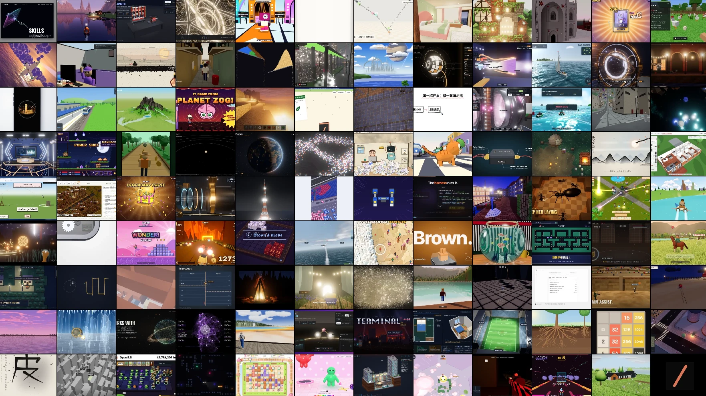
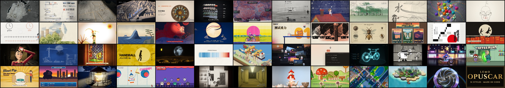
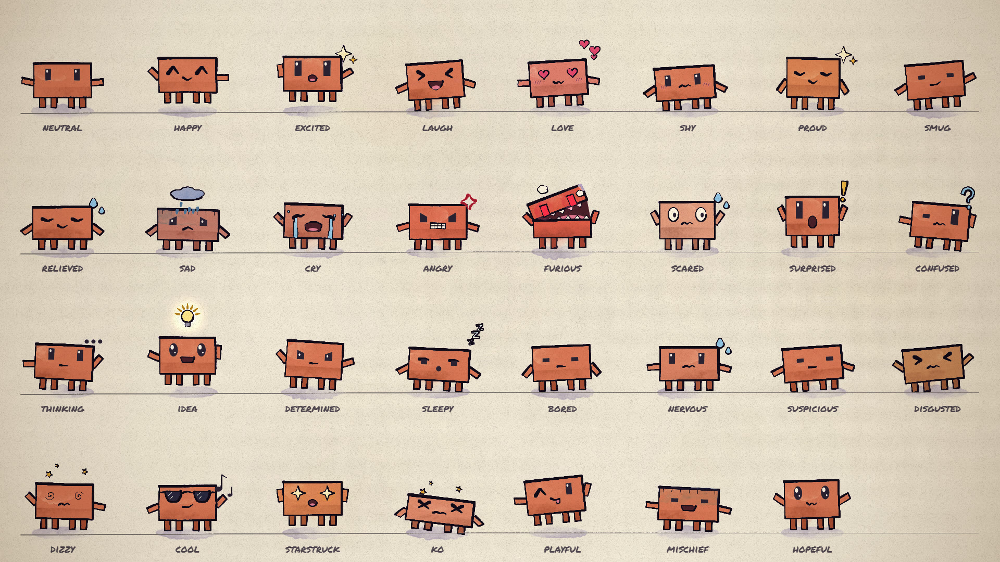
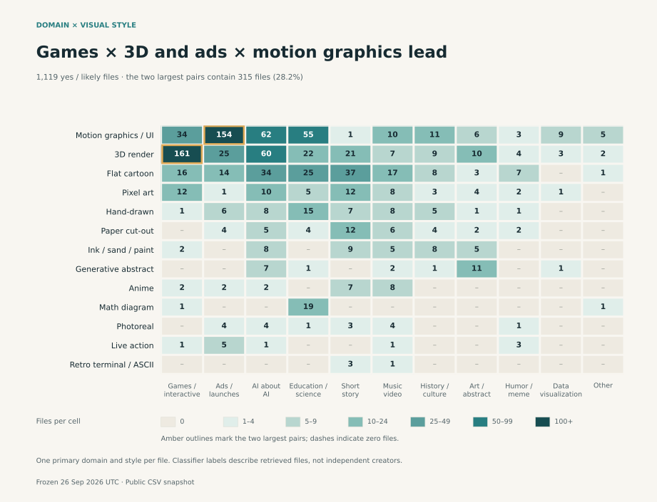

# Opus 5.5 视频八库源码地图：别把 Prompt 合集、Skill 与完整工程混为一谈

> **TL;DR：** Kin 在 2026 年 10 月 21 日推荐了 8 个用 Claude Opus 5.5 做视频的 GitHub 仓库。清单本身很有价值，但这 8 个库并不是八套同类工具：3 个主要是案例或 Prompt 索引，3 个是可复用的 Skill、风格实验室或角色动画底座，另外 2 个是同一首歌的完整 MV 工程。它们共同证明的也不是“Opus 5.5 是新的视频生成模型”，而是 Coding Agent 已经可以写 Canvas、SVG、Three.js、p5.js、Blender 和音频代码，再由浏览器逐帧渲染、FFmpeg 编码成片。真正应该收藏的不是 Star 排名，而是这条证据链：**案例来源 → 完整提示词 → 可运行源码 → 确定性渲染 → 声音与交付 QA。**



- **原始 X 帖：** [Kin：想用 Opus 5.5 做视频，一定要收藏这 8 个 GitHub 仓库](https://x.com/KinGao476942/status/2112729924943634602)
- **发布时间：** 2026-10-21
- **审计方式：** 检查 8 个仓库的当前主分支、README、目录树、运行入口、许可证与结构化数据
- **审计日期：** 2026-10-21

## 一句话判断

**这不是“八个视频神器”，而是一套从灵感搜索、Prompt 学习、风格复用到完整工程渲染的阶梯。**

如果只是把它们全部 Star，学习收益反而不高。正确用法是先判断自己缺的是哪一层：

- 缺案例：看索引库；
- 缺 Prompt 结构：看中文 Prompt 手册或 MG 风格包；
- 缺可重复的制作方法：安装 Skill 或角色动画底座；
- 缺一套可以解剖的成片工程：读两个 P(doom) 仓库。

## 原帖的 Star 数基本准确，但 Star 不是能力指标

截至 2026 年 10 月 21 日，原帖中的约数与 GitHub API 基本一致：

| 仓库 | Star 快照 | 实际类型 | 能否直接渲染 |
|---|---:|---|---|
| `yihui-dev/awesome-opus5-5-videos` | 7,171 | Prompt 与原帖语料库 | 否，重制版在外部 Skillry |
| `lemomo-ai/lemo-opuscar` | 4,418 | Claude Code Skill + 51 种影片风格 | 是，风格间复现程度不同 |
| `mexicat/pdoom-video` | 2,974 | TypeScript/Three.js 完整 MV 工程 | 是，支持 1080p60/4K60 |
| `JohnHeibel/PDoomVideo` | 2,317 | p5.js/p5.brush 完整 MV 工程 | 是，可续跑逐帧渲染 |
| `Vincentwei1021/mg-styles-15` | 1,422 | 15 种 MG 风格实验室 | 是，附 Prompt、源码、声音与成片 |
| `JohnHeibel/ClaudeAnimationBase` | 1,325 | 手绘角色动画起步模板 | 是，附 31 种表演情绪 |
| `athemeroy/awesome-claude-5-5-videos` | 557 | 带证据分级的研究型索引 | 否，主要用于研究与选型 |
| `joeseesun/opus-video-prompts` | 517 | 中文案例与 Prompt 手册 | 否，18 份完整 Prompt、54 条案例 |

Star 只能说明传播范围。一个 7,000 Star 的语料库不一定能本地出片；一个 500 Star 的工程也可能包含更完整的时间线、渲染器和素材说明。选库时应该看交付物，不应该看排名。

## 八个库其实只有四种资产

### 第一层：案例索引与灵感搜索

`awesome-opus5-5-videos`、`awesome-claude-5-5-videos` 和 `opus-video-prompts` 都帮助用户回答“别人做过什么”，但证据深度不同。

- `awesome-opus5-5-videos` 追求覆盖面和可搜索 Prompt；
- `awesome-claude-5-5-videos` 更强调来源、模型标签、输入、修改轮次与成本；
- `opus-video-prompts` 面向中文用户，把代表案例整理成可复制模板。

它们适合立项、找方向和比较技术路线，不应该被误认为包含所有项目源码。

### 第二层：可复用风格与生产规范

`lemo-opuscar` 和 `mg-styles-15` 不再只给一段 Prompt，而是把风格拆成制作合同：输出规格、技术路线、镜头节奏、声音、素材、渲染和验收。



这类仓库的价值是减少 Agent 每次从零发明工作流。用户换故事、品牌、颜色和素材时，仍能保留风格的 signature features 与交付标准。

### 第三层：角色与动画底座

`ClaudeAnimationBase` 把 P(doom) 项目中可泛化的部分抽出来：角色视角、眼睛、嘴型、帽子、舞蹈、镜头、纸张质感和 31 种带身体动作的情绪状态。



它不是“输入一句话就能生成任意动画”的模型，而是一个让 Coding Agent 少写底层角色系统、把精力放在分镜和表演上的 starter kit。

### 第四层：完整成片工程

两个 P(doom) 仓库最适合学习真实项目为什么复杂。它们不仅有画面代码，还包括歌词对齐、节拍、场景窗口、浏览器预览、逐帧导出和 FFmpeg 合成。


它们不是模板数量最多的仓库，却最接近“把一支完整 MV 拆开给你看”。

## 1. awesome-opus5-5-videos：最大的不是源码库，而是 Prompt 语料库

该仓库当前固定在提交 `92aee2f`，包含 703 份 Prompt 和对应结构化数据，其中 418 个案例在 Skillry 有 live remake。仓库本身只有 README、`data/videos.json` 与 `prompts/`，没有 703 套 HTML/JavaScript 工程、原始素材、完整视频或统一渲染器。

因此，它最适合：

- 搜索某种视觉形式是否有人尝试过；
- 比较 Canvas、SVG、GSAP、Three.js、GLSL 等路线；
- 研究 Prompt 如何规定时长、镜头、风格与技术栈；
- 回到原始帖子核对作者披露。

它不适合直接用来证明“复制 Prompt 就能复现原片”。有些 Prompt 本来就不完整，外部 remake 也不是作者原工程。

## 2. lemo-opuscar：最接近完整 Skill 的生产系统

原帖写“51 种风格”是当前数字；这比我们此前审计的 43 种版本又增加了 8 种。主分支也从旧快照 `227e00a` 更新到了 `b5e8ef9`。

Lemo-Opuscar 的核心不是风格名称，而是它同时提供：

- `SKILL.md`：Agent 入口与安装流程；
- `DIRECTOR.md`：分镜、叙事与验收方法；
- `TECHNIQUE.md`：浏览器渲染、声音与技术边界；
- `core/render/`：预览、静帧、视频、字幕与混流工具；
- 每种风格的 `STYLE.md`、海报、样片与不同程度的源码。

它适合想长期做纯代码短片的人，因为制作知识已经从单条 Prompt 提升为 Agent 可以反复读取的制度。但 51 个 demo 并不是 51 个完全同构、一键重建的项目；不同风格的工具栈、素材与完整度仍然不同。

## 3. mexicat/pdoom-video：工程化最强的 4K60 版本

这个仓库使用 TypeScript、Three.js、Bun、Vite、Playwright 和 FFmpeg。每一帧是歌曲时间的确定性函数，因此浏览器预览和离线导出共享同一条时间轴。

它公开的不只是画面：

- 132.007 BPM 的节拍与段落数据；
- Demucs、CTC forced alignment、Whisper 交叉检查得到的歌词时间；
- 17 个主要场景模块和后处理系统；
- 按 tile 自适应采样的运动模糊；
- 1080p60 与真正重新渲染的 4K60 命令。

“本地能渲 4K60”是真的，但不等于轻量。README 报告 M5 Pro 完整 4K 渲染约 57 分钟，内存峰值约 23 GB；CRF 16 的成片可到约 13 GB。它是一套值得拆解的高质量工程，不是普通电脑上的即时模板。

代码采用 MIT，但歌曲、歌词和相关数据不在 MIT 授权范围内，复用时必须分开处理版权。

## 4. JohnHeibel/PDoomVideo：更适合学习 Agent 怎样从第一版走到第二版

另一个 P(doom) 仓库不是前者的重复镜像。它使用 p5.js、p5.brush、无头 Chrome 与 FFmpeg，把 156.6 秒作品分成 9 个章节。

作者保留了 `legacy/` 第一版、第二版、`STORYBOARD.md` 和给并行 subagents 使用的 `ANIMATION_GUIDE.md`。这让它特别适合研究：

- 第一次生成哪里不够好；
- Agent 如何先写 storyboard，再拆给多个执行单元；
- 每个章节怎样共享角色、道具、歌词和统一时间线；
- 长渲染怎样保存帧并续跑，而不是失败后从头开始。

仓库当前没有根许可证文件。源码公开可读，不自动等于获得复制、修改或商业再发布许可。这一点原帖没有提醒。

## 5. mg-styles-15：八个库里最适合“照着做一遍”的课程

这个库只有 15 种风格，却为每一种都提供 10 秒成片、风格说明、完整 Prompt、源码、声音脚本和素材生成工具。所有影片都经过两轮 AI review 与修改。


它定义的核心接口是 `window.renderAt(t)`：任意时间 `t` 都能独立画出对应画面。无头 Chrome 负责逐帧截图，`audio.py` 按同一 cue 合成音乐和音效，FFmpeg 再做精确 10 秒封装。这是一套清楚、可教、可扩展的生产合同。

它也诚实写出了复现边界：字体文件不随仓库分发；同一 Prompt 每次不会自动生成同一支片；原片经过多轮迭代；部分音轨在不同数值库版本下不能 bit-identical。相比“复制即得”，这种说明更接近真正的工程文档。

## 6. ClaudeAnimationBase：不是 31 张表情图，而是 31 种表演状态

源码里的 `EMO` 对象确实定义了 31 种状态，从 `neutral`、`happy`、`sad` 到 `furious`、`dizzy`、`mischief` 和 `hopeful`。每个状态不仅换眼睛和嘴型，还包含身体起伏、手臂、位移、旋转、节拍反应和切换时的 take。

这正是它比普通 sprite sheet 更有用的地方：Agent 拿到的是表演 API，不只是图片。工作流要求先读 `ANIMATION_GUIDE.md`、先做 storyboard、逐镜头构建，再用 contact sheet 自检。

代价是 p5.brush 水彩填充很慢。官方建议无独显时改用更轻的填充；无 GPU 也可以软件渲染，但速度会明显下降。

## 7. awesome-claude-5-5-videos：不是更小的合集，而是研究型证据库

这个仓库截至 10 月 11 日记录 424 条不同来源帖子，其中 301 条标记为 Opus，199 条做过九帧抽样。它还跟踪 Sonnet、Haiku 与作者自报的 Fable，并把输入素材、修改轮次、任务总成本、模型与执行器分工单独分析。



它的价值不是“数量比 703 少”，而是证据更严格：明确区分作者声明、可见画面、模型标签和可复用项目，也提醒九帧预览不能证明完整运动或真实模型调用。

如果目标是写报告、做竞品研究或判断“Opus 到底负责了哪部分”，这个库比单纯 Prompt 列表更有用。

## 8. opus-video-prompts：中文入口很好，但不是 54 份完整 Prompt

仓库的 `cases.json` 记录 54 条案例，README 汇总实现方式、耗时和成本；`prompts/` 中实际有 18 份完整模板。它最大的价值是中文解释与路线分类：单 HTML、p5.js、Remotion、HyperFrames、Manim、Python、Three.js、专业软件控制和现有素材剪辑。

它适合快速理解 Prompt 应该包含什么：输出规格、总时长、镜头数、参考素材、禁用效果、确定性时间接口和自检要求。

但 54 个案例不能写成 54 个都能复制的 Prompt，更不能写成 54 个本地源码项目。仓库也没有声明根许可证，直接搬运 Prompt 到商业产品前应回到原作者和原始链接确认授权。

## 这八个库共同揭示的真正技术栈

这些项目最常见的流程不是“Prompt → 视频模型 → MP4”，而是：

```text
创作意图 / 音频 / 素材
          ↓
Opus 5.5 规划分镜、时间线与技术路线
          ↓
编写 Canvas / SVG / p5.js / Three.js / Blender / Remotion 代码
          ↓
浏览器或 DCC 在任意时间 t 重建一帧
          ↓
Playwright / Puppeteer / Blender 逐帧渲染
          ↓
FFmpeg + 音频脚本合成 MP4
          ↓
contact sheet、抽帧、声音与完整播放 QA
```

Opus 在这里更像导演、程序员与制作统筹，真正画出像素的是浏览器或 Blender，真正生成 MP4 的是 FFmpeg。这也是为什么结果可修改、可逐帧复查，但项目依赖、渲染时间和工程复杂度会高于一次性视频模型调用。

## 应该按什么顺序学习

### 想快速尝试

1. 从 `opus-video-prompts` 选一种中文模板；
2. 用 `mg-styles-15` 的 `renderAt(t)` 和 review rubric 学会确定性渲染；
3. 先做 10 秒、24 fps、单风格，不要一开始挑战 4 分钟 MV。

### 想做手绘角色短片

1. 用 `ClaudeAnimationBase` 建角色和 storyboard；
2. 研究 `PDoomVideo` 的章节组织与转场；
3. 加入续跑、contact sheet 与完整解码检查。

### 想做长期内容生产

1. 用 `awesome-claude-5-5-videos` 找有证据的生产路线；
2. 用 `lemo-opuscar` 把风格、导演规范和技术规范安装成 Skill；
3. 借鉴 `mexicat/pdoom-video` 的确定性时间线、音频分析与高质量导出。

## 收藏之前，先看五个问题

| 问题 | 为什么重要 |
|---|---|
| 有完整源码，还是只有 Prompt？ | 决定能否真正复现和修改 |
| 有统一时间函数吗？ | 决定逐帧渲染、并行与续跑是否稳定 |
| 音频、字体和素材是否齐全？ | 决定本机输出是否与样片一致 |
| 有渲染与验收命令吗？ | 决定它是展示仓库还是生产工程 |
| 许可证覆盖哪些文件？ | 代码许可不一定覆盖歌曲、字体、图片与 Prompt |

同样要记住：绿色 CI、存在 MP4、README 写着 “made with Opus” 分别只能证明发布流程、文件存在和作者声明。它们不自动证明模型独立完成、结果可从干净环境重建或素材可以商业使用。

## 结论

Kin 的清单抓住了 Opus 5.5 视频浪潮里最有代表性的八个仓库，但真正的价值不是“收藏后就会做视频”。它们连起来，展示了代码视频生态正在形成四类基础设施：案例语料、Prompt 教材、Agent Skill，以及可运行的成片工程。

最值得带走的不是某一条神奇 Prompt，而是三个方法：

1. **把视觉风格写成规范，而不是形容词；**
2. **让每一帧只由时间 `t` 决定，确保可复现、可并行、可续跑；**
3. **让 Agent 在最终渲染前看 contact sheet、听声音、修问题。**

如果只想找灵感，先看三个索引库；如果想真正学会生产，优先跑 `mg-styles-15`、`ClaudeAnimationBase` 和两个 P(doom) 工程；如果想把方法长期交给 Agent，`lemo-opuscar` 才是最接近完整生产系统的那一个。

## 参考资料

- [Kin 的原始 X 清单](https://x.com/KinGao476942/status/2112729924943634602)
- [yihui-dev/awesome-opus5-5-videos](https://github.com/yihui-dev/awesome-opus5-5-videos)
- [lemomo-ai/lemo-opuscar](https://github.com/lemomo-ai/lemo-opuscar)
- [mexicat/pdoom-video](https://github.com/mexicat/pdoom-video)
- [JohnHeibel/PDoomVideo](https://github.com/JohnHeibel/PDoomVideo)
- [Vincentwei1021/mg-styles-15](https://github.com/Vincentwei1021/mg-styles-15)
- [JohnHeibel/ClaudeAnimationBase](https://github.com/JohnHeibel/ClaudeAnimationBase)
- [athemeroy/awesome-claude-5-5-videos](https://github.com/athemeroy/awesome-claude-5-5-videos)
- [joeseesun/opus-video-prompts](https://github.com/joeseesun/opus-video-prompts)

*本文基于 2026-10-21 的仓库快照与 GitHub API 数据。Star 数会继续变化。本文检查了主分支 README、根目录、递归文件树、运行入口、结构化数据与许可证，但没有完整重渲染八个仓库的所有影片。配图来自各项目公开 README 或文档。模型参与程度以作者公开说明为准，不等于独立验证。*
