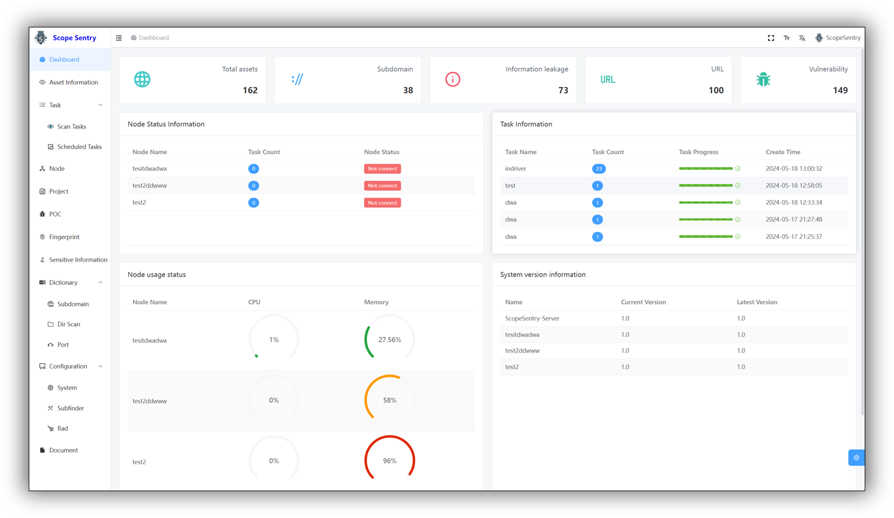

# Mapping Eight AI Security Projects: What Is Automated, and What Still Needs a Team

On October 22, 2026, WquGuru organized eight security projects into five layers: reconnaissance, reverse engineering, penetration testing, orchestration, and evaluation. The post suggested that work taking months could shrink to days, with individuals taking on tasks previously requiring a team.

The list is useful, but it is not an efficiency benchmark. **The observable change is that agents can access asset records, analysis tools, execution environments, and investigation history. That does not establish a mature eight-project pipeline or reliable replacement of a professional team.**

There is also a category distinction: most of the first six projects concern software or infrastructure, whereas garak and promptfoo primarily assess models and AI applications. They do not automatically form successive steps in one attack chain. [Original post](https://x.com/wquguru/status/2113181135522214168)



*An upstream example showing assets, tasks, and node status. Its counts, versions, and dates are illustrative, not measurements from this review or evidence of a current deployment.*

This review read the eight repositories' READMEs and revision metadata on October 23, alongside relevant security documentation and ARTEX's ScopeSentry synchronization implementation. No platform was installed, no network assessment or exploitation was performed, and no cross-project integration was tested. Pinned revisions and image provenance are retained below.

## Eight Projects, Different Jobs

| Project | Main role | What it does not establish |
|---|---|---|
| [ScopeSentry](https://github.com/Autumn-27/ScopeSentry/blob/d770b7a137ec2de15816fea4bd561f49cf486db2/README.md) | Distributed asset discovery, service inventory, and scanning-task management | An identified service or component is not a confirmed exploitable vulnerability |
| [REA](https://github.com/morluto/rea/blob/6c4d880f2dd9ca7d42593be916f90ec19b8a09d7/README.md) | MCP/CLI access to binary, application, and runtime analysis; native analysis can use Hopper, Ghidra, or IDA | Pseudocode and call relationships are neither original source nor proof of a vulnerability |
| [Strix](https://github.com/usestrix/strix/blob/594398876f9cd465f00cce626d0cb98bfa5e1662/README.md) | Agent-based application security testing, with multi-agent coordination and PoC validation emphasized by the project | Those claims do not guarantee reliable findings or zero false positives on arbitrary targets |
| [PentAGI](https://github.com/vxcontrol/pentagi/blob/cffed9485aa1cca70762cd08a57ac62a80406258/README.md) | Self-hosted multi-agent testing with Docker execution, security tools, persistent memory, and reports | A sandbox does not automatically enforce authorization scope or protect the host |
| [CyberStrikeAI](https://github.com/AIPentest/CyberStrikeAI/blob/c0d5c8460ba1f29d00f0cfd47855d724e257c46f/README.md) | A workspace combining MCP, retrieval, workflows, human oversight, and operational evidence | An approval interface cannot reliably identify every harmful consequence |
| [ARTEX](https://github.com/Hinln/ARTEX/blob/f3e3f54b6c93916388a0a3dc6a439893a9abe37a/README.md) | Asset graphs, investigation graphs, traffic records, and human participation | A graph is not a verified end-to-end attack path; the linked repository is a source backup |
| [garak](https://github.com/NVIDIA/garak/blob/b656779427ad40929211e7736cbbaea64700b3be/README.md) | Probing models or dialog systems for injection, leakage, and other undesirable behavior | Passing selected probes does not establish product or infrastructure security |
| [promptfoo](https://github.com/promptfoo/promptfoo/blob/b678d240d8f1426bee776ff24c34252baa564e17/README.md) | LLM application evaluation and red teaming, configuration comparison, and CI/CD integration | Scores do not replace checks of permissions, tool effects, and deployment behavior |

This is a functional map, not a ranking. Strix, PentAGI, and the orchestration workspaces overlap; installing all of them is not a prerequisite for useful security work.

## One Concrete Connection: ScopeSentry to ARTEX

One connection is more than conceptual. ARTEX's `server/sync_scopesentry.go` reads ScopeSentry projects, tasks, and assets through an HTTP MCP data source and maps the results into its asset model. The implementation includes pagination, asset-type translation, and ingestion. [Synchronization source](https://github.com/Hinln/ARTEX/blob/f3e3f54b6c93916388a0a3dc6a439893a9abe37a/server/sync_scopesentry.go)

That reduces manual data transfer. It does not prove successful downstream investigation or shared identity, evidence formats, and authorization policies across all eight projects. **Importing asset data and authorizing actions against those assets are separate decisions.**


*An upstream demonstration separates goals, intentions, facts, and findings. Its targets, credentials, and vulnerability labels are example content, not results verified here.*

The linked `Hinln/ARTEX` repository describes itself as a source backup based on `Autumn-27/ARTEX v0.3.15`. Preserve that provenance, and do not assume installation or update instructions prove that matching release downloads currently exist. [Repository description](https://github.com/Hinln/ARTEX)

Earlier articles cover [REA's evidence workflow](../2026-10-09/2026-10-09-rea-evidence-ledger-agentic-reverse-engineering-runtime-en.md) and [ARTEX's graphs and approval boundaries](../2026-10-08/2026-10-08-artex-dual-graph-autonomous-pentest-agent-audit-en.md). This follow-up concerns their place in a broader workflow rather than repeating those project reviews.

## Evaluation Is Not the Final Attack Step

Placing garak and promptfoo under “evaluation” can imply that they grade whatever the preceding tools accomplished. A more useful distinction is two parallel quality processes:

```text
Software/infrastructure: inventory -> authorized analysis/testing -> evidence review -> repair/retest
Models/AI applications: behavior contract -> probing/evaluation -> failure review -> regression tests
```

This is an analytical classification, not an implemented eight-project architecture.

garak centers on probing and detecting model failures. Promptfoo also supports comparing prompts, models, and application configurations; its documentation describes CI outputs and quality gates. [garak](https://github.com/NVIDIA/garak), [Promptfoo CI/CD documentation](https://www.promptfoo.dev/docs/integrations/ci-cd/)


*An upstream UI example illustrates reviewing inputs, outputs, and judgments. Its models, pass rates, and timing are not current rankings or measurements from this review.*

For a tool-using agent, a well-behaved final answer is insufficient. Application acceptance criteria should also address cross-tenant access, unauthorized actions, and whether external content can expand permissions. This is a testing recommendation, not a claim that a listed project fully covers those business risks.

## What the Productivity Claim Still Needs

The post supplies no controlled comparison using the same tasks, targets, and budget. This review likewise found no unified measurement covering the eight-project combination. Claims about elapsed time or staffing should remain hypotheses rather than established productivity gains.

It is reasonable to infer that repetitive tool use, information organization, asset handoffs, and report drafting are becoming easier to automate. That is different from measuring the entire journey from an unfamiliar target to a reliable conclusion.

A meaningful comparison should retain:

- A fixed task set and authorized scope, including unsuccessful cases.
- Matching model/tool versions, budgets, and stopping conditions.
- Validated findings, false positives, human intervention, and coverage gaps.
- Elapsed time, model costs, operational overhead, and post-fix verification.

More tools demonstrate a larger execution surface. More reports demonstrate a delivery format. Team-level efficiency requires reviewed results, accounted failures, and traceable costs.

## The Security Workbench Is Also a Privileged System

A neglected risk is granting a new platform excessive access in order to protect existing machines.

CyberStrikeAI's security model explicitly treats the platform as privileged automation and discusses prompt injection, untrusted MCP services, and sensitive-data retention. It warns that human approval may not reveal actual consequences. Its hardening guidance recommends restricted network access, auditing, fewer external tools, and avoiding blanket permission for high-risk capabilities. [Security model](https://github.com/AIPentest/CyberStrikeAI/blob/c0d5c8460ba1f29d00f0cfd47855d724e257c46f/docs/en-US/security-model.md), [hardening guide](https://github.com/AIPentest/CyberStrikeAI/blob/c0d5c8460ba1f29d00f0cfd47855d724e257c46f/docs/en-US/security-hardening.md)

PentAGI's README separately warns that exposing the host Docker socket to execution environments can also grant agents control over the host. “Runs in a container” must not be treated as synonymous with complete host isolation. [Docker access boundary](https://github.com/vxcontrol/pentagi/blob/cffed9485aa1cca70762cd08a57ac62a80406258/README.md#giving-agents-docker-without-giving-away-the-host)

Self-hosting does not automatically keep data local: external models or retrieval services may receive target information and tool results. Review that flow and keep credentials out of unnecessary requests. Also check project-specific terms: ScopeSentry's README includes additional commercial-use conditions; publicly readable code is not a blanket enterprise deployment permission. [ScopeSentry terms](https://github.com/Autumn-27/ScopeSentry/blob/d770b7a137ec2de15816fea4bd561f49cf486db2/README.md#license)

## A Defensive Reading of the Map

For developers and SRE teams, the useful response is not to deploy eight platforms. It is to separate four responsibilities:

1. **Know the assets.** Maintain ownership, exposure, and version information for your own services, with findings assigned to responsible people.
2. **Constrain testing.** Start with minimal tools in explicitly authorized, isolated test environments. Do not hand over production credentials or host control by default.
3. **Keep evidence attached.** Distinguish component clues, suspected issues, reviewed findings, and completed repairs. Preserve versions and retest records.
4. **Protect changes with regression tests.** Retain conventional software security checks; add behavior and permission tests when introducing LLMs. One score cannot substitute for every acceptance criterion.

AI security tooling lowers some operational barriers while making scope and verification more important. The productive question is not whether one person can replace a team. It is whether the same team can confirm its risks faster and turn reliable findings into repairs.

## Sources and Limits

- [WquGuru's October 22 post](https://x.com/wquguru/status/2113181135522214168). Direct X access was restricted; text and outbound links were obtained through the public FxTwitter transcription endpoint and technical claims checked against project sources.
- [Pinned revisions, inspection scope, and image provenance](imgs/ai-security-eight-repo-stack/SOURCES.md). October 23 snapshots may include changes after the post; they are not presented as a reconstruction of every capability available when it was published.
- Screenshots are upstream interface examples, not independent security tests. Documentation, UI, source implementation, and real deployment results are distinct forms of evidence.

This article concerns tool boundaries and defensive engineering on systems owned by, or explicitly authorized for, the operator. No third-party assessment procedure was provided and no scan or exploitation was performed.
