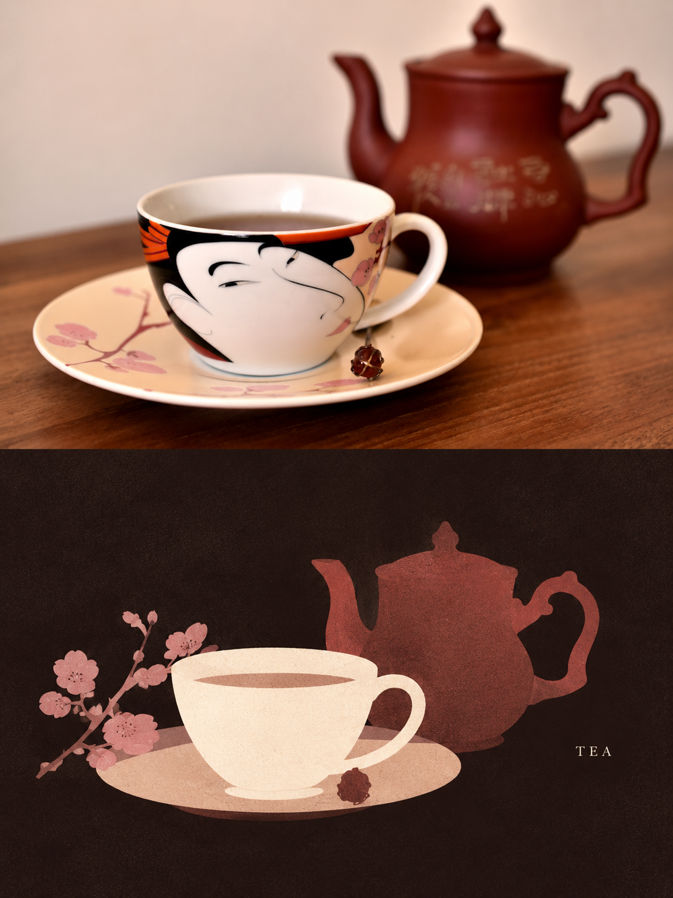
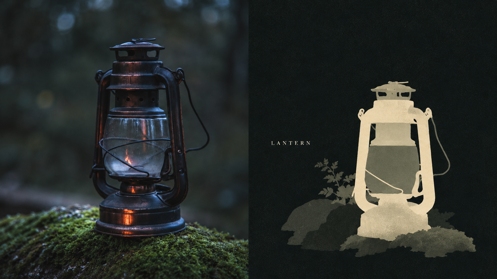

# Inside XXD Panel 345: Separating Art Direction, Image Generation, and Delivery

A photograph can preserve material detail, or become a few shapes that still identify its subject. XXD Panel 345 pairs those views: photography on one side, a flat silhouette still life against a dark ground on the other.

**This is an image Skill with runtime instructions and helper scripts, not a new model, filter engine, or editable vector template.** It constrains the art direction and passes the source photograph and delivery requirements to an existing image generator. The useful engineering question is how it separates style from aspect ratio, typography, batches, and acceptance checks.



*Upstream sample-01, 1152×1536. The design preserves relationships between the objects while dropping decoration and photographic lighting. This is an author's example, not a newly generated result from this review.*

- Project: [nevertoday/xxd-panel-345](https://github.com/nevertoday/xxd-panel-345), attributed in its README to Xiaoxiaodong, `@xiaoxiaodong01`
- Snapshot: [`6bad98d`](https://github.com/nevertoday/xxd-panel-345/tree/6bad98d47c8ac83b330da4abcbb949d1726c8e2e), committed October 22, 2026 UTC
- Reviewed October 24, 2026: source, manifest, selected images, and limited offline checks; no Skill installation or generation-service calls
- License: [PolyForm Noncommercial 1.0.0](https://github.com/nevertoday/xxd-panel-345/blob/6bad98d47c8ac83b330da4abcbb949d1726c8e2e/LICENSE), not MIT-style unrestricted commercial permission

## The Style Requires Reconstruction, Not a Dark Filter

Panel 345 asks the generator to remove much of the environment and reorganize a subject with a few nearby objects. Overlap and tonal differences carry depth instead of outlines and detailed modeling.

The palette remains connected to the photograph, but does not preserve every photographic highlight. A restrained overall value range makes one pale, warm area stand out. The background retains a dark hue rather than becoming featureless black; fine grain and sparse serif lettering finish the composition. [Source art-direction brief](https://github.com/nevertoday/xxd-panel-345/blob/6bad98d47c8ac83b330da4abcbb949d1726c8e2e/references/original-prompt/zh-CN.md)

The tea example gives up surface decoration while preserving the relationship between pot, cup, and plate. The vase example below changes the delivery orientation without mechanically rotating the visual language.


*Sample-21, 1536×864. Photography occupies the left half; the right reorganizes color, ground, and lettering. It demonstrates a direction, not guaranteed quality on arbitrary input.*

This composition suggests starting with a clearly recognizable object. Dense scenes, multi-person interactions, or tasks requiring fine structural fidelity need an explicit decision about what simplification may discard. That is a selection recommendation, not a measured success rate.

## Art Direction and Delivery Have Separate Authority

The style originates in `references/original-prompt/zh-CN.md`. Shared execution instructions live in `references/soldier-runtime.md`, while `SKILL.md` supplies the entry point and Panel 345-specific constraints.

The distinction lets a request for 16:9 change the delivery canvas without rewriting the material, palette, or typography. Mode-specific instructions can replace the source brief's original top-bottom arrangement while retaining its remaining aesthetic requirements. [Skill entry](https://github.com/nevertoday/xxd-panel-345/blob/6bad98d47c8ac83b330da4abcbb949d1726c8e2e/SKILL.md), [delivery adapter](https://github.com/nevertoday/xxd-panel-345/blob/6bad98d47c8ac83b330da4abcbb949d1726c8e2e/references/xxd-panel-345-prompt.en.md)

Written rules are not automatically enforced software. Recursive batching, source isolation, retries, and final aesthetic acceptance are substantially instructions for the host agent, rather than a single Python application implementing the whole pipeline.

| Mode | Visible output | Boundary |
|---|---|---|
| `top-bottom` | Photography above, design below | Equal halves, without an extra title band |
| `left-right` | Photography left, design right | Equal halves; do not silently switch orientation |
| `design-only` | Full-canvas reinterpretation | The source remains a reference, not a visible photo region |
| `wallpaper-pack` | Separate outputs for four device categories | Linked outputs share a reference anchor; independent ones start separately from the source |

Modes, sizes, and text settings combine. Six sources with two ordinary modes and three sizes already mean 36 requested outputs before retries. That is output-count arithmetic, not a measured bill. [Runtime contract](https://github.com/nevertoday/xxd-panel-345/blob/6bad98d47c8ac83b330da4abcbb949d1726c8e2e/references/soldier-runtime.md)

## What the Four Scripts Actually Do

| File | Implemented role | What it does not provide |
|---|---|---|
| `configured_imagegen.py` | Requests images from an already configured compatible route, decodes responses, and saves PNGs | Model weights or universal host compatibility |
| `compose_panel.py` | Resolves dimensions, computes halves, crops/composes rasters, and estimates a seam | Subject recognition, aesthetic judgment, or text verification |
| `panel_preferences.py` | Validates and persists approved delivery fields | Source-image storage, creative memory, or complete task state |
| `check_samples.py` | Checks manifests, hashes, PNG dimensions, and review flags | Independent visual judgment merely because a stored flag says `passed` |

The bitmap bridge contains real implementation but still needs an external image service. Its readiness probe treats several HTTP responses as evidence of a reachable route, not proof of model access, credit, or successful reference editing. It can also apply `ImageOps.fit` when output dimensions differ: correct pixels do not imply an undamaged composition. [Bridge source](https://github.com/nevertoday/xxd-panel-345/blob/6bad98d47c8ac83b330da4abcbb949d1726c8e2e/scripts/configured_imagegen.py)

The runtime normally prefers generating a complete canvas in one request, with composition helpers reserved for audits or particular preservation requirements. A diptych therefore does not necessarily mean two generated panels pasted together. Nor should the generated photographic region be assumed pixel-identical to the source. [Execution rules](https://github.com/nevertoday/xxd-panel-345/blob/6bad98d47c8ac83b330da4abcbb949d1726c8e2e/references/soldier-runtime.md#bitmap-execution)

## A Reproduced Acceptance Boundary

This review parsed all four Python scripts and passed ten offline assertions covering half-canvas geometry, rejection of incompatible odd dimensions, preference-field filtering, and endpoint/size parsing. It did not read local service configuration or credentials, or submit generation requests.

A deliberate negative check supplied sample-01, actually `1152×1536`, to the audit command with an expected size of `1152×1538`:

```text
size       OFF — requested 1152x1538, got 1152x1536
...
verdict    OK — the split is effectively exact.
```

The process still exited with code 0. The final `OK` refers to the seam, not the complete output contract. This is a human-readable diagnostic, not a reliable release gate based solely on process success. Automated acceptance needs separate dimension, layout, and content checks with explicit failure conditions. [Audit implementation](https://github.com/nevertoday/xxd-panel-345/blob/6bad98d47c8ac83b330da4abcbb949d1726c8e2e/scripts/compose_panel.py)

The intentionally wrong expectation does not indicate that the example has an incorrect size; its actual file matches the repository manifest.

## What Forty Samples Establish

The manifest lists 20 top-bottom and 20 left-right examples, with brief hashes, file hashes, dimensions, subjects, Unsplash identifiers, and author-recorded review status. This gives the gallery verifiable asset identities rather than anonymous promotional images. [Manifest](https://github.com/nevertoday/xxd-panel-345/blob/6bad98d47c8ac83b330da4abcbb949d1726c8e2e/references/samples.json)

It does not supply the total failed attempts, retry costs, or cross-model comparisons needed to estimate first-pass success. Three selected files were downloaded, visually inspected, and matched against their SHA-256 entries. The complete 40-file upstream checker was not run.



*Sample-39 reduces reflections and background detail, using a brighter lantern silhouette to establish hierarchy. It illustrates a visual choice, not a material-reconstruction or structural-accuracy benchmark.*

## Two Things to Establish Before Trying It

First, the Skill does not supply generation capability itself. A request such as the following is a task invocation for an agent with the Skill installed, not a standalone executable:

```text
/xxd-panel-345 photo.jpg --mode design-only --size 3:4 --text none --prefs off
```

For a noncommercial personal experiment, start with one photograph you have permission to use and a clear subject, then expand formats after reviewing the result. For private photographs, establish which image service receives the input; a locally executed script does not keep the image local by itself.

Second, the README applies **PolyForm Noncommercial 1.0.0** to the Skill, prompts, scripts, documentation, and included examples. Public availability or a membership advertisement should not be treated as permission for paid design delivery or anticipated commercial application. Confirm the appropriate authorization with the rights holder. This article retains image provenance and a copy of the [upstream license](imgs/xxd-panel-345-dark-ground-silhouette-skill/UPSTREAM-LICENSE.txt). [Upstream license explanation](https://github.com/nevertoday/xxd-panel-345/blob/6bad98d47c8ac83b330da4abcbb949d1726c8e2e/README.en.md#license)

## The Reusable Idea Is the Division of Work

Panel 345 separates visual language, delivery variables, deterministic helpers, and final review. It can reduce repeated style briefing, but cannot make probabilistic image generation deterministic or turn selected examples into a universal quality guarantee.

The transferable lesson is to state clearly what the model decides, what scripts enforce, and what a person must still approve.

### Sources and Verification

- [Pinned repository](https://github.com/nevertoday/xxd-panel-345/tree/6bad98d47c8ac83b330da4abcbb949d1726c8e2e)
- [Sources, sample hashes, and check scope](imgs/xxd-panel-345-dark-ground-silhouette-skill/SOURCES.md)
- GitHub tags and Releases queries were empty at review time. A packaging workflow is not evidence of an existing published download.
- This is a source and example review, not a new image-generation test, model-compatibility certification, or commercial-license opinion.
