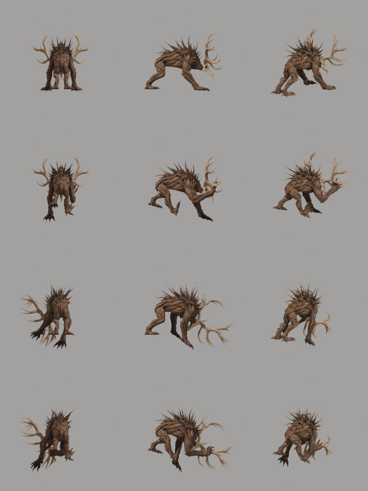

# video2rig：把自己角色的 AI 视频，拟合回可编辑的 Blender 骨骼动画

AI 视频可以让一个角色抬手、奔跑或后仰，但视频本身没有可交给游戏引擎的骨骼曲线。video2rig 尝试补上这一段：先用已有 3D 角色渲染首帧，让图生视频模型表演动作，再把画面中的动作拟合回这个角色自己的骨架。

**它输出的是可继续修改的 Blender Action，不是新的角色模型，也不是从任意网络视频恢复任意角色的通用动捕服务。** 已知模型、已知起始姿态和已知相机，是这套方法的重要前提。


*原作者示例：左侧为动作视频，右侧为原角色的拟合结果。图片来自仓库，不是本文完成的动作重建。*

本文依据 2026 年 10 月 23 日的首个公开提交 [`55d51b3`](https://github.com/donghaozhang/video2rig/tree/55d51b3b9685125a8ea27841d6af9523f6352aa1)，于 10 月 26 日核查。用户提供的 `donghaozhang/video2rig` 是 [`canitcode/video2rig`](https://github.com/canitcode/video2rig) 的 fork；核查时两者主分支指向同一提交。项目归属原作者 Can It Code，不能因 fork 地址而改变作者归属。

## 它连接的是 3D 资产和视频模型

完整流程可以拆成六步：

```text
已有的 3D 模型与蒙皮骨架
    → 导出骨架、网格与起始姿态
    → 用固定相机渲染首帧
    → 为该角色训练关节识别器（可复用于多个动作）
    → 图生视频生成动作片段
    → 读取关节、拟合骨架，导入 Blender Action
```

如果模型没有骨骼，项目另有自动绑定流程，调用单独安装的 UniRig，并提供基于网格中心线的后备路径。但这不替代模型制作：几何、纹理、骨架和蒙皮必须先具备可用质量。[教程](https://github.com/donghaozhang/video2rig/blob/55d51b3b9685125a8ea27841d6af9523f6352aa1/TUTORIAL.md)



*上游姿态检查图。应检查关节弯曲时是否撕裂、权重是否拖动错误部位；它不是“自动绑定永远正确”的证明。*

因此，它更适合已有角色、希望补充动作的制作流程。只有一个概念图、或者只有一段影视视频，还缺少它需要的基础输入。

## 为什么首帧最好是同一角色的两个视图

默认首帧把正面与侧面放在一张图中，同时保存相机参数。这样，同一个关节在两个画面中的位置可以约束其空间位置；单视图缺失的深度，则更多依赖起始姿态和骨架先验来猜。


*原作者首帧示例：灰色背景、可见地面、完整身体和动作余量，服务于测量，不是追求成片质感。*

它要求视频保留这个首帧、固定机位、不切镜、角色不出画，尽量不要烟尘、粒子和强烈模糊。遮挡和特效会破坏关节可见性。两格画面还必须描述同一时刻的同一动作；有两个视角不代表生成器一定维持了多视图一致性。[视频输入要求](https://github.com/donghaozhang/video2rig/blob/55d51b3b9685125a8ea27841d6af9523f6352aa1/docs/VIDEO.md)


*作者提供的视频帧拼图，说明双视图要在运动过程中保持对应。本文没有播放或复现完整片段。*

作者的实测片段使用 Seedance；其他保留首帧的图生视频工具只是原理上可接入，不能直接说已经逐一兼容验证。

## 关节识别器：为一个角色生成自己的训练标签

video2rig 没有把所有角色都塞进一个固定的人体姿态模板。它用该角色自己的骨架随机摆姿态，通过首帧相机渲染训练图，再从已知 3D 关节得到精确投影标签。模型学的是这个角色在这些相机下的关节外观，而不是某一个特定动作。

识别器基于 DINOv2-small，加上输出关节热图的小型解码器和细节分支。代码冻结嵌入与前四个 Transformer block，其余部分参与训练；并非仅仅给一个完全冻结的视觉模型加几条提示词。训练还包含遮挡可见性处理与外观、模糊等增强。[网络代码](https://github.com/donghaozhang/video2rig/blob/55d51b3b9685125a8ea27841d6af9523f6352aa1/video2rig/reader/net.py)、[原理说明](https://github.com/donghaozhang/video2rig/blob/55d51b3b9685125a8ea27841d6af9523f6352aa1/docs/HOW-IT-WORKS.md)


*上游识别结果图。关节热图的峰值用作置信度，但高置信度不保证对生成视频的误判已经消失。*

代价也很明确：更换角色、骨架或起始视图，需要重新准备相应识别器。所谓“一次训练、复用多个动作”有资产与相机条件，不是所有角色共享一次训练。

## 从二维关节到骨架动作，中间还有约束求解

识别到几个点，并不等于得到稳定的 3D 动画。当前主流程还会处理左右肢体混淆、置信度加权、关节活动范围、平滑和地面约束，并提供脚底锁定、根节点步进补偿与部分肢体穿身抑制。

这些处理是工程规则，不是完整物理仿真。例如，生成视频可能画出原地跑和脚底后滑，`steps` 会根据步态补出根节点前移；这时重建角色会向前走，而视频主体仍在原地，叠加画面出现位移不一定是拟合故障。[拟合实现](https://github.com/donghaozhang/video2rig/blob/55d51b3b9685125a8ea27841d6af9523f6352aa1/video2rig/reader/fit.py)

还要留意自动降级：`run` 在项目存在 `reader/reader.pt` 时使用关节识别流程，没有它或指定 `--old` 时，会走 BootsTAPIR 点跟踪与旧版求解。省略训练后仍有输出，不代表运行了同一种方法。[命令入口](https://github.com/donghaozhang/video2rig/blob/55d51b3b9685125a8ea27841d6af9523f6352aa1/video2rig/__main__.py)

原作者报告，九种角色的已知动作渲染测试中，拟合骨骼方向的每骨中位误差约 3 度；某个旧流程奔跑案例约 21 度。这是作者自己的合成测试口径，不是本文测得的真实 AI 视频精度。公开树中未找到代码注释引用的 `dev/bench/suite.py` 及完整测试资产，本文没有复现该分数。

## 输出是什么，检查又能证明什么

求解输出 `.npz`，包含时间、骨骼旋转、根节点位移和道具变换等信息。`blender/import_motion.py` 将其写成 Action，按内容时间映射到 Blender 帧，使用四元数旋转与线性关键帧；之后可在 Blender 中修整，再通过 Blender 的导出流程交付 FBX 或 glTF。`.npz` 本身不是已经导出的游戏资产。[导入脚本](https://github.com/donghaozhang/video2rig/blob/55d51b3b9685125a8ea27841d6af9523f6352aa1/blender/import_motion.py)

作者提供两个值得保留的验收入口：

| 命令 | 作用与边界 |
|---|---|
| `python -m video2rig check <project> <clip>` | 评估双正交视图的一致性等；不适用的相机给警告，而不是证明正确 |
| `python -m video2rig review <project> <clip>` | 生成视频、拟合与额外视角的对照，方便发现深度和接触问题 |

`check` 在身体跨视图偏差超过身高约 1.5% 时给 FAIL，并以非零状态退出。这是当前代码的启发式阈值，而且是需要主动执行的命令，不能说 `run` 自动替你完成了全部输入验收。[检查实现](https://github.com/donghaozhang/video2rig/blob/55d51b3b9685125a8ea27841d6af9523f6352aa1/video2rig/check.py)

单镜头看起来贴合，侧面却不对，是很实际的风险。作者自己披露过：单视图中的举石动作从输入相机看能对上，换侧面检查，道具却落在髋部附近。被两视图同时遮住的肢体、手指精细动作和武器轴向扭转也不能指望自动准确恢复。

## 能在什么机器上用，是否全部本地

作者文档面向 Windows/Linux、Python 3.10–3.12、Blender 5.1 和 RTX 30 系列或更新的 NVIDIA GPU，并报告在 12 GB 显卡上测试过。约 40 分钟的识别器准备与训练、约一分钟的片段处理等时间是上游机器上的经验值，不是本文性能测量。[运行要求](https://github.com/donghaozhang/video2rig/blob/55d51b3b9685125a8ea27841d6af9523f6352aa1/README.md)

源码训练入口明确使用 CUDA；读取已有识别器可走 CPU，但这里没有自动启用 Apple MPS 的路径。Mac 能运行 Blender 导入脚本，不等于已验证 Mac 可以完成默认的识别器训练。

动作读取和拟合可以本地进行，但图生视频通常仍用外部服务。仓库还包含可选的 BytePlus 付费生成脚本，需要密钥与预算账本，并能保存任务 ID 后恢复下载。因此，“本地工具不需要账号”只适用于相应本地环节，不能扩展成整个流程都离线、免费。[生成模块](https://github.com/donghaozhang/video2rig/blob/55d51b3b9685125a8ea27841d6af9523f6352aa1/video2rig/generate.py)

## 本次实际验证到哪里

本次使用 **Blender 5.1.2**，在临时空场景创建三个简单骨骼和一个立方体道具，给上游导入脚本提供三时刻的合成数据。检查通过的项目包括：

- 在 24 fps 下将 0、0.5、1 秒映射到第 1、13、25 帧，并写入 Action。
- 根骨与道具位移、旋转关键帧的四元数同半球处理、线性插值。
- 未参与拟合的骨骼保持原始旋转，编辑偏好在导入后恢复。
- 保存 `.blend`，再开新进程读取，确认 Action、末帧根骨与道具位移仍存在。

这只验证**合成动作数据到 Blender 的导入与保存环节**，没有验证蒙皮变形、训练、视频识别、真实拟合、FBX/glTF 导出或动画观感。没有安装推理依赖、下载模型权重、导入私人角色或调用视频生成服务。[验证脚本与记录](imgs/video2rig-ai-video-to-blender-action/SOURCES.md)

项目代码为 AGPL-3.0；DINOv2、BootsTAPIR 和单独安装的 UniRig 有各自许可。作者允许动画用于商业项目，但角色素材、生成服务和第三方组件的条件仍应分别检查，不能把输出使用与软件分发条款混为一谈。[许可](https://github.com/donghaozhang/video2rig/blob/55d51b3b9685125a8ea27841d6af9523f6352aa1/LICENSE)

video2rig 值得关注的地方，是**用自己资产产生标注，让视频模型提供动作提案，再把结果收回到可编辑骨架**。最合适的定位是动作初稿工具：先用一个短动作检查多视图、接触和蒙皮，再决定是否批量生成，别把一张对照图当作游戏动画已经交付。
