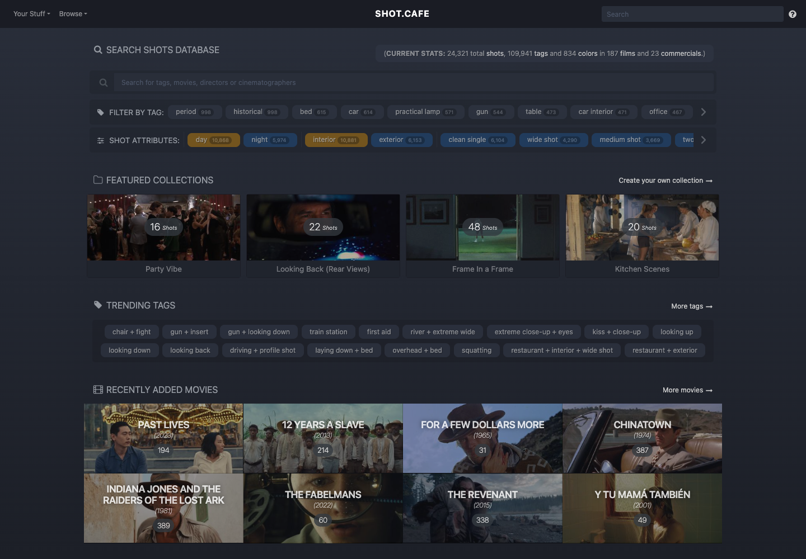
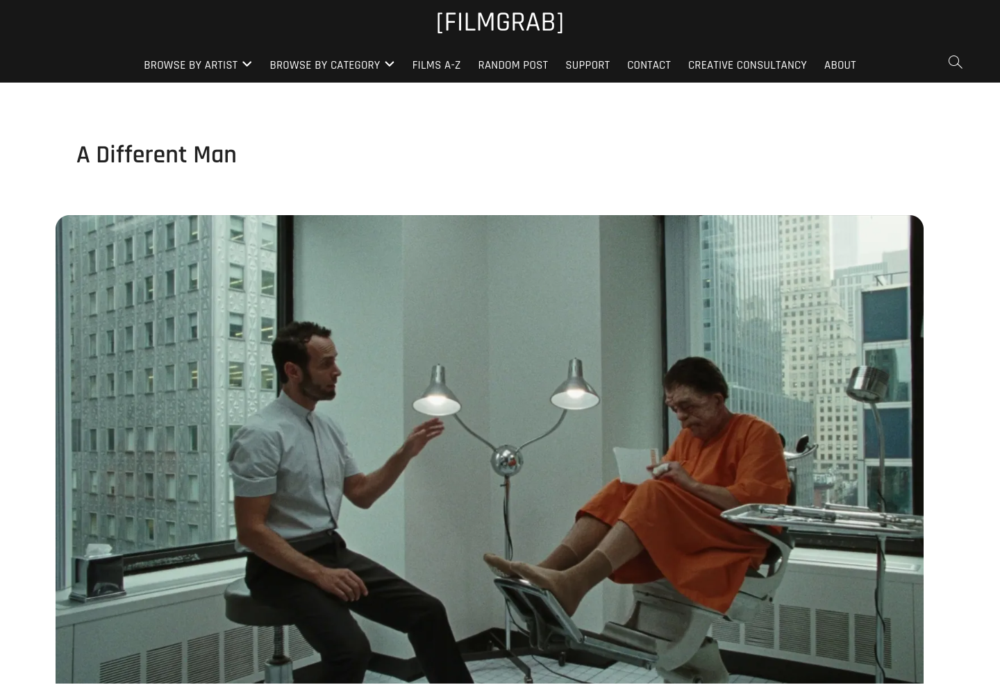
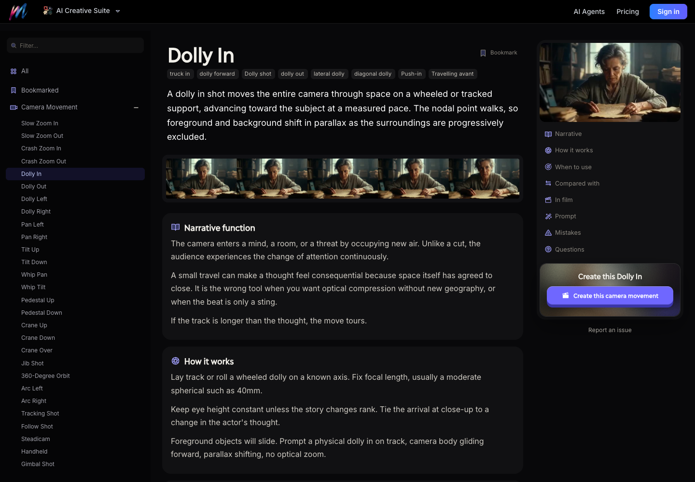
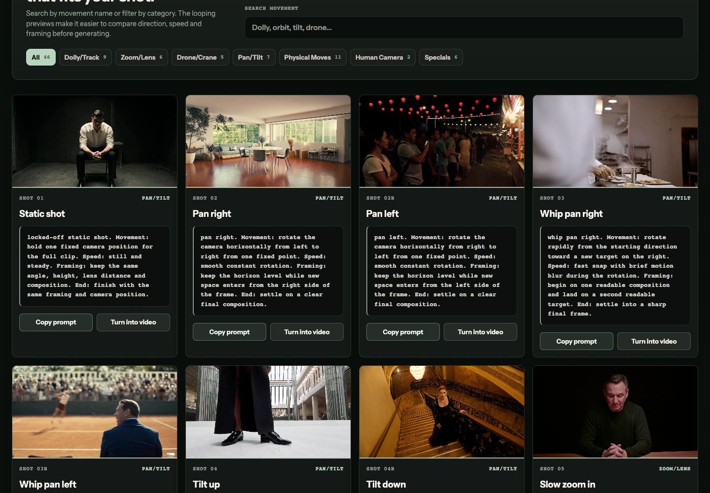
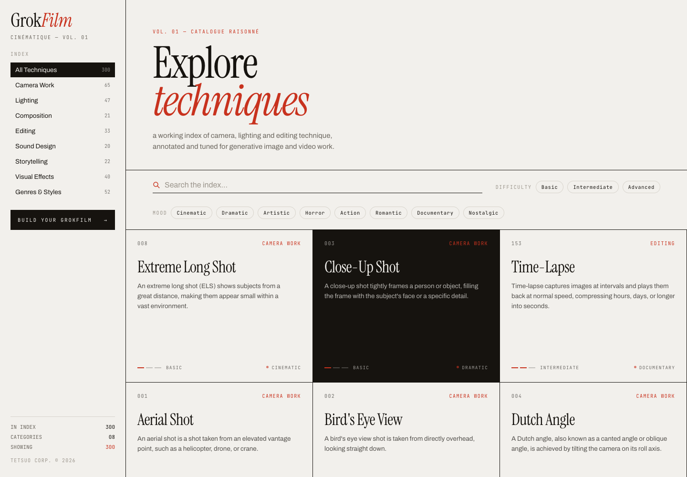
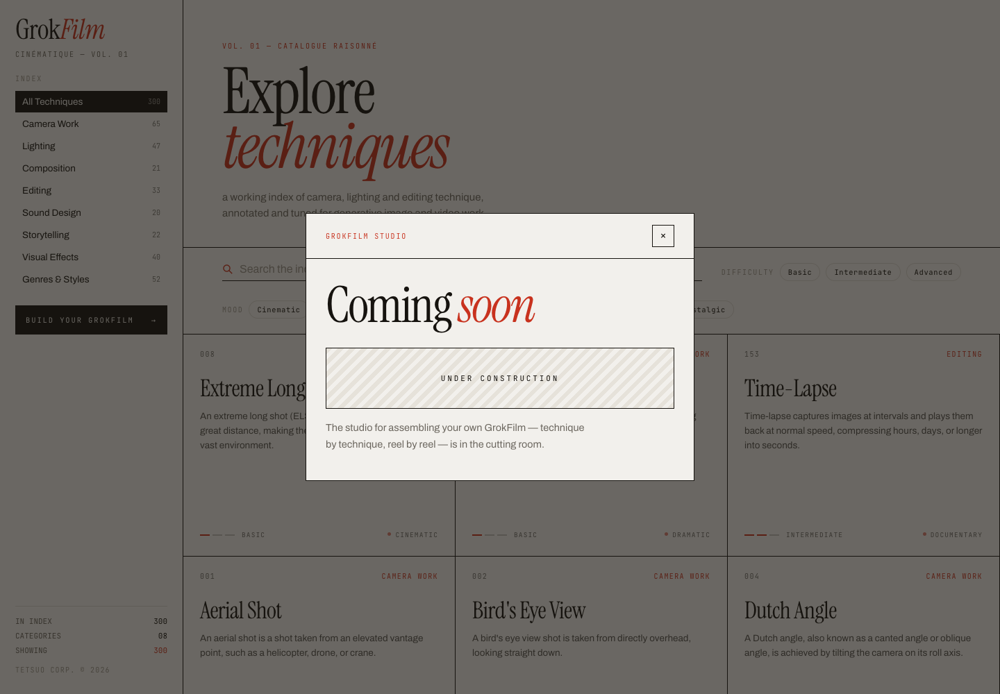

# From Film References to AI Camera Prompts: A Workflow Across Six Websites

“More cinematic” is an incomplete direction. It could mean a smaller figure in the frame, an obstructed foreground, a slower approach, or holding the next cut for another half-second.

In an [October 24 post](https://x.com/Crypto_QianXun/status/2113805484239286697), Qianxun recommended six websites. The useful interpretation is a learning workflow: **find visual evidence, name the technique, then translate it into requirements you can inspect.** These sites are not an integrated automatic filmmaking system.

This review checked their public pages on October 24, 2026 and captured browser screenshots. X returned HTTP 403, so post text and timing came from public FxTwitter metadata. Eyecandy also challenged browser access; its description below relies on readable official pages. No video model was called, and no cross-model prompt success rate was tested.

## Six Sites, Six Different Questions

| Site | Main use | Useful output |
|---|---|---|
| [Shot.Cafe](https://shot.cafe/) | Find film stills through subjects, tags, colors, and other attributes | References labeled by what you want to learn |
| [FilmGrab](https://film-grab.com/) | Study visual choices across stills from one film | Notes on framing, lighting, color, and space |
| [Eyecandy](https://eyecannndy.com/) | Find examples organized by named visual techniques | Vocabulary and moving-image references |
| [Melies Cinematic Techniques](https://melies.co/cinematic-techniques) | Connect definitions, narrative purpose, mechanics, and prompts | An explanation and constraints |
| [AI Camera Movements](https://aicameramovements.com/) | Compare camera examples and adapt instructions | Starting frame, path, speed, and end frame |
| [GrokFilm](https://grokfilm.app/) | Browse filmmaking techniques expressed for generative work | Further techniques and prompt language to investigate |

The repository's [earlier cinematic-reference article](../2026-07-08/2026-07-08-cinematic-reference-stack-ai-video-preproduction-en.md) covered discovery and pre-production organization. This follow-up focuses on translating references into shot instructions rather than ranking libraries again.

## 1. Shot.Cafe: State What the Reference Is For

Shot.Cafe offers browsing through films, cinematographers, tags, colors, and aspect ratios, along with collections and favorites. Personal collection features require login. Its About describes research, moodboards, lookbooks, and presentation work, not unrestricted commercial stock footage. [Official page](https://shot.cafe/)



*Browser capture: tags and shot attributes narrow the search. Depicted film images retain their respective ownership.*

“This frame looks good” is a weak production note. Better: borrow the doorway obstruction, not the costume; borrow the cool window against a warm lamp, not the complete composition. A reference may contain several useful ideas and several incompatible ones. Labeling its purpose makes deviations easier to diagnose.

## 2. FilmGrab: Study Consistency Within One Film

FilmGrab's film pages support studying several images from one work. The inspected page for *A Different Man* also lists director, cinematography, production design, camera, and film-stock information. This is a film-research entry point, not a validated AI parameter sheet. [Film page](https://film-grab.com/2026/09/28/a-different-man/)



*Browser capture: a still can show subject placement, window light, and spatial layers. It cannot establish camera movement by itself.*

A board assembled across many films can contain beautiful images that belong to incompatible worlds. Studying subject scale, skin against background, and motivated light within one film helps establish a coherent set of choices first.

A still cannot reveal the camera's previous position, speed, or stopping point. A close-up alone does not tell you whether the shot arrived through a dolly, a zoom, or a cut.

## 3. Eyecandy: Give the Effect a Searchable Name

Eyecandy organizes examples by visual technique. Its official categories include Dolly Zoom, Match Cut, Split Diopter, Snorricam, and Whip Pan, spanning editing, optics, and visual treatment as well as camera movement. [Official categories](https://eyecannndy.com/)

It helps when you recognize an effect but lack its name. After finding the term, return to moving examples: did the camera translate, the focal length change, the subject move, or two separate shots create a relationship? Browser verification was not bypassed here, and readable page text was not treated as successful playback testing.

## 4. Melies: Explain the Mechanics, Not Just the Mood

Melies connects technique definitions with narrative purpose, mechanics, comparisons, prompts, and mistakes. Its Dolly In page distinguishes physical forward camera travel, fixed focal length, and foreground/background parallax from a zoom at a fixed position. [Dolly In guide](https://melies.co/cinematic-techniques/camera-movement/dolly-in)



*Browser capture: narrative purpose and mechanics sit alongside the definition. Example imagery belongs to the site and was not generated during this review.*

That distinction gives you an acceptance criterion. If you requested forward camera travel but received a central enlargement without relative foreground motion, the result missed the intended move. Whether a particular model reliably implements that distinction still requires testing.

## 5. AI Camera Movements: Separate the Camera From the Scene

AI Camera Movements structures cards around Movement, Speed, Framing, and End, with examples and copying controls. It positions the prompts for adaptation across video tools; that does not establish equivalent results across models. [Movement library](https://aicameramovements.com/)



*Browser capture: instructions specify direction, speed, framing, and ending. Preview imagery is not output generated for this article.*

Borrow the structure rather than every word. Scene instructions describe who does what. Camera instructions describe where the camera starts, its path and timing, and where it finishes. Separating them lets you keep the character and setting constant while comparing a static shot against a slow approach.

An original, untested example for this article:

```text
Scene: A woman waits beside a rain-streaked station window.
She remains still, then turns her eyes toward the doorway at the end.

Camera: One continuous six-second shot, eye level.
Start in a medium shot and physically move slowly forward to a close-up.
Keep the focal length fixed, with visible foreground parallax.
End with the face fully readable. No cut or optical zoom.

Light: Cool window light from camera left; one warm practical lamp
in the background. Keep the lighting direction consistent.
```

Six seconds is an exercise specification, not a universal model capability. Where a tool supplies first-frame, last-frame, or camera controls, configure those actual interfaces instead of assuming prose replaces them.

## 6. GrokFilm: A Technique Index Is Not an Editing Suite

The loaded GrokFilm interface includes camera, lighting, composition, editing, sound, and story categories, with definitions, prompt language, and some Grok Imagine examples. Its public front end copies a prompt and opens an external generation entry point when “Try in Grok” is used; that is not in-site editing. [GrokFilm](https://grokfilm.app/)



*Browser capture: categories can inform a shot plan. Their existence does not establish implemented production tools.*

The post describes the final stop as adjusting lighting and editing. More precisely, it currently supports researching those techniques. Clicking “Build your GrokFilm” opened a Studio dialog explicitly marked Coming Soon / Under Construction.



*Captured after clicking the control: the assembly feature was not delivered through this entry point. It should not be presented as a verified timeline, relighting, or final-export tool.*

The public front end also constructs ordinary entry prompts around a cinematic still, with shared style language. Movement and editing require additional temporal instructions. One still cannot perform the editorial task of showing A and then cutting to B.

## A Small Shot Exercise With Clear Acceptance Criteria

You do not need all six sites for every shot. A first learning pass can follow the sequence; routine work should use whichever source resolves the missing information.

1. State the narrative task, such as revealing in the final beat that she heard something beyond the door.
2. Choose two or three references and label their framing, lighting, and spatial roles rather than treating them as one image to duplicate.
3. Choose one primary camera move. Specify start size, path, end composition, and the timing of the performance.
4. Hold available character references, input frames, and model settings constant. Change one variable at a time; if deterministic repetition is unavailable, record repeated samples instead of attributing randomness to wording improvements.
5. Review the whole clip for parallax, faces, occlusion, light direction, speed, and a usable ending. Then check it against neighboring shots.

A compact record is enough:

| Field | Example |
|---|---|
| Narrative task | Shift attention toward the doorway in the final second |
| Framing | Medium to close-up; doorway off-screen right |
| Camera | Slow forward travel, fixed focal length, no cut |
| Performance | Initially still; only the eyes turn near the end |
| Failure conditions | Digital enlargement, facial deformation, early reaction, lighting jump |
| Next check | Eyeline and incoming sound against the following shot |

These resources reduce the cost of finding references, learning vocabulary, and communicating a shot. They do not replace generation models, reference permissions, continuity checks, or editorial judgment. **The useful outcome is an inspectable shot requirement, not six more bookmarks.**

---

See [SOURCES.md](imgs/cinematic-reference-to-camera-prompts/SOURCES.md) for sources, captures, and access limits. Screenshots illustrate the reviewed sites; film imagery, examples, and trademarks retain their respective ownership. Browsable material is not automatically cleared for commercial footage or upload to external generation services.
