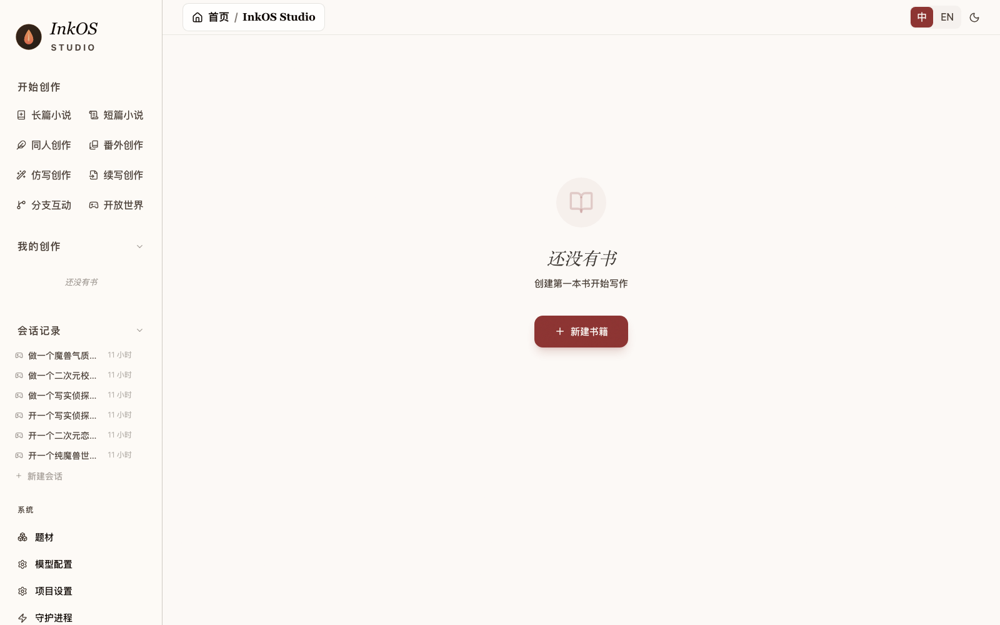
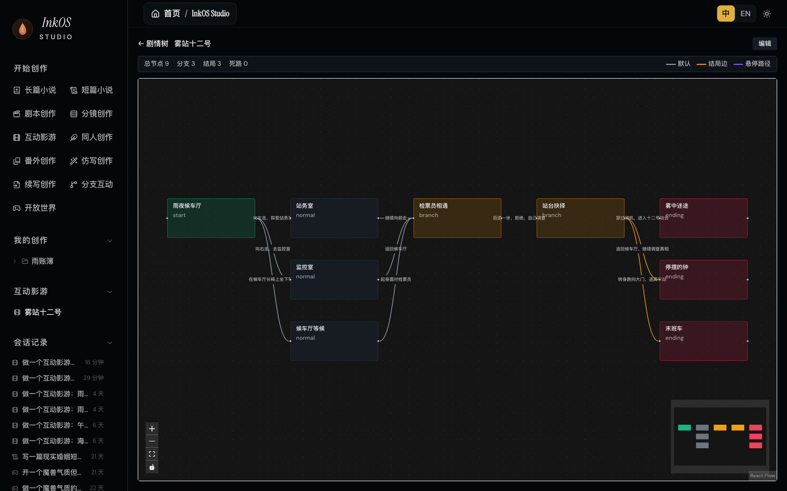

# InkOS 源码拆解：用正史、上下文和可恢复文件组织 AI 故事创作

AI 写作最容易演示的是开头几段，最难持续交付的是后面的几十章：谁知道了什么，某件物品还在不在，前文留下的承诺有没有兑现，改过一章之后又影响了哪些地方。

InkOS 尝试把这些问题从聊天记录中拆出来，变成作者意图、故事状态、章节计划、审稿意见和版本文件。**它的价值主要在故事生产的组织方式，不是一个新的写作模型，也不是把几条提示词包装成“自动出版”。**



*原仓库截图：Studio 把多种创作入口和已有会话放在同一工作台。截图来自作者，不是本文启动应用后截取的运行证据。*

本文于 2026 年 10 月 24 日核查 [`Narcooo/inkos`](https://github.com/Narcooo/inkos) 的固定提交 [`56aa33b`](https://github.com/Narcooo/inkos/tree/56aa33b04a27c45cc7a91f3d018187a77aec54ea)，并在临时源码目录运行选定测试。没有调用模型 API、生成小说或封面，也没有导入个人作品。

## 先分清源码和安装版本

当前 `master` 的 package 版本是 `2.0.0`，README 明确称它为 2.0 开发版本。核查时 npm `latest` 与 GitHub 最新正式 Release 都是 **1.8.0**；该 Release 发布于 2026 年 8 月 17 日。[开发分支说明](https://github.com/Narcooo/inkos/blob/56aa33b04a27c45cc7a91f3d018187a77aec54ea/README.md)、[v1.8.0 Release](https://github.com/Narcooo/inkos/releases/tag/v1.8.0)、[npm 包](https://www.npmjs.com/package/@actalk/inkos)

所以，下文是对这一份开发源码的分析，不是保证执行默认 npm 安装就能得到所有界面和行为。1.8.0 的发布说明也包含统一 Harness 的工作，不能反过来把这里讨论的所有能力都宣称为“2.0 首次新增”。

仓库分成 `packages/core`、`packages/cli` 和 `packages/studio`：核心负责创作与状态，CLI/TUI 和 Studio 提供操作入口。网页体验、npm 版本和开发分支应分别看待，不能混成一个已经验收的产品版本。

## 多角色之后，还需要一个能约束执行的宿主

README 列出 Planner、Composer、Writer、Settler、审稿与修订等角色。但角色多，不自动意味着系统可靠，也不意味着八个独立模型正在并发写同一本书。

这份源码更关键的设计，是让这些能力进入统一的生产执行层：

| 对象 | 可以怎样理解 |
|---|---|
| Work | 一部作品及其身份、类型与产物清单 |
| Profile | 这类作品可以调用哪些能力、按什么策略确认操作 |
| Episode | 一次创作任务的执行记录 |
| ActionResult / Artifact | 实际动作结果，以及对应文件和版本引用 |

`CreativeHarnessRuntime.executeAction()` 会检查 Profile 能否调用目标能力，再按动作风险、请求来源和确认状态判断是否执行；需要时返回确认要求。写入同一作品还会经过变更队列与书籍锁。开始、完成、失败和取消均有事件记录。[运行时实现](https://github.com/Narcooo/inkos/blob/56aa33b04a27c45cc7a91f3d018187a77aec54ea/packages/core/src/harness/runtime.ts)

这比给模型一句“写完记得保存”更明确。不过，它是应用内的执行治理，不等于操作系统级沙箱。外部模型仍负责推理，代码也不能仅凭工具调用成功就判断内容精彩。

## 先编译本章需要的上下文，再写正文

作者的长期方向、最近几章的注意事项和本章任务不是一回事。InkOS 用不同文件表达它们，在作品源目录内形成可查看的输入记录：

```text
story/author_intent.md                 长期创作方向
story/current_focus.md                 当前阶段重点
story/runtime/chapter-XXXX.intent.md    本章意图
story/runtime/chapter-XXXX.context.json 本章实际上下文
story/runtime/chapter-XXXX.trace.json   来源与编排轨迹
```

共享上下文编译器还把片段分为 `protected` 与 `compressible`。预算不足时，可压缩材料交给语义编译器处理；受保护部分自己就超预算，会明确报错，不静默截断。它检查压缩结果引用的来源 ID，并记录最终 Token 估计和压缩轨迹。[上下文编译器](https://github.com/Narcooo/inkos/blob/56aa33b04a27c45cc7a91f3d018187a77aec54ea/packages/core/src/harness/context-compiler.ts)

好处不是“模型终于拥有无限记忆”，而是作者可以追问：这一章到底看了哪些设定，为什么没带上某条信息？压缩结果的语义仍可能遗漏或误读，来源可追踪也不能替代人工复核。

## 正史、阅读版和检索索引不能互相冒充

长篇工作流把权威结构化状态、人类可读投影与搜索索引分开：

| 层 | 作用 |
|---|---|
| `story/state/*.json` | 当前事实、伏笔、章节摘要等结构化记录 |
| `story/*.md` | 便于人阅读的状态与摘要投影 |
| `story/memory.db` | 可重建的 SQLite FTS5/BM25 检索索引 |

`retrieveMemorySelection()` 读取结构化伏笔和摘要，为检索重建相应投影，再让语义选择器从候选材料中挑选。搜索命中不等于新的故事事实；相关性排序也不负责宣布某个伏笔必须立刻回收。[记忆检索实现](https://github.com/Narcooo/inkos/blob/56aa33b04a27c45cc7a91f3d018187a77aec54ea/packages/core/src/utils/memory-retrieval.ts)

但这仍有两层可靠性要分开：代码可以确认状态符合 Schema，却不能只靠 Schema 判断某条事实是否真的在正文中成立。Settler 的模型判断、写入验证和后续审阅都需要承担各自责任。

## 审稿是有来源的观察，修订是另一件事

当前审稿机制记录 `observation`，而不是把创作质量压成一个统一的通过分数。来源解析器可以把模型选择的行号转成宿主持有的原文片段，并校验引用确实出现在对应来源中。[Observation 实现](https://github.com/Narcooo/inkos/blob/56aa33b04a27c45cc7a91f3d018187a77aec54ea/packages/core/src/models/observation.ts)

这提高了审稿的可核对程度：作者至少可以看到意见在说哪段文字。但引用正确，不代表审美判断必然正确；“这句存在”与“这句应该删掉”是两个问题。

`reviewChapterDraft()` 还有一个重要边界：审稿调用失败时，会保留正文并记录审稿暂不可用，不把模型故障当成稿件不好。修订则由独立动作执行。不能把这套机制概括成“AI 自动打分，不合格就无限重写”。[章节审稿](https://github.com/Narcooo/inkos/blob/56aa33b04a27c45cc7a91f3d018187a77aec54ea/packages/core/src/pipeline/chapter-review.ts)

## 分支推演先留在候选区

创作中经常需要比较：“主角接受合作”和“主角拒绝合作”分别会导致什么。InkOS 的 narrative forecast 将这些候选未来放在独立目录，而不是直接写进章节和权威状态。

选中分支时，`selectNarrativeBranch()` 写的是 `selected-branch-plan.md`。把计划应用到大纲、章节意图或正史，是另一个需要明确处理的步骤。系统还对输入做指纹，正史变化后可以把旧推演标成 stale；这不是自动证明旧计划依然可用。[推演运行器](https://github.com/Narcooo/inkos/blob/56aa33b04a27c45cc7a91f3d018187a77aec54ea/packages/core/src/forecast/runner.ts)

本次运行的测试用模型替身生成两个分支，检查创建、读取和选择后正史文件没有变化。这验证的是隔离行为，不是两个分支的创作质量。

## 可恢复文件，比一句“已经完成”更重要

章节正文推进了，故事状态却没保存，是长任务中很难察觉的损坏。源码的文件集提交器先准备新文件和恢复日志，备份旧文件，再逐项替换；异常时回滚，重启后可恢复已失去进程所有者的事务记录。[文件集提交器](https://github.com/Narcooo/inkos/blob/56aa33b04a27c45cc7a91f3d018187a77aec54ea/packages/core/src/utils/atomic-file-set.ts)

相关测试确实覆盖了替换中途失败，以及写入子进程被终止后的恢复。不过，实现使用的是多次文件操作，不应据此宣传为完整数据库 ACID、所有读者瞬间看到同一快照，或任何断电情况下都不会丢失。本文也没有做断电测试。

同样，章节版本、产物清单和工具结果能说明哪些文件已经存在；它们不能替作者签署“这本书已经可以发表”。工程完成态与创作接受度应该分开。

## 不只小说，但也不是成片生成器

Studio 还展示剧本、分镜、互动影游和开放世界等入口。互动影游的交付代码可以检查剧情图，再导出 HTML、JSON 或 Ink；HTML 播放器根据变量、条件与选择推进节点。[互动作品交付](https://github.com/Narcooo/inkos/blob/56aa33b04a27c45cc7a91f3d018187a77aec54ea/packages/core/src/harness/tools/film-delivery.ts)



*作者提供的《雾站十二号》剧情图截图，展示分支和结局组织。图中的统计不是本次生成或运行测量，也不证明整部作品已通过玩家验收。*

这些能力让同一个故事可以有不同交付形态，但小说、分镜文本、可玩叙事页面与完整配音视频仍是不同产物。项目名称中出现“影游”或有一张剧情树，不等于完成了视频生成、配音、剪辑和发行。

外部 `SKILL.md` 则主要提供专业说明与静态资料，不自动获得执行脚本或绕过工具确认的权限。项目可覆盖写作、审稿和翻译方法，但 Skill 的指令仍不等于可执行产物。[Skill 加载实现](https://github.com/Narcooo/inkos/blob/56aa33b04a27c45cc7a91f3d018187a77aec54ea/packages/core/src/skills/external-loader.ts)

## 本次验证到哪里

在临时克隆内，以锁文件安装核心包依赖并禁用安装脚本，随后运行 9 个测试文件，**54 项测试全部通过**。范围包括文件恢复、章节版本、推演隔离、上下文压缩、结构化状态、本地检索、Skill 加载和使用替身的 Harness 流程。

没有运行全套测试，没有启动 Studio、全局安装 InkOS、调用真实模型、制作封面或写完一本书。截图来自原仓库，文学质量、长篇持续一致性、真实费用与模型兼容性都没有独立验收。[完整来源与测试命令](imgs/inkos-stateful-story-creation-harness/SOURCES.md)

个人评估时，建议先用新建测试作品跑一个小闭环：写两章，改一处影响后文的事实，确认审稿来源、版本恢复和状态变化能不能说明白。需要外部模型时，先确认未公开文本会发送到哪里。AGPL-3.0 代码许可也不代替模型服务条款，或授予参考作品和导入文本的使用权。

InkOS 最值得借鉴的是把“决定写什么”“实际看了什么”“保存了什么”“哪些意见仍待作者判断”分别记录。**它改善的是创作过程的可控性与可追溯性，至于故事是否值得读，仍需要读者和作者作答。**
