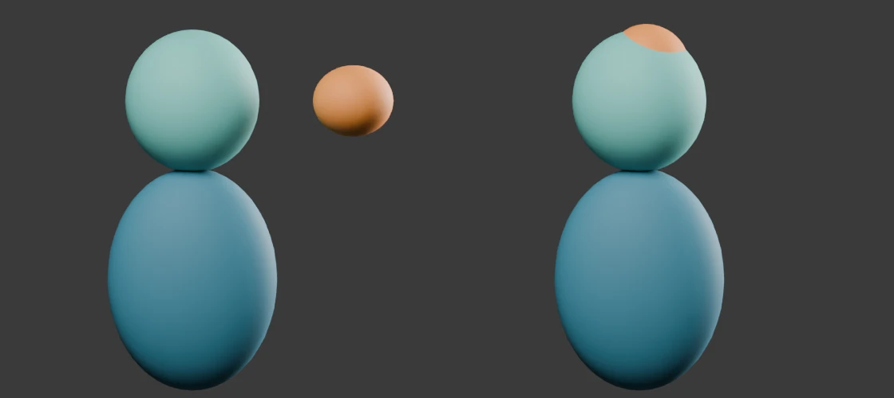

# Motion2MixamoRig: Turning a Single-Person Video into Mixamo Animation

> [中文](2026-10-24-motion2mixamorig-video-retargeting.md) · [Upstream project](https://github.com/MaxLiu22/Motion2MixamoRig) · [Submitted fork](https://github.com/donghaozhang/Motion2MixamoRig) · [v0.1.8](https://github.com/MaxLiu22/Motion2MixamoRig/releases/tag/v0.1.8) released October 24, 2026; reviewed November 17, 2026 (Melbourne)

Film someone raising an arm, turning, or walking. Can an existing 3D character do the same? Motion2MixamoRig takes **a single-person video (or a pose photo) and an already skinned Mixamo FBX**. It estimates the source motion, transfers it to the target bones, and delivers a GLB containing a skinned character and animation. It does not model the person in the footage or auto-rig an unbound mesh.

The earlier [video2rig](../2026-10-23/2026-10-23-video2rig-ai-video-to-blender-action-en.md) review describes a different starting point. That workflow renders training data for your character, then reads joints from AI footage of that type of character and fits them back to the original rig. Motion2MixamoRig recovers human motion first and targets a rig that follows Mixamo conventions. That is a more direct route when you already have human footage and a Mixamo character. Renaming a file won't make an arbitrary rig compatible.

## Extract once, then change characters

The first stage is human motion recovery. The [GVHMR](https://github.com/zju3dv/GVHMR) adapter estimates motion from a single camera and uses SMPL-X to obtain 24 SMPL joints in world coordinates. A photo takes the static-pose path; it doesn't generate a before and after. The project asks for one clearly visible, full-body subject. Heavy camera movement, occlusion, and quick turns are good reasons to scrutinize the estimate. [Extractor source](https://github.com/MaxLiu22/Motion2MixamoRig/blob/v0.1.8/motion2mixamorig/extractors/gvhmr.py)

The second stage is retargeting. The target can have different proportions and bind orientations, so the tool reads the FBX bind pose and calculates local rotations and hip translation for that rig. Where foot-contact data exists, the default path tries to pin the supporting foot and adjust height. That can help with sliding, but it doesn't guarantee natural heel, toe, or floor contact. Fingers stay at rest by default. `--detect-hands` adds the [HaMeR](https://geopavlakos.github.io/hamer/) and MANO hand pass. [Retarget pipeline](https://github.com/MaxLiu22/Motion2MixamoRig/blob/v0.1.8/motion2mixamorig/pipeline.py), [foot contact code](https://github.com/MaxLiu22/Motion2MixamoRig/blob/v0.1.8/motion2mixamorig/mixamo/animation.py)

| Output | What to do with it |
|---|---|
| `skeleton_motion.npz` | Keep the recovered motion. Pass `--skeleton` to target another character without extracting the body again. |
| `mixamo_rotations.npz` | Keep per-bone rotations, root translation, and frame rate. Read its quaternion and coordinate conventions before using it in your own tools. |
| `mixamo_character.glb` | Import the skinned character and clip into Blender. The writer emits base material colors, not the FBX textures, so this is not a lossless look transfer. |
| `run.json` / `diagnostics.json` | One records inputs and frame rate; the other identifies suspected self-intersections by body part, frame range, and depth. |

## The collision report locates problems; it doesn't review the shot

Version 0.1.8 reopens the exported GLB and checks its skinned geometry frame by frame. It assigns vertices to body parts by skin weight and uses nearby vertices and normals to estimate penetration depth. It skips neighboring parts that share a joint and does not check the floor. A flagged issue does not fail the run. An empty report doesn't rule out foot sliding, knee pops, missed hand contact, or bad timing. [Diagnostics source](https://github.com/MaxLiu22/Motion2MixamoRig/blob/v0.1.8/motion2mixamorig/diagnose.py)

I tested the downstream stages with three original skinned shapes. Both clips had **25 frames at 24 fps**. The static control reported no issues; the other deliberately moved a hand proxy into the head. With the default 1 cm threshold, the report flagged only the head and left hand, over **frames 9–15**, with the largest estimate at **frame 12, about 12.86 cm**. It correctly marked that the pair did not overlap in the bind pose. Blender 5.1.2 imported an armature, three skinned meshes, and `mixamo_clip`. Measuring the deformed vertices showed the hand move in at frame 12 and return at frame 24.

This verifies **the upstream GLB writer, diagnostics, and Blender readback**, not real-video inference, FBX bind parsing, or human-motion retargeting. For real footage, `m2mr diagnose <run> --visualize` opens a timeline alongside the source and supports manual notes by frame range. Its 3D view loads a library from a CDN, so it isn't a fully offline report viewer. [Test scripts and reproduction notes](imgs/motion2mixamorig-video-retargeting/SOURCES.md)

## A useful first run on a Mac

When checked, the v0.1.8 release supplied an **Apple Silicon macOS** extension package only, for Blender 4.2+. The extension calls a separate Python environment instead of running PyTorch inside Blender. You supply the SMPL-X model and target Mixamo FBX. The upstream docs estimate about **5 GB** of weights for the first body run and another **2.7 GB** plus MANO for hands. I did not install the extension, download inference weights, or test a full Windows or Linux workflow. [Release](https://github.com/MaxLiu22/Motion2MixamoRig/releases/tag/v0.1.8), [user guide](https://github.com/MaxLiu22/Motion2MixamoRig/blob/v0.1.8/docs/user-guide.md)

Start with a short, fixed-camera clip: one full-body subject, a clear foot plant, and a quick turn. Run the body pass first. Align the clip to the frame rate in `run.json` and a zero-based timeline, then inspect facing, floor contact, and intersections before reusing the cache on a second character. For commercial work, review the terms of the actual dependencies and assets. The repository code is Apache-2.0, but its [upstream notice](https://github.com/MaxLiu22/Motion2MixamoRig/blob/v0.1.8/NOTICE.md) flags separate GVHMR and SMPL-X restrictions, and [Adobe's Mixamo FAQ](https://helpx.adobe.com/creative-cloud/faq/mixamo-faq.html) covers Mixamo's own content. Producing a GLB is not the same as clearing it for delivery.
