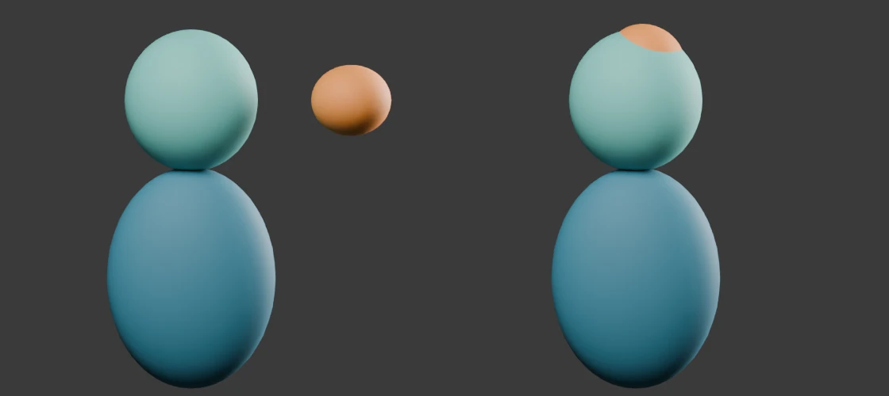

# Motion2MixamoRig：把单人视频变成 Mixamo 角色能用的动作

> [English](2026-10-24-motion2mixamorig-video-retargeting-en.md) · [上游项目](https://github.com/MaxLiu22/Motion2MixamoRig) · [所读 fork](https://github.com/donghaozhang/Motion2MixamoRig) · [v0.1.8](https://github.com/MaxLiu22/Motion2MixamoRig/releases/tag/v0.1.8) 发布于 2026 年 10 月 24 日；11 月 17 日核查（墨尔本）

拍一段人抬手、转身、走路的视频，能不能让已有的 3D 角色照着做？Motion2MixamoRig 的输入是**一个人的动作视频（或一张姿势照片）和一个已经蒙皮的 Mixamo FBX**。它估计源人物的三维动作，再把动作转到目标角色的骨骼上，最终交付的是一个含蒙皮和动画的 GLB。它不会把视频里那个人建模出来，也不负责给未绑定的角色自动绑骨。

对比以前写过的 [video2rig](../2026-10-23/2026-10-23-video2rig-ai-video-to-blender-action.md)，两者都把画面里的动作变成能编辑的骨骼运动，但输入假设不同。video2rig 的路线是先用自己的角色渲染训练数据，再从那类角色的 AI 视频读关节并拟合回原 rig；这里默认从单人画面恢复人体，再把它转到符合 Mixamo 约定的目标。手头有真人动作参考和 Mixamo 角色时，后者更直接；任意自定义骨架不能只靠改个文件后缀接进来。

## 提取一次，换角色不必重看视频

第一段是人体动作恢复。[GVHMR](https://github.com/zju3dv/GVHMR) 提供单目人体运动估计，这个项目的适配器用它恢复世界坐标里的动作，并通过 SMPL-X 得到 24 个 SMPL 关节点。单张照片走静态姿势路径，不会替你生成前后的动作。项目要求画面里只有一个人，尽量全身持续可见；镜头大幅移动、关节被遮住或快速转身时，不要把推测出来的姿态当成精确实测。[提取适配器](https://github.com/MaxLiu22/Motion2MixamoRig/blob/v0.1.8/motion2mixamorig/extractors/gvhmr.py)

第二段是重定向。目标角色的骨骼长度和绑定朝向可能跟提取到的人体不同，程序会读取目标 FBX 的绑定姿势，重新计算本地旋转和髋部位移。有脚接触数据时，默认会尝试锁住支撑脚，再调整高度；这可能减少滑步，但不保证脚跟、脚尖和地面接触都自然。默认只做身体，手指静止；`--detect-hands` 才加 [HaMeR](https://geopavlakos.github.io/hamer/) 与 MANO 的手部估计。[重定向流程](https://github.com/MaxLiu22/Motion2MixamoRig/blob/v0.1.8/motion2mixamorig/pipeline.py)、[脚接触处理](https://github.com/MaxLiu22/Motion2MixamoRig/blob/v0.1.8/motion2mixamorig/mixamo/animation.py)

| 输出文件 | 实际用法 |
|---|---|
| `skeleton_motion.npz` | 保留人体动作。用 `--skeleton` 换目标角色，跳过身体提取。 |
| `mixamo_rotations.npz` | 保存每根骨的旋转、根位移和帧率。接自有脚本时要看文件里的四元数顺序和坐标约定。 |
| `mixamo_character.glb` | 导入 Blender 看带蒙皮的角色和动画。当前写入器只输出基础材质色，不打包原 FBX 贴图，不宜把它当成外观无损转换。 |
| `run.json` / `diagnostics.json` | 前者记录输入和帧率，后者记录疑似自相交的身体部位、帧段和深度。 |

## 穿模报告能定位问题，不能替你审片

v0.1.8 会重新读导出的 GLB，用实际蒙皮逐帧检查。诊断按蒙皮权重把网格顶点分到身体部位，再依据邻近顶点和法线近似判断交叠深度。它跳过共享关节的相邻部位，也不查地面。发现穿模不会让任务失败；报告为空同样不能证明没有滑步、膝盖突跳、手没碰到目标或动作节奏不对。[诊断实现](https://github.com/MaxLiu22/Motion2MixamoRig/blob/v0.1.8/motion2mixamorig/diagnose.py)

我用自制的三个蒙皮几何体做了下游测试。两份文件都是 **25 帧、24 fps**：对照组的手部代理不动，诊断为零；另一份故意让它穿进头部。默认 1 cm 门槛下，报告只标出头部与左手一对，覆盖 **第 9–15 帧**，最严重在 **第 12 帧，约 12.86 cm**，并注明绑定姿势原本没有这对交叠。Blender 5.1.2 导回后一并读到了骨架、三个蒙皮网格和 `mixamo_clip`；我直接测了变形后网格的位置，确认手部在第 12 帧移入、到第 24 帧回到起点。

这验证的是**上游 GLB 写入器、诊断和 Blender 读回**，不包含真实视频推理、FBX 绑定解析或人体动作的重定向。真实项目可用 `m2mr diagnose <run> --visualize` 看时间轴、对照原视频，并导出手工审片区间；报告的 3D 视图从 CDN 加载库，不是完整的离线查看器。[测试脚本与复现说明](imgs/motion2mixamorig-video-retargeting/SOURCES.md)

## Mac 上怎样试，试完怎样交

核查时上游 v0.1.8 只提供 **Apple Silicon macOS** 扩展包，要求 Blender 4.2+；扩展调用独立 Python 环境，不是在 Blender 里直接运行 PyTorch。SMPL-X 模型和目标 Mixamo FBX 要单独准备。按上游文档，首次身体推理约需下载 **5 GB** 权重，手部另约 **2.7 GB** 并需要 MANO。本次没有安装该扩展、下载推理权重或验证 Windows、Linux 的完整流程。[发行页](https://github.com/MaxLiu22/Motion2MixamoRig/releases/tag/v0.1.8)、[使用指南](https://github.com/MaxLiu22/Motion2MixamoRig/blob/v0.1.8/docs/user-guide.md)

我会先用一个短片：固定机位，单人全身入镜，动作里至少有一次明显的脚落地和快速转向。先跑身体，按 `run.json` 的帧率和零起始帧对齐视频，检查朝向、接地和穿模；再换第二个角色复用缓存。如果项目要商用，先审实际依赖和素材的条款：仓库代码是 Apache-2.0，但[依赖声明](https://github.com/MaxLiu22/Motion2MixamoRig/blob/v0.1.8/NOTICE.md)明确指出默认链路中的 GVHMR、SMPL-X 等有单独限制，[Adobe 的 Mixamo FAQ](https://helpx.adobe.com/creative-cloud/faq/mixamo-faq.html)也只说明 Mixamo 自己的素材用途。能生成一份 GLB，和能把它用于你的交付，是两件事。
