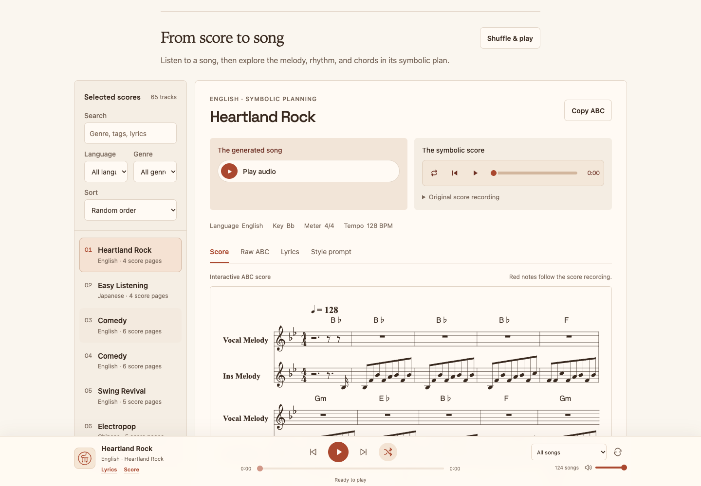
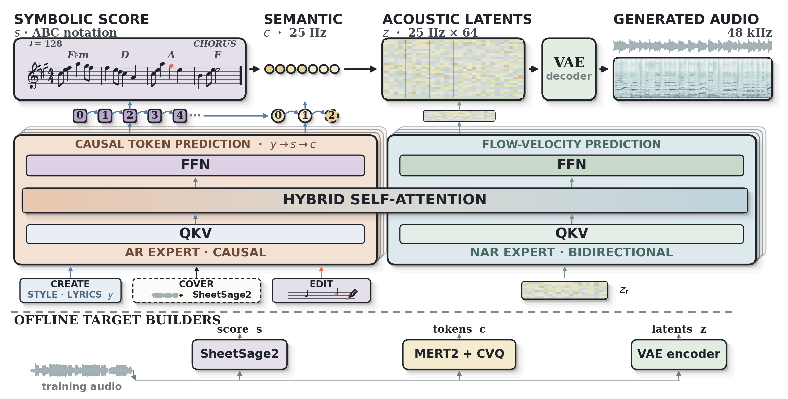
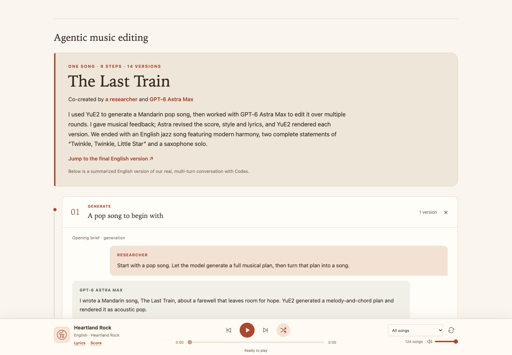
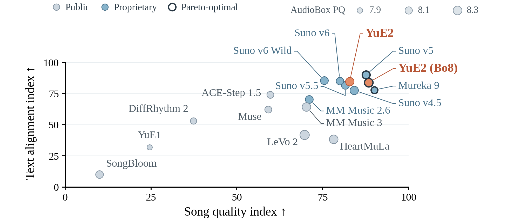

# YuE Is Now YuE2: Editable Scores Before Full-Song Audio

After generating a song, the difficult request is often not “make another,” but “keep the melody and change the harmony.” When prose is the only interface, both requests can collapse into drawing another result.

YuE2 exposes a different control surface: **an inspectable melody-and-chord score that can be revised before rendering a complete recording with vocals and accompaniment.** There is a music-generation model behind it, alongside tools for external agents. It is not merely a prompt collection or a Skill.



*Browser capture from October 25, 2026, showing song, score, lyrics, and style views. No audio was played or generated for this review.*

## One Repository, Different Generations

This review inspected `main` at [`1647252`](https://github.com/multimodal-art-projection/YuE/tree/1647252d68b70cbead046ffd3f7caf036dde47ee), committed October 6, 2026. The article date is the review date, not a launch date.

The original YuE was released in 2025, with code, documentation, and licensing preserved on [`YuE-v1`](https://github.com/multimodal-art-projection/YuE/tree/YuE-v1). The current main branch covers the YuE2 family released in September 2026. Earlier stage models, memory advice, and Apache-license descriptions should not be carried over to the new weights. [Current README](https://github.com/multimodal-art-projection/YuE/blob/1647252d68b70cbead046ffd3f7caf036dde47ee/README.md)

Three components deserve separate names:

| Component | Role |
|---|---|
| YuE2-3B and VAE | Generate a symbolic plan, music representations, and audio |
| SheetSage2 | Transcribe a recording into a reviewable score for covers and edits |
| `yue2-music` Skill and helpers | Let an external agent invoke models, edit ABC, check constraints, and organize versions |

Although the model is named `3B`, the official architecture description reports approximately 3.58B parameters. A general-purpose agent does not obtain equivalent singing merely by writing code: the music model still synthesizes the recording. [Model card](https://huggingface.co/m-a-p/YuE2-3B), [architecture description](https://map-yue2.github.io/#model-overview)

## The Score Is an Intermediate Artifact

The default generation path is:

```text
Lyrics + style
    → Melody-and-chord plan in ABC notation
    → Semantic music tokens
    → Acoustic latents
    → VAE decoding
    → 48 kHz stereo audio
```



*Upstream architecture figure: generation across the top, training-target builders below. It is not a measured execution trace from this review.*

The technical report describes an AR–NAR Mixture-of-Transformers. Autoregressive prediction produces the score and semantic tokens; flow matching produces acoustic latents, followed by audio decoding. The API exposes corresponding stages: `plan()`, `generate_semantic()`, `synthesize()`, and `decode()`. [Technical report](https://arxiv.org/abs/2609.33757), [generation interface](https://github.com/multimodal-art-projection/YuE/blob/1647252d68b70cbead046ffd3f7caf036dde47ee/docs/generation.md)

ABC expresses notes, rhythm, key, and related information as text. This editable plan is not a complete DAW session with every stem, instrument plugin, and automation curve. It exposes compositional decisions rather than independently editable control over every sound in the recording.

## Three Modes Define What Is Constrained

| Setting | Control | Practical purpose |
|---|---|---|
| `cot="full"` | Melody and chords | Constrain both tune and harmony |
| `cot="melody"` | Melody plan | Retain the tune while allowing more arrangement freedom |
| `cot="off"` | No symbolic plan | Generate directly from lyrics and style |

An `abc` input can supply an existing composition in full or melody mode. Arbitrary ABC dialects are not guaranteed to work unchanged: the helpers validate a limited native subset. Melody mode is not an automatic chord-removal switch; prepare a suitable chord-free score first. [Generation guide](https://github.com/multimodal-art-projection/YuE/blob/1647252d68b70cbead046ffd3f7caf036dde47ee/docs/generation.md), [cover guide](https://github.com/multimodal-art-projection/YuE/blob/1647252d68b70cbead046ffd3f7caf036dde47ee/docs/covers.md)

This makes preservation and permitted changes more explicit than “make it jazzier.” A correct score still does not guarantee exact audible adherence.

## The Agent Edits; YuE2 Performs Again

An external agent can interpret a request to retain the tune, modify chord symbols, run checks, and ask YuE2 for another version. The supplied harmony example changes ordinary chords to seventh chords while preserving melody, rhythm, meter, and tempo. [Editing guide](https://github.com/multimodal-art-projection/YuE/blob/1647252d68b70cbead046ffd3f7caf036dde47ee/docs/editing.md)

This review executed its symbolic comparison:

```bash
python3 skills/yue2-music/scripts/abc_tools.py compare \
  examples/score.abc examples/score-jazz.abc
```

It returned `match: true` for the `Vocal` and `Ins` voices. The check deliberately permits harmony changes. It establishes the checked melody and timing invariants, **not audible chord accuracy, identical singing, or improved musical quality**.



*The project's “The Last Train” demonstration documents nine steps and fourteen versions. This is an upstream example, not a reproduced editing session.*

The central limit: **editing produces a new complete recording. It does not replace a few seconds while locking the remaining waveform.** Unchanged notes do not ensure unchanged performance, timbre, or sonic detail. Controlled reinterpretation is a better description than lossless local audio editing.

## Covers and Instrumentals Add Their Own Steps

A cover is not simply a source recording passed to the current generator API. SheetSage2 first transcribes it; the melody and lyrics need review before YuE2 receives the score, words, and target style. Transcription and generation use separate dependency environments. SheetSage2 loads its required MERT2 encoder, while ordinary YuE2 text generation does not require an additional standalone MERT2 feature-extraction download. [Cover workflow](https://github.com/multimodal-art-projection/YuE/blob/1647252d68b70cbead046ffd3f7caf036dde47ee/docs/covers.md)

Zero-shot here means using the general generator without cover-specific fine-tuning. It does not mean transcription is error-free or that the source singer's timbre is precisely cloned.

The instrumental workflow still lets YuE2 compose by default. Helpers move `Vocal` melody into the `Ins` part before rendering; the agent coordinates and converts rather than automatically replacing the model as composer. Its documentation warns that recording duration may differ from score duration, and that vocal leakage and melody fidelity require listening. [Instrumental workflow](https://github.com/multimodal-art-projection/YuE/blob/1647252d68b70cbead046ffd3f7caf036dde47ee/skills/yue2-music/instrumental/README.md)

## Read the Suno Comparison With Its Protocol

The authors' September 12, 2026 WildSongBench comparison covers 192 prompts and 17 settings. This extract shows only SongBench Avg, not every quality dimension or listener preference:

| Setting | Reported SongBench Avg, higher is better |
|---|---:|
| YuE2 best-of-8 | 6.9632 |
| Suno v5 | 6.8721 |
| YuE2 standard evaluation setting | 6.7316 |
| Suno v6 | 6.5562 |



*Author-reported comparison. The axes are normalized composite indices, not success rates; bubble area represents AudioBox PQ. Bo8 selects from eight candidates, not one call.*

Standard YuE2 evaluation selects the lower-PER output from two candidates. Best-of-8 selects among eight using musicality, prompt control, and other rules, including a SongBench dimension. Candidate budgets differ across systems; a single pipeline call produces one candidate.

The reported protocol also uses `YuE2-Vae-legacy`, whereas default listening uses `YuE2-Vae`. Other systems lead some metrics, and small mean differences do not establish statistical significance. This review did not reproduce the benchmark or establish universal superiority over Suno. [Full results and protocol](https://github.com/multimodal-art-projection/YuE/blob/1647252d68b70cbead046ffd3f7caf036dde47ee/docs/benchmarks.md)

## Deployment and Licensing Have Separate Boundaries

Current repository instructions recommend Linux, Python 3.12, and a BF16-capable NVIDIA GPU with 24 GB VRAM as the starting point. The earlier Hugging Face wheel example differs from the source-install instructions. Keep code, dependencies, model, and VAE revisions aligned.

The source contains automatic `mps` and CPU device-selection branches, but no Apple Silicon inference was attempted here. Their presence does not establish usable Mac mini full-song performance, and 24 GB of GPU VRAM should not be interpreted as an equivalent promise for 24 GB of Mac unified memory. [Generation requirements](https://github.com/multimodal-art-projection/YuE/blob/1647252d68b70cbead046ffd3f7caf036dde47ee/docs/generation.md), [device-selection code](https://github.com/multimodal-art-projection/YuE/blob/1647252d68b70cbead046ffd3f7caf036dde47ee/src/yue2/pipeline.py)

The main repository code is Apache 2.0. YuE2 weights use **CC BY-NC 4.0 with additional individual-creator permission**. That permission allows qualifying individuals to use the model and monetize outputs under its conditions; it does not automatically authorize corporate commercial use of the weights. Companies are directed to discuss a commercial license with the authors. Bundled components may have separate terms, and third-party lyrics, recordings, and voices are not cleared by the model license. [Full weight terms](https://github.com/multimodal-art-projection/YuE/blob/1647252d68b70cbead046ffd3f7caf036dde47ee/MODEL_LICENSE), [third-party notices](https://github.com/multimodal-art-projection/YuE/blob/1647252d68b70cbead046ffd3f7caf036dde47ee/THIRD_PARTY_NOTICES.md)

## What Was Verified, and What Matters in Practice

In a temporary clone, **all 35 tests across five `test_skill_*.py` files passed**, alongside the two-score comparison above. They exercise ABC parsing, invariants, request handling, mocked transcription contracts, listening-page construction, and distribution checks, not real inference. No inference dependencies, model weights, or Skills were installed, no paid service was called, and no official song was auditioned.

A useful evaluation would retain a melody you have permission to use, change only its harmony, and separately inspect the score change and its audible realization. Preserve `save_artifacts()` outputs and inspect `truncated` flags: a playable file need not be a complete generation. [Artifact guidance](https://github.com/multimodal-art-projection/YuE/blob/1647252d68b70cbead046ffd3f7caf036dde47ee/docs/generation.md)

**YuE2's distinctive interface is an inspectable composition between a request and a recording, not merely an agent prompt that calls a music service.** It gives revisions a concrete target. Score fidelity, audio quality, vocal performance, and production suitability still need separate acceptance.

See [SOURCES.md](imgs/yue2-editable-score-music-generation/SOURCES.md) for provenance, media attribution, and verification commands.
