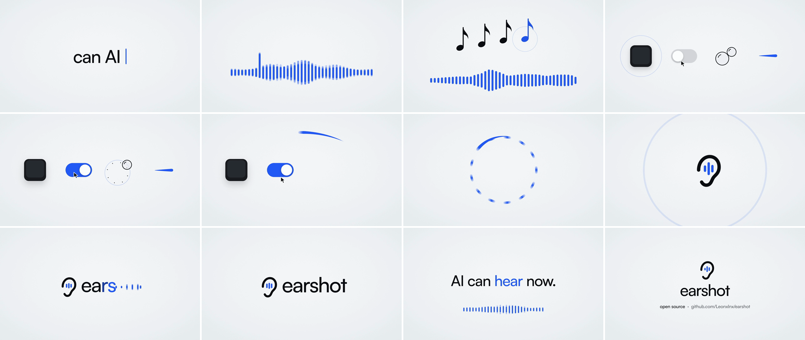

# AI 视频声音工作流：从六个网站到可追溯的配乐、环境音与动作音效

> 来源：[三个三的 X 帖子](https://x.com/3three_AI/status/2114545802211103044)，发布于 2026 年 10 月 26 日；官网与代码核查于 10 月 27 日。本文按原帖日期归档。六个入口是 Pixabay Music、Freesound、効果音ラボ、Mixkit、ElevenLabs Sound Effects 和 Leonxlnx/earshot。

画面里有人推门进来，声音却只有一条从头铺到尾的音乐；镜头换了房间，环境没有变化；按钮已经按下，点击声才慢半拍出现。这些问题，换一个视频生成模型未必能解决。

原帖列出的六个资源，适合按声音职责理解：配乐管情绪和节奏，环境音交代空间，动作音让事件落地，转场音强调少数重要变化，生成工具补缺，程序化工具负责可调音效和时间证据。它们有重叠，但不必每条视频都用全套。

*上图是原帖所用 earshot 演示拼图的官方高分辨率版本，不是这六个网站共同完成的成片，也不是本次制作结果。*

## 1. 六个入口各自解决什么问题

| 资源 | 主要用途 | 更有效的寻找方式 |
|---|---|---|
| [Pixabay Music](https://pixabay.com/music/) | 现成背景音乐 | 按情绪、风格与段落长度找候选，不只看曲名 |
| [Freesound](https://freesound.org/) | 环境录音、拟音、零散声音素材 | 把物体、材质、动作、距离和空间组合成关键词 |
| [効果音ラボ](https://soundeffect-lab.info/) | 日常、战斗、演出、按钮等分类音效 | 用日语分类与动作词缩小范围 |
| [Mixkit Transition](https://mixkit.co/free-sound-effects/transition/) | whoosh、sweep、impact 等剪辑强调音 | 根据运动方向、速度与力度选择，不给每个切点配同一种声音 |
| [ElevenLabs Sound Effects](https://elevenlabs.io/sound-effects) | 文字描述生成音效与氛围 | 写清声音主体、动作、材质、空间和不想要的背景 |
| [earshot](https://github.com/Leonxlnx/earshot) | 程序化音效、候选分析与声画同步证据 | 把素材变成可测量结果，再由人确认听感 |

核查时，Pixabay 首页仍标注超过 30 万首音乐，Freesound 显示 737,948 条声音；这些是网站规模快照，不是质量排名。効果音ラボ可以确认有日语搜索和分类，但本次没有独立核算原帖所说的两千多种素材。Mixkit 的转场页显示 42 条，整个站点不止转场音效。[Pixabay](https://pixabay.com/music/)、[Freesound](https://freesound.org/)、[Mixkit 转场页](https://mixkit.co/free-sound-effects/transition/)

## 2. 前四个是素材入口，检索时先想声音发生了什么

Pixabay 适合先找音乐候选，但音乐不能代替场景声音。对音乐驱动的产品片，可以先定节拍再组织画面；对有对白的故事，则应先保证对白和关键事件清楚，再让音乐让位。这是本文的剪辑建议，不是必须照着执行的网站顺序。

Freesound 的价值在具体录音。搜索“电影感”通常太宽；“室内近距离木门轻关”“雨落金属屋顶，远处车辆经过”更接近声音本身。选段时还要检查底噪、尾音和录音距离，不能只凭文件名认为它适合当前镜头。

効果音ラボ把生活、机械、环境、按钮等声音分得直观。需要雨声、脚步或开门时，可以尝试 `雨`、`足音`、`ドア` 这样的日语词。Mixkit 则能较快找到短促转场候选，官网说明音效可免注册下载；有意保留安静的切镜，也完全可以不加 whoosh。[効果音ラボ](https://soundeffect-lab.info/)、[Mixkit 音效入口](https://mixkit.co/free-sound-effects/)

## 3. ElevenLabs 补缺，earshot 解决的是另一类问题

当素材库缺少特定动作与材质组合时，文字生成更有用。比如可以先描述“一个沉重金属门闩在狭小室内滑入锁孔，短促、干燥、无音乐、无人声”，再根据实际输出调整。这里是提示词示意，本次没有调用生成或试听结果。

ElevenLabs 的入口是托管模型服务。earshot 的 `sfx` 则从包内的代码配方渲染声音，两者不能统称为同一种“AI 音效生成”。

原帖写 earshot 有 201 种声音。检查其 0.4.0 提交 `591fa3e` 时，四个音效库 JSON 文件合计 **252 个不重复音效 ID**：183 个既有配方、51 个新增配方、15 个拟合条目和 3 个拨弦条目。它们是可渲染条目，不是 252 个训练模型，也不等于 252 类互不相似的声音。[固定版本音效库](https://github.com/Leonxlnx/earshot/tree/591fa3e028032e6dce56620a20e932e35667e8d8/earshot/forge/bank)

更实用的部分是参数和同步点：声音能按时长、峰值位置、音高等调整；`kit` 给每个角色保存音效选择和测得的 onset、peak、end，供后续渲染器或混音器放到 cue 上。音频文件的开头不一定就是应该对齐画面动作的时刻。[音效库实现](https://github.com/Leonxlnx/earshot/blob/591fa3e028032e6dce56620a20e932e35667e8d8/earshot/forge/bank.py)、[kit 实现](https://github.com/Leonxlnx/earshot/blob/591fa3e028032e6dce56620a20e932e35667e8d8/earshot/forge/kit.py)

*这是上游针对其演示片生成的分析图。图内数字与标签属于该示例，不是本文对任意视频的测量结果；标签也不应视为逐项准确的人工标注。*

earshot 还提供候选匹配、长录音选段、时间轴和测量工具。它自己的限制文档明确承认，混音中的事件标签只是线索，参考评分范围来自少量发布片，不能证明音乐美不美、品牌合不合适或素材有没有版权。`sfx` 渲染无需模型推理和网络，不代表完整安装没有依赖；语义分析仍使用音频模型，可选 Gemini 意见还会在明确同意后上传音频。[能力边界](https://github.com/Leonxlnx/earshot/blob/591fa3e028032e6dce56620a20e932e35667e8d8/docs/LIMITS.md)、[上传边界](https://github.com/Leonxlnx/earshot/blob/591fa3e028032e6dce56620a20e932e35667e8d8/earshot/llm.py)

## 4. “免费”要拆成下载、商用和再分发三件事

下面只概括已读官方说明，不替代具体素材和项目用途的许可判断。

| 来源 | 需要保留的授权边界 |
|---|---|
| Pixabay | 内容许可允许免费使用、改编且通常不强制署名，但禁止基本原样的独立再销售或分发；还可能涉及其他权利 |
| Freesound | 逐条区分 CC0、CC BY、CC BY-NC；署名义务和非商业限制不能因为“免费下载”而忽略 |
| 効果音ラボ | 允许免费商用且无需强制署名，但禁止再分发、AI 训练及妨碍他人使用的权利登记等用途 |
| Mixkit | Sound Effects Free License 支持商业与非商业成品；禁止单独作为素材、工具或模板内容再分发，也禁止权利管理登记 |
| ElevenLabs | 当前音效页面区分免费用户的非商业用途与付费账户的商业用途；不能把免费试生成默认当成客户交付授权 |
| earshot | 代码采用 MIT；自带拟合配方另有来源记录。分析或拟合外来素材，不会自动改变原素材的许可 |

来源：[Pixabay 许可摘要](https://pixabay.com/service/license-summary/)、[Freesound FAQ](https://freesound.org/help/faq/)、[効果音ラボ条款](https://soundeffect-lab.info/agreement/)、[Mixkit 音效许可](https://mixkit.co/license/modal/sfxFree/)、[ElevenLabs 音效 FAQ](https://elevenlabs.io/sound-effects)、[earshot 来源说明](https://github.com/Leonxlnx/earshot/blob/591fa3e028032e6dce56620a20e932e35667e8d8/docs/CREDITS_FIT.md)。

尤其要分清“配进自己的成片”和“装进素材库供别人取用”。効果音ラボ明确把编辑器默认音效库、音效分发包等列为再分发场景。素材可以用于某类视频，不代表可以随软件、模板或公开仓库一起发出去。

Freesound FAQ 也说明，合法取得的声音仍可能遇到平台版权匹配。因此项目里最好留一张素材表：文件名、作者、原始页面、许可、获取日期、修改方式和最终使用位置。许可证解决使用依据，不保证平台永远不产生误报。

## 5. 怎样把资源表变成一条可验收的时间线

以下是本文建议的轻量流程，不是本次完成的一支实测影片：

1. **先定声音主角。** 对白片优先人声与动作；音乐片先确定节奏。不要让所有轨道争抢注意力。
2. **铺空间，再补动作。** 用连续环境声维持场景，再把开门、落脚、拿起物件等声音对准事件；换景时检查空间是否也需要变化。
3. **只强调重要变化。** 给少数转折、揭示或运动加转场音，普通切镜不必全部出声。
4. **找不到再生成或合成。** 特定材质与动作可试文字生成；按钮、点击和运动图形可试程序化配方。按声音任务选择工具。
5. **最后回听与留证。** 检查对白遮蔽、突兀尾音、循环接缝和声画时差；测量可辅助定位问题，最终听感仍需人工确认。

本次确认了原帖六个链接、阅读了各站说明与相关授权，并对 earshot 音效库做了结构化计数。没有批量下载音频、调用付费模型、进行试听盲评或制作成片。配图和来源记录保存在 [SOURCES.md](imgs/ai-video-six-audio-sources/SOURCES.md)。此前的 [earshot 专题](../2026-10-16/2026-10-16-earshot-agent-audio-evidence-layer.md) 可作为进一步的技术阅读。

这六个入口解决的是不同工种：找音乐、找真实空间、补动作、强调剪辑、生成缺失素材、检查时间和电平。成片是否成立，取决于这些声音如何服务同一段画面，而不是时间线上堆了多少条音轨。
