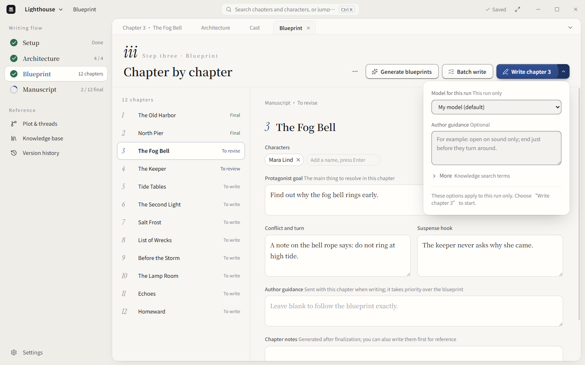
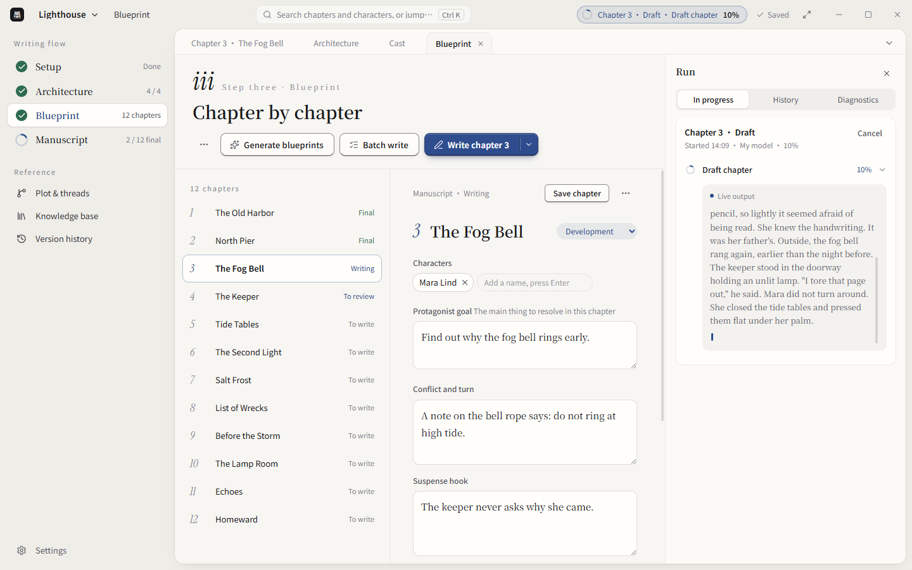

# Pagekin: An Author-Controlled Workflow for Planning, Drafting, Reviewing, and Finalizing Fiction

> Source review: October 26, 2026. Repository: [EthanYoQ/AI-Novel-Writer](https://github.com/EthanYoQ/AI-Novel-Writer), now named Pagekin. This article examines commit `62880d6`. The latest formal release at review time was v1.3.2, published October 22. That release and the inspected master commit are different snapshots; source observations below are not installer verification.

Generating a chapter is the easy part to demonstrate. Managing the next one is harder: which character state is current, which revision was accepted, whether a review finding is actually valid, and which text should count as established story history.

Pagekin addresses that workflow. It is a local-first desktop writing application, not a bundled language model. Authors connect their own model service, then work through story architecture, chapter blueprints, manuscript editing, and review. Its useful question is whether it reduces material confusion and accidental changes, not whether it introduces a newly capable fiction model. [Project overview](https://github.com/EthanYoQ/AI-Novel-Writer/tree/62880d629af7bbfaf968c0cda5ae76816e917915)

*All four English images are upstream-provided 1.3.0 interface assets showing a sample project. They are not screenshots from an application session or writing run performed for this article.*

## 1. From Story Plans to Chapters, Without an Ever-Growing Chat

Pagekin divides work into setup, architecture, blueprints, and manuscript. Premise, characters, worldbuilding, and plot outline become editable project material, then feed chapter-level goals, conflicts, turns, hooks, and cast lists.

Hierarchical planning is familiar. The practical benefit is keeping those materials editable and connected to the chapter being written, instead of repeatedly assembling a large prompt by hand.

Manuscript work separates drafting, review, revision, and finalization. Batch generation can accelerate production, but generated chapters still need to be treated as candidates. The README also describes inline continuation, polishing, expansion, version history, and comparison tools. Their actual usefulness requires evaluation with a real manuscript.

## 2. Context Depends on What Has Actually Happened

The implementation is more specific than sending character biographies and previous prose to a model. `chapter-materials.ts` distinguishes author facts, future plans, finalized material, candidate drafts, and reference sources. It records source identities, versions, content hashes, and reasons for omissions.

That distinction matters in fiction: a betrayal planned for a later chapter has not happened yet. A character killed in an unaccepted candidate is not necessarily dead in the story. Input assembly needs to preserve these differences instead of treating every available document as canon.

It is also inaccurate to summarize the current implementation as always inserting the entire previous chapter. The assembler selects relevant source passages, neighboring evidence paragraphs, and the previous chapter's ending. A candidate explicitly required as the continuation predecessor can instead be included in full. Mandatory materials, including author facts and character information, produce a capacity conflict when they cannot fit rather than being silently truncated. [Material assembly](https://github.com/EthanYoQ/AI-Novel-Writer/blob/62880d629af7bbfaf968c0cda5ae76816e917915/src/services/workflows/chapter-materials.ts)

The budget planner also distinguishes verified provider limits from user estimates and unknown limits. This makes capacity problems more explicit, but estimates are not exact bills, and retrieval can still miss the detail that matters to the plot. [Budget planner](https://github.com/EthanYoQ/AI-Novel-Writer/blob/62880d629af7bbfaf968c0cda5ae76816e917915/src/services/generation/task-budget-planner.ts)

## 3. A Review Is Advice Until the Author Selects It

A model reporting a contradiction does not establish that one exists. Its proposed background explanation is not automatically part of the author's worldbuilding either.

In `human-confirmed-review.ts`, author confirmation is stored as a separate snapshot while the original AI review remains intact. The revision brief is constructed from selected actionable items and author guidance, rather than forwarding the entire report unchanged. Ignored findings are excluded from that brief. The generated instructions explicitly distinguish an AI-proposed remedy from an author-established fact. [Human-confirmed reviews](https://github.com/EthanYoQ/AI-Novel-Writer/blob/62880d629af7bbfaf968c0cda5ae76816e917915/src/shared/human-confirmed-review.ts)

Revision context is also bound to a particular draft, version, and content. If the author changes the manuscript after review, an old confirmation cannot silently apply to the new text: the main process checks that its source still matches. [Revision source validation](https://github.com/EthanYoQ/AI-Novel-Writer/blob/62880d629af7bbfaf968c0cda5ae76816e917915/electron/services/review-revision-context.ts)

These safeguards prevent workflow mistakes. They do not establish that a review is correct. Reading the source passage and deciding whether to merge a revision remain author responsibilities.

## 4. Finalization and Local File Output Are Separate States

`finalization-service.ts` draws a useful boundary: the committed SQLite snapshot is authoritative, while the local manuscript file is a recoverable output.

Finalization stores the content, revision, and hash in a database transaction together with an output record. File output happens afterward. If that step fails, the application can report that finalization committed but file output is pending, rather than implying that nothing was saved. A retry reads the frozen content instead of substituting whatever happens to be in the editor at that moment. [Finalization service](https://github.com/EthanYoQ/AI-Novel-Writer/blob/62880d629af7bbfaf968c0cda5ae76816e917915/electron/services/finalization-service.ts)

The implementation's term `publication` means local manuscript output, not publication to a fiction platform. This review did not test power-loss recovery or the complete database integration. Separating these states is a meaningful design choice, not proof that data loss is impossible.

## 5. Retrieval and Skills Supply Material and Guidance

The knowledge base supports local full-text retrieval without an embedding service. Semantic retrieval requires a separately configured embedding model, and the code includes full-text fallbacks for unavailable vector queries or mismatched embedding spaces. No embedding service does not mean no search; adding embeddings does not create perfect long-form memory. [Knowledge-base implementation](https://github.com/EthanYoQ/AI-Novel-Writer/blob/62880d629af7bbfaf968c0cda5ae76816e917915/electron/knowledge-base.ts)

Writing Skills are textual guidance scoped to planning, drafting, review, or refinement, with supported referenced text. This is not a general-purpose Agent execution environment. A package's scripts, hooks, or tool declarations do not become executable merely by importing it. The loader also restricts file types, sizes, and paths, rejecting inputs such as symlinks. [Skill definitions](https://github.com/EthanYoQ/AI-Novel-Writer/blob/62880d629af7bbfaf968c0cda5ae76816e917915/src/shared/writing-skills.ts), [package reader](https://github.com/EthanYoQ/AI-Novel-Writer/blob/62880d629af7bbfaf968c0cda5ae76816e917915/electron/services/writing-skill-package.ts)

This limits foreign-code execution, but imported instructions can still misdirect writing. They should be read before installation.

The run panel places task output, history, and diagnostics beside the editor. The README also describes recovering partial failed output as a candidate rather than automatically treating it as a finalized chapter. For long tasks, seeing what ran and what remains is more useful than an indefinite spinner.

## 6. Local-First Is Not a Promise That Nothing Leaves the Computer

Projects are managed locally, but using a cloud model sends selected manuscript passages and planning material to that provider. Remote embedding services create another data boundary. WebDAV is an optional backup destination, not an unconditional offline-storage guarantee.

Model connections primarily use OpenAI-compatible Chat Completions or native Gemini. Ollama uses its compatible `/v1` endpoint. Accepting a custom URL does not establish support for every provider's native protocol.

The desktop application uses GPL-3.0 and offers Windows and Mac releases. The README states that Windows packages are unsigned and Mac packages are ad-hoc signed without Apple notarization. Check official releases and checksum information; open source does not mean an installer has passed platform security review. [Installation and model setup](https://github.com/EthanYoQ/AI-Novel-Writer/tree/62880d629af7bbfaf968c0cda5ae76816e917915), [v1.3.2 release](https://github.com/EthanYoQ/AI-Novel-Writer/releases/tag/v1.3.2)

## 7. What Was Tested, and What a Useful Trial Looks Like

Dependencies were installed at the pinned commit with installation scripts disabled. **Eight test files passed, totaling 184 tests.** Coverage included selected rules for human-confirmed reviews, writing Skills, continuity preflight, chapter-goal review, review reports, task budgets, and finalization snapshots.

No Electron application was launched, no real model was called, and native SQLite integration, installers, and long-form writing quality were not tested. Passing these tests establishes behavior for the tested inputs, not better novels. Commands and media provenance are recorded in [SOURCES.md](imgs/pagekin-local-first-novel-writing-workflow/SOURCES.md).

A useful trial would use two chapters of your own non-sensitive writing and deliberately introduce a fact that is easy to confuse: a key will be lost later, but the protagonist still has it now. Check whether drafting prematurely executes that future event and whether review cites the right source. Then change the manuscript, try applying the old review, and check consistency across finalization, export, and backup restoration.

**Pagekin's strongest proposition is separating creative material, candidate text, and author-accepted results. Outlines and retrieval are familiar techniques. Turning them into a daily workflow that authors can inspect, edit, and reject is the practical value this application needs to deliver.**
