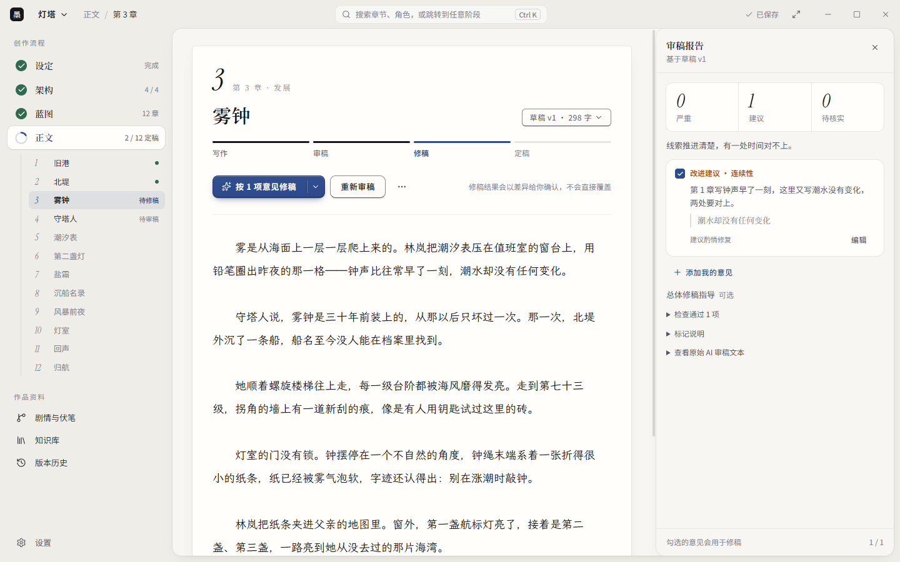
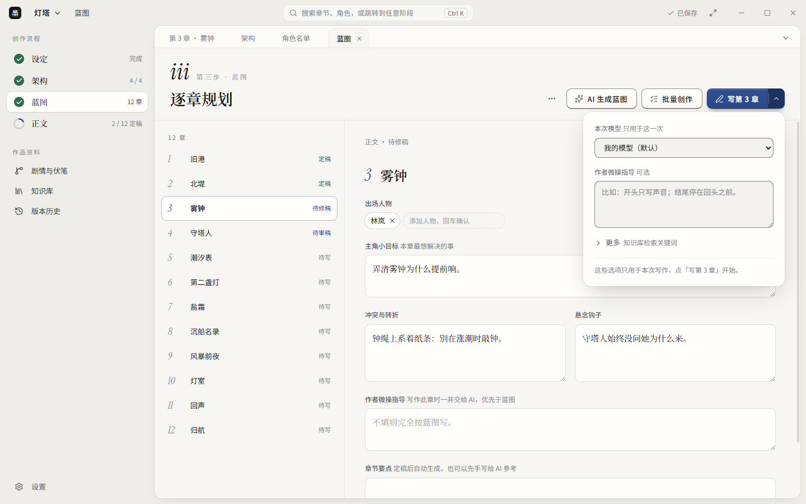
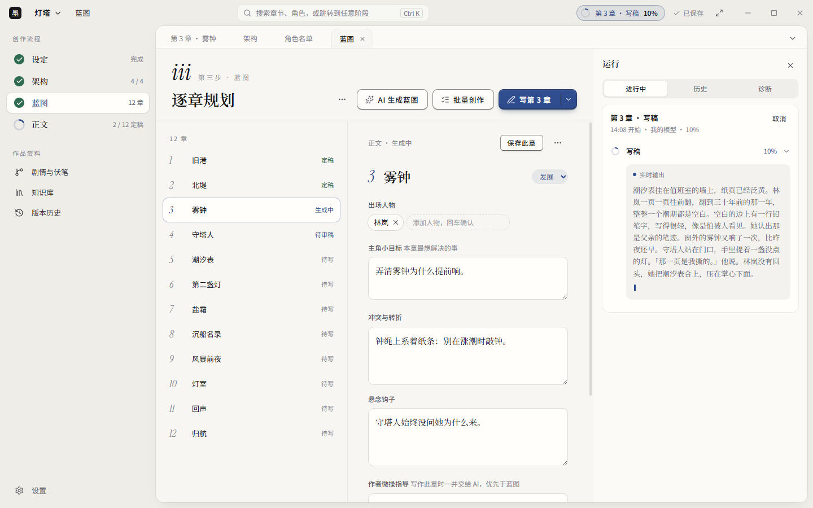

# 书童 Pagekin：把小说设定、写稿、审稿与定稿组织成作者确认的工作流

> 源码阅读日期：2026 年 10 月 26 日。项目：[EthanYoQ/AI-Novel-Writer](https://github.com/EthanYoQ/AI-Novel-Writer)，现名「书童 Pagekin」。本文检查 `62880d6` 的源码；当时最新正式 Release 为 10 月 22 日的 v1.3.2。当前主分支与该发行包不是同一个提交，下文源码机制不等于逐项验证过安装包。

AI 写小说最容易演示的是生成一章，最难管理的是下一章：人物状态改没改，上一版到底采用了没有，审稿模型指出的问题是否成立，重新生成后又该相信哪一份。

书童 Pagekin 的重点就在这些环节。它是一款本地优先的桌面写作软件，不自带语言模型；作者配置自己的模型服务，再通过作品架构、章节蓝图、正文编辑和审稿流程推进小说。它的价值应当按「能不能减少资料混乱和误操作」来判断，而不是按「有没有发明一种更会写小说的模型」来判断。[项目说明](https://github.com/EthanYoQ/AI-Novel-Writer/tree/62880d629af7bbfaf968c0cda5ae76816e917915)

*本文四张中文图均为上游仓库提供的 1.3.0 界面素材，展示示例作品，不是本次启动软件或生成小说得到的截图。*

## 1. 从作品设定走到章节，而不是不断追加聊天记录

Pagekin 把写作组织为设定、架构、蓝图、正文四步。故事前提、人物、世界观和情节大纲先成为可编辑资料，再细化成每章的目标、冲突、转折、悬念以及出场角色。

这一套分层方法本身并不罕见。长篇创作真正需要的是：作者能持续修改这些资料，知道当前章对应哪份计划，不必每次手工把所有设定拼成一个超长提示词。

正文阶段则分为写稿、审稿、修订和定稿。批量写作可以提高推进速度，但批量产出仍应视为待检查材料，而不是自动认可的成稿。README 说明还包括内联续写、润色、扩写、历史版本和差异查看等编辑能力；这些功能的实用性最终取决于真实作品中的操作体验。

## 2. 上下文最重要的区别，是哪些东西已经发生

源码比「把人物小传和前文发给模型」更细。`chapter-materials.ts` 将作者事实、未来计划、已定稿内容、候选稿和参考材料区分开来，并记录所用来源、版本、内容哈希以及遗漏原因。

这种区分有直接的创作意义：未来大纲里的背叛尚未发生；某个候选稿里写死的人物，也不能直接成为后续章节的既定事实。系统至少需要在输入组织层面保留这些差别，而不是把所有文本一股脑当成正史。

还有一个容易误解的细节：不能把它概括成「每次都塞入上一章全文」。当前材料组装器会选择相关原文段落、证据附近的段落和上一章结尾；明确要求作为续接来源的候选稿，则可以作为完整的必需材料。作者事实、人物资料等必需材料装不下时，会产生容量冲突，而不是默默截掉后继续。[材料组装源码](https://github.com/EthanYoQ/AI-Novel-Writer/blob/62880d629af7bbfaf968c0cda5ae76816e917915/src/services/workflows/chapter-materials.ts)

预算规划器也区分已验证的服务商限制、用户估计和未知限制。这让容量问题更容易暴露，但预算估算不是精确账单，也不能保证检索一定找到那个决定剧情的细节。[预算规划源码](https://github.com/EthanYoQ/AI-Novel-Writer/blob/62880d629af7bbfaf968c0cda5ae76816e917915/src/services/generation/task-budget-planner.ts)

## 3. 审稿结果不是命令，作者选择后才进入修订

模型审稿常有一个危险：它说某处矛盾，并不意味着真的矛盾；它建议补充背景，也不代表那段背景属于作者设定。

Pagekin 的 `human-confirmed-review.ts` 为作者确认结果保存独立快照，保留原始 AI 审稿记录。修订简报从被选择执行的条目和作者指导生成，而不是原样转发整份审稿报告；忽略的条目不会混入这份执行简报。代码也明确提醒：AI 建议的补救办法不能自动当成作者事实。[作者确认机制](https://github.com/EthanYoQ/AI-Novel-Writer/blob/62880d629af7bbfaf968c0cda5ae76816e917915/src/shared/human-confirmed-review.ts)

同时，修订上下文绑定具体草稿及其版本、内容。作者若在审稿后修改正文，旧确认不能悄悄套用到新稿上。主进程会检查来源是否仍匹配。[修订来源检查](https://github.com/EthanYoQ/AI-Novel-Writer/blob/62880d629af7bbfaf968c0cda5ae76816e917915/electron/services/review-revision-context.ts)

这类保护能避免流程上的错用，不能证明审稿意见正确。作者仍然要读原文、判断问题，再决定是否合并修订。

## 4. 定稿与本地文件输出，是两件需要分别报告的事

`finalization-service.ts` 采用的边界很清楚：SQLite 中提交的定稿快照是事实来源，本地实体稿文件是可恢复的输出。

定稿时，内容、修订号和哈希随数据库事务保存，并写入待输出记录。之后才生成本地稿件文件。如果文件写入失败，系统可以报告「定稿已提交，文件输出待重试」，而不是让作者误以为整个定稿从未发生。重试读取已经冻结的内容，不临时拿编辑器里的另一版正文来替换。[定稿服务](https://github.com/EthanYoQ/AI-Novel-Writer/blob/62880d629af7bbfaf968c0cda5ae76816e917915/electron/services/finalization-service.ts)

这里代码中的 `publication` 指本地稿件输出，不是向小说网站发布。本文也没有验证断电恢复或完整数据库集成行为；值得肯定的是源码将这些状态分开，而不是据此宣布数据永不丢失。

## 5. 知识库与 Skill 提供材料和指导，不是新模型

知识库默认支持本地全文检索，语义检索需要另配向量模型。源码包含向量查询不可用或嵌入空间不匹配时退回全文检索的路径。因此，没有 embedding 服务不等于完全不能查资料；反过来，装了向量检索也不等于获得完整长篇记忆。[知识库实现](https://github.com/EthanYoQ/AI-Novel-Writer/blob/62880d629af7bbfaf968c0cda5ae76816e917915/electron/knowledge-base.ts)

写作 Skill 则是按规划、写稿、审稿、修订阶段加入的文字指导，支持导入相应的 Skill 文本及受支持的引用文本。当前机制不是通用 Agent 执行环境，不会因为一个包里带有脚本、Hook 或工具声明就执行它们。加载器还限制文件类型、大小和路径，拒绝符号链接等不合要求的输入。[Skill 类型](https://github.com/EthanYoQ/AI-Novel-Writer/blob/62880d629af7bbfaf968c0cda5ae76816e917915/src/shared/writing-skills.ts)、[包读取器](https://github.com/EthanYoQ/AI-Novel-Writer/blob/62880d629af7bbfaf968c0cda5ae76816e917915/electron/services/writing-skill-package.ts)

这降低了执行外来代码的风险，但外来提示词仍可能误导写作，安装前依然要读内容。

运行侧页把任务输出、历史和诊断放在编辑流程旁边。README 还说明，失败后的部分输出可以作为恢复候选处理，不会直接成为定稿。对长任务来说，能看见运行到哪里、留下了什么，比只有一个转圈图标更有用。

## 6. 本地优先，不代表内容永远不离开电脑

作品在本机管理，但配置云模型后，被选入提示词的正文和设定仍会发往对应服务商；远程向量服务也有自己的数据边界。WebDAV 是可选备份目的地，不是默认的离线存储保证。

模型接入以 OpenAI 兼容的 Chat Completions 协议和原生 Gemini 为主；Ollama 使用兼容的 `/v1` 接口。不能把「能填一个 URL」理解成任意厂商的原生协议都已支持。

桌面应用采用 GPL-3.0，官方提供 Windows 和 Mac 发行包。README 明确说明 Windows 包未签名，Mac 包只有 ad-hoc 签名、未经过 Apple 公证。下载时应核对官方 Release 和校验信息，不能把开源身份等同于安装包已经接受平台安全审核。[安装与接入说明](https://github.com/EthanYoQ/AI-Novel-Writer/tree/62880d629af7bbfaf968c0cda5ae76816e917915)、[v1.3.2 Release](https://github.com/EthanYoQ/AI-Novel-Writer/releases/tag/v1.3.2)

## 7. 本次验证了什么，实际试用又该看什么

本次在固定提交安装依赖时关闭安装脚本，并运行了 8 个测试文件，**184 项测试全部通过**。范围包括作者确认审稿、写作 Skill、连续性预检、章节目标审稿、审稿报告、任务预算和定稿快照等局部规则。

没有启动 Electron，没有调用真实模型，也没有验证原生 SQLite 集成、安装包或长篇小说质量。测试通过说明这些被测规则在测试输入下成立，不说明软件一定能写出更好的小说。完整命令和素材来源保存在 [SOURCES.md](imgs/pagekin-local-first-novel-writing-workflow/SOURCES.md)。

最值得做的试用，是拿两章自己的非敏感文本，故意设置一个容易混淆的事实：未来某章才会丢失的钥匙，现在仍在主角身上。观察生成稿是否提前用掉未来事件，审稿是否能引用正确出处；随后修改正文，再尝试采用旧审稿，最后检查定稿、导出与备份恢复是否一致。

**Pagekin 值得关注的是把创作资料、候选内容和作者认可的结果分开管理。分层大纲与检索不是稀奇的发明，把这些约束做成作者能看懂、能修改、能拒绝的日常工作流，才是这款产品需要交付的实际价值。**
