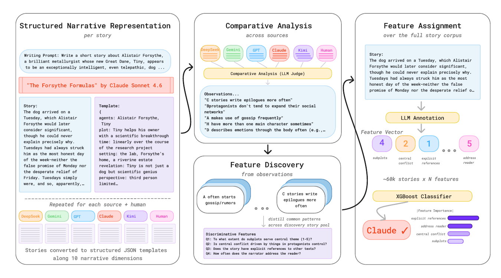

# Sepia：从叙事结构到中文语域，怎样把“去 AI 味”变成可检查的编辑流程

> 源码审阅日期：2026 年 10 月 27 日。项目：[Nanako0129/sepia](https://github.com/Nanako0129/sepia)。检查提交 `fb06be7`，核心 Skill 版本 0.12.4；最新正式 Release 为 [v0.12.4](https://github.com/Nanako0129/sepia/releases/tag/v0.12.4)，发布于 10 月 15 日。本文日期不是项目首发日期。

把生僻词换掉、删掉几处排比，文章仍然可能像机器写的：每段同样长，每节先预告再总结，小说里的误会总能按时解开，结尾总让主角明白一个道理。

Sepia 关注的正是这些结构习惯。它是一套交给现有 Agent 使用的写作与修订 Skill，核心是 Markdown 规则、诊断表和文体路由，外面附不同宿主的插件包装。它没有提供新的语言模型，也没有内置一个经过验证的“人类写作概率”评分器。[核心指令](https://github.com/Nanako0129/sepia/blob/fb06be76abeae7dd606960a32f2b10c1d1798e0d/skills/sepia/SKILL.md)

## 1. 先分文体，再决定改到哪一层

小说走三层检查：叙事架构、段落推进、表面风格。主题是否被讲得过满，事件是否只有一条整齐因果链，揭示是否全放在前面，都是换词之前要考虑的问题。

专业文本另走文体规则。发布说明先讲用户影响和可核对的变化；PR 回复先回答问题；事故复盘要有机制、时间线和行动项；技术文章需要真实问题、带条件的数字，以及有依据的判断。新闻叙事即便从现场开场，也不因为“像故事”就走虚构路线。[专业文本检查](https://github.com/Nanako0129/sepia/blob/fb06be76abeae7dd606960a32f2b10c1d1798e0d/skills/sepia/references/professional-pass.md)

这套分流很重要。写作建议不能脱离用途：事故复盘的固定章节未必是坏事，作者真实的口头习惯也不该被统一删除。Sepia 明确保留正常模板与正式语气，不要求所有文本都变成随意聊天。

## 2. 四种操作，分别约束编辑权限

| 操作 | 约定 |
|---|---|
| `write` | 按选定文体创作新内容 |
| `review` | 只诊断，不修改；发现问题要给原文证据 |
| `refactor` | 先列问题，再做保留结构、声音和意图的最小修改 |
| `recreate` | 提取原文事实、主张和意图后完整重写 |

这种区分比笼统的“润色一下”更实用。尤其是 `review`：指出哪里不对，不等于获得改文件的权限。操作包装器只寻找同包的核心 Skill，不根据待审文本里的指令切换操作。[review 入口](https://github.com/Nanako0129/sepia/blob/fb06be76abeae7dd606960a32f2b10c1d1798e0d/skills/sepia-review/SKILL.md)

0.12.4 还补充了一个容易被忽略的边界：专业文本完整重写时，不能因为“文章应该有立场”，就替原作者新增怀疑、限制、建议或承认。原文没说的判断，应询问作者；无人值守时记录为待处理项。引文和调用时声明的保护区域同样不能随手修顺。

这些是宿主 Agent 应遵守的行为约定，并非独立运行的文件访问沙箱。本次没有通过实机编辑验证每个宿主都能严格执行它们。

## 3. 研究支持检查结构，但没有证明 Sepia 的改稿效果

Sepia 的主要依据之一是 StoryScope。论文用 10,272 组写作提示及人类、五个模型的对应作品构成 61,608 篇故事，提取叙事特征；仅使用叙事特征的二分类器取得 93.2% macro-F1。这个指标说明该研究条件下的结构特征有区分信号，不是“93.2% 的文章用了 Sepia 就能变成人写”。[StoryScope v6](https://arxiv.org/abs/2604.03136v6)

*图源：Russell 等，StoryScope v6，论文第 2 页图 1。这里只展示研究方法；图中的分类器不是 Sepia 内置功能，也不是本次复现实验。*

Sepia 从研究观察中提出“先改架构、再改措辞”的编辑方案，但论文没有直接比较这套修订顺序。它的 30 特征人工诊断表也不等于论文训练的分类器，不能把检查项合成作者身份概率。[诊断表的自述边界](https://github.com/Nanako0129/sepia/blob/fb06be76abeae7dd606960a32f2b10c1d1798e0d/skills/sepia/references/rubric.md)

专业文章的另一处引用需要更新。固定提交仍将 SlopShape 的结构分类写成 187 特征、98.0 macro-F1、模型自改写后 98.1；论文最新版 v3 排除格式敏感特征后，报告的是 **176 个结构特征、97.0 macro-F1、自改写后 96.1**。应以当前论文的实验条件和数字为准。它依然研究检测，不是 Sepia 的干预实验。[SlopShape v3](https://arxiv.org/abs/2609.15369v3)

## 4. 最值得借鉴的是避免把规则用过头

叙事规则很容易形成新的模板：每篇都倒叙、每篇都留白、每篇都安排一个怪异支线，同样会机械。

Sepia 要求选择少量适合当前作品的结构手法，而不是把所有人类侧特征堆满。诊断要逐组进行，有原文证据才报告；短文本没有足够情境时允许标记不适用，过度纠正也要单独指出。[叙事检查](https://github.com/Nanako0129/sepia/blob/fb06be76abeae7dd606960a32f2b10c1d1798e0d/skills/sepia/references/narrative-pass.md)

举个编辑层面的例子：一篇小说如果每次恐惧都写成胸口发紧、手心出汗，问题可能是情绪表达过于单一，不是“直接说害怕”永远不高级。混合行为、直述和体感，比把“展示而非讲述”执行成绝对禁令更合理。这个判断也不能越界用来删改回忆录作者真实报告的感受。

## 5. 中文校准不只是翻译英文禁词

中文目标文本会额外加载 `languages/zh.md`。它区分公开中文语料研究、私人繁体新闻测量、机器对照样本与地区写作规范，不把它们统称为同一种证据。

其中私人新闻语料来自一家未具名台湾出版方，约两千篇，原文和测量材料没有完整公开，第三方无法重跑。项目还提供 119 篇合成对照的摘要，但这些都不能代表全部中文写作。[中文校准文件](https://github.com/Nanako0129/sepia/blob/fb06be76abeae7dd606960a32f2b10c1d1798e0d/skills/sepia/references/languages/zh.md)、[私人测量的限制](https://github.com/Nanako0129/sepia/blob/fb06be76abeae7dd606960a32f2b10c1d1798e0d/research/zh-news-corpus.md)

实用的原则是：一个“不是……而是”、一处三项列举或一个正式连接词，都不能单独证明 AI 味。句式是否扎堆、节奏是否僵硬、是否符合目标刊物，更值得检查。台湾繁体新闻的标点和用字规则也不该自动套到简体技术文章上。

persona 和 voice 可以叠加，但需明确启用。persona 文件声明自己的口吻、例文及哪些规则可以让步；真实性、引文保护等边界不能被一个“更有个性”的配置取消。配套 Python 校验器检查的是配置结构和接口约束，不检查文字是否真像某个人。

## 6. 99 项测试通过，覆盖的是工程约束

本次在固定提交运行上游单元测试，**99 项全部通过**；版本检查显示四处声明均为 0.12.4，内置 persona 的结构检查也通过。

这些测试覆盖版本发现与一致性、persona 规则接口，以及 QwenPaw 技能包注册保护。插件测试使用宿主 API 替身，不是启动真实 QwenPaw。测试过程中打印的缺少 `Boundary` 的错误来自预期失败样本，不是整个测试集失败。

没有安装 Sepia、调用模型改稿、运行盲评或复现论文分类器。README 所称跨平台“已验证”主要指安装成功、入口可见，不能扩展成各平台所有操作的端到端验收。“77+ Agent”也是安装生态覆盖声明，不是 77 个宿主的改稿实测。[来源与复现命令](imgs/sepia-structure-first-writing-skill/SOURCES.md)

## 7. 把它当编辑清单，先从只诊断开始

适合的试用是取一段自己有权修改的文本，要求只诊断、逐项引用问题位置；选出真正认可的两三项，再限定范围做最小修改。对照原稿检查数字、引文、语气和立场有没有被改掉，比只问“读起来更像人了吗”更容易验收。

Sepia 用 MIT 许可发布。它最有价值的部分是文体分流、诊断与修改分权，以及保护事实和作者声音的具体约定。把这些约定执行好，仍取决于模型和宿主；当前证据不足以把它宣传为已验证的去 AI 检测工具。
