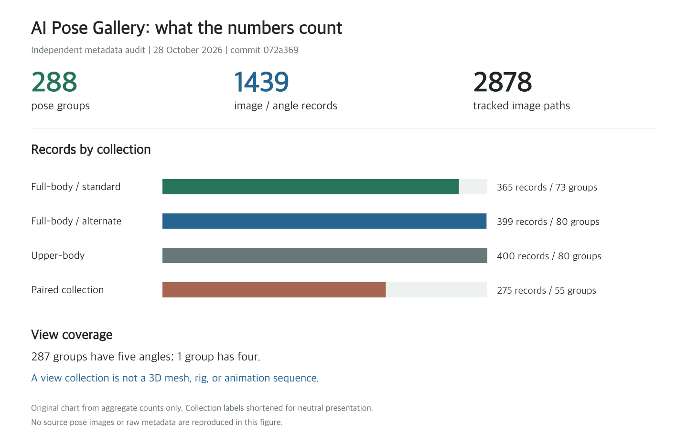

# AI Pose Gallery in Chinese: 288 Pose Groups, Static Search, and Asset Rights

> Source: [Anhao's X post](https://x.com/anhao_ai/status/2115070903386296398), dated October 28, 2026 in Melbourne. Reviewed the same day. Chinese project: [anhao/ai-pose-gallery-zh](https://github.com/anhao/ai-pose-gallery-zh), inspected at `072a369`. The original collection is maintained by ギア at [POSE-DB-01](https://ai-pose-gallery.pages.dev/).

Asking for this pose can be more direct than describing every limb. But three separate questions remain: whether a useful reference exists, whether the generation tool follows it accurately, and what the reference's license permits.

The Chinese AI Pose Gallery mainly addresses the first question. It translates Japanese metadata and adds filtering, grouped browsing, angle switching, and image-download controls. It is a static reference collection, not a newly trained pose model or a 3D editor with movable joints and rig export.

The source project includes adult-oriented categories. This article addresses data organization, general pose-reference use, and implementation without displaying that material. Because the original site explicitly restricts image-data redistribution, no source pose images are reproduced here; an independently generated count chart is used instead.

*Original chart generated from pinned metadata and the Git tree, not a gallery screenshot or an image-decoding/generation test. Two collection labels are shortened neutrally.*

## 1. The 1,439 Images Represent 288 Pose Groups

The frontend groups by collection plus pose number, rather than treating each image as a distinct pose. Structured checks found:

| Quantity | Meaning and result |
|---|---|
| Pose groups | 288 |
| Image/angle records | 1,439, with unique IDs |
| Image references | One thumbnail and one full image per record; 2,878 distinct paths, all tracked in Git |
| Angle coverage | 287 groups have five angles; one has four |
| Categories and angle types | 26 categories and five angle labels |
| Distinct names | 288 Japanese names but 287 Chinese translations |

The last result does not mean a group disappeared. Two different Japanese names translate to the same Chinese label for leaning forward with hands on knees; grouping keys and IDs remain separate. Save an ID and angle when recording a reference, not just its translated name.

Likewise, 2,878 files do not mean 2,878 different actions: the count includes thumbnail/full-image pairs. The project and viewer advertise 900-by-1,200 originals, but every image was not downloaded and decoded in this review. No complete dimensional or content validation is claimed. [Audit report](imgs/ai-pose-gallery-zh-reference-audit/data-audit.json), [grouping implementation](https://github.com/anhao/ai-pose-gallery-zh/blob/072a3690af6e7e0011abbe0fa1ccc08939fbb47d/index.html)

## 2. Localization Makes the Reference Material Easier to Find

The core interface is one HTML file. It fetches `data/pose-zh.json`, builds pose groups and search strings in the browser, and combines collection, category, angle, and keyword filters.

Grouped browsing supports choosing an action before comparing angles; individual-image browsing supports finding a particular view. Cards switch thumbnails, while the lightbox shows a small image before asynchronously loading the original. An incrementing token prevents a slow previous request from replacing the currently selected image during fast navigation.

These are concrete usability improvements beyond translated labels: fewer repeated cards, related views together, and a stable identifier for returning to a record. Search is local substring matching, not semantic understanding of an action or a vector-search service. [Page implementation](https://github.com/anhao/ai-pose-gallery-zh/blob/072a3690af6e7e0011abbe0fa1ccc08939fbb47d/index.html), [translation application](https://github.com/anhao/ai-pose-gallery-zh/blob/072a3690af6e7e0011abbe0fa1ccc08939fbb47d/scripts/apply_translation.py)

## 3. Multiple Views Are Not a 3D Asset or Motion Sequence

Five angles are still five 2D images. The inspected record schema stores names, angles, and image paths, not meshes, joint coordinates, rig hierarchies, calibrated cameras, or animation timelines.

The collection can help select framing, balance, and limb placement. It cannot directly export a character rig or establish strict geometric agreement across views. Actual pose adherence depends on the generation tool receiving the reference. Workflows requiring skeleton maps, depth, or animation need additional extraction, modeling, or rigging steps.

A small general-purpose trial would select an ordinary standing pose, retain its ID and angle, and keep character identity, clothing, and background as separate conditions. Change the pose and inspect limbs, support, and occlusion. That is a proposed acceptance test, not a model experiment performed here.

## 4. Open Code Does Not Mean Redistributable Images

The original site's notice allows free creative use, including commercial works, editing, and reference use, but prohibits redistribution, republication, or resale of the image data itself, including modified versions. It is not an unrestricted open-data license for mirroring the collection. [Original notice](https://ai-pose-gallery.pages.dev/)

The Chinese repository also separates the rights: its `LICENSE` limits MIT to code, excluding images and original data. Its current wording is nevertheless inconsistent: the license says those materials are not for commercial use, while the page's help repeats the original site's permission for commercial creative-reference use. Selecting just one sentence cannot settle every intended use. [Repository license](https://github.com/anhao/ai-pose-gallery-zh/blob/072a3690af6e7e0011abbe0fa1ccc08939fbb47d/LICENSE)

Mirroring and bulk publication require separate attention. Permission to use references in a work does not automatically authorize putting the full image set in a public repository. The translated help itself says permission for the mirror's public display and republication needs separate confirmation by its maintainer. No additional authorization document was obtained or verified here, so this article makes no determination that the mirror is or is not authorized.

For readers, keep the decisions separate: reuse code under its license, read the original creator's terms for specific images, and verify the intended application. MIT code licensing is not permission for training data, stock packs, template bundling, or republishing the collection. This describes the published terms and their differences, not clearance for a specific project.

## 5. Static Does Not Mean No External Requests

Filtering and grouping require neither a backend database nor a frontend framework build. But JSON is fetched over HTTP; a static site is not necessarily usable by double-clicking its HTML file. Its own error message asks users to check HTTP access and the data path.

The pinned version also loads an external analytics script. Static hosting of the gallery data therefore does not mean that version makes no third-party requests. Its actual telemetry payload was not analyzed; offline or privacy-sensitive deployments need a separate dependency review. [Pinned HTML](https://github.com/anhao/ai-pose-gallery-zh/blob/072a3690af6e7e0011abbe0fa1ccc08939fbb47d/index.html)

`verify.py` checks existence, minimum file size, and JPEG/PNG signatures. It does not fully decode images or establish anatomy, cross-view consistency, or permissions. A passing result would cover only those limited file checks. [Verification script](https://github.com/anhao/ai-pose-gallery-zh/blob/072a3690af6e7e0011abbe0fa1ccc08939fbb47d/scripts/verify.py)

## 6. What Was Actually Verified

This review read the post, Chinese source, original site's public notices, and both metadata JSON files. Eight independent structural checks passed, covering record and group counts, unique IDs, preserved original order and paths, unique tracked image references, and the four/five-angle distribution.

That does not establish that all 1,439 images are correct. A sparse checkout avoided fetching the full image set. No bulk downloader, gallery UI session, exhaustive visual inspection, or AI generation test was run. Only an original chart and aggregate results are published, not the underlying dataset. Reproduction instructions are in [SOURCES.md](imgs/ai-pose-gallery-zh-reference-audit/SOURCES.md).

The collection lowers the effort of finding and revisiting pose references. Chinese search, stable IDs, and grouped views are useful ideas. Geometric consistency, model adherence, and asset permissions remain separate questions to verify.
