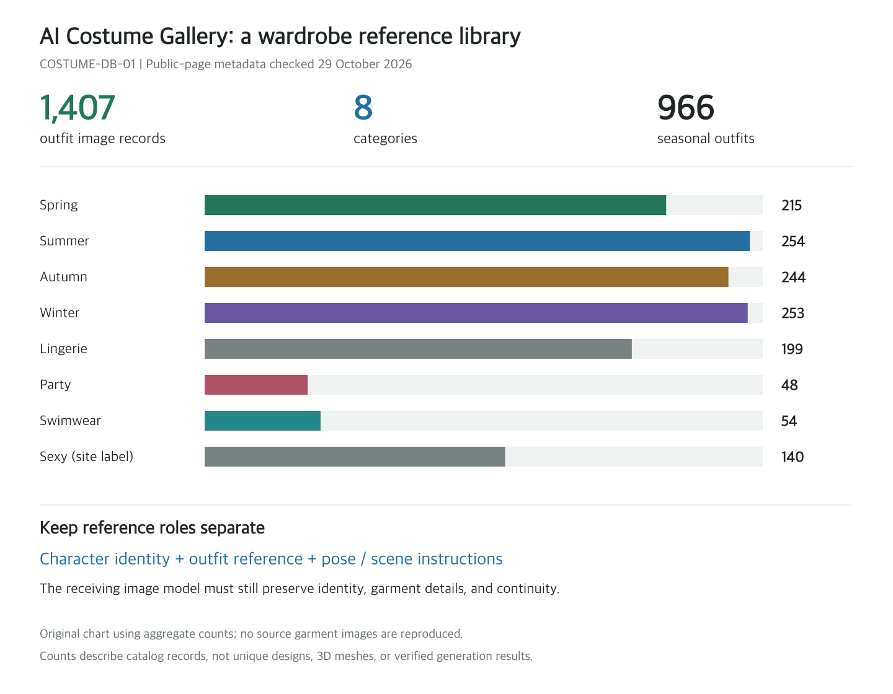

# AI Costume Gallery: 1,407 Person-Free Outfit References for Character Creation

> Source: [COSTUME-DB-01](https://ai-costume-gallery.pages.dev/), credited on the page to [ギア](https://x.com/giaaibusi). Reviewed October 29, 2026. The site's original launch date was not established; this is a review date, not a release announcement.

A useful outfit photograph often comes with unwanted instructions: the model's face, body, pose, and background. When an image generator receives that photograph, which parts should it borrow?

AI Costume Gallery offers a straightforward starting point: two-dimensional images of outfits without the people wearing them. Creators can select clothing separately from character identity. It is a searchable reference collection, not an automatic virtual try-on model running in the browser.

The live page and its embedded metadata both contained **1,407 image records across eight categories**. Some categories cover lingerie, swimwear, and sexy styling. This review inspected ordinary spring outfits only. Because the site restricts redistribution of its images, the illustration below is an original aggregate chart, not a reproduction of the clothing artwork.

*Original chart derived from public-page metadata. Counts refer to catalog records, not deduplicated designs or successful generation tests.*

## 1. A Reference for the Whole Outfit

The site describes its images as person-free clothing references in a 2:3 format. Ordinary spring examples combine tops, bottoms, outerwear, footwear, bags, and accessories. Garments retain a worn silhouette without showing the wearer. That makes the reference closer to a complete character look than a product image of one shirt.

| Category | Records | Category | Records |
|---|---:|---|---:|
| Spring | 215 | Lingerie | 199 |
| Summer | 254 | Party | 48 |
| Autumn | 244 | Swimwear | 54 |
| Winter | 253 | Sexy styling | 140 |

The four seasonal collections total 966 records. These are organizational labels, not validation of insulation, fabric properties, or manufacturability.

The creator says the outfits are fictional, generated through text-to-image, and do not use actual product photographs. This describes the creator's stated provenance; generation logs were not independently examined. The collection should not be treated as a shopping catalog, a brand archive, or evidence of historical dress. [Site introduction and notices](https://ai-costume-gallery.pages.dev/)

## 2. IDs Make References Retrievable

The interface supports category selection, outfit IDs, and clothing keywords. In browser tests, `SPR-0001` returned one record. Searching all categories for `denim` returned 151; restricting the same query to spring returned 47. Independent metadata counts matched the latter two results.

The page script filters records locally. It applies the selected category, splits the query on whitespace, and requires every query term to match. Clothing tags use prefix matching, with a dictionary translating selected Japanese terms into English tags. This is not semantic search for a paragraph-long styling brief. For readers who do not know Japanese, existing English tags and complete IDs are practical search inputs. [Current page implementation](https://ai-costume-gallery.pages.dev/)

Opening a card provides an enlarged view, previous/next navigation, and an original-size PNG download link. The inspected `SPR-0001` enlarged preview decoded in the browser as a 1366×2048 WebP; its download link pointed to a separate PNG. Preview and download are different files. The original PNG was not downloaded, and this sample does not establish dimensions for the entire collection.

For production notes, save the site URL, outfit ID, and your own description of the details that matter. An ID is easier to retrieve than “the pale top,” while a written note can specify neckline, sleeve shape, hem length, and accessories. Search tags are not precise garment specifications.

## 3. Separate Clothing from Character Identity

The site's usage guidance recommends loading an outfit into an AI tool that supports clothing or image references, then supplying the face, body, and background separately. That division can help with character illustrations, comics, and storyboard preparation: each reference has a clearer job.

A bounded trial would be:

1. Choose an ordinary outfit, record its ID, and obtain the reference through its original-image link.
2. Prepare an authorized reference for a fictional adult character, explicitly separating identity and clothing inputs.
3. Keep pose and background fixed for the first image. Check identity, collar, layers, lengths, and accessories.
4. Then change pose or camera angle and inspect side views, rear views, occlusion, and continuity.

This is a proposed acceptance test, not an experiment completed for this article. Whether multiple references are supported or interpreted correctly depends on the receiving tool. The gallery does not itself ensure faithful clothing transfer or consistent garments across shots.

## 4. A Clothing Image Is Not an Editable Garment

The inspected records contain IDs, categories, keywords, and thumbnail, preview, and original-image paths. The page does not provide sewing patterns, measurements, seam definitions, physical material parameters, meshes, or rigging data.

A garment that looks three-dimensional in an image is therefore not ready for Blender or cloth simulation. A front reference does not establish a coherent back design, either. Work requiring a 3D character, physical garment construction, or strict costume continuity still needs additional design, modeling, and validation.

The collection helps answer “What could this character wear?” It does not deliver “How is this garment constructed and simulated?”

## 5. Creative Use and Redistribution Are Different

The site's notices permit free creative use, including commercial work, editing, and reference use, with optional credit. They also prohibit redistribution, republication, and resale of the image data itself, including modified image data. The permissive and restrictive parts must be read together. [Site notices](https://ai-costume-gallery.pages.dev/)

Using a reference for a work is different from publishing a mirror of the library. A GitHub image dump, downloadable asset pack, paid image collection, or bundled product library should not be assumed authorized. The page also does not explicitly grant model-training or dataset-republication permission. Ambiguous cases need clarification from the creator.

The creator reports checking brand similarity before publication but does not guarantee that third-party rights are clear. The material is provided without warranty, and the user remains responsible for checking the intended use. The notices also restrict uses depicting real people or minors, and uses contrary to public order and morals. This article reports those conditions; it is not a rights-clearance assessment for a specific project.

## 6. A Useful Library, with a Narrow Role

The value here is organization rather than a new generation technique: clothing images become categorized, tagged, numbered references that can be found again. For creators repeatedly selecting character wardrobes, that can reduce search and cataloging work while keeping identity and costume inputs distinct.

This review read the public guidance, visually inspected ordinary spring examples, tested ID and keyword/category searches, opened one enlarged preview, and checked embedded JSON counts and ID uniqueness. It did not bulk-download images, run a generation model, inspect every image, establish design originality, or verify additional permissions. See the [source and verification notes](imgs/ai-costume-gallery-outfit-reference/SOURCES.md) for the script and aggregate report.

A searchable two-dimensional wardrobe inspiration library is the right expectation. Automatic try-on capability, editable 3D assets, and an unrestricted open dataset are not established by the material reviewed here.
