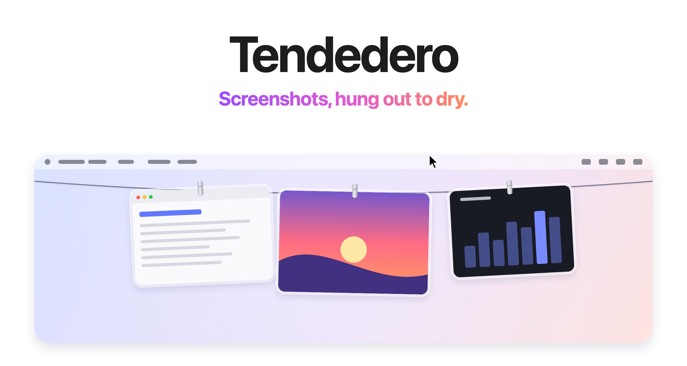
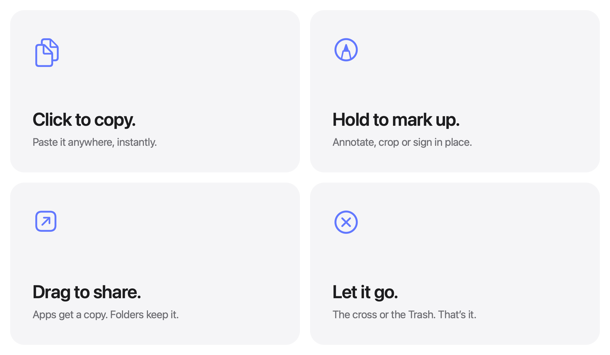
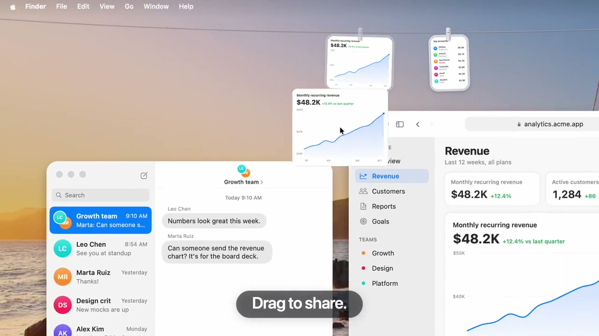

# Tendedero: Keeping Screenshots Within Reach Until You Use Them

> Project: [donghaozhang/tendedero](https://github.com/donghaozhang/tendedero), a fork of Alejandro Buján's [alejandrobujan/tendedero](https://github.com/alejandrobujan/tendedero). This article uses the November 1, 2026 release date of `v1.8.1`. Reviewed November 4, when both repositories' `main` branches pointed to `6df2cfe`. The product originally launched October 7; this is not a launch report.

The awkward part of taking a screenshot often comes afterward: finding its file, switching back to a conversation, and dragging it in. Temporary captures accumulate on the Desktop, creating another cleanup task.

Tendedero turns that interval into a small visual workspace. New screenshots hang from a line at the top of the screen. Rest the pointer near the middle of the menu bar to reveal them, click to copy, or drag one into an application. It is a native macOS utility, not an AI image-organizing service or a new screenshot engine. [Project overview](https://github.com/donghaozhang/tendedero/blob/6df2cfe6455b39c0356c606992361b08ae6b8941/README.md)



*Official press-kit artwork, not a screenshot from an application run performed for this review. The media is retained under the press kit's permission for coverage.*

## 1. A Staging Area, Not an Image Library

The application leaves familiar screenshot shortcuts in place. `ScreenshotWatcher.swift` monitors the save directory and reports new files. On the default Desktop, it filters captures using a macOS screenshot extended attribute. Users can also select additional image folders.

That defines its scope: recent images awaiting an immediate action, rather than a searchable asset library with tags, OCR, or AI classification. It is not a general history of copied text and files either. [Folder watcher](https://github.com/donghaozhang/tendedero/blob/6df2cfe6455b39c0356c606992361b08ae6b8941/Sources/Tendedero/ScreenshotWatcher.swift), [contribution boundaries](https://github.com/donghaozhang/tendedero/blob/6df2cfe6455b39c0356c606992361b08ae6b8941/CONTRIBUTING.md)

For a sequence of bug reports, interface comparisons, or temporary references, keeping images next to the current task can be more useful than adding another filing system.

## 2. Simple Gestures, Different File Outcomes



The main actions reuse familiar system capabilities:

| Action | Result |
|---|---|
| Click | Copy the image |
| Press and hold | Open Markup for an image; recordings can enter duration trimming |
| Double-click | Open in Preview |
| Space or force click | Quick Look |
| Drag into an app | Usually send a copy while retaining the item on the line |
| Drag into a Finder folder | Move the file to that location and remove it from the line |
| Pin | Protect the item from ordinary capacity eviction |
| Hold | Take it off the line into a floating reference view |

The drag implementation offers copy, move, and delete operations to external destinations, which negotiate the accepted operation. Copying into apps and moving into folders describe the normal workflow, not a guarantee about every receiving application. [Drag handling](https://github.com/donghaozhang/tendedero/blob/6df2cfe6455b39c0356c606992361b08ae6b8941/Sources/Tendedero/GrabArea.swift)



*Extracted at eleven seconds from the author's demonstration video. It does not establish drag compatibility with every application; the business data shown is demonstration content.*

The useful design distinction is between sharing, keeping, pinning, and referencing. Each has its own action without requiring a full image-management window.

## 3. A Clean Desktop Has a Retention Policy

On first launch, Tendedero offers to handle screenshots. Accepting changes the system capture target to files, redirects saves to the user's `Application Support/Tendedero/Screenshots` directory, and disables the floating screenshot thumbnail. Previous settings are saved and restored when the mode is disabled or the app quits normally. Some termination signals are handled too, but that does not establish restoration after every forced exit. [Inbox settings](https://github.com/donghaozhang/tendedero/blob/6df2cfe6455b39c0356c606992361b08ae6b8941/Sources/Tendedero/Inbox.swift), [termination handling](https://github.com/donghaozhang/tendedero/blob/6df2cfe6455b39c0356c606992361b08ae6b8941/Sources/Tendedero/AppDelegate.swift)

**Leaving the line can mean more than becoming invisible.**

Unpinned files in Tendedero's own inbox are sent to the Trash when discarded or automatically evicted for capacity. Files elsewhere normally only leave the line during automatic eviction; their originals remain. Pinned items have different removal behavior again, so every corner control should not be interpreted as a delete button. [Retention and removal logic](https://github.com/donghaozhang/tendedero/blob/6df2cfe6455b39c0356c606992361b08ae6b8941/Sources/Tendedero/Line.swift)

Capacity normally follows the space available on screen, with options to retain 25, 50, or 100 items. Pinning prevents ordinary automatic eviction, but does not create a backup. The list and pin state persist in local preferences; restoring them still requires the underlying files to exist at their paths.

Manual removal has an undo history of up to twenty steps, retained only while the app runs. **Capacity eviction is not added to that undo history.** Emptying the Trash or changing the underlying files can also prevent recovery. Screenshots that matter long term should be moved into a proper archive.

## 4. Version 1.8.1 Waits for Files to Finish Arriving

The release addresses a small but consequential problem. Some applications create a download under its final filename and continue filling it over several seconds. Displaying it immediately can produce a partial or blank image. [Release notes](https://github.com/alejandrobujan/tendedero/releases/tag/v1.8.1)

The watcher now checks format-specific endings or declared sizes, including PNG end chunks, JPEG end markers, and WebP lengths. For formats without a matching rule, it falls back to size stability between checks. Unfinished candidates are retried approximately every half-second and abandoned after ten minutes; abandonment here means not hanging the file, not deleting its source. [Completeness checks](https://github.com/donghaozhang/tendedero/blob/6df2cfe6455b39c0356c606992361b08ae6b8941/Sources/Tendedero/ScreenshotWatcher.swift)

This is an arrival-completeness heuristic, not a content-security scan or a strict proof for every format. It highlights the less visible work behind a lightweight utility: coordinating filesystem events, ongoing writes, and UI updates.

## 5. What Native and Local Mean Here

Tendedero uses Swift, AppKit, and SwiftUI, with no third-party package dependencies declared in `Package.swift`. A transparent, nonactivating `NSPanel` hosts the line without becoming the main window; mouse interception is limited to the relevant photo regions. The line stays hidden over full-screen applications by default, with an option to show it. Full-screen detection uses private WindowServer interfaces, so future OS compatibility should not be assumed. [Panel implementation](https://github.com/donghaozhang/tendedero/blob/6df2cfe6455b39c0356c606992361b08ae6b8941/Sources/Tendedero/LinePanel.swift), [full-screen handling](https://github.com/donghaozhang/tendedero/blob/6df2cfe6455b39c0356c606992361b08ae6b8941/Sources/Tendedero/FullScreen.swift)

Copied-image capture is optional and disabled by default. When enabled, the watcher checks the pasteboard change count every half-second, accepting suitable image types while skipping items carrying text, file URLs, or specific private and temporary markers. Accepted images are saved as local PNGs with `0600` permissions. **An image that previously existed only on the clipboard may therefore become a disk file.** Filtering also depends on source applications supplying the appropriate markers; it is not infallible sensitive-content detection. [Clipboard watcher](https://github.com/donghaozhang/tendedero/blob/6df2cfe6455b39c0356c606992361b08ae6b8941/Sources/Tendedero/ClipboardWatcher.swift)

The project describes no account, uploads, or analytics. Its contribution guide says checking for updates opens the website in a browser. No runtime traffic audit was performed here. Uploads after sharing to another application, or synchronization of external directories, remain outside that local-processing promise. [Project documentation](https://github.com/donghaozhang/tendedero/blob/6df2cfe6455b39c0356c606992361b08ae6b8941/README.md)

## 6. Who It Fits

Tendedero fits people who repeatedly create temporary captures, use them immediately, and want less Desktop clutter. Long-term tagged search, cross-device libraries, comprehensive clipboard history, and advanced editing remain separate jobs. Its contribution is shortening the path from capture to the next action.

The official application supports macOS 14 Sonoma and later on Apple silicon and Intel, with Simplified Chinese among its languages. Version 1.8.1 is distributed as a universal download; the release documentation states Developer ID signing and Apple notarization. Use the [upstream release](https://github.com/alejandrobujan/tendedero/releases/tag/v1.8.1), rather than assuming a fork without release assets is an official download source. Homebrew installation is:

```sh
brew install --cask alejandrobujan/tap/tendedero
```

The source code is MIT-licensed, but the license reserves rights to the name, icon, and associated artwork. Modified or redistributed versions need their own name and icon. The illustrations used here are covered by the [official press kit's](https://tendedero.app/press/) permission for reporting, not a blanket license to reuse brand assets. [License](https://github.com/donghaozhang/tendedero/blob/6df2cfe6455b39c0356c606992361b08ae6b8941/LICENSE)

At the pinned revision, `swift build -c debug` succeeded and the localization checker passed for 64 strings across eleven languages. **The application was not launched, screenshot settings were not changed, and the current clipboard was not read. Dragging, undo, and multiple-display behavior were not tested interactively.** A successful build is not interaction acceptance. See [SOURCES.md](imgs/tendedero-macos-screenshot-clothesline/SOURCES.md) for provenance and verification scope.
