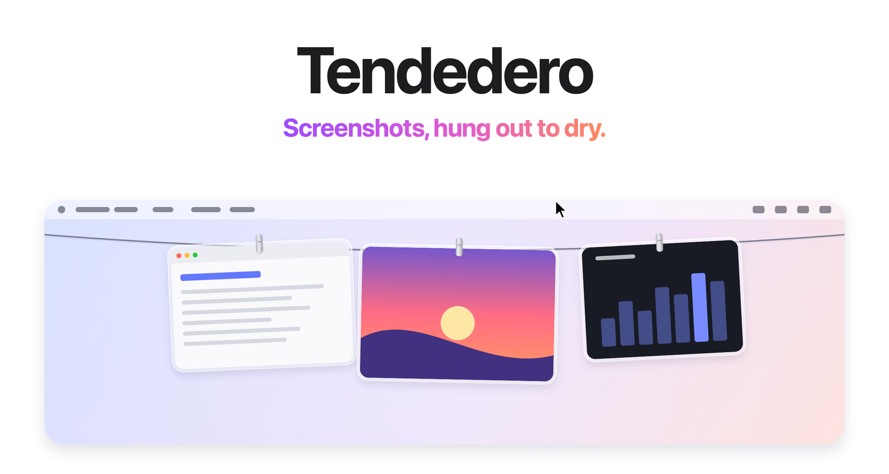
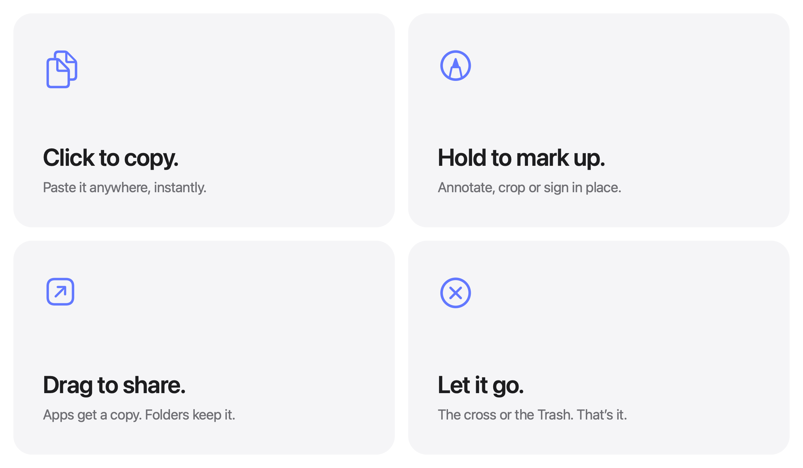
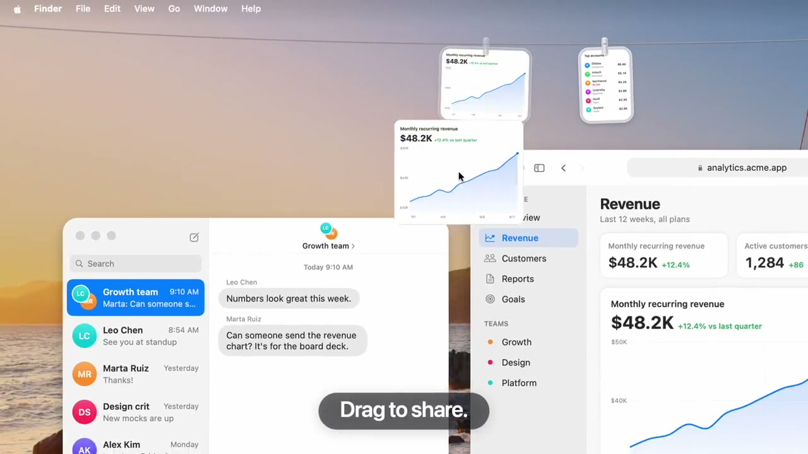

# Tendedero：把截图挂在屏幕顶端，缩短从截取到使用的距离

> 项目：[donghaozhang/tendedero](https://github.com/donghaozhang/tendedero)，上游作者为 Alejandro Buján，原仓库为 [alejandrobujan/tendedero](https://github.com/alejandrobujan/tendedero)。本文日期采用 `v1.8.1` 的发布日期 2026 年 11 月 1 日；11 月 4 日核查时，两个仓库的 `main` 均为 `6df2cfe`。产品最初于 10 月 7 日推出，本文不是首发报道。

截图的麻烦经常发生在截完之后。你想把一个报错、一张图表或一段界面发给别人，却还要去桌面找文件，再切回聊天窗口。临时图片越积越多，又需要另花时间清理。

Tendedero 把这个中间环节做成了一根“晾衣绳”：新截图挂在屏幕顶端，指针停到菜单栏中间，绳子就降下来；单击复制，拖进应用发送，不用时再收起。它是原生 macOS 工具，不是 AI 图片整理服务，也不负责重新发明截图引擎。[项目说明](https://github.com/donghaozhang/tendedero/blob/6df2cfe6455b39c0356c606992361b08ae6b8941/README.md)



*官方媒体包中的界面示意图，不是本文运行应用的截图。文内素材按官方媒体包的报道使用许可保存。*

## 1. 它是暂存架，不是图片库

Tendedero 不改变你熟悉的系统截图快捷键。`ScreenshotWatcher.swift` 监听截图保存目录，发现新文件后把它挂上去；在默认桌面目录中，它通过 macOS 的截图扩展属性筛选文件。用户也可以指定额外图片目录。

这决定了它的产品边界：它处理“刚产生、马上要用”的图片，不提供素材库式的标签、全文检索或 AI 语义分类，也不是保存所有文字与文件的剪贴板历史。[目录监听实现](https://github.com/donghaozhang/tendedero/blob/6df2cfe6455b39c0356c606992361b08ae6b8941/Sources/Tendedero/ScreenshotWatcher.swift)、[项目贡献边界](https://github.com/donghaozhang/tendedero/blob/6df2cfe6455b39c0356c606992361b08ae6b8941/CONTRIBUTING.md)

它与普通文件夹的区别，是把近期图片放在当前任务旁边，而不是要求用户先去某个位置找文件。对连续发错误截图、收集几个界面对照，或临时参考一张图的工作，这种入口比增加一层分类更直接。

## 2. 手势少，但文件去向不能混淆



主要交互沿用系统能力：

| 动作 | 结果 |
|---|---|
| 单击 | 复制图片 |
| 长按图片 | 打开系统 Markup 标记；录屏则可进入裁剪时长流程 |
| 双击 | 用 Preview 打开 |
| 空格或用力点按 | Quick Look 快速查看 |
| 拖进应用 | 通常发送副本，原图继续挂着 |
| 拖进 Finder 文件夹 | 移动保存到目标位置，并从绳上移走 |
| Pin | 固定在绳上，不因新截图挤入而自动掉落 |
| Hold | 从绳上取下，作为浮动参考放在面前 |

拖拽并不是应用只看鼠标落在哪里来猜动作。`GrabArea.swift` 向外部目标提供复制、移动和删除操作，由接收方协商；因此“拖进应用是副本、拖进文件夹是移动”是常规工作方式，具体仍取决于目标支持什么。[拖拽处理](https://github.com/donghaozhang/tendedero/blob/6df2cfe6455b39c0356c606992361b08ae6b8941/Sources/Tendedero/GrabArea.swift)



*截帧来自作者提供的演示视频，不代表本文验证了所有应用的拖放兼容性；画面中的业务数据只是演示内容。*

这里值得借鉴的是动作和结果的对应关系：复制用于分享，移动用于正式保存，固定用于暂留，Hold 用于边看边工作。几种需求不用都变成“打开一个图片管理窗口”。

## 3. “桌面干净”有一套明确的保存规则

首次启动时，应用会询问是否接管截图。接受后，`Inbox.swift` 将系统截图目标设为文件，保存目录指向用户的 `Application Support/Tendedero/Screenshots`，并关闭系统浮动缩略图。原设置先保存，关闭该模式或正常退出时再恢复；源码也处理了部分终止信号，但不能把这理解成任何强制退出情形都已验证能恢复。[接管设置](https://github.com/donghaozhang/tendedero/blob/6df2cfe6455b39c0356c606992361b08ae6b8941/Sources/Tendedero/Inbox.swift)、[退出处理](https://github.com/donghaozhang/tendedero/blob/6df2cfe6455b39c0356c606992361b08ae6b8941/Sources/Tendedero/AppDelegate.swift)

**最重要的区别是：离开绳子，可能不只是隐藏。**

在自己的收件目录中，未固定的图片被丢弃，或因容量不足自动掉落时，会尝试进入废纸篓；外部目录的图片自动掉落通常只是从绳上移除，原文件不动。固定图片的移除逻辑又有所不同，不能把所有角落按钮都当作删除键。[保存、丢弃与容量逻辑](https://github.com/donghaozhang/tendedero/blob/6df2cfe6455b39c0356c606992361b08ae6b8941/Sources/Tendedero/Line.swift)

容量默认随屏幕可显示数量变化，也可选择保留 25、50 或 100 项；Pin 使图片不受普通自动淘汰影响，但不是额外做了一份备份。当前列表与固定状态会记录到本机偏好设置，恢复时仍依赖原路径下的文件存在。

手动移除有撤销记录，最多保留 20 个操作步骤，并且只在应用运行期间存在。**容量淘汰没有加入这条撤销记录**，废纸篓已清空或原文件已被改动时，也不能承诺恢复。要长期保存的截图，应主动移到正式目录，不要把暂存架当成档案库。

## 4. 1.8.1 解决的是文件“出现了但还没写完”

这个版本的更新很小，却直接影响可靠性。有些应用下载图片时，先创建最终文件名，再持续往里写数据。监听器一看到路径就显示，图片可能只解码出半张，甚至空白。[1.8.1 发布记录](https://github.com/alejandrobujan/tendedero/releases/tag/v1.8.1)

实现现在会检查 PNG 的结束块、JPEG 的结束标记、WebP 声明长度等；没有对应格式规则时，使用两次检查之间的文件大小稳定性作为判断。未完成的文件约每半秒重试，等待超过十分钟便放弃挂入，不是删除源文件。[完整性判断](https://github.com/donghaozhang/tendedero/blob/6df2cfe6455b39c0356c606992361b08ae6b8941/Sources/Tendedero/ScreenshotWatcher.swift)

这是一种到达完整性检查，不是图片内容安全扫描，也不是对所有格式都能严格证明文件完成。它说明这类轻量工具的难点往往不在动画，而在目录事件、文件写入和界面更新之间的时序。

## 5. 本地与原生，具体体现在哪里

应用使用 Swift、AppKit 和 SwiftUI，`Package.swift` 没有声明第三方包依赖。顶端条带由透明、非激活的 `NSPanel` 承载，不把自己变成当前主窗口；只有照片区域需要接收鼠标事件。全屏时默认隐藏，也有允许覆盖全屏的选项。全屏判断调用了私有 WindowServer 接口，不能据此承诺未来系统版本始终兼容。[窗口实现](https://github.com/donghaozhang/tendedero/blob/6df2cfe6455b39c0356c606992361b08ae6b8941/Sources/Tendedero/LinePanel.swift)、[全屏处理](https://github.com/donghaozhang/tendedero/blob/6df2cfe6455b39c0356c606992361b08ae6b8941/Sources/Tendedero/FullScreen.swift)

可选的“挂起复制图片”默认关闭。启用后，剪贴板监视器每半秒检查变化计数，只接收合适的图片类型，跳过带文字、文件 URL 或特定私密、临时标记的条目；图片会保存为本地 PNG，并设置 `0600` 文件权限。**因此，原先只在剪贴板中的图片，启用后可能变成磁盘文件。** 过滤也依赖来源应用是否正确附加标记，不是万无一失的敏感信息识别。[剪贴板实现](https://github.com/donghaozhang/tendedero/blob/6df2cfe6455b39c0356c606992361b08ae6b8941/Sources/Tendedero/ClipboardWatcher.swift)

项目宣称没有账号、网络上传和分析统计；贡献说明指出“检查更新”通过浏览器打开官网。本文没有做运行时抓包。主动拖给聊天应用后如何上传、外部目录是否参与同步，仍由接收应用和用户环境决定，不能由 Tendedero 的本地处理承诺覆盖。[项目说明](https://github.com/donghaozhang/tendedero/blob/6df2cfe6455b39c0356c606992361b08ae6b8941/README.md)

## 6. 适合谁，怎样理解它的边界

适合它的是频繁产生临时截图、希望马上复制或拖走，又不想桌面被文件堆满的人。需要长期标签检索、跨设备素材库、完整剪贴板历史或复杂修图的人，仍需要其他工具。它减少的是截图到下一步动作之间的操作，不是取代整个截图与归档系统。

官方支持 macOS 14 Sonoma 及以后版本，同时提供 Apple silicon 和 Intel 的通用下载，包含简体中文；1.8.1 的官方发行说明称安装包经过 Developer ID 签名与 Apple 公证。下载应走[上游 Release](https://github.com/alejandrobujan/tendedero/releases/tag/v1.8.1)，不应把没有发行资产的 fork 当成官方下载源。Homebrew 安装命令为：

```sh
brew install --cask alejandrobujan/tap/tendedero
```

源码采用 MIT，但许可证明确保留名称、图标及相关 artwork 的权利；修改或重新分发的版本需要自己的名称与图标。本文的图片来自[官方媒体包](https://tendedero.app/press/)针对报道提供的许可，不意味着它们随代码一起成为可任意挪用的品牌资产。[许可证](https://github.com/donghaozhang/tendedero/blob/6df2cfe6455b39c0356c606992361b08ae6b8941/LICENSE)

本次固定源码的 `swift build -c debug` 编译成功，64 个本地化字符串在 11 种语言中的检查通过。**没有启动应用、接管系统截图、读取当前剪贴板或实测拖放、撤销和多显示器行为**；编译通过不是交互验收。素材来源、版本与核查范围见 [SOURCES.md](imgs/tendedero-macos-screenshot-clothesline/SOURCES.md)。
