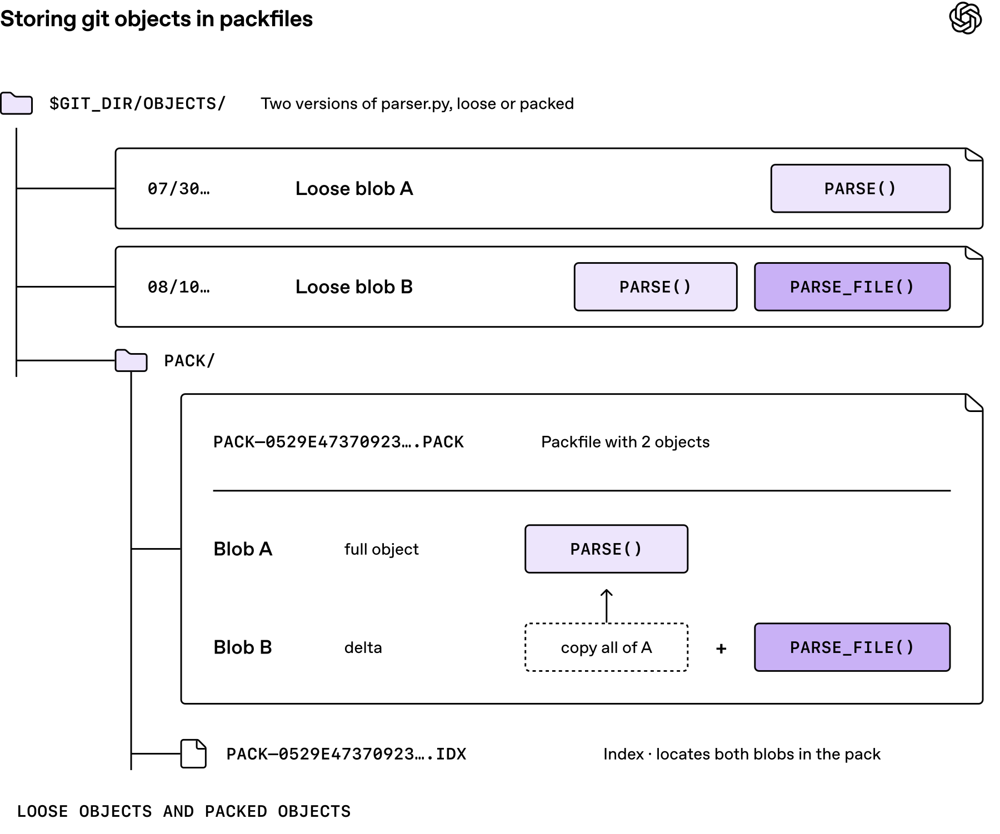
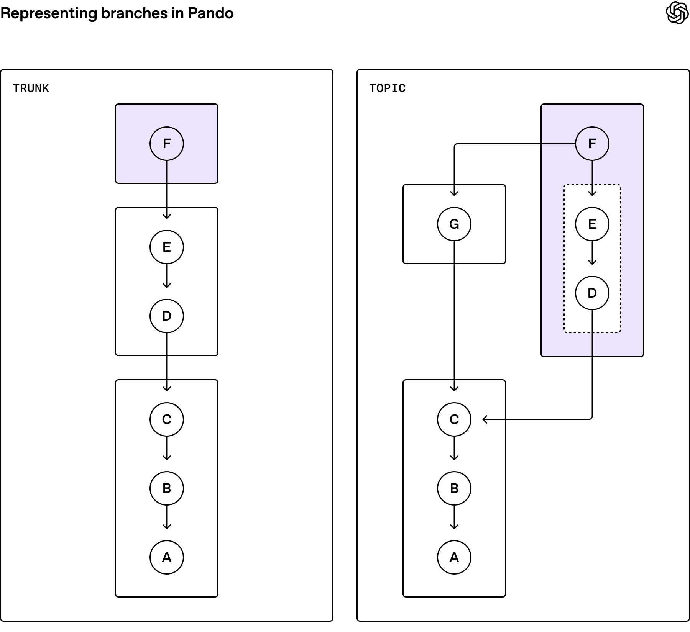

# Pando: Scaling the Git Backend for Large Numbers of Coding Agents

> Sources: the [OpenAI Developers announcement](https://x.com/OpenAIDevs/status/2117408792346509663) and [Scaling Git at OpenAI](https://openai.com/index/scaling-git-at-openai/). The engineering article is dated November 2, 2026 and credited to Aaron Friel, Taylor Blau, and Ted Nyman. The announcement appeared November 3 in Melbourne; this review was completed that day.

More agents writing code do not automatically make the whole development process proportionally faster. Hundreds of tasks can create branches, push changes, trigger CI, and ask multiple environments to download overlapping history. The queue can move from producing code to distributing it.

Pando addresses that layer. It is the Git backend for OpenAI's monorepo, not another coding model, editor extension, or replacement command set. OpenAI reports roughly an 80% reduction in median push latency and nearly a petabyte of Git data delivered daily. Those are first-party operational claims, not measurements independently reproduced here. [Official article](https://openai.com/index/scaling-git-at-openai/)

Two questions help explain the design: who may advance a branch pointer, and how the objects needed for a commit reach many readers.

## 1. Branches Are Pointers, Not Copies of a Directory

A Git reference points to a commit. Commits, trees, and blobs describe history, directories, and file contents. Fetching must supply the objects needed for the requested history that the reader does not already possess.

Packfiles organize multiple objects for storage and transfer, with delta representations reducing repeated content. The official illustration below shows why another version of a file need not require storing its entire contents again.

*Official OpenAI illustration of Git's data representation, not a Pando performance result.*

For an agent platform, this distinction matters: many branch names need not mean many complete copies of the files. Many readers need not require an entirely new packaging job for each request. [Git protocol documentation](https://git-scm.com/docs/gitprotocol-v2), [packfile URI design in OpenAI's Git branch](https://github.com/openai/git/blob/9fe64f46bdef176eabbc4e7f1f15c8e4f8dbc325/Documentation/technical/packfile-uri.adoc)

## 2. Independent Branches Can Proceed Independently

The official thread states Pando's consistency boundary: different branches can update concurrently; updates to the same branch remain ordered. Reading several branch tips does not guarantee a repository-wide snapshot from one instant. [Consistency explanation](https://x.com/OpenAIDevs/status/2117408809224470742)

Consider a hypothetical interface task and an export task. If they publish to independent feature branches, sharing a repository need not force their unrelated pointer updates into one global queue. If both advance `main`, however, the system still needs to validate the expected prior value and coordinate the result.

This does not mean losing commits is acceptable. Nor does it resolve semantic merge conflicts. It changes coordination between references, not the meaning of conflicting edits.

An engineering consequence is to record immutable commit IDs for builds and releases. When a job depends on several references, save the exact tuple of SHAs in its input manifest. Observing several branch names is not proof of an atomic cross-branch snapshot. This is an operational recommendation derived from the stated boundary, not a release feature claimed for Pando.

## 3. The Smallest Transfer Is Not Always the Fastest System

Another official post explains that Pando chooses stored packfiles from the commits a reader has and wants, returning download links. Reusing packs can resend some objects the reader already holds. [Pack reuse explanation](https://x.com/OpenAIDevs/status/2117408834348310581)

That exposes two different optimization targets:

| Target | What it minimizes | Cost to examine |
|---|---|---|
| Tailor the smallest pack for each reader | Bytes in one transfer | Repeated computation, compression, and queueing |
| Reuse existing packs across readers | Repeated work and cache misses | Redundant objects, dependency checks, and storage |

Fine-grained tailoring may pay off for a one-off transfer. With many CI jobs and agents requesting overlapping history, cacheable identical bytes become more attractive. The right answer depends on measured reuse, network cost, and CPU cost, not compressed file size alone.

*Official OpenAI illustration. Later topic packs can repeat earlier objects. The arrow toward trunk commit G denotes a pack dependency on trunk history; it does not redefine a commit's Git parent.*

Reuse does not mean sending an arbitrary incomplete file to any reader. All dependencies must still be available to reconstruct the requested history. The diagram concerns pack coverage and dependencies, not collapsing every branch into one history.

## 4. Git Compatibility Still Has Client Boundaries

Git's `packfile-uris` mechanism lets a server return additional pack addresses after capability negotiation. A client downloads and indexes them before its connectivity check. This separates negotiation from bulk distribution without requiring a new commit format. [Git protocol v2](https://git-scm.com/docs/gitprotocol-v2)

The public OpenAI Git branch was inspected at commit `9fe64f4`. Its technical document adds several practical qualifications:

- The mechanism requires protocol v2 and capability negotiation.
- In that version's documentation, `fetch.uriprotocols` defaults to empty. Protocol availability is not universal default enablement.
- Delta dependencies can constrain indexing order. Increasing download concurrency alone does not establish that indexing can safely run in parallel.
- Pack URLs follow their own HTTP authentication and redirect rules. Credentials from negotiation should not be assumed to transfer unconditionally to another host.

These are statements about the inspected version, not every Git release, and not instructions to change the current machine. The public `openai/git` repository is OpenAI's Git distribution branch; it should not be mistaken for a deployable Pando server release. [Pinned technical document](https://github.com/openai/git/blob/9fe64f46bdef176eabbc4e7f1f15c8e4f8dbc325/Documentation/technical/packfile-uri.adoc), [repository](https://github.com/openai/git)

## 5. Reading the 80% Claim Correctly

Lower push latency is a specific improvement. It is not five times faster code generation or a fivefold improvement in end-to-end delivery. If pushing accounts for only a small share of a task's elapsed time, even a major reduction in that component has a bounded overall effect.

A useful evaluation separates:

1. Push-to-acknowledgment latency, including tail latency and retries.
2. Time until another machine can fetch and check out the commit.
3. Bytes transferred, cache hits, and client download/indexing CPU.
4. Merge, build, test, and review time.

The official page also includes an architecture comparison explicitly labeled as a teaching simulation rather than a production benchmark. It illustrates coordination and queueing; its results should not substitute for measurements on a real workload. [Official comparison and qualification](https://openai.com/index/scaling-git-at-openai/#comparing-approaches)

The broader lesson is to treat agent concurrency as infrastructure load, not merely a model-count setting. Before increasing parallelism, identify where version control, CI, and shared services actually wait. If tests or review dominate, rebuilding the Git backend may not be the first investment that pays off.

This review read the official thread, engineering article, protocol material, and pinned Git-branch document, and saved and rendered two official diagrams. It did not access internal Pando, run its server, reproduce production performance, or modify local Git configuration. See [SOURCES.md](imgs/openai-pando-agent-scale-git/SOURCES.md) for provenance and scope.
