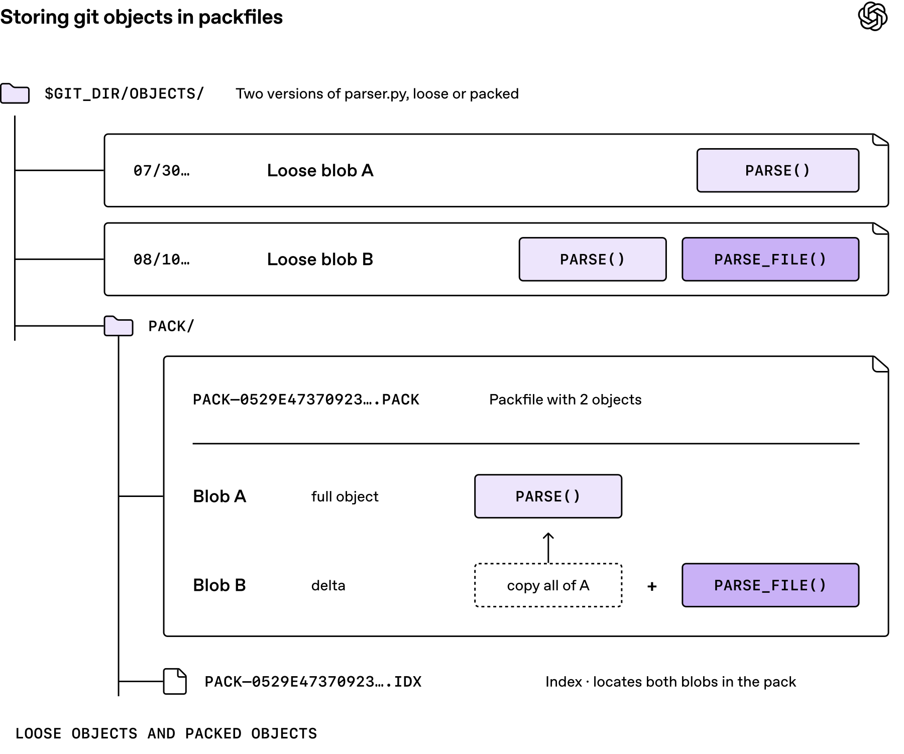
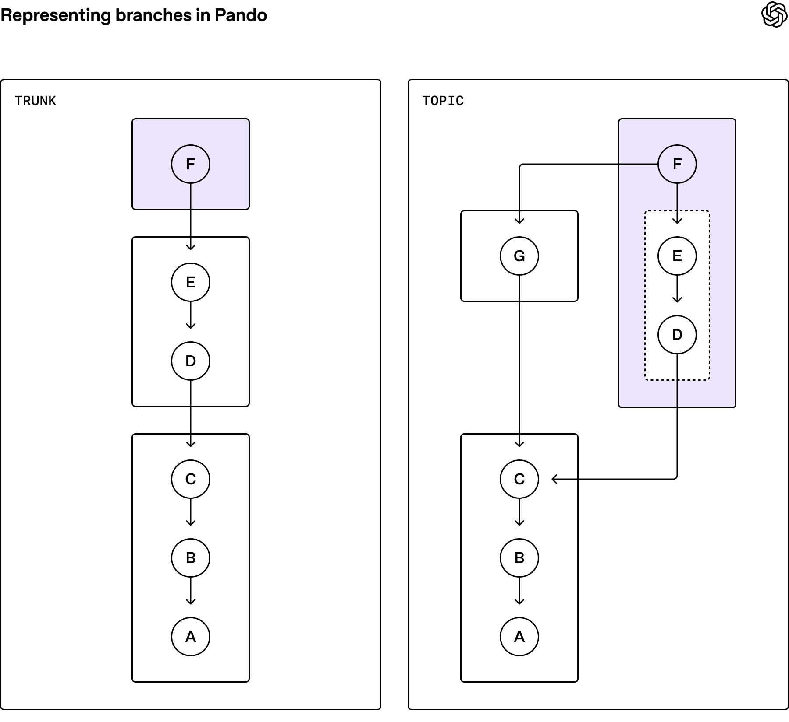

# Pando：当大量 Agent 一起写代码，Git 服务端要怎样扩容

> 来源：[OpenAI Developers 推文](https://x.com/OpenAIDevs/status/2117408792346509663)及官方工程文章 [Scaling Git at OpenAI](https://openai.com/index/scaling-git-at-openai/)。长文标注日期为 2026 年 11 月 2 日，作者 Aaron Friel、Taylor Blau、Ted Nyman；推文发表于墨尔本时间 11 月 3 日，本文同日核查。

Agent 能同时写出更多代码，不代表整个开发流程会按同样比例变快。如果几百个任务都在创建分支、推送提交、触发 CI，再让多个测试环境下载同一段历史，排队的位置可能从“写代码”移到“传代码”。

OpenAI 这次介绍的 Pando，就处在这个位置。它是服务 OpenAI monorepo 的 Git 后端，不是新的编程模型、编辑器插件或替代 Git 命令的工具。官方称其内部生产环境的推送中位延迟降低约 80%，每天提供接近 1 PB 的 Git 数据。这是 OpenAI 的系统运行报告，不是本文独立复现的性能结果。[官方长文](https://openai.com/index/scaling-git-at-openai/)

要理解它，先分清两个问题：谁有权移动分支指针，以及怎样把提交需要的数据交给大量读取者。

## 1. 分支是指针，提交历史才是需要传输的内容

Git 分支不是一份不断被整包覆盖的目录。分支引用指向提交，提交再通过 tree、blob 等对象描述文件和目录。一次 fetch 的任务，是让本地拿到目标提交所需、但尚未拥有的对象。

packfile 是把多个 Git 对象组织起来的传输和存储格式，还可以用差分减少相似内容的体积。下面的官方图用同一文件的两个版本说明这一点：保存第二个版本，不一定需要再存一份完整内容。

*OpenAI 官方示意图。这里说明的是 Git 数据表示方式，不是 Pando 的性能测试。*

这一区分对 Agent 平台很重要：分支名很多，不意味着文件内容必须复制很多份；读取者很多，也不意味着每次都必须重新计算一份专属的数据包。[Git 协议说明](https://git-scm.com/docs/gitprotocol-v2)、[OpenAI Git 分支的 packfile URI 文档](https://github.com/openai/git/blob/9fe64f46bdef176eabbc4e7f1f15c8e4f8dbc325/Documentation/technical/packfile-uri.adoc)

## 2. 不同分支可以并行，但同一分支仍需协调

官方推文串明确给出了 Pando 的一致性边界：不同分支可以并行更新，同一分支的更新仍然有序；一次读取多个分支时，不能假设它们来自仓库的同一时刻。[一致性说明帖](https://x.com/OpenAIDevs/status/2117408809224470742)

用一个假设例子理解：Agent A 在做界面，Agent B 在做导出功能。如果它们推送到各自的功能分支，没有必要仅仅因为共享同一仓库，就把两个互不相关的指针更新放进同一条全局队列。但当两个任务都要移动 `main`，仍然需要检查旧值、确认依赖并决定更新顺序。

这个取舍不等于“允许丢提交”，也不等于“自动解决合并冲突”。它改变的是服务端协调不同引用的方式，而不是代码修改之间的语义冲突。

对构建与发布系统，本文建议记录实际使用的 commit SHA。若一次任务同时依赖多个引用，把这组 SHA 明确写进输入清单；不要把“某次看到了几个分支名”当成获得了跨分支的原子快照。这是由一致性边界推导出的工程建议，不是 Pando 已提供的发布功能。

## 3. 为什么少传一点数据，不一定等于整体更快

另一条官方说明指出：Pando 根据客户端已有和想要的提交，选择已存储的 packfile，返回下载链接。这样可能传输少量客户端已拥有的对象，但能让多个读取者复用相同的包。[packfile 复用说明帖](https://x.com/OpenAIDevs/status/2117408834348310581)

可以把两种优化目标分开：

| 目标 | 优先减少什么 | 需要关注的代价 |
|---|---|---|
| 为每个读取者生成最精简的包 | 单次传输字节数 | 服务端反复计算、压缩与排队 |
| 给很多读取者复用已有包 | 重复计算与缓存失效 | 少量冗余对象、依赖检查与存储 |

如果一个包只会被读取一次，精细裁剪可能值得；如果大量 CI 和 Agent 都需要相近历史，可缓存、可复用的相同字节就更有价值。哪种划算，取决于真实命中率、网络和计算成本，不能只比较压缩后的文件大小。

*OpenAI 官方示意图：功能分支后续包可能重复包含早先对象。指向主干 G 的箭头表示包对主干历史的依赖，不应误读为改变了提交的 Git 父子关系。*

需要特别防止一个简化误解：“复用包”不是把一个不完整文件随便发给任何人。接收者仍必须拿到全部依赖，才能重建所需历史。官方图展示的正是数据包覆盖范围与依赖，而不是把所有分支强行压成同一条历史。

## 4. 兼容 Git，不代表所有客户端配置都一样

Git 的 `packfile-uris` 机制允许服务端在协商后返回额外包的地址，客户端下载并建立索引，再进行连通性检查。这使 Git 协商与大块数据分发可以分开设计，而不必发明另一种提交格式。[Git 协议 v2](https://git-scm.com/docs/gitprotocol-v2)

本次还读取了 OpenAI 公开 Git 仓库的固定提交 `9fe64f4`。其中的技术文档给出几条实际边界：

- 该机制需要协议 v2，客户端和服务端需要协商相关能力。
- 该版本文档中，`fetch.uriprotocols` 默认是空值；不能把协议存在理解为所有客户端默认启用。
- 不同包可能通过差分互相依赖，并行建立索引需要满足额外约束，不能只把下载线程数调大。
- 包地址有自己的 HTTP 认证和重定向规则，不能假定协商请求的凭证会无条件复制到另一台主机。

这些是检查版本的文档内容，不是对所有 Git 版本的统一断言，也不是本文建议修改现有机器配置。公开的 `openai/git` 是 OpenAI 维护的 Git 发行分支，不能据此认定 Pando 服务端已经开源或可以直接部署。[固定版本文档](https://github.com/openai/git/blob/9fe64f46bdef176eabbc4e7f1f15c8e4f8dbc325/Documentation/technical/packfile-uri.adoc)、[仓库](https://github.com/openai/git)

## 5. 应该怎样看待“降低约 80%”

推送延迟下降，是一个明确但有限的指标。它不等于代码生成速度提高五倍，也不等于一次完整研发任务快五倍。假设一个任务的等待时间只有一小部分来自 push，那么即使把这部分大幅压缩，端到端节省也会受到占比限制。

评价类似系统时，至少应把以下量分开：

1. push 从开始到服务端确认的延迟，尤其是 P95、P99 与失败重试。
2. 提交被另一台机器成功 fetch 并检出的时间。
3. 实际传输字节、缓存命中率和客户端下载／索引 CPU 开销。
4. 合并、构建、测试与人工审查消耗的时间。

官方页面还提供架构对比交互，但明确将它标为教学模拟，而非生产基准。它适合解释排队与协调，不应拿界面中的模拟结果替代自己的压测。[官方对比交互及说明](https://openai.com/index/scaling-git-at-openai/#comparing-approaches)

Pando 给开发者的启发，是把 Agent 并行度看成基础设施负载，而不只看模型数量。增加任务之前，先量出版本控制、CI 和共享服务到底在哪里等待。若主要时间耗在测试或审查，重做 Git 后端未必是最值得先做的事。

本次读取了推文串、官方长文、Git 协议资料及上述固定 Git 分支文档，保存两张官方图并检查本地渲染；没有接入内部 Pando、运行其服务端、压测生产指标或改动本机 Git 配置。来源、图像与范围记录见 [SOURCES.md](imgs/openai-pando-agent-scale-git/SOURCES.md)。
