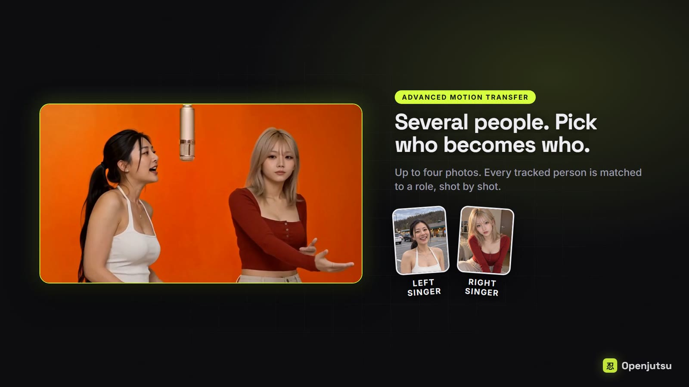
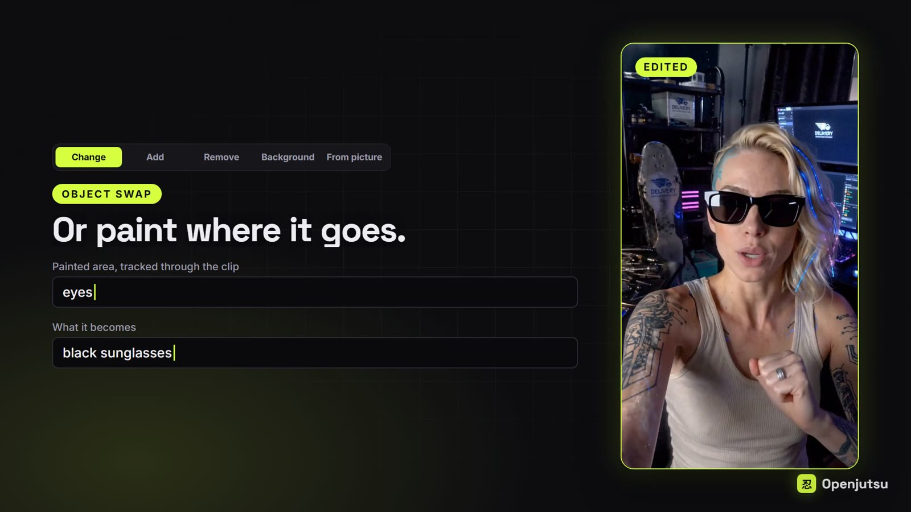
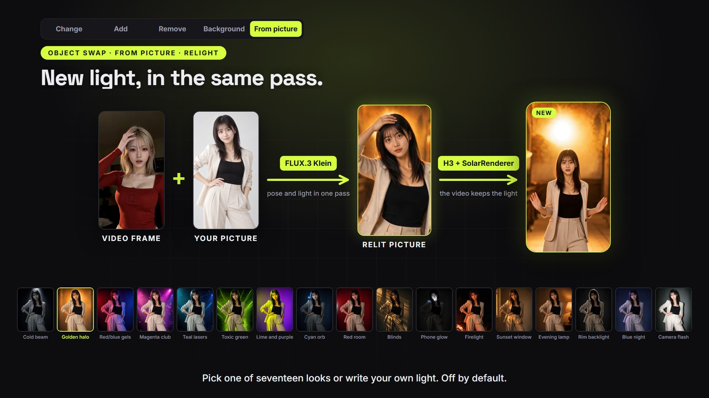
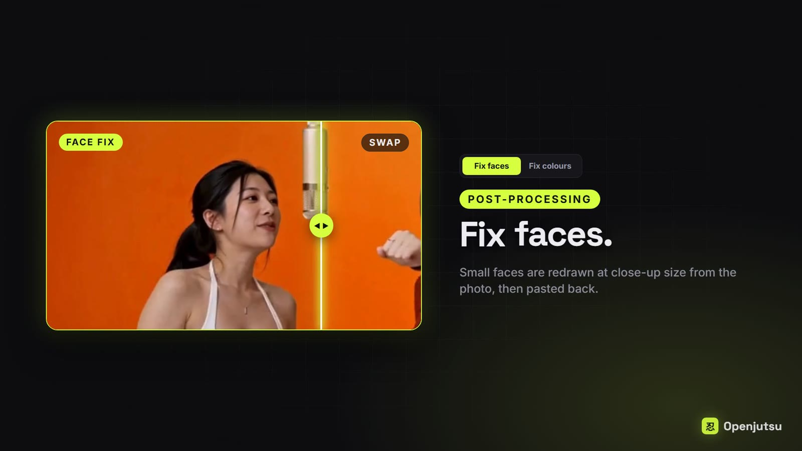

# Openjutsu: A Local Workflow for Recasting, Editing, and Relighting Video

> Project: [donghaozhang/openjutsu](https://github.com/donghaozhang/openjutsu), a fork of [D3voz/openjutsu](https://github.com/D3voz/openjutsu). Reviewed November 3, 2026, at commit `7fe118b`; both repositories had identical `main` branches when checked. This is a source and workflow review, not a launch report or a reproduction of GPU-generated results.

Suppose a video already has the performance, movement, and camera work you want, but the wrong character. Openjutsu aims to reuse those conditions while replacing the person. It also brings clothing changes, object removal, background editing, and picture-led relighting into the same application.

**It is a local video-editing application built around ComfyUI, not a newly trained foundation model or a webpage calling MiniMax's hosted API.** The repository describes it as an open-source, Genjutsu-style alternative. That positioning should not be mistaken for an independently verified comparison with the commercial service. [Project overview](https://github.com/donghaozhang/openjutsu/blob/7fe118bb5a61fcfac0148e1bfea3dd29884dbf26/README.md)

*All four figures come from the pinned repository's product demonstrations. They are not outputs generated for this review or independent quality measurements.*

## 1. What the Application Connects

The application uses Next.js, React, and `@comfyorg/sdk` to configure and submit ComfyUI JSON workflows. The repository assigns the following responsibilities:

| Component | Role | What it does not establish |
|---|---|---|
| MiniMax H3 | Regenerates video using image, motion, and text conditions | Deterministic, pixel-exact replacement of the source |
| SAM 3.1 | Tracks people or objects and supplies edit regions | Correct identity, occlusion, and edges in the generated result |
| Qwen3-VL and alternative visual describers | Describe pictures, shots, and actions; assist role matching | Error-free understanding of every scene |
| FLUX.3 Klein | Prepares a new first frame, optionally changing its lighting | A physically editable lighting setup for the whole video |
| Metric3D and the SolarRenderer path | Supply normal-map motion reference and video sampling configurations | An exported 3D mesh, skeleton, or animation rig |

These model names and roles are grounded in the project's documentation and workflow configuration. This review did not download the weights or audit every external model implementation. The application's contribution is the orchestration: uploads, controls, graph pruning, progress reporting, and output retrieval. Models and external custom nodes still supply the core generation capabilities. [Dependencies](https://github.com/donghaozhang/openjutsu/blob/7fe118bb5a61fcfac0148e1bfea3dd29884dbf26/package.json), [workflow submission](https://github.com/donghaozhang/openjutsu/blob/7fe118bb5a61fcfac0148e1bfea3dd29884dbf26/lib/comfy.ts)

## 2. Recasting Is More Than Pasting a Face

The standard swap path tracks the person, builds an edit mask, and creates a gray mannequin reference that retains silhouette and movement. H3 receives the new character photograph alongside motion conditions. Context loops, overlapping segments, and final assembly handle longer sequences.

The source supplies **how the person performs**, the photograph supplies **who they should become**, and the mask indicates **where editing should occur**. This reaches beyond face replacement, but also makes body shape, clothing outlines, and occlusion important sources of failure.

In `pruneSimple`, options change the graph itself: hat correction and No lip-sync nodes can be removed, while resolution, seed, role, and segment length are configured. Certain model and motion-reference changes also produce distinct saved-run names to avoid resuming with incompatible previous segments. These are workflow safeguards, not new generation algorithms. [Simple swap implementation](https://github.com/donghaozhang/openjutsu/blob/7fe118bb5a61fcfac0148e1bfea3dd29884dbf26/lib/simple.ts), [model and run-name handling](https://github.com/donghaozhang/openjutsu/blob/7fe118bb5a61fcfac0148e1bfea3dd29884dbf26/lib/model.ts)

Advanced mode accepts one to four character photographs and matches tracked people to roles shot by shot. Unassigned people are intended to remain unchanged. A separate two-character mode processes each person in a separate pass, adding generation work. Preserving movement, camera work, and cuts remains a workflow objective, not proof of exact preservation in every output. Reusing the soundtrack does not establish accurate lip synchronization. [Modes and limitations](https://github.com/donghaozhang/openjutsu/blob/7fe118bb5a61fcfac0148e1bfea3dd29884dbf26/README.md)

## 3. Object Editing Requires Different Reference Choices

The object modes do not all follow the same tracking process:

- **Change** edits an existing tracked object using text or a photograph, with outline-preservation and painted-area controls.
- **Remove** regenerates what should appear behind a selected object.
- **Background** inverts the retained subject's mask to edit the surrounding setting.
- **Add** uses manually defined placement keyframes rather than asking SAM to track something absent from the source; synchronized-action cases have additional logic.

The implementation removes source-video reference connections for removal, addition, and changes that disable outline preservation. Its comments explain why: a gray outline can bring a deleted object back, while an empty source region can suppress an object being added. [Object-editing implementation](https://github.com/donghaozhang/openjutsu/blob/7fe118bb5a61fcfac0148e1bfea3dd29884dbf26/lib/object.ts)

The same mechanism explains a clothing limitation. Keeping the old silhouette helps constrain movement, but changing a tank top into a shirt can still produce a sleeveless outline. Releasing that outline gives the model more freedom and introduces more uncertainty.

## 4. Approve the First Frame Before Rendering the Video

From picture follows a separate path. FLUX first prepares the new character using the source frame's pose and body crop. The user reviews, edits, or regenerates that image before explicitly approving it for video generation. The video stage reuses the saved image rather than automatically repeating preparation.

That approval point matters: an incorrect identity, crop, or setting in the first frame can otherwise become an expensive video mistake.

Relight is disabled by default and offers seventeen looks plus custom lighting descriptions. Pose adjustment and relighting happen in the same FLUX edit. A prompt upsampler reads the video-frame pose and passes it to FLUX as text. Another option prepares a relit frame of the source person without replacing their identity.

The video stage combines Metric3D normals with an action description through native H3 or the SolarRenderer configuration. **This path does not use a SAM edit mask or a context loop.** Its documentation calls the normals soft reference conditioning, not a dedicated normal ControlNet. [From picture workflows](https://github.com/donghaozhang/openjutsu/blob/7fe118bb5a61fcfac0148e1bfea3dd29884dbf26/workflows/picture/README.md)

The documented single-clip selection extends to fifteen seconds, rounded down to H3's valid frame grid. At 24 fps, a six-second selection becomes 141 frames, or 5.875 seconds; fifteen seconds becomes 345 frames, or 14.375 seconds. Editing to an exact duration requires checking the actual output. Lighting can also alter the background or composition. This is not a 3D scene in which lights and cameras remain independently editable.

## 5. Better Likeness Can Mean Worse Mouth Fidelity

Fix faces crops a matched face, redraws it at close-up scale, and pastes it back, targeting faces that are small in the frame. Its controls expose a tradeoff:

- **Match the photo** prioritizes likeness but may invent expressions and mouth movements.
- **Follow the mouth** preserves more of the source expression and mouth motion at some cost to likeness.

A sharper face is therefore not sufficient evidence of correct identity, emotion, and lip synchronization. Fix colours is separate again: detail-contrast processing and tone mapping without another H3 run, rather than generative relighting. [Face graph handling](https://github.com/donghaozhang/openjutsu/blob/7fe118bb5a61fcfac0148e1bfea3dd29884dbf26/lib/face.ts), [color processing](https://github.com/donghaozhang/openjutsu/blob/7fe118bb5a61fcfac0148e1bfea3dd29884dbf26/lib/color.ts)

## 6. Local Control Still Requires a Substantial Runtime

The repository requires an NVIDIA GPU, ComfyUI 0.41.2 or newer, Node.js 22.6 or newer, Python, custom nodes, and multiple model files. The author tested an RTX 4060 Ti with 16 GB VRAM and 64 GB system RAM, streaming H3 INT8 weights from RAM. **That is not a claim that any computer with 16 GB memory can run it, nor evidence of Apple Silicon inference support.**

The README reports roughly six to thirteen minutes for a six-second, 480p clip on that GPU; the default resolution is 736p. The picture-workflow documentation separately records a SolarRenderer nine-second selection, aligned to approximately 8.708 seconds, taking 34 minutes 23 seconds. These are author-reported runs under different settings, not a unified benchmark or measurements reproduced here. [Hardware and timing notes](https://github.com/donghaozhang/openjutsu/blob/7fe118bb5a61fcfac0148e1bfea3dd29884dbf26/README.md), [SolarRenderer conditions and patch requirements](https://github.com/donghaozhang/openjutsu/blob/7fe118bb5a61fcfac0148e1bfea3dd29884dbf26/workflows/picture/README.md)

Preflight checks inspect the enabled workflow against ComfyUI's registered nodes and model-file lists, reporting missing packs and destination folders. They do not validate model integrity, available VRAM, or every runtime dependency. [Setup checks](https://github.com/donghaozhang/openjutsu/blob/7fe118bb5a61fcfac0148e1bfea3dd29884dbf26/lib/setup.ts)

## 7. Keep Failure Conditions and Permissions Explicit

The project explicitly says **mirrors and person reflections are unsupported**: the original person in a reflection can reintroduce their old hair, clothing, or build. A sensible first trial is a short clip with a clear subject, limited occlusion, and no reflections. Inspect the mask before reviewing identity, hands, edges, mouth motion, and audio.

Local operation also does not automatically settle security or commercial rights:

- The application code is MIT-licensed; model and dependency licenses are separate. The project specifically flags InsightFace `buffalo_l` in Fix faces. InsightFace's upstream policy distinguishes MIT code from pretrained models restricted by default to non-commercial research and provides commercial licensing contacts. [Project licensing note](https://github.com/donghaozhang/openjutsu/blob/7fe118bb5a61fcfac0148e1bfea3dd29884dbf26/README.md#license), [InsightFace policy](https://github.com/deepinsight/insightface#license)
- Default start scripts bind to loopback. Network serving requires an `OPENJUTSU_PASSWORD` of at least twelve characters, but a shared password is not multi-tenant authorization. Basic authentication should be paired with HTTPS for external access. [Access checks](https://github.com/donghaozhang/openjutsu/blob/7fe118bb5a61fcfac0148e1bfea3dd29884dbf26/lib/http.ts), [startup checks](https://github.com/donghaozhang/openjutsu/blob/7fe118bb5a61fcfac0148e1bfea3dd29884dbf26/instrumentation.ts)
- The documentation says proxy-upload cleanup does not remove copies from ComfyUI's input directory. Source footage, photographs, and outputs still need retention controls and appropriate likeness and media permissions. [Runtime and deployment notes](https://github.com/donghaozhang/openjutsu/blob/7fe118bb5a61fcfac0148e1bfea3dd29884dbf26/README.md)

Openjutsu is useful to study for its task-specific reference choices and its approval steps before expensive generation. It offers an inspectable, adjustable video-regeneration workflow, not a promise of unconditional fidelity, real-time performance, or automatic commercial clearance.

For this review, **65 unit tests across seven files passed** at the pinned commit under Node.js `v25.7.0`, covering graph pruning, model configuration, role mapping, object editing, and clip calculations. No model weights were installed, ComfyUI was not started, and the full `npm test`, TypeScript check, and production build were not run. Video quality was not independently tested. See [SOURCES.md](imgs/openjutsu-local-video-character-swap/SOURCES.md) for commands and figure provenance.
